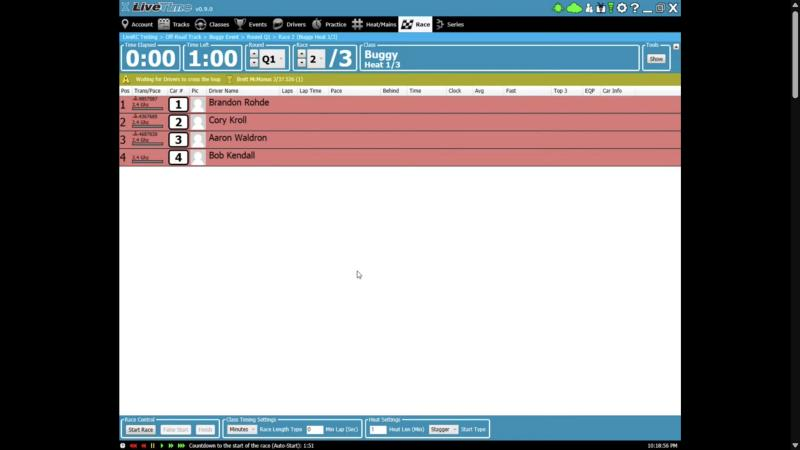
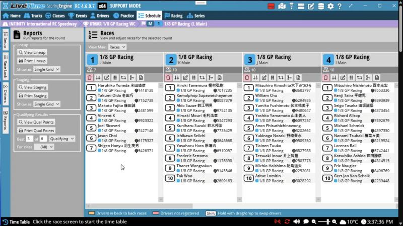
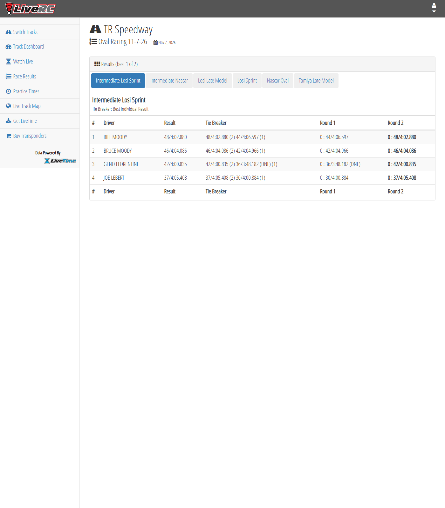
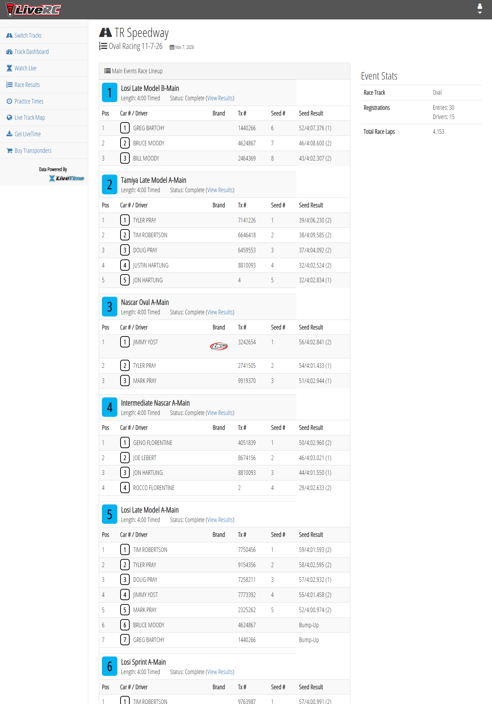
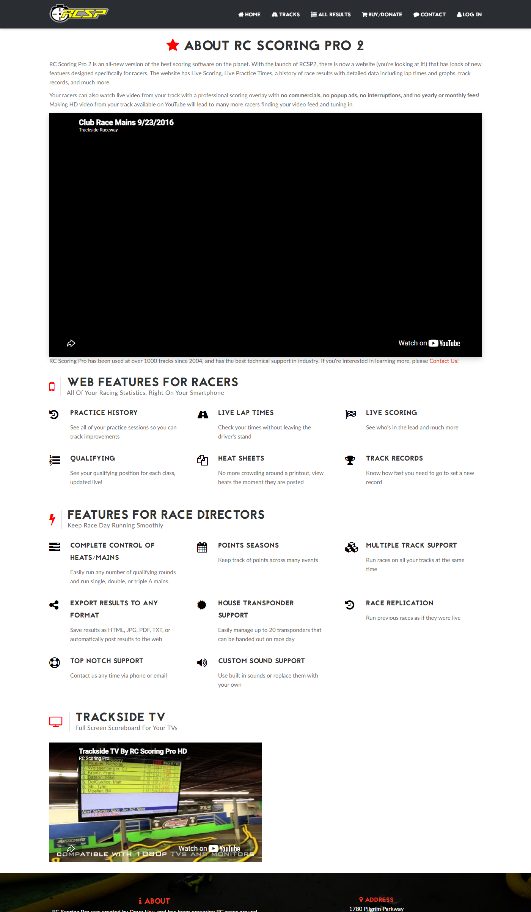
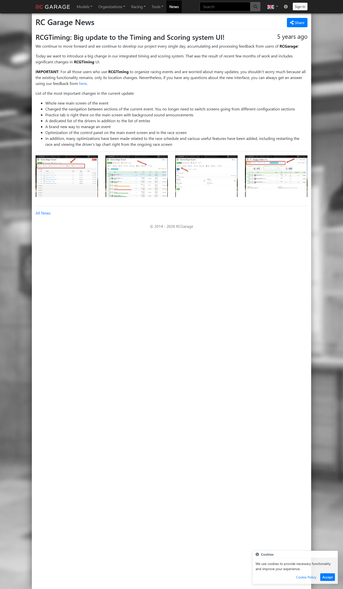

# How the competition runs a race night (Nov 2026)

How the main RC timing products handle a race night today, from setup through each heat to the mains. Then where HeatCaller already wins, where it doesn't, and a plan to make it clearly better.

Researched 10 Nov 2026 from:

- vendor sites, docs and release notes
- LiveTime's own training videos (the frames below come from them)
- live LiveRC event pages
- race-director columns on LiveRC and RC Car Action
- sanctioning-body rulebooks
- forum excerpts. RCTech.net refused direct access (HTTP 403) and Reddit blocks search, so forum evidence comes from search excerpts and is thinner than the rest.

Screenshots are in [`screenshots/`](screenshots/).

---

## 1. The bottom line

- **LiveRC is two things:** the website people watch on (liverc.com), and **LiveTime Scoring Engine**, the Windows desktop program the race director uses. LiveTime is the US default and runs ROAR and IFMAR events. In Europe the default is **RCM + MyRCM** (RC-Timing, Switzerland). Behind those come **RC Scoring Pro** in the US, **Everlaps** in Spain, the free **ZRound**, and the cloud newcomer **RCGTiming**. MYLAPS Orbits/Speedhive is not a real contender for RC race nights: MYLAPS does not ship RC event software.
- **Every serious rival automates the gap between heats with a timetable and countdown:**
  - LiveTime: *Time Table → Countdowns Between Races*, with auto-advance, auto-countdown and auto-start.
  - RCM: automatic start by time schedule.
  - Everlaps: the *Auto* panel.

  As far as HeatCaller's docs show, HeatCaller calls the next heat up and shows NEXT, but **a person still presses Start Next**. There is no fixed-interval auto-start. This is the biggest gap against LiveTime.
- **Going from heats to mains is always a separate step done by hand**, buried in a settings panel:
  - LiveTime: a *Seeding Options* panel with about 15 settings.
  - Everlaps: you press *Generate* again.
  - RCM: finals settings.

  HeatCaller's Next Steps card already turns this into one obvious button ("Qualifying is complete → Build the finals from qualifying", then "B-Main has finished → Move the top finishers up"). **This is where HeatCaller is already ahead.** It should be shown off and measured.
- **LiveTime is powerful but dense.** Its desktop screens are dozens of dropdowns. Its manual is about 30 YouTube videos with mid-roll ads, and there is no written guide. Its race-night stars are the live web results and very flexible seeding and mains (ladder mains A–L, HRQF, Reedy, triple A-mains).
- **The biggest complaint in the forums is dead time between heats, not features.** A LiveRC column works out that a two-class racer spends about 20% of an 8-hour day on track. The lever that makes a night "demonstrably better" is **minutes per heat and minutes per round**. HeatCaller should measure that and put it on screen.

---

## 2. Who the competitors are

| Product | Where it's used | Platform | Price | Voice | Moving between heats | Heats → mains |
|---|---|---|---|---|---|---|
| **LiveTime + LiveRC** | US, Australia; ROAR, IFMAR | Windows desktop, pushes results to *track*.liverc.com | Basic $9.99–12.99/mo (20 registrations a day max), Standard $29.99–39.99, Premium $39.99–49.99; pay only for months you race | "Advanced Automated Announcing" with Windows text-to-speech | **Time Table:** auto-advance N seconds after a race, countdown N seconds, announce, auto-start | Schedule → Seeding Options → Create/Seed Round. Ladder mains, bump-ups, double/triple A-mains, HRQF |
| **RCM + MyRCM** | UK/EU; BRCA, EFRA | Windows plus add-on programs (Publisher, Voice, Board) | Four editions, no public price | RCM Voice add-on | Manual, automatic countdown, or **automatic by time schedule** | EFRA-style ladder: subfinals feed up; "drivers moving up" set by laps or time |
| **RC Scoring Pro 2** | US long tail, ovals | Desktop + rcscoringpro.com | $20/mo or $999 lifetime (MyLaps build); $10/mo (I-Lap/Trackmate build) | **None** (custom sounds only) | Mostly manual | Single/double/triple A-mains; bump-ups not mentioned |
| **Everlaps** | Spain, some UK | Windows; you buy your own SAPI voice | Paid, no public price | Built in (grid, time left, standings, marshals) | **Auto panel:** schedule plus minimum gaps; launches the next heat | Press *Generate* again on Series |
| **ZRound** | Spain/LatAm, slot cars | Windows | Free | Spoken notices | — | "Heats and Mains" (no detail online) |
| **RCGTiming** | Eastern Europe, new | **Cloud**: the decoder talks to their server | Free / $19.99 / $39.99 a month | Countdown, time, positions | Day schedule, drag to reorder | Heat points, configurable bump-ups |

---

## 3. How LiveRC/LiveTime runs a night, step by step

### 3a. Before the night: event, classes, entries

- Online entry is at **register.liverc.com**. It needs a LiveRC account. Each event page has *Event Details*, *Entry List* and *Register Online*, a closing date and an entry cap. Big events pre-pay and hold a lottery if they're oversold.
- LiveTime **imports entries** from RCSignup, MultiGP or a CSV. Racer profiles carry over week to week, and a global driver database links results across tracks.
- Inside LiveTime the order is: **Events → Event** (Classes / Registrations / Imports / Exports / Timing Results / Adjustments tabs). Classes are dragged into the event in order. Then each class gets settings tabs: Timing, Rounds, Audio, Splits.

*LiveTime RC 4.6.0.7, **Schedule → Setup**. The left rail holds the actions: **Seed Q1 Round**, **Create Round**, **Create Q1 Copies**, transponder rentals and **Add Race**. Heats are columns you can drag between. The legend flags "Drivers in back to back races" and "Drivers not registered".*

*register.liverc.com: an event's registration page.*

### 3b. Building qualifying

- The heat/main area is called **Schedule**; heat sheets are called **lineups**. A round is a *practice*, *qualifier*, *seeding* or *main* round.
- *Seed from* prior results (Top 3 consecutive, best lap, Top 5 average or points), by driver ability, or from a series. You set a heat count, drivers per heat and seeding rules per class.
- There's an alternative format, **HRQF** (Heat Race Qualifying Format), for heads-up qualifying:
  1. Seed by best 3 consecutive practice laps.
  2. Round 1 spreads drivers 1/3/5/7 and 2/4/6/8 across the heats.
  3. Round 2 reverses the grid.
  4. Round 3 reseeds.
  5. Scoring is position points, lowest total wins.
  6. Mains are seeded on points.

*What racers see: the **Race Lineup** for a qualifier round. Each heat block shows length, status (Complete / Not Yet Run), and car #, driver, transponder, seed # and seed result.*

### 3c. Running heats and moving to the next one

- **Racing** screen: clock, round, race number, class and a status line ("Green Flag | Waiting for the driver(s) to all cross the loop for their staggered start | *Spec Buggy Heat 1/1 next*"). A **purple flag** opens the race so cars register by crossing the loop. Cars not yet heard show **red**.
- Corrections are made mid-race from a right-click menu (edit transponder, add manual lap, ±1 lap, DNS/DNF/DQ) and a **Race Adjustments** side panel. You can drag an unknown transponder onto a racer and keep their laps.
- **Moving to the next heat is the Time Table's job:** "Advance through the event with *Countdowns Between Races*". You can tick:
  - automatically advance to the next race N seconds after one finishes
  - automatically count down N seconds to the start
  - announce the time leading up to the start
  - automatically start when the timer reaches zero
  - automatically finish the race

  The *detailed* mode plans the whole day, including meal breaks, the drivers' meeting and trophies.
- **Parent/Child mode** (Premium) mirrors the timing PC to a backup PC.

*Race screen just after the green, with "Spec Buggy Heat 1/1 next" already in the status line.*

*Mid-race corrections: right-click menu plus the Race Adjustments panel.*

*The heat-to-heat automation (from an older v0.9 training video; the current version keeps the same feature).*

*Next heat loaded: "Waiting for Drivers to cross the loop", cars not yet seen in red, and the status bar counting down to auto-start (1:51).*

### 3d. Qualifying results and building the mains

- **Rankings per round** can be by Laps/Time, Top 2 or 3 consecutive, Top 5 average or fastest lap. The **overall** ranking uses "Results (best 1 of 2)" with a stated tie-breaker, and the counted round is in bold. The TQ icon and Estimated Position Data project where a car on track would finish.
- The mains are built on the Schedule screen with **Seeding Options**: seed from prior results, main seeding (e.g. Top 5 Average), use best N qualifying rounds, tie-break rule, main order/splitting, limits, Super Pole. A **Seeding Preview** shows drivers per main (here 117 drivers in **A–L Mains of 10**). Bump-ups are a race option, and bumped drivers appear in the next main up marked **"Bump-Up"**.

*Turning qualifying into mains: Seeding Options plus Seeding Preview, with ladder mains A to L.*

*Mains created as columns (L, K, J, I Main...). Reports for lineups, staging sheets and qual points ("Best 3 of 6").*

*A real club night (TR Speedway, 7 Nov 2026): the Losi Late Model B-Main runs first, and two of its drivers appear in the A-Main with Seed Result **"Bump-Up"**.*

*The same night, end to end:*

- 15 drivers, 30 entries.
- Q1 ran 12:04–12:41 (8 heats, about 5 minutes apart).
- **A 43-minute gap**, then Q2 from 1:24 to 2:12.
- Mains from 2:29 to 3:24, about 9 minutes each.

*The heats are tight; the gaps between rounds are where the night goes.*

Also captured: [overall final ranking](screenshots/liverc-overall-final-ranking.png), [A-Main result page](screenshots/liverc-amain-result.png) (with stats, and video locked behind the paid "Bonus Lap" membership), [entry list](screenshots/liverc-entry-list.png), [LiveRC tracks live now](screenshots/liverc-live-tracks.png), [HRQF article](screenshots/liverc-hrqf-article.png), [LiveTime pricing](screenshots/livetime-features-pricing.png), [LiveTime release notes](screenshots/livetime-download-release-notes.png).

### 3e. What drivers and spectators get

- **LiveRC live pages:** scoring, lineups, rankings and results, published automatically as the night runs. Video of each race is embedded if the track streams.
- **RaceVision** for a TV and **RaceBoard** wall tablets (both Premium; RaceBoard was last updated 2018).
- **Voice:** Windows text-to-speech. It calls the race, the heat and the driver order before the start, the countdown, laps and positions, the last lap, and the next race and marshals.
- **No official phone app.** A third-party "RC Replay" app reads LiveRC.

---

## 4. The other main competitors, briefly

**Everlaps** has the clearest documented heat control. A single panel holds *Start* (with a 30 s or 10 s prologue), *Go*, *Grid* (announces the heat, drivers and marshals), *Stop*, *Finish* and *Last lap*. An **Auto** tab schedules heats and starts them on their own.

See also the [quick start](screenshots/everlaps-quick-start.png) (Drivers → Races → Registrations → Series *Generate / Print / Confirm* → Heats *Activate / Start*) and [qualifying and finals settings](screenshots/everlaps-qualify-finals.png).

**RCM / MyRCM** has editions with features gated behind them, separate client programs, and the EFRA ladder finals. Drivers register on MyRCM.

**RC Scoring Pro 2** offers instant TQ, an estimated qualifier number, house transponders, a Trackside TV board and free YouTube overlays. It has no voice.

[Its live results page](screenshots/rcscoringpro-live.png).

**RCGTiming** is the closest match to HeatCaller's relay: cloud and phone first. Heats move from prepared to scheduled to started, you drag to reorder, and it pings each driver 5 minutes before their heat.

**ZRound:** [home page](screenshots/zround-home.png). It's free, and has a track designer and spoken notices.

---

## 5. What race directors and drivers actually complain about

Ranked by how often each came up:

1. **Dead time between heats and rounds.** On one RCTech thread, delays are "most of the day by far". The LiveRC column puts on-track time at about 20% of the day. RC Car Action says a qualifying round takes an hour or more.
2. **Drivers and marshals not ready when called.** The LiveRC director's advice is not to wait, and to allow 120 s to get from the stand to the marshal posts. Racers marshal more willingly when heats start on time.
3. **Late sign-ups break the heat sheets.** The director has to regenerate, re-sort and repost them. Tracks set strict cutoffs 30–60 minutes before racing.
4. **Drivers don't know when they race.** Paper on the wall is still the norm, and phone pings are praised where they exist.
5. **Transponder failures:** missed laps, borrowed or house units, and dead plugs.
6. **Lap-count disputes** that have to be settled before the mains.
7. **Fragile or legacy software and subscriptions.** BBK won't run on current Windows; LiveTime's monthly fee; server or account errors when going live.
8. **Internet dependence.** LiveRC live results need the cloud. Nobody documents what happens when the connection drops.
9. **Too much qualifying, not enough racing.** This is why formats like HRQF and heads-up qualifying exist.

**Rulebook norms to support out of the box:**

- **ROAR:** best 2 of 3 rounds on Qual-Points, with 2 bump-ups.
- **ROAR track guide:** 2–5 minutes between races.
- **BRCA:** up to 10 cars per heat, 1-second staggered start, round 1 in number order, later rounds seeded by FTQ (fastest qualifying time).
- **EFRA:** 10-minute heats, finals of 10 at most, the top 3 bump up from subfinals.
- **NZRCA:** 12 cars at most, at least 3 rounds.
- **A typical club night:** 2–3 qualifying rounds of 5 minutes, mains of 10 with 2 bump-ups. About 2 minutes between heats is the stated target; 5 or more is reality.

**What people praise:** software that calls the race and the next heat by itself; a ping before your heat; live timing on the phone; clean per-heat results; simple software; editing the schedule from any device; starting heat 1 on time and holding a fixed interval.

---

## 6. HeatCaller against the field

**Where HeatCaller is already ahead (keep these and show them off):**

- **Guided flow.** The *Next Steps* card always offers the single next action: build heats → start Q1 Heat 1 → … → build the finals → move the top finishers up. Bump-ups are offered before the next upper main can go out. No rival guides the heats-to-mains transition like this. LiveTime's equivalent is a settings panel with about 15 controls.
- **Set Up Tonight wizard**, a Ready to race checklist, and **Simple mode**, all aimed at volunteers. Rivals assume a trained timekeeper.
- **The announcer.** The others use robotic Windows text-to-speech or none at all. HeatCaller has a natural voice, On Air openings, driver intros, call-ups to the stand repeated every 2 minutes, and marshals called by themselves.
- **Pre-race check** for dead transponders before the green. A **banner for unknown transponders** after the session, without interrupting the race.
- **Redo Remaining Heats** handles a no-show or late entry. **Move Drivers Between Heats** with group or spread by pace.
- **Phones:**
  - QR and phone self check-in
  - driver requests
  - "Your next race" on a phone
  - online sign-up with approval
  - a race-day manager on a phone or tablet
  - a phone remote

  LiveRC has no first-party phone app. RCGTiming is the only rival in this space.
- **Price:** HeatCaller is not tiered by registration count. LiveTime's Basic tier stops at 20 registrations a day.

**Where HeatCaller is behind or unproven:**

1. **No fixed-interval auto-advance or auto-start between heats** (as far as the docs show). LiveTime, RCM and Everlaps all have one, and it targets complaint #1.
2. **Format breadth.** LiveTime has ladder mains (A–L), double/triple A-mains, HRQF, Reedy, Super Pole, and "best N of M" on any seeding. HeatCaller's docs show qualifying method, main size and bump-ups per class, plus sanctioning presets. Each LiveTime format needs checking against HeatCaller.
3. **Spectator reach.** LiveRC is a national destination: racers already have accounts and follow other tracks. HeatCaller's relay pages are per club.
4. **Entry import** from RCSignup, the de facto US pre-entry system, is a one-click import in LiveTime.
5. **Backup timing PC.** LiveTime's Parent/Child mode mirrors the PC; HeatCaller has crash recovery but no live mirror.
6. **No measured proof.** Nothing yet shows HeatCaller makes a night faster.

---

## 7. Plan: make it demonstrably better

The goal is something a club can *see*, not a feature list. Two parts: measure the night, then attack the gaps that cost the most minutes.

### Step 1: Measure (so "better" is a number)
- **Night pace on Next Steps and in the event report:**
  - minutes from green to green, averaged over the night
  - the longest gap and what caused it (waiting for drivers, bump-ups, a rebuild)
  - rounds finished against plan
  - on-track time as a share of the night

  The data is already there in Race History timestamps and the timetable's "running 12 min late". Build it into a "how the night went" card and the shareable results.
- **A timed head-to-head script for demos.** For HeatCaller vs LiveTime on the same entry list (15 drivers, 3 classes, 2 qualifying rounds, mains with bump-ups), count clicks and seconds for each of:
  - first launch to first green
  - heat to heat
  - qualifying done to first main on track
  - a late entry after Q1

  LiveTime has a 30-day free trial, so this can be run for real.

### Step 2: Close the biggest gap (dead time)
- **Fixed-interval "Keep the night moving" mode.** After a race, count down a set gap (default 2–3 minutes, ROAR guidance) to the next round. Use what HeatCaller already has: call-ups at T-2:00 and T-1:00, marshals called, the auto pre-race check, then On Air, then a start nobody has to press. A director can hold, add a minute or skip a driver who isn't ready (one tap) from the PC or the phone remote. LiveTime offers this as three tick boxes; HeatCaller should make it the default once a program exists, with a visible countdown on Race Control, the Big Screen and drivers' phones.
- **Rest-time guard.** Never schedule a driver in back-to-back races without a minimum gap: drivers in two classes, and bump-ups. LiveTime only *colours* these drivers; HeatCaller can auto-reorder or warn on the Next Steps card.
- **Push "you're up in 5 minutes"** to the phone of each driver in the next heat and the marshals, through the relay. Praised where RCGTiming does it, and HeatCaller already has push and "Your next race".

### Step 3: Make heats → mains bulletproof and quick
- **A one-screen mains preview before committing:** who's in each main, why (their counted result and tie-breaker), and who bumps up. Then a single **Build**. This matches LiveTime's Seeding Preview without its 15 settings, with the class's settings behind an "Advanced" link.
- **Audit HeatCaller against LiveTime's formats** and add the common ones that are missing: best N of M, ROAR Qual-Points tie-breakers, ladder mains beyond C, double/triple A-mains, HRQF heads-up qualifying, 1-second staggered start. Lead with a sanctioning preset for each body (ROAR / BRCA / EFRA / NZRCA), with defaults from section 5.
- **Disputes window:** a "results final in 5:00" timer after each qualifying round. Mains can't be built until it ends or the director overrides. This settles lap disputes before the mains, as the forums ask.

### Step 4: Kill setup friction
- **Import from RCSignup / LiveRC entry lists / CSV**, mapped onto HeatCaller drivers and transponders, so a track switching from LiveTime brings its roster in one step.
- **"Switching from LiveTime" guide and importer.** Ideally HeatCaller would read LiveTime's database or exports for drivers, transponders and classes. A written guide alone already beats their video-only documentation.
- **Late entry without reposting:** after the cutoff, a late driver goes into the smallest heat still to run, without disturbing any heat that's already posted. The lineup on phones and the Big Screen updates on its own.

### Step 5: Resilience and reach
- **Offline first, stated loudly.** The race runs with no internet, and the relay catches up when it's back. Say so in the marketing: it's a known LiveRC worry.
- **A warm standby PC**, modelled on LiveTime's Parent/Child: a second laptop on the LAN mirrors the race and can take over.
- Later, consider a cross-club results index so racers can follow other tracks. This is where LiveRC's network effect sits, and it's a strategy call more than a build.

**Suggested order:** Step 1 measuring (cheap, and it gives the proof) → Step 2 keep-the-night-moving mode (biggest real effect) → Step 3 mains preview and format audit → Step 4 imports → Step 5.

---

## 8. Caveats

- The LiveTime desktop frames come from their own training videos. The Schedule, seeding and race frames are v4.6 (2026). The Time Table frames are from an old v0.9 video; the feature is still current according to the release notes and training list.
- I couldn't read forum threads in full; RCTech returned 403. Pain points come from search excerpts plus full LiveRC and RC Car Action columns.
- "HeatCaller has no auto-start between heats" comes from reading the user guide, not the code. Check it before planning around it.
- Prices are from public pages on 10 Nov 2026. RCM and Everlaps don't publish prices.

## Sources
- LiveTime: https://www.livetimescoring.com/features · /training · /download
- LiveTime training videos: Schedule (youtube.com/watch?v=E09Mym2nRaM), Racing (GfA1cmF_fkM), Time Table Countdown (_3ULTQc8c9Q), HRQF (Ucyo2NvoO38)
- LiveRC event: https://trspeedway.liverc.com/results/ (7 Nov 2026), https://norcar.liverc.com/results/?p=view_heat_sheet&id=11011845
- LiveRC registration: https://register.liverc.com/snowbirdnationals/
- LiveRC columns: "A Moment with Mike – time spent at the track vs on the track"; "Where's Waldo – smash the clocks"; HRQF article
- RC Car Action on qualifying length: https://www.rccaraction.com/?p=223774
- RCM: https://www.rc-timing.ch/products/timekeeping.html · MyRCM: https://www.myrcm.ch
- Everlaps docs: https://docs.everlaps.com/en/
- RC Scoring Pro: https://rcscoringpro.com/about-rcsp2/
- RCGTiming: https://rcgarage.info · https://rcgtiming.com/page/timing-faq
- ZRound: https://www.zround.com
- RCTech threads via search excerpts: "many bigger races vs club racing", "timing software recommendations", transponder-missing-laps threads
