# How the competition runs a race night (Nov 2026)

How the main RC timing products handle a race night today, from setup through each heat to the mains. Then where HeatCaller already wins, where it doesn't, and a plan to make it clearly better.

Researched 10 Nov 2026 from:

- vendor sites, docs and release notes
- LiveTime's own training videos (the frames below come from them)
- live LiveRC event pages
- race-director columns on LiveRC and RC Car Action
- sanctioning-body rulebooks
- forum excerpts. RCTech.net refused direct access (HTTP 403) and Reddit blocks search, so forum evidence comes from search excerpts and is thinner than the rest.

Screenshots are in [`screenshots/`](screenshots/).

**Updated 15 Nov 2026.** Sections 6 and 7 originally described HeatCaller as it stood on 10 Nov. Most of the plan was built between 11 and 13 Nov, so those sections now show each item's current status, checked against the code on main (a655e91a). The research into the competitors themselves is unchanged.

---

## 1. The bottom line

- **LiveRC is two things:** the website people watch on (liverc.com), and **LiveTime Scoring Engine**, the Windows desktop program the race director uses. LiveTime is the US default and runs ROAR and IFMAR events. In Europe the default is **RCM + MyRCM** (RC-Timing, Switzerland). Behind those come **RC Scoring Pro** in the US, **Everlaps** in Spain, the free **ZRound**, and the cloud newcomer **RCGTiming**. MYLAPS Orbits/Speedhive is not a real contender for RC race nights: MYLAPS does not ship RC event software.
- **Every serious rival automates the gap between heats with a timetable and countdown:**
  - LiveTime: *Time Table → Countdowns Between Races*, with auto-advance, auto-countdown and auto-start.
  - RCM: automatic start by time schedule.
  - Everlaps: the *Auto* panel.

  On 10 Nov, HeatCaller called the next heat up and showed NEXT, but **a person still pressed Start Next**. That was the biggest gap against LiveTime. *Closed 11 Nov 2026 (PR #144):* Race Control now has an Auto start switch, on by default, with a 2:30 gap, Hold / +1 min / Start now, and a "Start without them?" check when a car hasn't been seen.
- **Going from heats to mains is always a separate step done by hand**, buried in a settings panel:
  - LiveTime: a *Seeding Options* panel with about 15 settings.
  - Everlaps: you press *Generate* again.
  - RCM: finals settings.

  HeatCaller's Next Steps card already turns this into one obvious button ("Qualifying is complete → Build the finals from qualifying", then "B-Main has finished → Move the top finishers up"). **This is where HeatCaller is already ahead.** It should be shown off and measured.
- **LiveTime is powerful but dense.** Its desktop screens are dozens of dropdowns. Its manual is about 30 YouTube videos with mid-roll ads, and there is no written guide. Its race-night stars are the live web results and very flexible seeding and mains (ladder mains A–L, HRQF, Reedy, triple A-mains).
- **The biggest complaint in the forums is dead time between heats, not features.** A LiveRC column works out that a two-class racer spends about 20% of an 8-hour day on track. The lever that makes a night "demonstrably better" is **minutes per heat and minutes per round**. HeatCaller should measure that and put it on screen.

---

## 2. Who the competitors are

| Product | Where it's used | Platform | Price | Voice | Moving between heats | Heats → mains |
|---|---|---|---|---|---|---|
| **LiveTime + LiveRC** | US, Australia; ROAR, IFMAR | Windows desktop, pushes results to *track*.liverc.com | Basic $9.99–12.99/mo (20 registrations a day max), Standard $29.99–39.99, Premium $39.99–49.99; pay only for months you race | "Advanced Automated Announcing" with Windows text-to-speech | **Time Table:** auto-advance N seconds after a race, countdown N seconds, announce, auto-start | Schedule → Seeding Options → Create/Seed Round. Ladder mains, bump-ups, double/triple A-mains, HRQF |
| **RCM + MyRCM** | UK/EU; BRCA, EFRA | Windows plus add-on programs (Publisher, Voice, Board) | Four editions, no public price | RCM Voice add-on | Manual, automatic countdown, or **automatic by time schedule** | EFRA-style ladder: subfinals feed up; "drivers moving up" set by laps or time |
| **RC Scoring Pro 2** | US long tail, ovals | Desktop + rcscoringpro.com | $20/mo or $999 lifetime (MyLaps build); $10/mo (I-Lap/Trackmate build) | **None** (custom sounds only) | Mostly manual | Single/double/triple A-mains; bump-ups not mentioned |
| **Everlaps** | Spain, some UK | Windows; you buy your own SAPI voice | Paid, no public price | Built in (grid, time left, standings, marshals) | **Auto panel:** schedule plus minimum gaps; launches the next heat | Press *Generate* again on Series |
| **ZRound** | Spain/LatAm, slot cars | Windows | Free | Spoken notices | — | "Heats and Mains" (no detail online) |
| **RCGTiming** | Eastern Europe, new | **Cloud**: the decoder talks to their server | Free / $19.99 / $39.99 a month | Countdown, time, positions | Day schedule, drag to reorder | Heat points, configurable bump-ups |

---

## 3. How LiveRC/LiveTime runs a night, step by step

### 3a. Before the night: event, classes, entries

- Online entry is at **register.liverc.com**. It needs a LiveRC account. Each event page has *Event Details*, *Entry List* and *Register Online*, a closing date and an entry cap. Big events pre-pay and hold a lottery if they're oversold.
- LiveTime **imports entries** from RCSignup, MultiGP or a CSV. Racer profiles carry over week to week, and a global driver database links results across tracks.
- Inside LiveTime the order is: **Events → Event** (Classes / Registrations / Imports / Exports / Timing Results / Adjustments tabs). Classes are dragged into the event in order. Then each class gets settings tabs: Timing, Rounds, Audio, Splits.

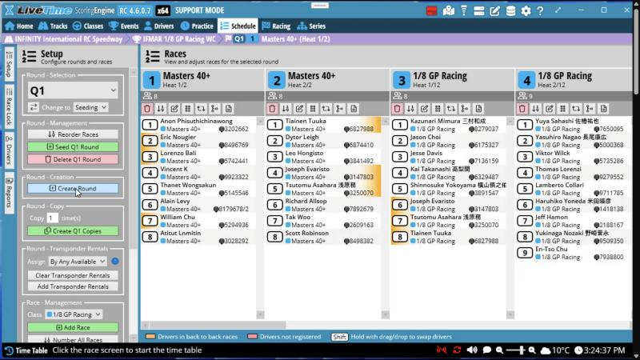
*LiveTime RC 4.6.0.7, **Schedule → Setup**. The left rail holds the actions: **Seed Q1 Round**, **Create Round**, **Create Q1 Copies**, transponder rentals and **Add Race**. Heats are columns you can drag between. The legend flags "Drivers in back to back races" and "Drivers not registered".*

*register.liverc.com: an event's registration page.*

### 3b. Building qualifying

- The heat/main area is called **Schedule**; heat sheets are called **lineups**. A round is a *practice*, *qualifier*, *seeding* or *main* round.
- *Seed from* prior results (Top 3 consecutive, best lap, Top 5 average or points), by driver ability, or from a series. You set a heat count, drivers per heat and seeding rules per class.
- There's an alternative format, **HRQF** (Heat Race Qualifying Format), for heads-up qualifying:
  1. Seed by best 3 consecutive practice laps.
  2. Round 1 spreads drivers 1/3/5/7 and 2/4/6/8 across the heats.
  3. Round 2 reverses the grid.
  4. Round 3 reseeds.
  5. Scoring is position points, lowest total wins.
  6. Mains are seeded on points.

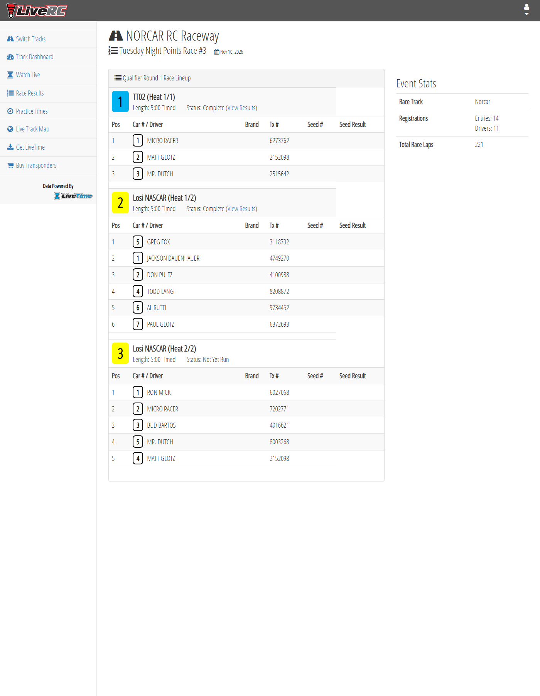
*What racers see: the **Race Lineup** for a qualifier round. Each heat block shows length, status (Complete / Not Yet Run), and car #, driver, transponder, seed # and seed result.*

### 3c. Running heats and moving to the next one

- **Racing** screen: clock, round, race number, class and a status line ("Green Flag | Waiting for the driver(s) to all cross the loop for their staggered start | *Spec Buggy Heat 1/1 next*"). A **purple flag** opens the race so cars register by crossing the loop. Cars not yet heard show **red**.
- Corrections are made mid-race from a right-click menu (edit transponder, add manual lap, ±1 lap, DNS/DNF/DQ) and a **Race Adjustments** side panel. You can drag an unknown transponder onto a racer and keep their laps.
- **Moving to the next heat is the Time Table's job:** "Advance through the event with *Countdowns Between Races*". You can tick:
  - automatically advance to the next race N seconds after one finishes
  - automatically count down N seconds to the start
  - announce the time leading up to the start
  - automatically start when the timer reaches zero
  - automatically finish the race

  The *detailed* mode plans the whole day, including meal breaks, the drivers' meeting and trophies.
- **Parent/Child mode** (Premium) mirrors the timing PC to a backup PC.

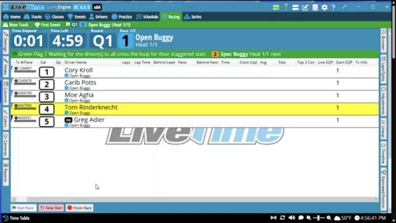
*Race screen just after the green, with "Spec Buggy Heat 1/1 next" already in the status line.*

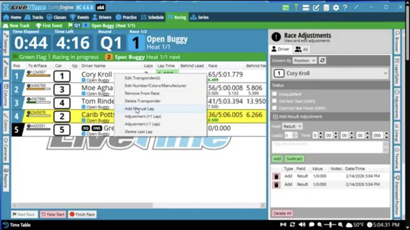
*Mid-race corrections: right-click menu plus the Race Adjustments panel.*

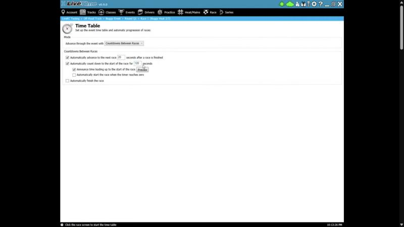
*The heat-to-heat automation (from an older v0.9 training video; the current version keeps the same feature).*

*Next heat loaded: "Waiting for Drivers to cross the loop", cars not yet seen in red, and the status bar counting down to auto-start (1:51).*

### 3d. Qualifying results and building the mains

- **Rankings per round** can be by Laps/Time, Top 2 or 3 consecutive, Top 5 average or fastest lap. The **overall** ranking uses "Results (best 1 of 2)" with a stated tie-breaker, and the counted round is in bold. The TQ icon and Estimated Position Data project where a car on track would finish.
- The mains are built on the Schedule screen with **Seeding Options**: seed from prior results, main seeding (e.g. Top 5 Average), use best N qualifying rounds, tie-break rule, main order/splitting, limits, Super Pole. A **Seeding Preview** shows drivers per main (here 117 drivers in **A–L Mains of 10**). Bump-ups are a race option, and bumped drivers appear in the next main up marked **"Bump-Up"**.

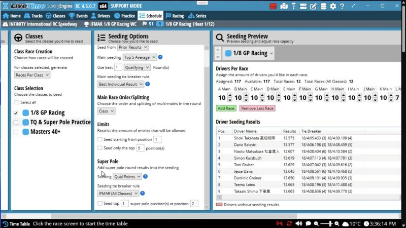
*Turning qualifying into mains: Seeding Options plus Seeding Preview, with ladder mains A to L.*

*Mains created as columns (L, K, J, I Main...). Reports for lineups, staging sheets and qual points ("Best 3 of 6").*

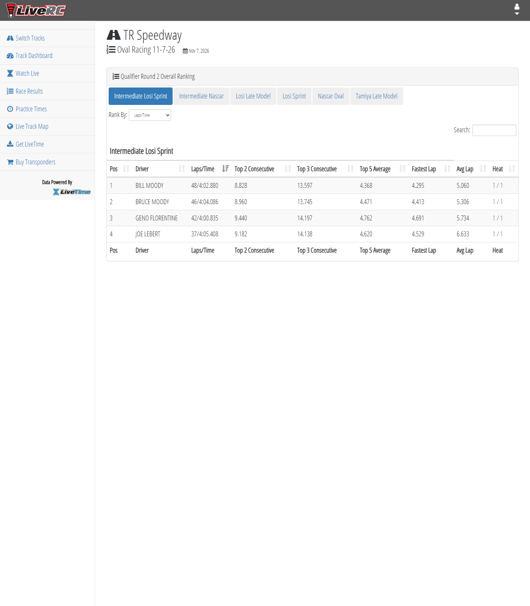

*A real club night (TR Speedway, 7 Nov 2026): the Losi Late Model B-Main runs first, and two of its drivers appear in the A-Main with Seed Result **"Bump-Up"**.*

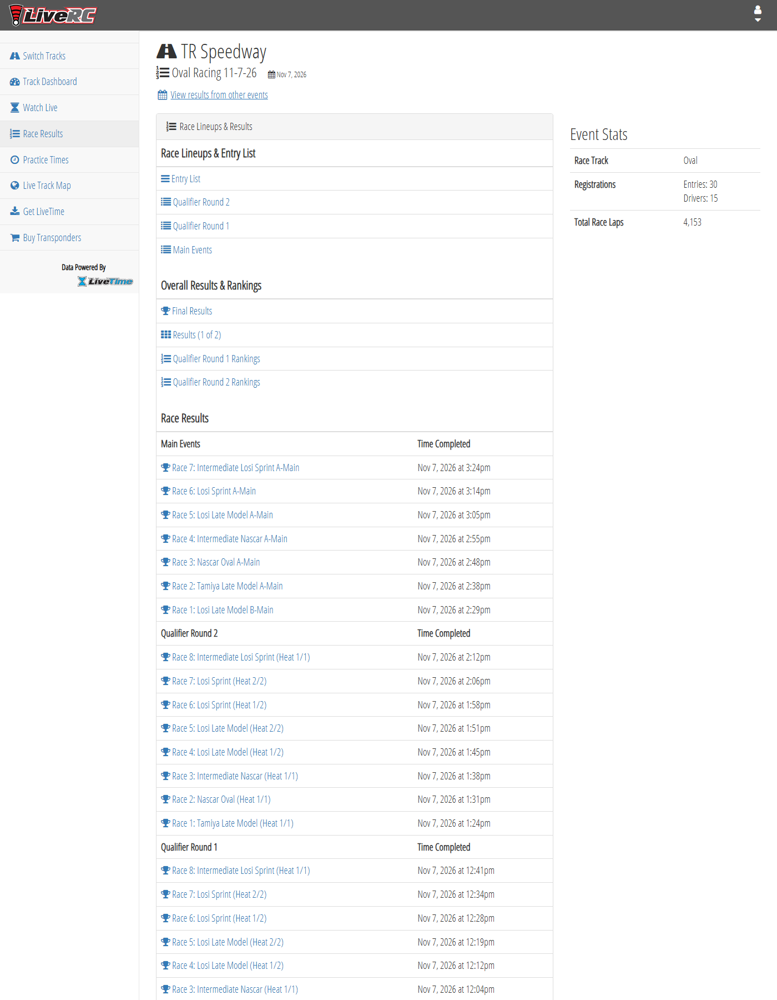
*The same night, end to end:*

- 15 drivers, 30 entries.
- Q1 ran 12:04–12:41 (8 heats, about 5 minutes apart).
- **A 43-minute gap**, then Q2 from 1:24 to 2:12.
- Mains from 2:29 to 3:24, about 9 minutes each.

*The heats are tight; the gaps between rounds are where the night goes.*

Also captured: [overall final ranking](screenshots/liverc-overall-final-ranking.png), [A-Main result page](screenshots/liverc-amain-result.png) (with stats, and video locked behind the paid "Bonus Lap" membership), [entry list](screenshots/liverc-entry-list.png), [LiveRC tracks live now](screenshots/liverc-live-tracks.png), [HRQF article](screenshots/liverc-hrqf-article.png), [LiveTime pricing](screenshots/livetime-features-pricing.png), [LiveTime release notes](screenshots/livetime-download-release-notes.png).

### 3e. What drivers and spectators get

- **LiveRC live pages:** scoring, lineups, rankings and results, published automatically as the night runs. Video of each race is embedded if the track streams.
- **How LiveRC's race video works** (checked 15 Nov 2026 from LiveRC's own news posts and public pages):
  - The **Race Video Archive (RVA)** records one clip per heat and embeds it on that heat's result page. It was announced in 2012/13 for subscribers ([announcement](https://www.liverc.com/news/liverc-unveils-revolutionary-new-race-video-archival-system/)).
  - Since Dec 2016 the recording is tied to the LiveTime race start, "tweaked to capture the start of the race, every time" ([Dec 2016 post](https://www.liverc.com/news/lrc-new-liverc-broadcasting-features-available-to-all-tracks-using-livetime-scoring-engine/)).
  - In Nov 2020 it moved off YouTube to LiveRC's own hosting after YouTube capped automated uploads, and became a Bonus Lap member feature ([Nov 2020 post](https://liverc.com/news/liverc-rva-race-video-archive-back)). Result pages today say "The (RVA) Race Video Archive is available to Bonus Lap members" ([example](https://lcrc.liverc.com/results/?p=view_race_result&id=6994730)).
  - **Not known:** whether the member player can jump to a lap, how exactly the clip is synced, or whether any offset can be adjusted. Answering that needs a Bonus Lap login. Nothing public shows per-lap links.
- **Other race-video-from-timing products found** (same check): RotorHazard's [rh-youtube-chapters](https://github.com/dutchdronesquad/rh-youtube-chapters) plugin (drone racing, Jan 2025) and Skate Results' [chapter export](https://docs.skateresults.app/features/livestream/export-chapters) (roller skating, with a time-offset field) make one YouTube chapter per race from timing data, but not per lap. Onboard-camera loggers (Racelogic Circuit Tools, AiM SmartyCam) let you click a lap to seek the video, but from the car's own logger, not a stream linked from results. Patents [US10923157B2](https://patents.google.com/patent/US10923157B2/en) and [US11636880B2](https://patents.google.com/patent/US20210134329A1/en) (Scorebreak) align game video with box-score events using a computed offset.
- **RaceVision** for a TV and **RaceBoard** wall tablets (both Premium; RaceBoard was last updated 2018).
- **Voice:** Windows text-to-speech. It calls the race, the heat and the driver order before the start, the countdown, laps and positions, the last lap, and the next race and marshals.
- **No official phone app.** A third-party "RC Replay" app reads LiveRC.

---

## 4. The other main competitors, briefly

**Everlaps** has the clearest documented heat control. A single panel holds *Start* (with a 30 s or 10 s prologue), *Go*, *Grid* (announces the heat, drivers and marshals), *Stop*, *Finish* and *Last lap*. An **Auto** tab schedules heats and starts them on their own.
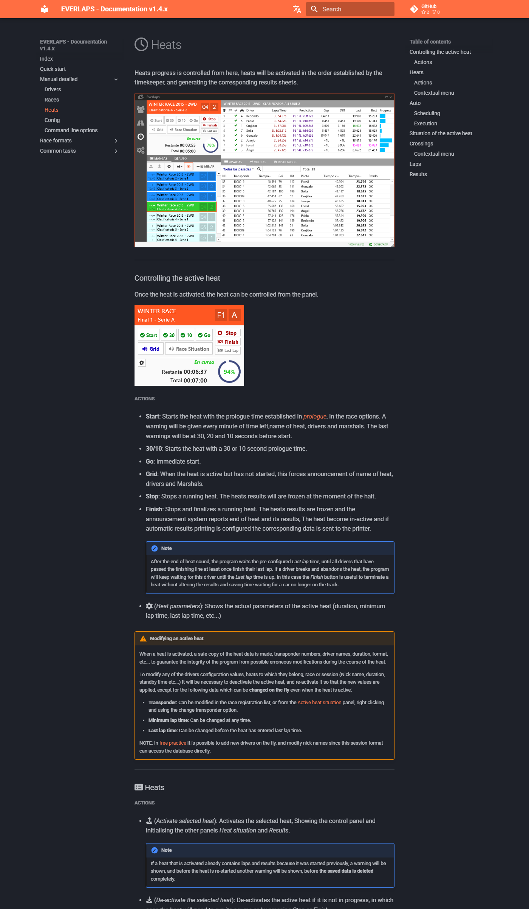
See also the [quick start](screenshots/everlaps-quick-start.png) (Drivers → Races → Registrations → Series *Generate / Print / Confirm* → Heats *Activate / Start*) and [qualifying and finals settings](screenshots/everlaps-qualify-finals.png).

**RCM / MyRCM** has editions with features gated behind them, separate client programs, and the EFRA ladder finals. Drivers register on MyRCM.
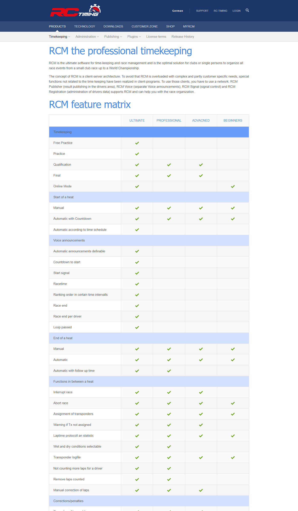
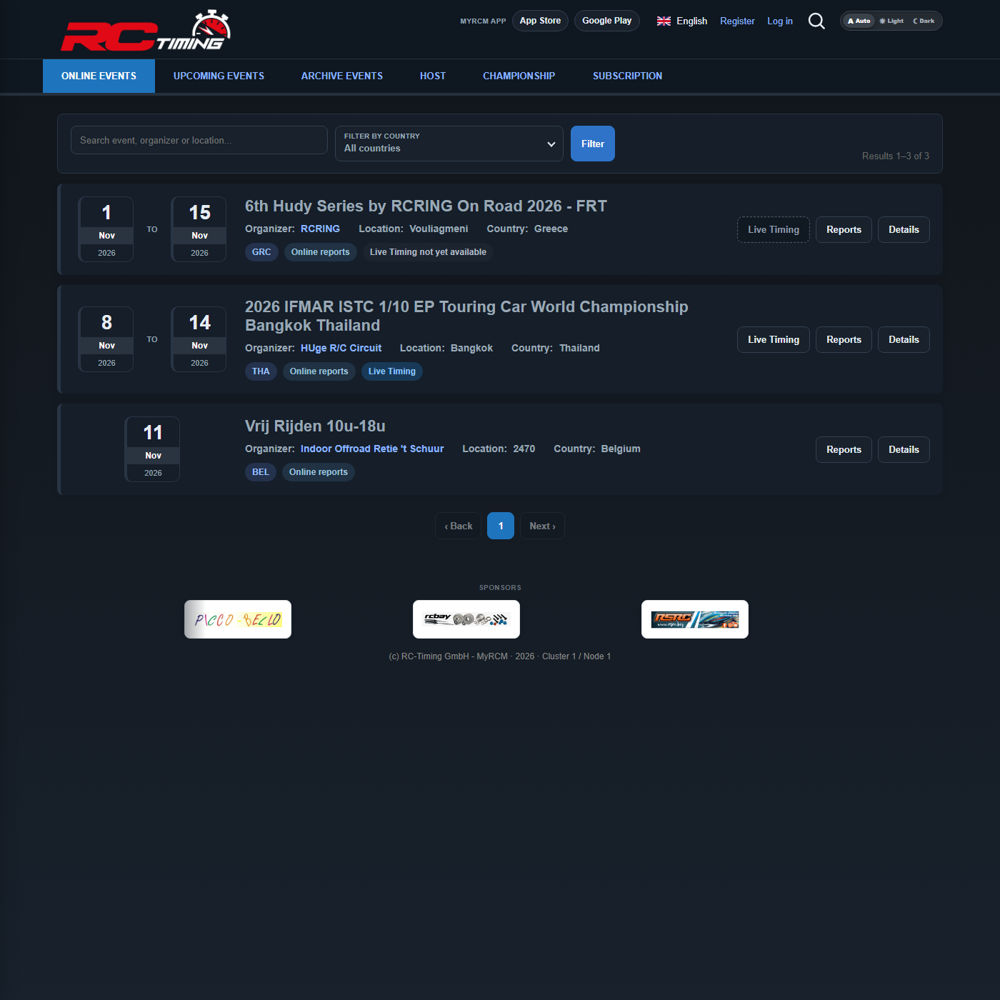

**RC Scoring Pro 2** offers instant TQ, an estimated qualifier number, house transponders, a Trackside TV board and free YouTube overlays. It has no voice.

[Its live results page](screenshots/rcscoringpro-live.png).

**RCGTiming** is the closest match to HeatCaller's relay: cloud and phone first. Heats move from prepared to scheduled to started, you drag to reorder, and it pings each driver 5 minutes before their heat.

**ZRound:** [home page](screenshots/zround-home.png). It's free, and has a track designer and spoken notices.

---

## 5. What race directors and drivers actually complain about

Ranked by how often each came up:

1. **Dead time between heats and rounds.** On one RCTech thread, delays are "most of the day by far". The LiveRC column puts on-track time at about 20% of the day. RC Car Action says a qualifying round takes an hour or more.
2. **Drivers and marshals not ready when called.** The LiveRC director's advice is not to wait, and to allow 120 s to get from the stand to the marshal posts. Racers marshal more willingly when heats start on time.
3. **Late sign-ups break the heat sheets.** The director has to regenerate, re-sort and repost them. Tracks set strict cutoffs 30–60 minutes before racing.
4. **Drivers don't know when they race.** Paper on the wall is still the norm, and phone pings are praised where they exist.
5. **Transponder failures:** missed laps, borrowed or house units, and dead plugs.
6. **Lap-count disputes** that have to be settled before the mains.
7. **Fragile or legacy software and subscriptions.** BBK won't run on current Windows; LiveTime's monthly fee; server or account errors when going live.
8. **Internet dependence.** LiveRC live results need the cloud. Nobody documents what happens when the connection drops.
9. **Too much qualifying, not enough racing.** This is why formats like HRQF and heads-up qualifying exist.

**Rulebook norms to support out of the box:**

- **ROAR:** best 2 of 3 rounds on Qual-Points, with 2 bump-ups.
- **ROAR track guide:** 2–5 minutes between races.
- **BRCA:** up to 10 cars per heat, 1-second staggered start, round 1 in number order, later rounds seeded by FTQ (fastest qualifying time).
- **EFRA:** 10-minute heats, finals of 10 at most, the top 3 bump up from subfinals.
- **NZRCA:** 12 cars at most, at least 3 rounds.
- **A typical club night:** 2–3 qualifying rounds of 5 minutes, mains of 10 with 2 bump-ups. About 2 minutes between heats is the stated target; 5 or more is reality.

**What people praise:** software that calls the race and the next heat by itself; a ping before your heat; live timing on the phone; clean per-heat results; simple software; editing the schedule from any device; starting heat 1 on time and holding a fixed interval.

---

## 6. HeatCaller against the field

**Where HeatCaller is already ahead (keep these and show them off):**

- **Guided flow.** The *Next Steps* card always offers the single next action: build heats → start Q1 Heat 1 → … → build the finals → move the top finishers up. Bump-ups are offered before the next upper main can go out. No rival guides the heats-to-mains transition like this. LiveTime's equivalent is a settings panel with about 15 controls.
- **Set Up Tonight wizard**, a Ready to race checklist, and **Simple mode**, all aimed at volunteers. Rivals assume a trained timekeeper.
- **The announcer.** The others use robotic Windows text-to-speech or none at all. HeatCaller has a natural voice, On Air openings, driver intros, call-ups to the stand repeated every 2 minutes, and marshals called by themselves.
- **Pre-race check** for dead transponders before the green. A **banner for unknown transponders** after the session, without interrupting the race.
- **Redo Remaining Heats** handles a no-show or late entry. **Move Drivers Between Heats** with group or spread by pace.
- **Phones:**
  - QR and phone self check-in
  - driver requests
  - "Your next race" on a phone
  - online sign-up with approval
  - a race-day manager on a phone or tablet
  - a phone remote

  LiveRC has no first-party phone app. RCGTiming is the only rival in this space.
- **Price:** HeatCaller is not tiered by registration count. LiveTime's Basic tier stops at 20 registrations a day.

**Built since 10 Nov 2026, and not matched by anything found in this research:**

- **Race video:** each race on a driver's page links to its moment in the club's YouTube stream ("Watch my race"), with a per-lap jump for the driver's own laps (PRs #203 and #204, 14 Nov). LiveRC embeds race video behind its paid membership; see section 3e.
- **Stream overlays for OBS** that follow the race state, with presets, sponsor turns and a phone view (PR #207, 15 Nov). RC Scoring Pro offers free YouTube overlays.
- **Live track map** on phones and the Big Screen, with stopped-car alerts (built 4 Nov, before this research, but not listed in it), and the **track designer** (25 Oct).
- **Family and follower links** with a "your driver races soon" alert (PR #207).
- **Warm-up flag** and a **Drivers' Meeting** read-out (PRs #195, #209 to #211).
- **Race Analytics** with a head-to-head grid and gaps in car lengths (PR #188), and a **championship hub** with "Can they still win?" (PR #185).

**Where HeatCaller was behind or unproven on 10 Nov, and where each stands now:**

1. **No fixed-interval auto-advance or auto-start between heats.** *Closed 11 Nov (PR #144).* Auto start is on by default with a 2:30 gap, Hold / +1 min / Start now, and a director "Skip in this race (DNS)".
2. **Format breadth.** LiveTime has ladder mains (A–L), double/triple A-mains, HRQF, Reedy, Super Pole, and "best N of M" on any seeding. *Mostly closed.* Ladder mains, best N of M and staggered starts (1 to 120 s) were already there. Points qualifying, HRQF heads-up and double/triple A-mains came 11 Nov (PRs #149, #150). Sanctioning presets for ROAR, BRCA, EFRA, NZRCA, IFMAR, Reedy Race and PN Racing came 12 Nov. *Still missing:* Super Pole, the Reedy Invitational head-to-head format, and lower mains in legs.
3. **Spectator reach.** LiveRC is a national destination: racers already have accounts and follow other tracks. HeatCaller's relay pages are per club. *Still open.* A cross-club index is a proposal only (`plans/cross-club-index-proposal.md`, 12 Nov). Phones gained a clubs list on 14 Nov (PR #198).
4. **Entry import** from RCSignup, the de facto US pre-entry system, is a one-click import in LiveTime. *Closed 11 Nov (PR #149).* "Import Entries..." reads RCSignup exports, a pasted LiveRC entry list, a LiveTime driver export or any CSV, and matches by transponder then name. It does not read LiveTime's database directly.
5. **Backup timing PC.** LiveTime's Parent/Child mode mirrors the PC. *Mostly closed 11 Nov (PR #149).* A standby PC copies the timing PC every 15 seconds and can Take Over by hand. The copy is one-way: there is no live mirror of a race in progress and no automatic failover.
6. **No measured proof.** *Half closed.* Night pace is measured in the event report (PR #140, 11 Nov). The head-to-head demo script is written (`plans/head-to-head-demo-script.md`) but has not been run against LiveTime yet.

---

## 7. Plan: make it demonstrably better

The goal is something a club can *see*, not a feature list. Two parts: measure the night, then attack the gaps that cost the most minutes.

### Where the plan stands (15 Nov 2026, checked in code)

Almost all of it was built and merged between 11 and 13 Nov 2026. The steps below are the original plan, kept as written.

| Plan item | Status | What exists now |
|---|---|---|
| Night pace measurement | Built (#140) | "Night pace" in the event report: green to green, longest gaps with cause, on-track share, rounds against plan |
| Timed head-to-head demo | Script only | `plans/head-to-head-demo-script.md`; not yet run against LiveTime |
| Keep the night moving | Built (#144) | Auto start, Hold / +1 min / Start now, director "Skip in this race (DNS)" |
| Rest-time guard | Built (#144) | "Races off between a driver's races" (0 to 3); manual moves warn first |
| "You're up in 5 minutes" push | Built (#144, #169) | To drivers, and to marshals with their post |
| Mains preview | Built (#146) | "Build the Finals from Qualifying..." shows each main, why each driver is there, and bump-up places |
| Disputes window | Built (#146, #150) | "Provisional until 20:42" on every screen. It warns but does not block building the mains |
| Late entry without reposting | Built (#146) | "Add a Late Entry..." puts the driver in the smallest unrun heat |
| Imports and LiveTime guide | Built (#149) | RCSignup, LiveRC entry list, LiveTime driver export, CSV; `website/docs/getting-started/switching-from-livetime.md` |
| Offline first, said loudly | Partly | In the app and the user guide; not on the docs home page |
| Warm standby PC | Built (#149) | One-way copy every 15 s, manual Take Over; no live mirror |
| Cross-club results index | Not built | Proposal only (`plans/cross-club-index-proposal.md`) |
| Curfew planner | Built (#141) | "Out of the venue by:", finish estimate, fixes with minutes saved |
| Rain / stoppage plan | Built (#141) | "We're Done After This Round..." |
| Decoder-down fallback | Built (#149, #150) | "Score by Hand" tap grid, also from the phone remote; results marked hand-scored |
| Mixed-class heats | Built (#149, #175) | "Run Together...", scored per class |
| Money at the desk | Built (#147, #151) | Fees, extra-class price, comps, paid/owing, cash and card totals (tracking only) |
| Close-the-night checklist | Built (#141, #160) | "Close the Night" window, club can add lines |
| Car broken / need 5 minutes | Built (#144) | "Need 5 minutes" and "Skip my race" from the phone |
| Clock time for my heat | Built (#150) | "about 20:42" on phones, sheets, Big Screen and program |
| Seed Q1 by pace | Built (#146) | "First round seeded:" by recent pace (default), alphabetical, random, HRQF, race number |
| Marshal swaps | Built (#147, #176) | "Cover my post": a friend accepts, the desk approves or it's automatic |
| "Leader behind you" in your ear | Built (#149) | A clip in the phone lap voice |
| Mid-pack personal lines | Built (#149) | "0.31s quicker than your Heat 1" and similar, on the night page, report card and email |
| Formats from the Step 3 audit | Mostly built (#149, #150, 12 Nov presets) | Missing: Super Pole, Reedy Invitational, lower mains in legs |

### Step 1: Measure (so "better" is a number)
- **Night pace on Next Steps and in the event report:**
  - minutes from green to green, averaged over the night
  - the longest gap and what caused it (waiting for drivers, bump-ups, a rebuild)
  - rounds finished against plan
  - on-track time as a share of the night

  The data is already there in Race History timestamps and the timetable's "running 12 min late". Build it into a "how the night went" card and the shareable results.
- **A timed head-to-head script for demos.** For HeatCaller vs LiveTime on the same entry list (15 drivers, 3 classes, 2 qualifying rounds, mains with bump-ups), count clicks and seconds for each of:
  - first launch to first green
  - heat to heat
  - qualifying done to first main on track
  - a late entry after Q1

  LiveTime has a 30-day free trial, so this can be run for real.

### Step 2: Close the biggest gap (dead time)
- **Fixed-interval "Keep the night moving" mode.** After a race, count down a set gap (default 2–3 minutes, ROAR guidance) to the next round. Use what HeatCaller already has: call-ups at T-2:00 and T-1:00, marshals called, the auto pre-race check, then On Air, then a start nobody has to press. A director can hold, add a minute or skip a driver who isn't ready (one tap) from the PC or the phone remote. LiveTime offers this as three tick boxes; HeatCaller should make it the default once a program exists, with a visible countdown on Race Control, the Big Screen and drivers' phones.
- **Rest-time guard.** Never schedule a driver in back-to-back races without a minimum gap: drivers in two classes, and bump-ups. LiveTime only *colours* these drivers; HeatCaller can auto-reorder or warn on the Next Steps card.
- **Push "you're up in 5 minutes"** to the phone of each driver in the next heat and the marshals, through the relay. Praised where RCGTiming does it, and HeatCaller already has push and "Your next race".

### Step 3: Make heats → mains bulletproof and quick
- **A one-screen mains preview before committing:** who's in each main, why (their counted result and tie-breaker), and who bumps up. Then a single **Build**. This matches LiveTime's Seeding Preview without its 15 settings, with the class's settings behind an "Advanced" link.
- **Audit HeatCaller against LiveTime's formats** and add the common ones that are missing: best N of M, ROAR Qual-Points tie-breakers, ladder mains beyond C, double/triple A-mains, HRQF heads-up qualifying, 1-second staggered start. Lead with a sanctioning preset for each body (ROAR / BRCA / EFRA / NZRCA), with defaults from section 5.
- **Disputes window:** a "results final in 5:00" timer after each qualifying round. Mains can't be built until it ends or the director overrides. This settles lap disputes before the mains, as the forums ask.

### Step 4: Kill setup friction
- **Import from RCSignup / LiveRC entry lists / CSV**, mapped onto HeatCaller drivers and transponders, so a track switching from LiveTime brings its roster in one step.
- **"Switching from LiveTime" guide and importer.** Ideally HeatCaller would read LiveTime's database or exports for drivers, transponders and classes. A written guide alone already beats their video-only documentation.
- **Late entry without reposting:** after the cutoff, a late driver goes into the smallest heat still to run, without disturbing any heat that's already posted. The lineup on phones and the Big Screen updates on its own.

### Step 5: Resilience and reach
- **Offline first, stated loudly.** The race runs with no internet, and the relay catches up when it's back. Say so in the marketing: it's a known LiveRC worry.
- **A warm standby PC**, modelled on LiveTime's Parent/Child: a second laptop on the LAN mirrors the race and can take over.
- Later, consider a cross-club results index so racers can follow other tracks. This is where LiveRC's network effect sits, and it's a strategy call more than a build.

### Step 6: Race-director gaps (from running the night, not from the competitors)
These were found by reading HeatCaller's user guide as a veteran race director would, looking for moments where a director still works it out on paper. The guide already covers penalties, the marshal roster, printed heat sheets, Redo Remaining Heats for no-shows, "Running 6 min behind", tech inspection, rental deposits and corrections, so they aren't listed. The guide doesn't mention the items below. That was checked against the docs only, not the code, so confirm each one before building it.

- **Curfew planner (build first; it pairs with Step 2).** Before the first green, Next Steps shows the finish time for the night: "42 entries, 3 rounds + mains, finishes about 10:40, venue out by 10:00." It offers fixes, each with the time it saves: drop a round, shorten qualifiers to 4 minutes, run mixed-class heats, cut the lower mains. Once racing starts it becomes the target that "Keep the night moving" and the running-late line measure against. In a timed demo against LiveTime this is the easiest thing to show.
- **Rain/stoppage plan.** One "We're done after this round" button. Seed the mains from the rounds that ran, shorten or drop mains to fit the time left, and tell everyone through the announcer, the Big Screen and phones. Where a sanctioning preset (Step 3) has rules for incomplete rounds, follow them.
- **Decoder-down fallback.** If the loop or decoder fails mid-race, hand scoring takes over: one tap per car on a tablet or phone (the phone remote already reaches the laptop), or lap counts typed in at the end. The race is marked as hand-scored in the results. A power cut is already covered; this is the "laptop's fine, loop's dead" case.
- **Mixed-class heats.** Let small classes share a heat (3 Stock + 4 Mod) and score them separately: separate results, standings and mains seeding, plus an announcer call per class. It saves a whole heat slot per round at small club nights. The curfew planner can suggest it.
- **Money at the desk.** Per event: entry fee per class, a discount for a second class, comps (marshals, volunteers, juniors), paid/owing on check-in (desk and phone check-in), and an end-of-night cash/card total for the treasurer. At the moment the only money HeatCaller tracks is the rental deposit.
- **Protest window.** Already in Step 3 as the disputes window. Results show as *provisional* on every screen until it closes.
- **Rest time for drivers in two classes.** Already in Step 2 as the rest-time guard. The marshal roster already skips back-to-back duties; the heat order should guarantee the same for racing and warn before a manual move breaks it.
- **Close-the-night checklist.** At the end of the event, Next Steps lists: results posted, result emails sent, backup taken, rentals and transponders returned, cash counted. It shows what's left, then "lights out".

### Step 7: Driver gaps (what makes the night less fun for a racer)
These were found by reading the guide as a veteran driver would. The guide already covers: lap times in your ear, the report card and driver score, Check my transponder, querying a result, the overdue-car marshal alert, and call-ups to the drivers stand. What spoils a racer's night is mostly waiting, feeling it wasn't fair, and chores between races. The guide doesn't mention the items below; that was checked against the docs only, not the code.

- **"Car broken / need 5 minutes" buttons (build first).** Two buttons on the driver's night page: **Skip me this round** and **Need 5 minutes**. They show at once on Race Control and the Next Steps card, so the director stops waiting and stops repeating call-ups. Build them on Driver Requests and the relay. This helps Step 2's dead-time work as much as it helps the driver.
- **A clock time for my heat.** The phone, Schedule page and Big Screen show "Q2 Heat 3 · about 8:42", updated as the night runs early or late. This builds on the Step 6 curfew planner and the timetable's running-late figure, so a driver knows whether there's time to fix a car or eat.
- **Seed the first round by pace.** Q1 heats are built from recent results (last night's pace, or the class standings), so heats are close racing and rookies aren't lapped four times by the A-main drivers. Heats already mix from Q2; this covers Q1. Add an "Off" option for clubs that want random.
- **Marshal swaps.** A driver asks a friend to cover their post from the phone. The friend accepts, the director approves (or it's automatic if allowed), and the roster and the announcer's marshal call update.
- **"Leader behind you" in your ear.** When a car is about to be lapped, the lap-times voice quietly warns the backmarker. The crowd-facing "car gets lapped" call already exists; this one is for the driver. It means fewer crashes between the leader and lapped cars.
- **Something to race for in the mid-pack.** After each race, give the driver a personal line on their phone and report card: "0.3s quicker than your Q1", "held off Sam for 4 laps", "best finish in Stock this season". Most of the field isn't winning, and these are the people who keep coming back.

**Suggested order:** Step 1 measuring (cheap, and it gives the proof) → Step 2 keep-the-night-moving mode together with Step 6's curfew planner and Step 7's car-broken buttons (biggest real effect) → Step 7's clock time per heat → Step 3 mains preview and format audit → mixed-class heats and money at the desk (common club-night asks) → Q1 pace seeding and marshal swaps → decoder-down fallback and rain plan → Step 4 imports → the rest of Step 7 → close-the-night checklist → Step 5.

---

## 8. Caveats

- The LiveTime desktop frames come from their own training videos. The Schedule, seeding and race frames are v4.6 (2026). The Time Table frames are from an old v0.9 video; the feature is still current according to the release notes and training list.
- I couldn't read forum threads in full; RCTech returned 403. Pain points come from search excerpts plus full LiveRC and RC Car Action columns.
- The original 10 Nov claims about HeatCaller's gaps came from reading the user guide, not the code. The 15 Nov status updates in sections 1, 6 and 7 were checked against the code.
- LiveRC's member-only video player was not seen; whether it can jump to a lap is still unknown.
- Prices are from public pages on 10 Nov 2026. RCM and Everlaps don't publish prices.

## Sources
- LiveTime: https://www.livetimescoring.com/features · /training · /download
- LiveTime training videos: Schedule (youtube.com/watch?v=E09Mym2nRaM), Racing (GfA1cmF_fkM), Time Table Countdown (_3ULTQc8c9Q), HRQF (Ucyo2NvoO38)
- LiveRC event: https://trspeedway.liverc.com/results/ (7 Nov 2026), https://norcar.liverc.com/results/?p=view_heat_sheet&id=11011845
- LiveRC registration: https://register.liverc.com/snowbirdnationals/
- LiveRC columns: "A Moment with Mike – time spent at the track vs on the track"; "Where's Waldo – smash the clocks"; HRQF article
- RC Car Action on qualifying length: https://www.rccaraction.com/?p=223774
- RCM: https://www.rc-timing.ch/products/timekeeping.html · MyRCM: https://www.myrcm.ch
- Everlaps docs: https://docs.everlaps.com/en/
- RC Scoring Pro: https://rcscoringpro.com/about-rcsp2/
- RCGTiming: https://rcgarage.info · https://rcgtiming.com/page/timing-faq
- ZRound: https://www.zround.com
- Race video (15 Nov 2026): the LiveRC news posts and pages linked in section 3e; https://github.com/dutchdronesquad/rh-youtube-chapters; https://docs.skateresults.app/features/livestream/export-chapters; https://support-centre.racelogic.co.uk/motorsport/software/ct3/ug/view-layout/; https://patents.google.com/patent/US10923157B2/en; https://patents.google.com/patent/US20210134329A1/en
- RCTech threads via search excerpts: "many bigger races vs club racing", "timing software recommendations", transponder-missing-laps threads
