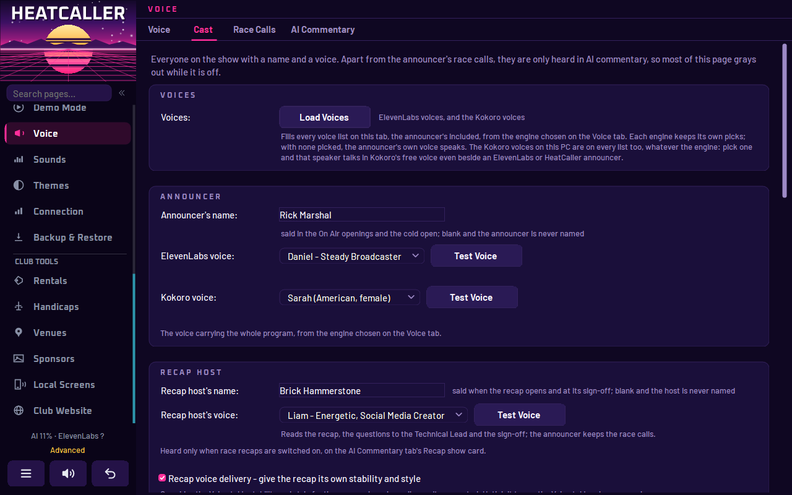
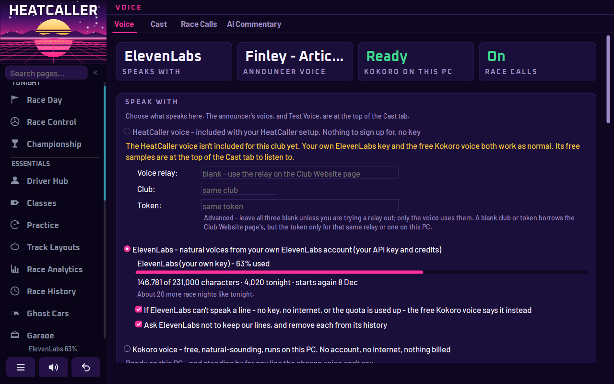
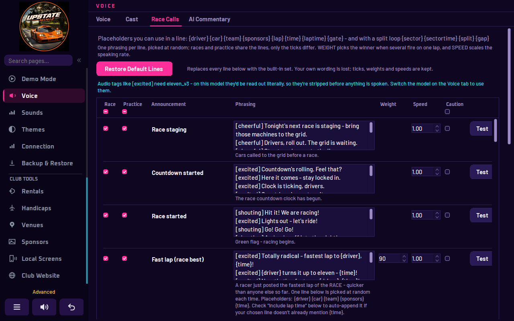
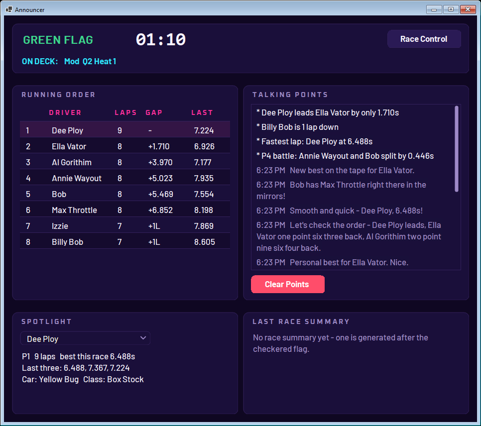

# Voice announcements

HeatCaller can call the race out loud: the start, flags, fast laps, lead changes, streaks, the last lap and the finish. It speaks with one of three voices:

- **The HeatCaller voice** — natural announcer voices that come with HeatCaller, spoken through your club's relay. There's no account to sign up for, no key to paste and no bill. This is the one most clubs will use. It needs the relay, it has a monthly allowance, and the wording it speaks is fixed.
- **Your own ElevenLabs account** — your key, your voices, your credits, and complete control of the voice, the tuning and every word the announcer says.
- **The free Kokoro voice** — a natural-sounding voice that runs on the club's own PC. No account, no internet, nothing to pay however much the announcer talks, and full control of the wording. It's what a new install speaks with, and it's what speaks whenever the voice you chose can't.

Everything to do with the announcer speaking is on the **Voice** page (called **Voice Announcements** in earlier versions), on four tabs:

| Tab | What's on it |
|---|---|
| **Voice** | Which voice speaks, [race calls on or off](#race-calls-on-or-off), your own ElevenLabs connection, the voice's tuning, and the lines saved on the laptop. Covered from [Choose the voice](#choose-the-voice) down to [Saved voice lines](#saved-voice-lines). (Called **Voice Settings** before 17 October.) |
| **Cast** | **Load Voices** at the top, which fills every voice list on the tab, then the announcer's voice with **Test Voice**, and everyone else on the show below it. See [Choose the voice](#choose-the-voice) for the announcer, and [Commentary](commentary.md#technical-lead-and-team-principal) for the rest. |
| **Race Calls** | One row for each moment the announcer can call: whether it's on for races and for practice, and the lines it picks from (called **Announcements** before 17 October). See [Announcements](#announcements). Under the rows, the **How often** card sets how many calls a lap gets, the gap between them and what counts as a streak; see [How often](#how-often). Its last section, **Rivalries**, holds lines for two particular drivers swapping places; see [Rivalries](#rivalries). |
| **AI Commentary** | Race intros, recaps and talking points, written through your club's relay or by the small model built into HeatCaller. It has [its own page](commentary.md). |

This page also covers the [Announcer screen](#announcer-screen), a window for whoever is on the microphone, opened from **Race Control**. How the whole race night sounds, the announcer's words included, can be set in one go with a [soundscape](sounds-and-music.md#soundscapes).

!!! note
    In Simple mode the **Race Calls** tab is hidden, and so are the ElevenLabs **Model:**, the **Voice parameters** and **Saved voice lines** cards, the voice relay rows and the consent rows on **Voice → Voice**, and the **Recap host**, **Technical Lead**, **Team Principal** and **Achievements reader** cards on **Cast**. Hidden settings keep working. Turn on Advanced mode to see them; see [Simple and Advanced mode](../getting-started/simple-and-advanced-mode.md).

## Before you start

- For the HeatCaller voice, your club set up on the **Club Website** page — address, club id and publish token — and internet at the track. It speaks through the same relay, with the same token, so there's nothing extra to enter. See [Setting up the Club Website page](../online/setup.md). Your club also has to be switched on for the voice on the relay; the page tells you if it isn't.
- For the Kokoro voice, nothing: it comes with HeatCaller, and a new install already speaks with it. If its voice file isn't on the PC, there's one button to fetch it. See [Use the Kokoro voice](#use-the-kokoro-voice).
- For your own ElevenLabs account, an API key, and an internet connection during the race. Each new line is sent to ElevenLabs and comes back as audio.
- Driver profiles with names filled in, so the announcer says "Dana" rather than a transponder number. See [Drivers and classes](../race-day/drivers-and-classes.md).

!!! note
    HeatCaller picks an announcement line for each moment even when no voice can speak it, for example on a PC that hasn't got Kokoro's voice file. The line still appears on the [Announcer screen](#announcer-screen) and on the [Big Screen](../screens/big-screen.md). See [When nothing can speak](#when-nothing-can-speak).

## Choose the voice

The **Speak with** card at the top of **Voice → Voice** decides what speaks every announcement. Like everything on this tab, the choice saves as you make it. Its first line says where the rest is: "Choose what speaks here. The announcer's voice, and Test Voice, are at the top of the Cast tab."

The announcer's voice itself is picked on **Voice → Cast**, on the **Announcer** card under the **Voices** card at the top of the tab, just under **Name:**. The card shows the picker and the test for each voice that can speak, given the choice made here:

| Row at the top of **Voice → Cast** | Shown when |
|---|---|
| **HeatCaller voice:** with **Refresh** and **Hear It**, then **Your own words:** with **Preview**, and a line saying what the last press did. See [Pick a HeatCaller voice](#pick-a-heatcaller-voice). | The HeatCaller voice is chosen. Also whenever its list holds only its free samples, because your club isn't signed up for it yet, so you can listen before deciding. |
| **ElevenLabs voice:** with **Test Voice**, and a line under them. Its list is filled by **Load Voices** on the **Voices** card above. See [Set up your own ElevenLabs account](#set-up-your-own-elevenlabs-account). | ElevenLabs is chosen. Also while the Kokoro voice is chosen and a key is typed in **API Key:**, so you can set ElevenLabs up before switching to it. |
| **Kokoro voice:** with **Test Voice**, and a line for what the test did. While Kokoro only stands in, the caption reads **If ElevenLabs runs out:**, as it does under each of the rest of the cast. See [Use the Kokoro voice](#use-the-kokoro-voice). | The Kokoro voice is chosen, or it's standing in: always with the HeatCaller voice, and with ElevenLabs while the stand-in box under it is ticked. The voice picked here is the one that stands in. |

**Name:** is at the top of the same card, above the voice: it's said in the On Air openings and the cold open, and left blank the announcer is never named.





| Choice | What it is |
|---|---|
| **HeatCaller voice - included with your HeatCaller setup. Nothing to sign up for, no key, no bill** | An announcer voice from HeatCaller's own catalog, spoken through your club's relay. Pick one in **HeatCaller voice:** at the top of **Voice → Cast**. Everything that would spend is fixed while it's chosen, and your club has a monthly allowance of characters. See [The HeatCaller voice](#the-heatcaller-voice). |
| **ElevenLabs - natural voices from your own ElevenLabs account (your API key and credits)** | ElevenLabs' online voices, set up on the **ElevenLabs connection** card below, with the voice picked at the top of **Voice → Cast**. It needs a key, a voice and internet at the track, and uses your ElevenLabs credits. Everything on the page is yours to change. |
| **Kokoro voice - free, natural-sounding, runs on this PC. No account, no internet, nothing billed** | A natural-sounding voice that runs on the laptop itself. It comes with HeatCaller, so there's nothing to sign up for, no internet needed and nothing to pay, however much the announcer talks. The wording is yours to change, and it's also what speaks whenever the voice you chose can't. See [Use the Kokoro voice](#use-the-kokoro-voice). |

Under the ElevenLabs choice, **If ElevenLabs can't speak a line - no key, no internet, or the quota is used up - the free Kokoro voice says it instead** is ticked by default. It makes Kokoro the stand-in, so a flag call is never silent. See [When ElevenLabs can't speak a line](#when-elevenlabs-cant-speak-a-line). The box only matters with ElevenLabs chosen: it's grayed out, keeping its tick, while the HeatCaller voice or the Kokoro voice is chosen. With the HeatCaller voice it isn't a choice at all — Kokoro always stands in, because there's no key of your own to fall back on.

Kokoro is the bottom of the ladder, and nothing stands in for it. On a PC that hasn't got Kokoro's voice file the announcer can't speak at all, and the page, the **Mixer** and the console all say so rather than letting the night go quiet. See [When nothing can speak](#when-nothing-can-speak).

### Race calls on or off

Under the three choices on the **Speak with** card, **Race calls:** has two tick boxes, **In races** and **In practice**. Untick one and every call on the **Race Calls** tab goes quiet there at once, while each call keeps its own **Race** and **Practice** ticks for when you tick the box again. Sound effects and the AI commentary aren't race calls, so they carry on. Both are ticked to begin with, and applying a soundscape leaves them as they are. This is the switch to use in Simple mode, where the **Race Calls** tab is hidden.

### Pick a HeatCaller voice

1. On **Voice → Voice**, choose **HeatCaller voice - included with your HeatCaller setup. Nothing to sign up for, no key, no bill** under **Speak with**.
2. Open **Voice → Cast** and pick one of the announcer voices in **HeatCaller voice:**, at the top of the **Announcer** card. Each is listed as its name and a short description, for example "Clubhouse - Warm and clear, easy over a PA". The first one is chosen for you if you've never picked one, so the announcer works without another decision.
3. Press **Hear It** beside the list to listen to the voice you've highlighted, and **Preview** to hear it say words of your own. See [Hear a voice before you choose it](#hear-a-voice-before-you-choose-it).
4. Back on **Voice → Voice**, read the line under the HeatCaller choice, which says where your allowance stands.

**Refresh**, beside the list on **Cast**, asks the relay again — for the list of voices and for the allowance. The page does it by itself when you open **Voice → Voice** and when you choose the HeatCaller voice, in the background, so the page is usable while it waits. While the page is on screen it asks again every two minutes, so a page left open through a race keeps a current number; press **Refresh** if you want it this second. The meter under it is different: it moves as lines are spoken. See [The meter under the voice](#the-meter-under-the-voice).

The line under the HeatCaller choice on **Voice → Voice** says one of:

| The line says, for example | What it means |
|---|---|
| "Included - 34,120 of 100,000 characters this month - starts again 1 Oct. Saved lines cost nothing. When the allowance is gone the free Kokoro voice speaks every line until it starts again, and your saved lines are kept." | All set. The line turns amber once the allowance is spent. See [Your club's monthly allowance](#your-clubs-monthly-allowance). |
| "Set the club up on the Club Website page first - the HeatCaller voice speaks through the same relay, with the same token." | The **Club Website** page has no relay address, club id or token yet. See [Setting up the Club Website page](../online/setup.md). |
| "The HeatCaller voice isn't included for this club yet. Your own ElevenLabs key and the free Kokoro voice both work as normal. Its free samples are at the top of the Cast tab to listen to." | The relay knows your club, but hasn't been set up to give it the voice. Ask whoever runs your relay. You can still press **Hear It** on any voice in the list at the top of **Voice → Cast**. |
| "The relay has no voices to offer yet." | The relay has no voice catalog configured. Ask whoever runs your relay. |
| "This relay doesn't offer *the voice's name*, the voice chosen here, so the free Kokoro voice would speak every line. Pick one at the top of the Cast tab." | The voice saved on this laptop isn't one this relay offers. Pick another in **HeatCaller voice:** on **Voice → Cast**. |
| "Couldn't ask the relay:" and a reason | The relay couldn't be reached just now. The list is left as it was, and the voice you already chose keeps working. |

A voice the relay has since dropped from its catalog stays in the list, chosen, marked "not offered by the relay any more", rather than being quietly swapped for another one. Pick a different one.

!!! note
    Choosing the HeatCaller voice while you have wording of your own on the page puts the standard lines back, after asking: "The HeatCaller voice speaks the standard announcer lines, so the wording on this page will go back to them. Your own wording is kept if you use your own ElevenLabs key, or the free Kokoro voice, instead. Use the HeatCaller voice and the standard lines?" Answer **No** and nothing changes. The lines of a built-in [soundscape](sounds-and-music.md#soundscapes) aren't wording of your own: they ship with the app, so they're the same words at every club, and they're kept without asking. Applying a soundscape *after* you're on the HeatCaller voice is different — it brings its sounds, but nothing from the **Race Calls** tab.

### Hear a voice before you choose it

Two buttons at the top of **Voice → Cast**, on the **Announcer** card, let you listen to a HeatCaller voice before you commit to it. Neither one spends your race-night allowance.

- **Hear It**, beside **HeatCaller voice:**, plays a short sample of the voice you've highlighted. It's free, and it works before your club has signed up for anything at all: the sample needs no token, so a laptop with nothing but a relay address on the **Club Website** page can still listen to every voice. The first person anywhere to ask for a given voice has it rendered once; everyone after that hears the saved copy, for nothing. The sample is the same fixed line for every voice, so you're comparing like with like.
- **Preview**, beside **Your own words:**, has the voice say whatever is in that box. This is the one that settles it: a stock sample can't tell you whether a voice gets "Stock Buggy A-Main" right, or your drivers' names. A starting line is filled in for you, so the button does something the first time you press it; replace it with your own class names and driver names. Keep it to a sentence — a preview can be up to 200 characters, and a longer one is refused straight away with a message saying so.

Previews come out of **a small daily allowance of their own, kept completely separate from the race-night voice allowance**. An afternoon of auditioning can't leave you short on Saturday. When the day's previews are used up the relay says so in words, for example "That is this club's previews for today - 3,000 characters a day of trying voices out. Its race-night voice allowance has not been touched, and previews start again tomorrow." Nothing falls through to the race-night budget. **Hear It** still works, because it costs nothing.

The line under the two buttons says what the last press did, and begins as a reminder of the difference: "Hear It plays a short sample - free, and it works before you have signed up for anything. Preview says your own words in that voice, on a small daily preview allowance that is kept separate from your race-night voice."

!!! note
    Both buttons need a relay that has been redeployed since they were added. An older relay answers "This relay doesn't offer voice samples yet." (**Hear It** then disappears) or refuses the preview. If you run the relay yourself, deploy it again; otherwise ask whoever does. See [Hosting the relay](../admin/relay-hosting.md#the-heatcaller-voice).

**Listening before you sign up.** When the relay has nothing to offer your club — never signed up, not on the plan, or a token it won't take — the voice list fills from the free sample list instead of sitting empty, so the voices can still be heard. Those rows show at the top of **Voice → Cast** whichever voice is chosen under **Speak with**, so a club on Kokoro can listen without switching. The page says so, for example: "Listening only for now - these are HeatCaller's own 6 voices, free to play. Press Hear It to try one. Preview, which says your own words, needs your club set up on the relay first." **Preview** is switched off in that state, and nothing you highlight in that list is saved as your club's voice — it isn't a list the relay has said you may use.

### Use the Kokoro voice

Kokoro is the free voice: natural-sounding, running on the laptop's own processor, and costing nothing however much the announcer talks. A new install speaks with it, and it's what stands in whenever the voice you chose can't.

1. On **Voice → Voice**, choose **Kokoro voice - free, natural-sounding, runs on this PC. No account, no internet, nothing billed** in **Speak with**.
2. Open **Voice → Cast** and pick a voice in **Kokoro voice:**, at the top of the **Announcer** card. **Michael (American, male)** is chosen to begin with. There are American and British voices, women and men.
3. Press **Test Voice** beside it. You should hear "This is HeatCaller, testing the Kokoro voice. Green flag, green flag!" The first test after starting HeatCaller takes a few seconds while Kokoro loads. The line under it says what the test did, for example "Done - that was Michael (American, male)."

Kokoro's voice file (about 310 MB) comes with HeatCaller, so there's normally nothing to download and the line under the Kokoro choice on **Voice → Voice** reads "Speaking with Kokoro - ready on this PC. Nothing is billed, however much the announcer talks." — or, with another voice chosen, "Ready on this PC - and standing by for any line the chosen voice can't say."

If the file isn't there, a **Download (about 310 MB)** button appears under the Kokoro choice on **Voice → Voice** and the line turns red: "Kokoro isn't on this PC - press Download (about 310 MB, once). Until then the announcer can't say anything at all." Press it, answer **Yes**, and the line counts up while it downloads; **Cancel Download** stops it and keeps nothing. You only download it once per PC. If the file is there but won't load on this PC, the line says why and the button reads **Download Again (about 310 MB)**: press it to fetch a fresh copy, which usually fixes it.

**Prepare Lines** isn't needed with Kokoro: it speaks each line on the laptop as it's wanted, so the button is grayed out and the line beside it reads "Not needed with the Kokoro voice - it speaks each line on this PC as it's wanted." A line it has said once plays straight away for the rest of the session.

Kokoro gets 30 seconds to make a line as it's spoken. A line made ahead of time, such as the recap while the teaser plays, gets longer, in step with its length (up to five minutes), so a long recap is still said when Kokoro is speaking it or standing in.

The downloaded copy is kept in `%LocalAppData%\HeatCaller\Kokoro`, on that PC only, and isn't part of a backup. Nothing Kokoro says is kept with the [saved voice lines](#saved-voice-lines).

Everyone on **Voice → Cast** can have a Kokoro voice of their own — the recap host, the co-host, the Technical Lead, the Team Principal and the achievements reader — **whatever voice the announcer uses**. Every voice list on the Cast tab ends with the Kokoro voices on this PC, each marked "Kokoro:", for example "Kokoro: Emma (British, female)". Pick one and that speaker talks in Kokoro's free voice even beside an ElevenLabs or HeatCaller announcer; press **Test Voice** beside the list to hear it. Picking any other voice in the list, or "(the announcer's own voice)", puts them back on it. With Kokoro chosen under **Speak with**, the lists are the Kokoro voices, as before.

The Kokoro voices are only offered once Kokoro is on this PC (see the **Download** button above). If it is taken off again, a speaker given one says their lines as they did before — in the voice picked for them for the engine in use, or the announcer's — and their list shows the voice with "not downloaded" after it. See [Technical Lead and Team Principal](commentary.md#technical-lead-and-team-principal).

#### Each of the cast when ElevenLabs runs out

When Kokoro stands in, each of the cast keeps a voice of their own, so an interview never turns into the announcer talking to himself. Under each speaker's **Voice:** on **Voice → Cast** is an **If ElevenLabs runs out:** list of the Kokoro voices on this PC, with its own **Test Voice**, which says that speaker's test line in the Kokoro voice picked. The same voice stands in for them when the HeatCaller voice can't speak.

Until you pick one, each speaker stands in with the Kokoro voice already picked for them, or else a default of their own, none of them the announcer's: **George (British, male)** for the recap host, **Adam (American, male)** for the co-host, **Eric (American, male)** for the Technical Lead, **Lewis (British, male)** for the Team Principal and **Bella (American, female)** for the achievements reader.

A list is grayed out while it would never be heard: with the Kokoro voice chosen under **Speak with**, while the speaker has "(the announcer's own voice)" (they then stand in with the announcer's Kokoro voice), and while they already speak in a "Kokoro:" voice. The lists are shown in Advanced mode; in Simple mode each speaker still stands in with their own voice. A voice saved on another PC that this one hasn't got stays in the list, marked "(not on this PC - Michael (American, male) speaks instead)".

### What the Kokoro voice uses

Kokoro uses **Speed:** on the **Voice parameters** card (with each announcement's own **Speed**), the **Announcements** fader on **Sounds → Mixer**, and **Max spoken announcements per lap:** on the **How often** card of **Voice → Race Calls**. **Stability:**, **Similarity boost:**, **Style:**, **Text normalize:**, **Language:**, **Output format:** and **Speaker boost** are ElevenLabs settings and don't change it.

Audio tags such as `[excited]` are always taken out before Kokoro speaks, whatever the model is set to for ElevenLabs, because it would read them out as words. Nothing it says is kept with the [saved voice lines](#saved-voice-lines). The hint under the three choices sums it up: "Kokoro uses the Speed below and the Mixer's Announcements level, and leaves out audio tags like [excited]. It also speaks whenever the chosen voice can't, so a flag call is never silent." The ElevenLabs settings are kept whichever voice is chosen, so you can switch back and forth without setting anything up again.

### When nothing can speak

Kokoro is the last voice in the chain, so there is one state in which the announcer has nothing to speak with: Kokoro's voice file isn't on this PC, or it's there and won't load. HeatCaller says so in three places rather than going quiet, and all three name the same button:

| Where | What it says |
|---|---|
| The console | "[voice] NO VOICE - The Kokoro voice isn't downloaded on this PC yet (the Voice tab has a Download button). Open the Voice tab and press Download under the Kokoro voice (about 310 MB, once) - until then the announcer can't say anything at all." Said once for that reason, not for every line. |
| **Sounds → Mixer** | A red **NO VOICE:** notice above the channels with the reason, and the **Announcements** channel reads "Can't speak -" and the reason. See [Mixer](sounds-and-music.md#mixer). |
| **Voice → Voice** | A red line under the Kokoro choice, and, with Kokoro chosen, "NOTHING CAN SPEAK -" and the reason on the line below the three choices. With another voice chosen the line warns that nothing can stand in: "Speaking with the HeatCaller voice - but the Kokoro voice isn't downloaded on this PC yet (the Voice tab has a Download button), so nothing can stand in and a line it can't say is lost. ..." |

The fix is one press of **Download** under the Kokoro choice on **Voice → Voice**. While it lasts, announcement lines are still chosen and still appear on the [Announcer screen](#announcer-screen) and the [Big Screen](../screens/big-screen.md) — they just aren't spoken. Sound effects, lap beeps, ambience and music are unaffected, and a [soundscape's recorded voice lines](sounds-and-music.md#voice-lines) still play, because they're audio files rather than something that has to be spoken.

### After the Windows voice was retired

The free voice built into Windows is gone. It used to be both a choice under **Speak with** and the voice that spoke whenever nothing else could; Kokoro is both of those now, and it sounds like a person. Nothing is left to set up:

- A club whose voice was set to the Windows voice comes up on **Kokoro voice**, with nothing to do.
- A club that pays ElevenLabs by the character **stays on ElevenLabs**, and its key is untouched. That's deliberate: a club that had a key *and* had deliberately chosen the free voice isn't moved onto the one that charges it.
- An old saved choice of which Windows voice to use for the co-host or the Technical Lead (then called the mechanic) is simply forgotten. Pick a Kokoro voice for the Technical Lead on **Voice → Cast** if you want one.

### After updating from 0.50 or earlier

- A laptop with an ElevenLabs key keeps speaking with ElevenLabs, with the free Kokoro voice standing in (the box is ticked). A key still locked to the PC it was saved on, after a move, counts as a key.
- A laptop with no ElevenLabs key switches to the Kokoro voice. Its announcer couldn't speak before; now it speaks every announcement that's switched on.
- A new install starts on the Kokoro voice.

### After updating to 0.52

Nothing changes by itself. A laptop keeps whichever voice it was speaking with, and a new install still starts on the free voice. The HeatCaller voice is a choice you make: set the club up on the **Club Website** page, then pick it under **Speak with**.

## The HeatCaller voice

The HeatCaller voice is ElevenLabs, on HeatCaller's account rather than yours, asked for through your club's relay. Your club holds no key and pays no ElevenLabs bill, and there's nothing to set up beyond the relay you already have for your online pages.

That's also why it works differently from a key of your own. The account behind the voice is HeatCaller's, so everything that would spend money on it is fixed while the voice is chosen: the words, the voice's own settings, and the buttons that would render a line to try it out. A club that wants its own words, its own voice or the **Test** buttons uses its own ElevenLabs key, or the free Kokoro voice, where both are theirs to spend.

### What's fixed while it's chosen

| On the page | While the HeatCaller voice is chosen |
|---|---|
| The lines in each announcement's box on the **Race Calls** tab | Read-only. You can still read and copy them; you can't type in them. |
| **Restore Default Lines** | Switched off — the lines are already the standard ones. |
| Each announcement's **Test** | Hidden. See [Testing a line](#testing-a-line) for what you can still hear. |
| Each announcement's **Speed** | Switched off. The speed is the relay's, not the club's. |
| The **Rivalries** tab's lines and its **Use Default Lines** | Read-only and switched off, with an amber line saying why. See [Rivalries](#rivalries). |
| A [soundscape](sounds-and-music.md#soundscapes) applied on **Sounds → Soundscapes** | Its sounds apply; nothing on its **Race Calls** does, lines included. The wording stays the standard set. |
| **API Key:**, **Show**, **Model:** | Switched off. They belong to your own ElevenLabs account. |
| **ElevenLabs voice:** and **Test Voice** on **Voice → Cast** | Not shown. The **Announcer** card shows the HeatCaller voice's own picker instead. |
| **Stability:**, **Similarity boost:**, **Style:**, **Speed:**, **Speaker boost**, **Text normalize:**, **Language:**, **Output format:** | Switched off. The relay decides all of these, per voice. |

**Hear It** and **Preview** are the exceptions, and deliberately so: neither spends a character of the race-night allowance, so both stay live while the HeatCaller voice is chosen. See [Hear a voice before you choose it](#hear-a-voice-before-you-choose-it).

There's no way round the rest, and that's on purpose: every one of those either spends a character on HeatCaller's account or changes what would be spent. A club that wants its own words uses its own ElevenLabs key, or the free Kokoro voice, where both are theirs to spend.

Everything else works as it always did: which announcements are on, their **Caution** ticks and **Weight**s, the per-announcement extras such as **Include lap time**, **Race calls:**, the **Announcements** level on the **Mixer**, **Max spoken announcements per lap:**, the [Announcer screen](#announcer-screen), and **Prepare Lines**. A soundscape still applies its sound effects and its crowd and music, so it's worth using on this voice — it just can't change the words, and its tuning makes no difference to how this voice sounds. See [What applying a soundscape changes](sounds-and-music.md#what-applying-a-soundscape-changes).

Audio tags such as `[excited]` are left in the line and sent as written. The relay knows which model each of its voices uses, and takes the tags out itself for the ones that would read them aloud, so you never hear "bracket excited". A tag doesn't count toward the line-length limit either, because it's measured on the words that will actually be spoken. See [Audio tags](#audio-tags).

### Your club's monthly allowance

Each club gets a number of characters a month on the HeatCaller voice — 100,000 unless whoever runs your relay has set yours differently. The line under the HeatCaller choice on **Voice → Voice** shows where you stand, for example "34,120 of 100,000 characters this month - starts again 1 Oct." The month is a calendar month, and it survives a relay redeploy.

Far less of it is spent than that number suggests:

- **A line already saved on this laptop costs nothing.** As with your own key, the first render is kept and played from the laptop after that. See [Saved voice lines](#saved-voice-lines).
- **A line with nothing filled into it is rendered once for every club, not once for yours.** "Green flag!" is the same words at every club in the country, so the first club to ask pays for it and everyone else gets it free. With the standard lines that covers **Race started**, **Green flag (resumed)**, **Yellow flag**, **Red flag**, **Race staging**, **Countdown started**, **Race time over**, **Final minute** and **Race completed** — the calls a race night leans on most.
- **What's left is the lines that get something filled in** — lap times, positions, streak counts, a driver's name, a class or the marshals. Those are your club's alone, so **Last lap**, **Grid call**, **Staggered start release** and every per-lap call are on your allowance.

So the cheapest thing you can do before a race night is press **Prepare Lines**, which works on this voice just as it does on a key of your own. See [Prepare lines in advance](#prepare-lines-in-advance).

#### The meter under the voice

Under the line, a meter shows the same month at a glance, and keeps itself up to date while the page is open:

- the name and the share used, for example "HeatCaller voice - 34% used", or "HeatCaller voice - used up";
- a bar, green while there's plenty left, amber from 80% used and red when it's gone;
- the figures, for example "34,120 of 100,000 characters · 2,410 tonight · starts again 1 Nov" ("tonight" runs from 6am to 6am, so a late meeting is one night);
- once something has been spoken tonight, how long it will last, for example "About 6 more race nights like tonight.";
- **Ask for More**, once 80% is used. It works as it does for the AI commentary: the request is noted on the relay and emailed to support@heatcaller.com from the club's mailbox, or your email program opens with it written out for you to send. See [Asking for more](commentary.md#asking-for-more).

It's only there while the HeatCaller voice is chosen. The same figures are in the This Month window, the chip at the foot of the sidebar and Mission Control's **Allowances** tile, and the club gets an email at 80% and when it's used up. See [This month: every allowance in one place](commentary.md#this-month-every-allowance-in-one-place).

When it's used up, the free Kokoro voice speaks every line until the month starts again or a top-up arrives; see [When the HeatCaller voice can't speak a line](#when-the-heatcaller-voice-cant-speak-a-line).

The relay speaks one line at a time up to 600 characters, which is far longer than any announcement. The count is of the words that will actually be spoken, so audio tags don't count toward it. A longer line is refused and the Kokoro voice says it.

### The warning before it runs out

At nine tenths spent, the console says so once a month:

```
[voice] The HeatCaller voice has used 90,000 of 100,000 characters this month. When it's gone, the free Kokoro voice speaks every line until it starts again on 1 Oct. Lines already saved are kept either way.
```

It's said once, the next time the relay speaks a line after the count crosses nine tenths, and again after the month has started over. Take it as the cue to check the number on **Voice → Voice** and decide whether to turn a chatty announcement off, or to use your own key for the rest of the month.

### When the HeatCaller voice can't speak a line

The free Kokoro voice stands in, always — there's no box to untick and nothing to set up, because the alternative would be silence. What happens next depends on why:

| What's wrong | What happens |
|---|---|
| **The month's allowance is used up** | Every line is spoken by the Kokoro voice until the allowance starts again, **including lines already saved**. That's deliberate: a night that's half one voice and half another sounds like a broken announcer, and one voice with the reason in the console is honest. It holds until the relay actually speaks a line again, so nothing slips through in the HeatCaller voice mid-night. Nothing is thrown away either — every saved line is still there next month, and plays again then. The relay is still asked about every half hour, so a club topped up mid-month is speaking again within half an hour. |
| **The relay can't be reached** — no internet, or a request that times out | Lines already saved still play in the HeatCaller voice from the laptop. New lines go straight to the Kokoro voice with no wait, and the relay is tried again in the background about once a minute. |
| **No HeatCaller voice is chosen yet** | The Kokoro voice speaks every line, and the console says to pick one. The picker is **HeatCaller voice:**, at the top of **Voice → Cast**. |
| **The relay says the voice isn't included for this club, isn't switched on at all, doesn't know the token, or no longer has the voice you chose** | The Kokoro voice speaks, and the relay is tried again about every half hour — none of those mends itself in a minute, but whoever runs the relay can put it right while you race. |
| **The relay or ElevenLabs is busy, or the line is too long** | The Kokoro voice says that line, and the next line is asked for as normal. |

The console says which is happening, once per reason rather than for every line:

```
[voice] This month's HeatCaller voice allowance is used up - the free Kokoro voice speaks every line until it starts again. Nothing is lost: every line already saved is kept and plays again then.
[voice] The HeatCaller relay can't be reached (...) - the free Kokoro voice is standing in. It is tried again in the background about once a minute.
```

And when it comes back:

```
[voice] The HeatCaller voice is back - it speaks from the next line, and the Kokoro voice stands down.
```

**Sounds → Mixer** says the same thing while it lasts: the **Announcements** channel reads "Ready - Kokoro voice standing in", and an amber notice above the channels gives the reason, for example "The free Kokoro voice is standing in - this month's HeatCaller voice allowance is used up." See [Mixer](sounds-and-music.md#mixer).

On a PC that hasn't got Kokoro's voice file there's nothing to stand in, and those lines are skipped. See [When nothing can speak](#when-nothing-can-speak).

### Your own announcer's voice: recording consent

The stock HeatCaller voices are nobody's own. If your relay offers a voice recorded from a real person, such as your own announcer, HeatCaller won't speak in it until this PC holds a record that they agreed: until then the free Kokoro voice reads every line.

The record is on the **Speak with** card, in the **Who agreed:** row (shown in Advanced mode):

1. Pick that voice in **HeatCaller voice:** on **Voice → Cast**. A consent is for one voice.
2. Type the name of the person who agreed in **Who agreed:**.
3. Press **Record Consent**. Unlike the rest of the page, this box isn't saved as you type: the press is what records it, with today's date.

The line under the row says where things stand, for example "No consent is recorded on this PC. A cloned voice will not be used until one is." HeatCaller keeps only the name and the date; the recording and whatever was signed are the club's to keep. This PC holds one consent at a time, so recording one for a different voice replaces the old record, after asking.

**Take It Back** withdraws it, after asking. Nothing is spoken in that voice after that, but the record is kept rather than deleted, so the club can still say when it had permission.

### Sending the voice to a different relay

Under the voice list are three boxes — **Voice relay:**, **Club:** and **Token:** — and almost every club should leave all three blank. Blank means the voice speaks through the relay on the **Club Website** page, with the same club id and token, which is what you want.

They're there for trying a relay out. Filled in, they move **only the voice** to that address: results, check-in, the race-day manager and everything else carry on going wherever the Club Website page points, and nothing your drivers or the public see changes.

Leave **Club:** blank and the Club Website page's club id is used. **Token:** works the same way, but only when the voice relay is your club's own relay (the one on the Club Website page) or a relay on this PC (`localhost`) — any other address, including one elsewhere on your network, needs its token typed in. That's on purpose: your publish token can publish and delete as your club, and a mistyped address that happens to exist shouldn't be handed it.

While any of them is filled in:

- the line under the HeatCaller choice starts with "Test relay", so the allowance you're reading is that relay's and not your club's;
- the console says so once a night, the first time the voice speaks.

A plain `http://` address is only accepted for this PC or your own network — `http://localhost:8787` is fine, an address out on the internet isn't, because the token would cross it readable. Emptying all three puts the voice back on the Club Website page's relay straight away.

If you run the relay yourself, [Hosting a relay](../admin/relay-hosting.md#trying-the-heatcaller-voice-out-on-your-own-laptop) has the one command that starts one here with the voice switched on.

## Set up your own ElevenLabs account

The key and the model are on the **ElevenLabs connection** card on **Voice → Voice**; the voice, with **Test Voice**, is at the top of **Voice → Cast**, filled by **Load Voices** on the **Voices** card there. The connection card can be filled in whichever voice is speaking. Its first line says so: "Used when ElevenLabs is chosen above, and for the saved voice lines - it can be set up whichever voice is speaking." The one exception is the HeatCaller voice: the whole card is switched off while that's chosen, because the account behind that voice isn't yours, and the **ElevenLabs voice:** row on **Cast** isn't shown. Choose ElevenLabs or the Kokoro voice under **Speak with** first, then fill the box in.

1. Get an API key from your ElevenLabs account. <!-- TODO: confirm the exact steps/menu names on the ElevenLabs website for creating an API key, and which key permissions HeatCaller needs (it lists voices and synthesizes speech). -->
2. In HeatCaller, open **Voice → Voice**.
3. On the **ElevenLabs connection** card, paste the key into **API Key:**. Tick **Show** if you want to check what you pasted. With the Kokoro voice chosen, the **ElevenLabs voice:** row appears on **Cast** once a key is typed.
4. Pick a model from **Model:** (see [Choosing a model](#choosing-a-model)). It's shown in Advanced mode; in Simple mode the model is `eleven_v4_turbo`.
5. Open **Voice → Cast** and press **Load Voices** on the **Voices** card at the top. HeatCaller asks ElevenLabs for the voices on your account and fills every voice list on the tab, **ElevenLabs voice:** on the **Announcer** card included. The line under it says, for example, "Loaded 24 voices."
6. Pick a voice from **ElevenLabs voice:**.
7. Press **Test Voice** beside it. You should hear "This is HeatCaller testing your announcer voice." It uses the **Voice parameters** on **Voice → Voice** as they are on screen, so you can change one there and test again. **Test Voice** always tests ElevenLabs, whichever voice is chosen under **Speak with**.
8. Back on **Voice → Voice**, under **Speak with**, choose **ElevenLabs - natural voices from your own ElevenLabs account (your API key and credits)**.

There's no Save button. Every change on this tab saves as you make it, and the line at the bottom of the tab shows "Saved automatically at" and the time. Races use the new settings straight away.

<!-- screenshot: Voice tab, ElevenLabs connection card with API key hidden, voice and model selected -->

### Where the key is kept

The key is stored encrypted and locked to your Windows user account on this laptop. It's never written to a file in plain text, and it's never saved into a [soundscape](sounds-and-music.md#soundscapes). If you restore a backup onto a different laptop, you may need to enter the key again. See [Backups](../admin/backups.md) and [Security and privacy](../admin/security-and-privacy.md).

### Your own key's month

With ElevenLabs chosen under **Speak with** and a key in **API Key:**, a meter under the ElevenLabs choice shows how much of your ElevenLabs plan's characters this month is used, read from ElevenLabs itself: the share used and a bar, the figures (for example "1,200 of 30,000 characters · starts again 7 Nov" - the day your own plan starts again, which needn't be the 1st), and how many more race nights like tonight it will last. It's asked for when you open **Voice → Voice**, when HeatCaller starts and every five minutes after.

To read the plan, the key needs the **User: read** permission. A key made without it still speaks perfectly well, but the meter can't see the plan, and says instead: "This key can't read its plan - give it the User: read permission on elevenlabs.io to see it here." Give the key that permission in your ElevenLabs account and the figures appear at the next check.

There's no **Ask for More** here: the characters are on your own ElevenLabs plan, so HeatCaller can't add any. Once 80% is used, **Upgrade on elevenlabs.io** appears under the bar instead, and opens your plan's page on ElevenLabs.

At 100%, the **If ElevenLabs can't speak a line - no key, no internet, or the quota is used up - the free Kokoro voice says it instead** box decides. Ticked (the default), ElevenLabs isn't asked at all: the free Kokoro voice speaks every line, each of the cast in their own [stand-in voice](#each-of-the-cast-when-elevenlabs-runs-out), and saved ElevenLabs lines are held back too, so the night is in one set of voices. ElevenLabs and its saved lines come back by themselves once the meter is under 100% again, after your plan starts again or you move to a bigger one. Unticked, the meter changes nothing: lines already saved still play in your voice, and new lines are skipped once ElevenLabs refuses them. See [When ElevenLabs can't speak a line](#when-elevenlabs-cant-speak-a-line).

The same figures are in the This Month window, the sidebar chip (as "ElevenLabs") and Mission Control, and the club gets an email at 80% and when it's used up. See [This month: every allowance in one place](commentary.md#this-month-every-allowance-in-one-place).

## Choosing a model

This is for your own ElevenLabs account. The HeatCaller voice's model is part of the voice, set on the relay, and the **Model:** box is switched off while that voice is chosen.

The **Model:** box offers these presets. You can also type any ElevenLabs model ID.

| Model | Notes |
|---|---|
| `eleven_v4_turbo` | The default. v4 tuned for speed, at half v4's price. Understands audio tags (see below) and ignores **Speed:**. |
| `eleven_v4` | The newest expressive model. Understands audio tags and ignores **Speed:**. |
| `eleven_v3` | The previous expressive model. Understands audio tags and ignores **Speed:**. |
| `eleven_multilingual_v2` | The default before 10 Nov 2026. |
| `eleven_turbo_v2_5` | |
| `eleven_flash_v2_5` | |
| `eleven_monolingual_v1` | |

The hint on the page puts it plainly: on the v2 models, **Style** varies the energy but won't turn the voice into a radio personality, and above about 0.6 it starts to distort. If you want a real performance, use `eleven_v3` or one of the v4 models.

### Audio tags

With `eleven_v3`, `eleven_v4` or `eleven_v4_turbo` (any model ID containing "v3" or "v4"), you can put a tag in square brackets in a line to color how it's delivered. With that model chosen, the note above the rows on the **Race Calls** tab lists these tags:

`[excited]` `[cheerful]` `[sad]` `[angry]` `[whispers]` `[laughs]` `[sighs]` `[awe]` `[sarcastic]` `[curious]` `[crying]` `[shouting]`

One tag per line is usually enough. Stacked tags fight each other.

The v4 models play a tag much harder than v3 did, so the built-in lines keep the two loud tags for the moments that matter:

- `[shouting]`: the start, time up and the checkered flag, a new leader, records (track record, fastest lap of the race, provisional pole, record pace), and the yellow, red and green flags and jump starts.
- `[excited]`: passes and battles, ghost passes, getting lapped, the last lap and the final minute and seconds.
- A driver's own bests (personal bests, a best ever here, several personal bests said together, streaks, qualifying improvements and achievements) are never `[excited]` or `[shouting]`. Their `[cheerful]` and `[awe]` stay.
- Everything else (staging, the countdown, lap times, the position report, minutes left, sector and split pace) is read with no tag.

On any other model, a tag would be read out word for word, so HeatCaller strips anything in square brackets before the line is spoken. That means you can leave tags in your lines and switch models without the announcer saying "bracket excited". The built-in lines already use tags, so switching to `eleven_v3` makes them more lively.

Kokoro can't perform a tag either — it would read it out as words — so tags are always taken out before it speaks, whatever model is set for ElevenLabs. With Kokoro chosen, the note above the rows on the **Race Calls** tab says so: "Audio tags like [excited] only work with ElevenLabs' eleven_v3 and v4 models - the Kokoro voice would read them out as words, so they're taken out before anything is spoken. Your lines can keep them for ElevenLabs."

With the HeatCaller voice, the line goes to the relay with its tags still in it. The relay knows which model each of its voices uses and takes the tags out for the ones that can't perform them, so a voice that understands tags gets them and the rest never read them aloud. Nothing on the laptop has to be set either way.

## Voice parameters

These sit on the **Voice parameters** card, and they tune ElevenLabs; the Kokoro voice uses only **Speed:** (see [What the Kokoro voice uses](#what-the-kokoro-voice-uses)). The HeatCaller voice uses none of them: everything that shapes how it sounds belongs to the relay (see [What's fixed while it's chosen](#whats-fixed-while-its-chosen)).

How loud the announcer plays is the **Announcements** fader on **Sounds → Mixer**, the one place it's set (default 100%). How many routine calls one lap can trigger is **Max spoken announcements per lap:** on the **How often** card of **Voice → Race Calls**; see [How often](#how-often). Both work on every voice.

To hear them, press **Test Voice** beside **ElevenLabs voice:** at the top of **Voice → Cast**. It uses the values on this card as they are on screen, saved or not, and the card says so: "To hear these, press Test Voice at the top of the Cast tab - it uses the values here."

| Setting | What it does | Default |
|---|---|---|
| **Stability:** | 0 to 1. Lower gives a more varied, emotional read. Higher is steadier. | 0.50 |
| **Similarity boost:** | 0 to 1. How closely the output sticks to the original voice. | 0.75 |
| **Style:** | 0 to 1. Style exaggeration. Higher is more dramatic. Past about 0.6 it can distort. | 0.00 |
| **Speed:** | 0.70 to 1.20. Overall speaking rate. `eleven_v3`, `eleven_v4` and `eleven_v4_turbo` don't take a speed, so with those models a note under the box says ElevenLabs ignores it. | 1.00 |
| **Text normalize:** | `auto`, `on` or `off`. Whether ElevenLabs spells out numbers and similar text. `auto` is right for almost everyone. | `auto` |
| **Language:** | A two-letter language code such as `en` or `es`, to force a language. Leave it blank for automatic detection. | blank |
| **Output format:** | ElevenLabs audio format, for example `mp3_44100_128`. Higher-quality formats need a paid ElevenLabs plan, so leave it blank unless you know you have one. | blank (your plan's default) |
| **Speaker boost** | ElevenLabs speaker boost. | On |
| **Livelier in the big races, steadier in the heats** | Steps **Stability:** and **Style:** a tenth from your own settings with the size of the race: steadier in practice and heats, your settings as they are for the lesser mains, livelier for the top main, and one step up for the last race of the night. A line already saved or prepared is played as it is and never bought again. Shown for your own ElevenLabs voice on models other than v3. | On |

Lap times are always spoken as words, the way a race caller says them, so the voice doesn't misread the digits: 6.935 is "six nine thirty-five", 5.060 is "five oh six" and 5.000 is "five flat". The voice says the same time the screens show, down to the thousandth, with nothing rounded. Screens show the numbers as digits. In lines written by the commentary model and in the reminders from the race day's Timetable, only a number with a unit ("6.9s", "6.9 seconds") is read as a time; other numbers are left as they are.

## Saved voice lines

Every line the HeatCaller voice or your own ElevenLabs account speaks is saved on the laptop the first time it's rendered. The next time the same words are wanted in the same voice and settings, HeatCaller plays the saved copy instead of asking again, so each line is paid for once. Saved lines survive restarts.

Saved lines belong to those two voices only. With the Kokoro voice chosen they aren't used at all: it speaks each line on the laptop as it's wanted, costs nothing, and nothing it says is kept here, not even when it's standing in. Kokoro does keep what it has said in memory for the rest of the session, so a line it has spoken once plays straight away — but that's forgotten when HeatCaller closes.

!!! note
    A soundscape's **voice lines** are something else: its fixed race calls, recorded on purpose with **Voice Lines** on **Sounds → Soundscapes**. Those play from the laptop whichever voice is chosen, Kokoro included, and they're kept with the rest of your data, so they're in backups. The one exception is while your own ElevenLabs allowance is used up and Kokoro is standing in: they're held back then, like saved lines. See [Voice lines](sounds-and-music.md#voice-lines).

What a saved line is matched on depends on the voice:

- **Your own ElevenLabs account:** the words, the voice, the model, **Stability:**, **Similarity boost:**, **Style:**, **Speed:** (with the row's own **Speed**), **Speaker boost**, **Text normalize:**, **Language:** and **Output format:**. Change any of them and only the lines it affects are rendered again, the next time they're spoken. The API key isn't part of the match: a saved line plays whichever ElevenLabs account paid for it.
- **The HeatCaller voice:** the words and the announcer voice you picked — nothing else, because nothing else is yours to change. The relay also gives each voice a fingerprint covering its model and settings, so if a voice is re-tuned on the relay, every laptop renders its lines again rather than playing takes that no longer match.

Either way there's nothing to update by hand. The two sets are kept apart, so a club that tries the HeatCaller voice and goes back to its own key still has every line it has already paid for.

<!-- screenshot: Saved voice lines card with the count, Prepare Lines, Stop and the Recently played list -->

The **Saved voice lines** card is the last on **Voice → Voice**, under **Voice parameters**. It shows how many lines are saved and how much room they take, for example "214 lines saved, 11.8 MB."

Saved lines keep playing while ElevenLabs or the relay can't be reached. A used-up allowance is different: once the HeatCaller voice's month is spent, or your own ElevenLabs plan is at 100% (or ElevenLabs refuses a line for the quota) with the Kokoro stand-in box ticked, saved lines are passed over too and the Kokoro voice speaks the whole night, so it's one set of voices rather than two. They're all still there when the allowance starts again. With the stand-in box unticked, saved ElevenLabs lines go on playing, since nothing else would say them. See [When the HeatCaller voice can't speak a line](#when-the-heatcaller-voice-cant-speak-a-line) and [When ElevenLabs can't speak a line](#when-elevenlabs-cant-speak-a-line).

### Prepare lines in advance

**Prepare Lines** renders, in one go, every line whose words are known before the race:

- every line without a placeholder in each announcement that's switched on, for races or for practice, the flag calls included;
- the **Staggered start release** lines for every driver checked in for the current event.

Lines built from something that happens during the race, such as a lap time, the running order, a streak count or a driver's name on a lap call, can't be made in advance. They're saved the first time they're spoken, and cost nothing after that whenever they come round word for word. **Every lap completed** and **Fast lap (race best)** lines are left out while their **Include lap time** box is ticked, because the time is added as the line is spoken.

1. Check your drivers in first, if you want their release calls included.
2. Click **Prepare Lines**.
3. HeatCaller tells you how many lines it will render, how many are already saved and will be skipped, and roughly how many characters it will use. Click **Yes** to go ahead.

What step 3 says depends on the voice. With your own account: "That's about 4,100 characters of your ElevenLabs quota, used once - each line is then played from this PC." With the HeatCaller voice: "That's about 4,100 characters of this club's monthly HeatCaller allowance at most - each line is then played from this PC, and the lines with no driver's name in them are rendered once for every club, so most of them cost nothing at all." **At most** is the word that matters — on this voice, most of what it prepares has already been rendered for some other club and costs your allowance nothing.

It renders one line at a time and waits whenever the announcer is speaking, so it's safe to leave running while you race. The line beside the buttons shows how far it has got ("Preparing 12 of 80..."), then a summary such as "Done: 80 lines rendered and saved." Click **Stop** at any point; everything rendered by then is kept, and stopping isn't counted as a line that failed. It also stops by itself if your quota or your monthly allowance runs out, or if three lines in a row fail. The console says why each failed line failed.

Pressing **Prepare Lines** again later only renders what's missing, for example after you've edited some lines or checked more drivers in. If everything is already there it says "All 80 lines are already saved - nothing to render."

Prepare only ever asks the chosen voice, never the Kokoro voice standing in: a line it can't render counts as failed. With Kokoro chosen there's nothing for it to do, so **Prepare Lines** is grayed out and the line beside it reads "Not needed with the Kokoro voice - it speaks each line on this PC as it's wanted." If you choose Kokoro while a run is going, the run stops before its next line, keeps what it has rendered, and says why in the console.

!!! tip
    On the HeatCaller voice this is the cheapest thing you can do, and the only way to get a whole race night's fixed lines onto the laptop before the crowd arrives. Run it once after you've picked your announcer voice, and again after checking drivers in.

### Fix a line that came out wrong

Now and then a take comes out odd: a strange pause, or a word stressed wrongly. Because the take is saved, it would sound the same way every time. There are two ways to fix it:

- **For a flag call, or any line without a placeholder:** with ElevenLabs chosen under **Speak with**, press **Test** on its row on the **Race Calls** tab until it sounds right. A test always asks ElevenLabs for a fresh take and saves it in place of the old one, so the race plays the take you heard last.
- **For any saved line, on either paid voice:** choose it in **Recently played:** (the lines played or saved most recently, newest first) and click **Re-roll Line**. It says what the new take will cost and asks first; press **Yes** and it makes a new take, plays it, and keeps it as the one the race plays: "New take kept - 84 characters. The race plays this one now." If it fails, the old take is kept. Each entry in the list shows what the line costs to make again, in characters, beside when it was last used.
- **Forget Line** throws the saved take away instead, and the line is rendered afresh the next time it's spoken.

On the HeatCaller voice the **Test** buttons are hidden, so **Re-roll Line** is the way to get a new take. The new take is your club's own: the relay keeps it for your club only, other clubs keep hearing the shared take, and it costs your allowance like any line that wasn't saved. (**Forget Line** on its own usually brings back the relay's shared copy, which costs nothing but sounds the same.) The relay must be up to date for this — on an older relay a re-roll hands back the same take; see [Relay hosting](../admin/relay-hosting.md).

**Re-roll Line** refuses, with the reason, for a Kokoro line (Kokoro makes every line fresh on this laptop anyway), for a line whose words weren't recorded with it, for a line spoken in pieces, for a line saved with a different voice or different settings — an event's own speed, say — and for a line saved with drivers' full names before **Shorten published names** was ticked, which the race no longer plays (re-rolling it would send the full names to the online voice again). **Forget Line** is the answer for those.

A name the voice says wrongly is best fixed with the driver's **Announcer name:** on **Driver Hub**. Changing the words makes a new line, so it's rendered the new way from then on. That works on every voice.

**Shortened names on the paid voices.** With **Shorten published names to a first name and an initial** ticked (it's on unless your club turned it off), a line sent to the HeatCaller voice or your own ElevenLabs account carries each driver's name in the same short form the club's pages use — "Billy S" rather than "Billy Smith" — so a full name never leaves the laptop. That applies to the **Announcer name:** too, and to AI-written recaps. The Kokoro voice speaks on the laptop and sends nothing anywhere, so it still says names in full. To hear full names on a paid voice and keep the short ones online, tick **Say full names aloud with the online voices**, just under it on the Club Website page: the announcer then says full names on every voice, while the club's pages and captions still show the short form, and a line that says a full name isn't sent to people listening along at home.

**Forget All** clears every saved line, after asking first. Everything is then rendered, and paid for, again as it's spoken. It's worth doing after changing something HeatCaller can't see, such as editing a cloned voice in your ElevenLabs account.

A saved file that won't play — damaged on disk, or cut short by a crash mid-write — is forgotten by itself and rendered again the next time that line is wanted, on either paid voice. The console says so, for example "[voice] A saved release call for 1234 wouldn't play (...) - rendering it again." There's nothing to clear out by hand.

### Where saved lines are kept

In `%LocalAppData%\HeatCaller\VoiceLibrary` on the laptop, up to about 500 MB. Past that, the lines played least recently are cleared. They aren't part of backups, because they can always be made again: after moving to a new laptop, each line is rendered once more the first time it's spoken. See [Where HeatCaller keeps your data](../admin/data-files.md).

## Announcements

**Voice → Race Calls** has one row for each moment the announcer can call, under column headings that stay in view as the rows scroll: **Race**, **Practice**, **Announcement**, **Phrasing**, **Weight**, **Speed** and **Caution**. Each row has:

- **Race** and **Practice** tick boxes: whether the announcement speaks in races, and in practice. See [Race and practice](#race-and-practice).
- **Announcement**: its name.
- **Phrasing**: the lines the announcer picks from. Type one per line. A random line is picked each time, so the same sentence doesn't repeat back to back. Under the box, a hint says when the announcement fires and which placeholders it takes. A few rows have extra settings under it too; see [Extra settings on some rows](#extra-settings-on-some-rows).
- **Weight** (only on the per-lap announcements): 0 to 100. When several announcements fire on the same lap, the higher weights win the slots allowed by **Max spoken announcements per lap:** on the [How often](#how-often) card.
- **Speed**: 0.50 to 1.50. A multiplier on the main **Speed:** setting, just for this announcement. Lower it for long lines, such as the position report. The result is still kept between 0.70 and 1.20.
- **Caution**: lets this announcement speak while a yellow or red flag is out. Off for everything by default (see [How the announcer behaves during a race](#how-the-announcer-behaves-during-a-race)).
- **Test**: speaks one random line from this box, at this row's speed, using the settings currently on screen and the voice chosen under **Speak with**. With ElevenLabs it always renders a fresh take; see [Fix a line that came out wrong](#fix-a-line-that-came-out-wrong).

Above the rows are the placeholders you can use ("Placeholders you can use in a line: {driver} {car} {team} {sponsors} {lap} {time} {laptime} {gate} - and with a split loop {sector} {sectortime} {split} {gap}"), a note on how lines are picked, **Restore Default Lines**, and a line about audio tags for the voice and model you've chosen (see [Audio tags](#audio-tags)). There's no Save button: changes save as you make them, as the status line under the rows says. That line also shows what a **Test** spoke; see [Testing a line](#testing-a-line). The grip under the rows drags the list taller or shorter, and it keeps the height you leave it at.

Under the rows are the [How often](#how-often) card and then the [Rivalries](#rivalries).

To silence every row at once, for races or for practice, use **Race calls:** on **Voice → Voice** instead of unticking them one by one; see [Race calls on or off](#race-calls-on-or-off).

With the HeatCaller voice chosen, the lines boxes are read-only, the **Speed** boxes are switched off and the **Test** buttons aren't shown. The **Race** and **Practice** ticks, **Caution**, **Weight** and the per-row extras all still work. See [What's fixed while it's chosen](#whats-fixed-while-its-chosen).



### Race and practice

Every row has two tick boxes side by side, **Race** and **Practice**, so you can see and change both at once and keep practice quieter. The lines themselves are shared between the two; as the note at the top of the tab puts it, "only the ticks differ". **Consistency streak** also has a separate cadence for each (see [Extra settings on some rows](#extra-settings-on-some-rows)).

Under the **Race**, **Practice** and **Caution** headings is a tick box for the whole column. Click it to tick every announcement in that column, or to clear them all when they're all ticked. It shows a part-way mark when only some are ticked. Undo puts back the ticks you had.

Earlier versions had an **Editing:** list that switched the whole page between race and practice ticks. It's gone, and the ticks you'd set for each are kept.

### Restoring the built-in lines

**Restore Default Lines** replaces every line on the tab with the built-in set. As the note beside it says: "Your own wording is lost; ticks, weights and speeds are kept." HeatCaller asks you to confirm first ("Replace the spoken lines for 3 event types with the built-in defaults?"), and tells you if your lines already match the defaults. **Undo** in the sidebar gives your own lines back.

It's switched off with the HeatCaller voice chosen: those lines are already the built-in ones, so there's nothing to restore.

### Placeholders

Placeholders are words in curly brackets that are filled in when the line is spoken. The legend at the top of the tab lists the common ones. The full set is:

| Placeholder | Filled with |
|---|---|
| `{driver}` | The driver's spoken name: their **Announcer name:** if set, otherwise their driver name, otherwise the transponder number. |
| `{car}` | The car model from the driver's profile. |
| `{team}` | **Team / club:** from the driver's profile. |
| `{sponsors}` | **Sponsors:** from the driver's profile, read as a list: "Kyosho, PN Racing and Dad". |
| `{lap}` | Laps completed. |
| `{time}` | The driver's fastest lap of the race so far. |
| `{laptime}` | The lap just completed. |
| `{gate}` | The timing gate reported for the pass. |
| `{streak}` | The length of a clean-lap streak. |
| `{rival}` | The other driver in a two-driver moment (close battle, lapping, ghost passes, streak takeovers). |
| `{previous}` | Who the new leader took the lead from (**Leader change** only). |
| `{previouslaps}` | How many laps that driver led this race, "6 laps" (**Leader change** only). |
| `{leadchanges}` | Which lead change this is, "fourth"; empty on the first (**Leader change** only). |
| `{leaders}` | How many drivers have led, "three"; empty on the first change (**Leader change** only). |
| `{backinfront}` | "back in front for the second time", for a driver retaking the lead (**Leader change** only). |
| `{rivalstreak}` | The streak of the driver who was passed (**Longest streak taken over** only). |
| `{positions}` | The running order with each car's gap to the leader, "Sam leads, Bill one point two three four back, Frank two point oh five back". With **Say each car's gap to the leader** ticked, places only: "Sam leads, Bill second, Frank third" (**Position report** only). |
| `{gaps}` | Each car's gap to the leader, "Bill one point two three four back and Frank two point oh five back", or "a lap down". Filled only with **Say each car's gap to the leader** ticked (**Position report** only). |
| `{achievement}` | The achievement just earned (**Achievement unlocked** only). `{badge}`, its old name, still works. |
| `{class}` | The class being called (**Grid call** only). |
| `{round}` | The round being called (**Grid call** only). |
| `{sector}` | The sector's number, "1" (**Fastest sector** only). |
| `{sectortime}` | The sector's time (**Fastest sector** only). |
| `{split}` | The split loop, "Split 1" (**Up at the split**, **Record pace at the split**, **Split time**, **Split coach (up or down)** and **Battle gap at the split**). |
| `{gap}` | A gap, said the way a gap is called: "two tenths", "half a second" (**Up at the split**, **Record pace at the split**, **Battle gap at the split** and **Gap to their ghost (coach)**). |
| `{splittime}` | The time from the line to the split loop, "eight point four zero seconds" (**Split time** only). |
| `{delta}` | "Up a tenth", "Down two tenths" or "Level", against the coached driver's best (**Split coach (up or down)** only). |
| `{battle}` | What a fight is for, "for the lead", "for third" (**Close battle**, and **Battle gap at the split**, where it is empty in practice). |
| `{ghostgap}` | Where the coached driver is against their own-best ghost, "Two tenths behind your ghost" (**Gap to their ghost (coach)** only). |
| `{sectors}` | Who was quickest through each sector, "sector one was Sam, sector two Bill" (**Sectors at the flag** only). |
| `{pace}` | "On target", "Two tenths off" or "A tenth under", against the coached driver's target (**Target lap (coach)** only). |
| `{target}` | The coached driver's target lap, "nine point two zero seconds" (**Target lap (coach)** only). |
| `{consistency}` | The whole consistency verdict, "Last five within a tenth - that's your rhythm" (**Consistency (coach)** only). |
| `{spread}` | How far apart the block's laps were, "three tenths" (**Consistency (coach)** only). |
| `{laps}` | How many laps make the block, "five" (**Consistency (coach)** only). |
| `{minutes}` | The minutes left, "four" (**Minutes left** only). |
| `{seconds}` | The seconds left, "thirty" (**Last minute countdown** only). |
| `{marshals}` | The corner marshals for the heat being called, said as "Sam, Bill and Frank" (**Grid call** only). It's the same list as the **Marshals...** window, for the current race day. |

Each row's hint says which placeholders that announcement supports.

If a placeholder has nothing to fill it, HeatCaller takes it out along with the little words that introduce it. For example, "{driver} takes the lead in his {car}!" becomes "Dana takes the lead!" when Dana has no car model set. The same goes for team and sponsor phrases such as "sponsored by {sponsors}", "racing for {team}" or "({team})": for a driver with no sponsors or team, the whole phrase is dropped. Likewise, when nobody is assigned to marshal a heat, the phrase that introduces `{marshals}` ("Marshals:", "marshalled by" and so on) is dropped with it.

### Every announcement

Defaults are for a new install. The **Practice** tick starts the same as the **Race** tick, except for **Split time**, **Split coach (up or down)**, **Battle gap at the split**, **Target lap (coach)**, **Consistency (coach)** and **Gap to their ghost (coach)**, which start ticked for practice only. A dash in the Weight column means the row has no weight box.

| Row | When it fires | Placeholders | On by default | Weight |
|---|---|---|---|---|
| **Race staging** | Cars are called to the grid before a race. | none | No | – |
| **Countdown started** | The race countdown begins. | none | No | – |
| **Race started** | Green flag, racing begins. | none | Yes | – |
| **Fast lap (race best)** | Someone sets the fastest lap of the race so far. | `{driver}` `{car}` `{team}` `{sponsors}` `{time}` | Yes | 90 |
| **Personal best lap** | A driver beats their own best this race. Fires often with a full grid. | `{driver}` `{car}` `{team}` `{sponsors}` `{time}` | No | 45 |
| **Jump start** | A car crosses the line before the green flag. | `{driver}` `{car}` `{team}` `{sponsors}` | Yes | 95 |
| **Track record** | The all-time fastest lap on the track layout selected in Race Control is broken. | `{driver}` `{car}` `{team}` `{sponsors}` `{time}` | Yes | – |
| **Leader change** | P1 changes hands. If the driver who lost the lead takes it straight back before the line is said, the line is stopped and the new lead change is called instead. Unless the line says `{leadchanges}`, the count is added ("the fourth lead change, among three drivers"); see [Extra settings on some rows](#extra-settings-on-some-rows). | `{driver}` `{car}` `{team}` `{sponsors}` (new leader), `{previous}` `{previouslaps}` `{leadchanges}` `{leaders}` `{backinfront}` | Yes | 100 |
| **Every lap completed** | Every finish-line pass. | `{driver}` `{car}` `{team}` `{sponsors}` `{lap}` `{time}` `{laptime}` | No | 40 |
| **Lap time only** | A quieter alternative: just the lap time after each lap. | fixed wording (see below) | No | 30 |
| **Consistency streak** | A driver's clean-lap streak reaches the streak threshold, and again as it continues. | `{driver}` `{car}` `{team}` `{sponsors}` `{streak}` | Yes | 70 |
| **Race time over** | The time limit is reached: last-lap warning. | none | Yes | – |
| **Race completed** | The race has finished. | none | Yes | – |
| **Yellow flag** | A yellow (caution) is called. | none | No | – |
| **Red flag** | A red flag stops the race. | none | No | – |
| **Green flag (resumed)** | Racing resumes after a yellow or red. Separate from **Race started** so the restart can be worded differently. | none | No | – |
| **Position report** | Reads the running order during a race. | `{positions}` | No | – |
| **Close battle** | Two drivers on the same lap within a second of each other. Once per pair per race. If the chaser gets past before the line is finished, it stops and the pass is called instead ("And Sam is through, up into third!"). A fight for the lead that the line doesn't mention starts "Battle for the lead!". | `{driver}` `{car}` `{team}` `{sponsors}` (car in front), `{rival}` (chaser), `{battle}` | Yes | – |
| **Car gets lapped** | The leader puts a full lap on another driver. | `{driver}` `{car}` `{team}` `{sponsors}` (leader), `{rival}` (lapped car) | No | – |
| **Passed a ghost** | You get past a ghost car. | `{driver}`, `{rival}` (the ghost) | Yes | – |
| **Passed by a ghost** | A ghost car gets past you. | `{driver}`, `{rival}` (the ghost) | Yes | – |
| **Longest streak taken over** | A driver's current clean run passes every other run going on track. Once per change, not every lap. | `{driver}` `{car}` `{team}` `{sponsors}` `{streak}`, `{rival}` `{rivalstreak}` | No | – |
| **Staggered start release** | A staggered driver's turn to go, or a driver you release by hand. Keep these lines short. | `{driver}` `{car}` `{team}` `{sponsors}` | Yes | – |
| **Achievement unlocked** | A driver earns an achievement. Spoken after the race once the result is saved, at most a few per race. | `{driver}` `{car}` `{team}` `{sponsors}` `{achievement}` | Yes | – |
| **On record pace** | A driver laps within two percent of the track record without beating it. Needs a layout selected with a record on it. At most once per driver per race, never before their third counted lap. | `{driver}` `{car}` `{team}` `{sponsors}` `{laptime}` (this lap), `{time}` (their best) | No | – |
| **Last lap** | The leader starts the final lap of a lap-limited race. Fires once. | `{driver}` `{car}` `{team}` `{sponsors}` | Yes | – |
| **Minutes left** | A timed race's time left at each whole minute from two up, "Four minutes to go". By default only the last five minutes; see [Extra settings on some rows](#extra-settings-on-some-rows). In a race with a lap limit too, only when the clock will end it first. | `{minutes}` | No | – |
| **Final minute** | A timed race has one minute left. Fires once. In a race with a lap limit too, only when the clock will end it first. | none | Yes | – |
| **Last minute countdown** | Through a timed race's last minute, the time left every 15 seconds: 45, 30 and 15 seconds. In a race with a lap limit too, only when the clock will end it first. | `{seconds}` | No | – |
| **Provisional pole (qualifying)** | The top of the qualifying order changes hands. Qualifiers only. | `{driver}` `{car}` `{team}` `{sponsors}` `{time}` | Yes | – |
| **Qualifying improvement** | A driver improves their own best in a qualifier without taking provisional pole. | `{driver}` `{car}` `{team}` `{sponsors}` `{time}` | No | – |
| **Grid call** | A round is called to the grid as it starts. | `{class}` `{round}` `{marshals}` | Yes | – |
| **Fastest sector** | With a [split loop](../timing/decoders.md#a-split-loop): a driver goes quicker through a sector than anyone has this session. Not for the session's first sector times. | `{driver}` `{car}` `{team}` `{sponsors}` `{sector}` `{sectortime}` | No | – |
| **Up at the split** | With a split loop: a driver crosses it at least a tenth up on their own best lap to that point. At most once every five of their laps. | `{driver}` `{car}` `{team}` `{sponsors}` `{split}` `{gap}` | No | – |
| **Record pace at the split** | With a split loop: a driver crosses it ahead of the track record lap at that point. Races only. Needs a record set with a split loop running. At most once every five of their laps. | `{driver}` `{car}` `{team}` `{sponsors}` `{split}` `{gap}` | No | – |
| **Split time** | With a split loop: each car's time from the line to the split loop, read as it crosses: "Eight point four zero seconds at the split." The split loop's **Lap time only**. | `{driver}` `{car}` `{team}` `{sponsors}` `{split}` `{splittime}` | Practice only | – |
| **Split coach (up or down)** | With a split loop: for the driver you coach with **Coach *name*** → **At the split** on Race Control's right-click, how they stand at the split against their own best lap this session: "Up a tenth at the split.", "Down two tenths at the split.", "Level at the split." Every time they cross it, until you stop coaching them, the race is reset, or the race they were picked for ends (in practice, until **Reset**). Silent until they have a best lap with a split time. | `{driver}` `{car}` `{team}` `{sponsors}` `{split}` `{delta}` | Practice only | – |
| **Battle gap at the split** | With a split loop: two cars on the same lap less than a second apart, timed at the split: "At the split, Sam's two tenths up on Bill." Not on lap one. At most once every five laps per pair, and only when the gap has moved a tenth since it was last said. | `{driver}` `{car}` `{team}` `{sponsors}` (car in front), `{rival}` (chaser), `{gap}` `{split}` `{battle}` | Practice only | – |
| **Sectors at the flag** | With a split loop: after a race, who was quickest through each sector, said straight after the unofficial result (or on its own when that's switched off): "Quickest through sector one was Sam, sector two Bill." When one driver was quickest through every sector it says "Sam was quickest through both sectors." whatever the line. Ghosts and drivers marked **Exclude from records** are left out. | `{sectors}` | No | – |
| **Target lap (coach)** | For the driver you coach with **Coach *name*** → **Target lap...** on Race Control's right-click: each lap against their target, "On target." (within a twentieth), "Two tenths off.", "A tenth under." A lap half as long again as their best is not said. With **Tones instead of words** ticked for them, a tone plays instead. See [Coaching a driver](../race-control/running-a-race.md#coaching-a-driver). | `{driver}` `{car}` `{team}` `{sponsors}` `{pace}` `{target}` `{laptime}` | Practice only | – |
| **Consistency (coach)** | For the driver you coach with **Coach *name*** → **Consistency**: every few clean laps, how far apart they were, "Last five within a tenth - that's your rhythm.", and whether that's tighter or looser than the block before. Laps half as long again as their best are left out. | `{driver}` `{car}` `{team}` `{sponsors}` `{consistency}` `{spread}` `{laps}` | Practice only | – |
| **Gap to their ghost (coach)** | For the driver you coach with **Coach *name*** → **Gap to their ghost** on Race Control's right-click, once they have an own-best ghost on track (**Chase *name*'s best (ghost)**): at the line, how far behind or ahead of the ghost they are on the track, "Two tenths behind your ghost.", "A tenth ahead of your ghost.", "Level with your ghost." | `{driver}` `{car}` `{team}` `{sponsors}` `{ghostgap}` `{gap}` | Practice only | – |

The default **Grid call** lines include "grid up! Marshals: {marshals}." so the marshals are read out with each call. If you've been using HeatCaller before, your own grid-call lines are kept as they are; add `{marshals}` to them yourself, or use **Restore Default Lines** (which replaces all your lines). Marshals come from [Corner marshals](../race-day/program-and-mains.md#corner-marshals).

!!! tip
    **Yellow flag**, **Red flag** and **Green flag (resumed)** are off in a new install. If you want the announcer to call flags, tick them.

Reminders from the race day's **Timetable** ("5 minutes to Stock Buggy A-Main") are also spoken by the announcer, but they have no row here because their wording is generated. See [Program and mains](../race-day/program-and-mains.md).

### Extra settings on some rows

| Row | Setting | What it does |
|---|---|---|
| **Fast lap (race best)** | **Include lap time (auto-appended if the chosen line doesn't already say {time})** | Adds "New fastest time: ..." to the end of the line. |
| **Leader change** | **Add the count ("the fourth lead change, among three drivers") unless the line says {leadchanges}** | On by default. Adds the count to the line, so it isn't said twice when your line already has `{leadchanges}`. |
| **Every lap completed** | **Include lap time** | Adds "Lap time: ..." unless the chosen line already has `{laptime}`. |
| **Every lap completed** | **Only announce best lap** | Restricts the call to new best laps. |
| **Lap time only** | **Say "lap time" (untick to just speak the number)** | "Lap time: five twenty-three." or just "five twenty-three." |
| **Lap time only** | **Say the driver's name first (e.g. "Sam, 5 point 23 seconds")** | Useful once more than one car is on track. |
| **Lap time only** | **Announce every** _n_ **lap(s) per driver (1 = every lap)** | 1 to 20. Counted per driver: 3 means each driver hears their own time every third lap, and the laps in between are skipped. |
| **Split time** | **Read every** _n_ **split crossing(s) per driver (1 = every one)** | 1 to 20. Counted per driver, like **Announce every** on **Lap time only**, and starting again with each race. |
| **Target lap (coach)** | **Say it every** _n_ **lap(s) (1 = every lap)** | 1 to 20, counted for the coached driver and starting again with each session. |
| **Consistency (coach)** | **Every** _n_ **clean laps, about those laps** | 3 to 20 (default 5): how many clean laps make a block, and how often the line is said. |
| **Consistency streak** | **Announce every** _n_ **lap(s) in races,** _n_ **in practice** | 1 to 20 each. Counted from the streak threshold on the [How often](#how-often) card: with a threshold of 3 and every 3, a driver is called at 3, 6, 9 and so on. |
| **Consistency streak** | **Only the longest streak in the field** | Only the driver on the longest clean run is called. |
| **Consistency streak** | **Mention the runner-up** | Adds the next-best streak to the line. |
| **Position report** | **Read every** _n_ **lap(s) of the LEADER, down to P** _n_ | Every 1 to 50 leader laps (default 5), reading from 2 to 10 places deep (default 3). The report waits until the last car it names has crossed the line on the leader's lap (a car a lap or more down doesn't hold it up), then gives each car its gap to the leader exactly, to the thousandth, the same as the board's **Gap to P1**: "Bill one point two three four back". A car that never comes round holds it up for half a lap longer than the leader's last lap at most; it's then read without that car and anyone behind it. The line under the setting says when it's read, and turns into a warning past P3, since a deeper report is heard well after the leader crosses. If it has to wait behind other lines, it waits its turn: just before it's spoken the board is read again, and if anything in it has changed, it's said from the order as it stands then. A newer report replaces one still waiting. |
| **Position report** | **Say each car's gap to the leader (put {gaps} in the line)** | Reads the order as places and says the gaps where you put `{gaps}` in the line, so no gap is said twice. Off by default. |
| **Minutes left** | **Only the last** _n_ **minutes (untick to call every minute)** | 2 to 60 (default 5): with 5, a ten-minute race hears five, four, three and two minutes to go. Untick it to hear every minute. One minute to go is always **Final minute**'s, so it's never said twice. |

### How often

The **How often** card, under the rows, holds the settings that decide how much the announcer says, whichever lines are ticked:

| Setting | What it does | Default |
|---|---|---|
| **Max spoken announcements per lap:** | 1 to 5. When one lap triggers several routine announcements (say a fast lap, a streak and a lead change), only this many are spoken. The ones with the highest **Weight** win. **How chatty** on the **AI Commentary** tab scales it up or down, even with AI commentary off. | 2 |
| **Pacing:** | The gap between these calls: **Room to breathe**, **Spacious**, **Balanced**, **Busy** or **Wall to wall**. The line under it says the gap each choice leaves in practice, a heat and the top main. A change of lead, a flag, a countdown, a grid call, a driver's release, the finish, an achievement, the last lap, the final minute and a track record are never held back, nor is a call that clearly outweighs the one before it. It doesn't space the AI commentary, whose gaps follow **How chatty**. On **Race Control**, "held" calls are this leaving a gap; "lost" ones are the announcer running out of room. | **Balanced** |
| **Streak threshold - races:** and **Streak threshold - practice:** | 2 to 50. How many valid laps in a row count as a streak, for the **Consistency streak** announcement and the streak sound on **Sounds → Effects** alike, and to color the Streak column on leaderboards. | 3 |

The streak thresholds were on **Sounds → Effects** before 17 October, and **Max spoken announcements per lap:** on the **Voice parameters** card. They're the same settings, and a soundscape still sets them. **Pacing:** was on the **AI Commentary** tab until 3 November; it's the same setting, and a soundscape doesn't change it.

### Testing a line

There are no **Test** buttons with the HeatCaller voice chosen — not the per-row ones on **Race Calls** and not **Test Voice** at the top of **Voice → Cast**. Every test would render a line on HeatCaller's ElevenLabs account, which isn't yours to spend, so they're taken off the page rather than left to fail. The Kokoro voice's **Test Voice**, which shows there too because Kokoro stands in for the HeatCaller voice, still works, since it costs nothing.

To hear a HeatCaller voice, use **Hear It** and **Preview** beside **HeatCaller voice:** at the top of **Voice → Cast** instead: both are meant for exactly this, and neither touches your race-night allowance. See [Hear a voice before you choose it](#hear-a-voice-before-you-choose-it). Pressing **Test** on the **Announcements** channel of **Sounds → Mixer** also speaks a level-check line in whichever voice is chosen, and a [demo race](../race-control/practice-and-ghosts.md) gives you a fuller listen — but those two do spend a little of the allowance.

Each row's **Test** button on the **Race Calls** tab speaks a random line from that row, using what's on screen rather than what was last saved, in the voice chosen under **Speak with**. It fills in sample values: Sam for `{driver}`, Bill for `{rival}`, "Mini-Z MR03" for `{car}`, lap 7, "6.92 seconds" for `{time}` and `{laptime}`, gate 1, "Sam leads, Bill one point two three four back, Frank two point three oh five back" for `{positions}` and "Bill one point two three four back and Frank two point three oh five back" for `{gaps}`. `{round}`, `{class}` and `{marshals}` are filled with sample values too, so you can hear a whole grid call, and so are the split-loop and coaching placeholders, "Hat-Trick" for `{achievement}`, "four" for `{minutes}` and "thirty" for `{seconds}`. `{team}`, `{sponsors}`, `{streak}` and the **Leader change** and ghost placeholders get sample values too. A placeholder a test has no sample for is left out, as a race leaves out an empty one, so it's never read aloud.

The status line at the foot of the **Race Calls** tab shows what was spoken, or the reason a test failed — the error message from ElevenLabs, or, with Kokoro chosen and nothing to speak with, "Kokoro can't speak yet - ..." and the reason. While the **ElevenLabs voice:** row is showing, the line under its **Test Voice** at the top of **Voice → Cast** says the same.

With ElevenLabs chosen, a test always asks ElevenLabs for a fresh take rather than playing a saved one, and it's never handed to the Kokoro voice: if ElevenLabs can't speak it, you see ElevenLabs' own error, and "Enter an API key on the Voice tab, and pick a voice at the top of the Cast tab, first." when there's no key or voice. For a line without placeholders, the test is word for word what the race says, so the new take replaces the saved one and the race plays it from then on. Lines with placeholders are tested with the sample values, so testing them doesn't change what's saved for your drivers.

With Kokoro chosen, a test speaks the line with Kokoro, as a race would, and nothing is saved. There's no stand-in behind it, so a test either speaks or says why it can't.

Because a test uses what's on screen, it can sound different from what races use. With ElevenLabs, when that happens the status says so, for example "Tested with X; races use Y (last saved) - see the note at the bottom of the page." Settings on these tabs save automatically, so there's nothing to press; the note at the bottom of **Voice → Voice** shows when they were last saved, or why a save failed.

## How the announcer behaves during a race

The announcer is built so that important calls are never late and routine chatter never piles up.

- **Flag and race-control calls cut in.** **Race started**, **Green flag (resumed)**, **Yellow flag**, **Red flag**, **Race time over** and **Race completed** stop whatever is being said mid-word and play straight away. Anything routine waiting in the queue is thrown away. If two flag calls are pressed close together, only the newer one is spoken.
- **Other priority calls are never dropped.** **Race staging**, **Countdown started**, **Staggered start release**, **Last lap**, **Final minute**, **Track record**, **Achievement unlocked** and Timetable reminders wait their turn but are always spoken. A release call or reminder queued behind **Last lap** or **Final minute** doesn't push it out; only a flag call clears them.
- **The time left is said while it's true.** **Minutes left** and **Last minute countdown** wait their turn like **Final minute**, but a newer time call replaces one still waiting, and one that waited too long isn't said: "thirty seconds" is dropped rather than spoken with twenty left.
- **The grid call is always spoken**, before the staging line, with the marshals if your lines include them. It's spoken even straight after a race: it ends the post-race quiet.
- **Routine lines are dropped when the announcer is busy.** If the announcer is already talking when a lap-time, streak or similar line comes up, that line is skipped rather than queued. On a fast track, a late line would describe a lap that's long gone. A newer line about the same driver also replaces an older one still waiting.
- **Under a yellow or red, routine lines are skipped** so the announcer doesn't talk over instructions to drivers. Tick **Caution** on its row on the **Race Calls** tab to let it through anyway. Rivalry lines are also held under caution. Flag calls are never held.
- **After the checkered flag, only the wrap-up speaks.** Cars still crossing the line don't trigger lap times, personal bests or streak calls. The finish call, badges, and the recap teaser and summary from [Commentary](commentary.md) still play. Badge calls always come after the checkered-flag call. The hold lifts when the next race stages or starts.
- **Flag lines are prepared ahead of time.** When a race stages, HeatCaller prepares one line each for **Race started**, **Green flag (resumed)**, **Yellow flag**, **Red flag** and **Race completed** (those that are switched on) in the background, in whichever voice will speak them, so pressing a flag button plays audio already on the laptop instead of waiting. Only lines without placeholders can be prepared ahead. After a line is used, another is picked for next time. Lines already saved are read from the laptop rather than rendered again (see [Saved voice lines](#saved-voice-lines)). If you change the voice (switching between the HeatCaller voice, ElevenLabs and Kokoro, or picking another voice within any of them, included), the model, the tuning or the lines, the prepared audio is thrown away, and whatever changed is prepared again. The release calls of a staggered start are prepared the same way at the green.
- **Release calls follow the voice you chose.** With your own ElevenLabs key, a grid's worth of release calls is rendered as one request and cut into clips, which saves round trips rather than characters. With the HeatCaller voice they go through the relay one line at a time: an old ElevenLabs key still saved on the laptop is never used for them, so nothing on that voice is ever billed to your club.

### On a short track

The announcer is at its best when laps average 8 seconds or more, which covers most Mini-Z clubs on RCP track (typically 9 to 10 seconds a lap), dirt off-road and most road courses. Below that, the race can move faster than anyone can talk, whichever voice and model you use, even ElevenLabs' fastest (Flash v2.5). Ovals, at 3 to 7 seconds a lap, are the usual case:

- **More calls are skipped.** A spoken line takes two or three seconds, so on a 6-second lap a car can cross the line again before the call about its last lap has finished. Routine calls that come up while the announcer is talking are dropped (see above), so on a short track many lap-time calls are never said.
- **A call can be out of date by the time it's heard.** Just before it speaks, HeatCaller checks the board again for a position report, a time-left call and a fastest-lap call, and rewrites or drops one that's no longer true. If a car changes place while the position report is being read out, the report stops and a short correction is said next: "Hold on - Sam takes the lead! So it's Sam leads, Bill second, Frank third." After a penalty or another correction by hand, it starts "And with that ruling" instead. A report that's dropped before it starts, because the order moved while it was being prepared, is queued once more using the board as it stands then. If the order moves again, the second one is dropped too. It can't do that for every line, so a gap, a place or a lap time can still be a lap old when you hear it.
- **The commentary can get a number wrong.** On a short lap the lap times sit close together (5.096 and 5.06, say), and the AI commentary can mix them up. HeatCaller checks every number the commentary writes against the race and drops a line that doesn't match, but a near miss can still get through, in the recap as well as during the race.

The 8 seconds leaves some margin: the shorter the lap, the worse it gets.

Lap timing and scoring aren't affected. The laps, results and standings on the screens are right however short the lap; only what's spoken can be wrong. Treat the screens and the results, not the announcer, as the record of the race.

HeatCaller lets you know. While the track picked on the **Session** card on **Race Control** averages under 8 seconds a lap, an amber line under the card says so: "Short laps (5.8s here): under 8 seconds a lap, the announcer skips some calls and can fall a lap behind. Timing and results aren't affected." The lap it goes by is the middle lap of the races saved on that layout once there are at least 10 laps (demo races left out), or else the **Average lap time (sec):** typed on **Track Layouts**, which shows the same warning as you type a lap under 8 seconds.

### When ElevenLabs can't speak a line

With ElevenLabs chosen and **If ElevenLabs can't speak a line - no key, no internet, or the quota is used up - the free Kokoro voice says it instead** ticked (the default), Kokoro stands in, so a flag call is never silent, and each of the cast speaks in their own [stand-in voice](#each-of-the-cast-when-elevenlabs-runs-out). A line that's already [saved](#saved-voice-lines) still plays in your ElevenLabs voice from the laptop, even offline, except while the allowance is used up (the first two rows below). For any other line:

| What's wrong | What happens |
|---|---|
| No API key, no voice selected, or a key locked to the PC it was saved on | The Kokoro voice speaks every line. The console says so once, for example "[voice] No ElevenLabs API key is set - the free Kokoro voice is speaking instead." |
| The ElevenLabs meter (see [Your own key's month](#your-own-keys-month)) is at 100% | ElevenLabs isn't asked at all. Kokoro speaks every line, and no saved ElevenLabs line, recorded [voice line](sounds-and-music.md#voice-lines) or prepared take plays, so the night is in one set of voices. The console says "[voice] The ElevenLabs allowance is at 100% on the usage chip - the free Kokoro voice is speaking from here, ..." once, and "[voice] The ElevenLabs allowance is under 100% again - ElevenLabs and its saved lines speak from the next line." when the meter drops back, after your plan starts again or you move to a bigger one. |
| ElevenLabs refuses a line because the quota is used up | ElevenLabs is still asked first for each line (the refusal is quick), Kokoro says the line, and saved ElevenLabs lines are held back as above. This covers a meter that's a few minutes behind, or a key that can't read its plan. The console says "[voice] ElevenLabs quota exceeded - the free Kokoro voice is standing in until it's back, each of the cast in their own Kokoro voice. ..." ElevenLabs, and its saved lines, take over again by themselves the moment a request succeeds, for example after you top up or your monthly allowance resets. |
| No internet, or a request that times out | ElevenLabs "rests": lines go straight to Kokoro with no wait, and ElevenLabs is tried again in the background about once a minute until it answers. The console then says "[voice] ElevenLabs is reachable again - it speaks from the next line, and the Kokoro voice stands down." |
| ElevenLabs turns the API key down, for example a wrong or revoked key | ElevenLabs rests in the same way, and the console says "[voice] ElevenLabs turned the API key down (...) - the free Kokoro voice is standing in. ..." It's tried again in the background about once a minute, and straight away once you change the key on **Voice → Voice**. |
| Any other refusal, such as too many requests or a server error | Kokoro says that line, and ElevenLabs is asked again for the next one. The reason is written to the console once, not for every line. |
| A line waited 30 seconds for its turn, because HeatCaller already had its two requests going to ElevenLabs | The same as any other refusal. That's this laptop's own queue, not ElevenLabs being out of reach, so ElevenLabs doesn't rest for it. |

**Sounds → Mixer** shows a notice while Kokoro is standing in, for example "The free Kokoro voice is standing in - the ElevenLabs quota is used up." See [Mixer](sounds-and-music.md#mixer).

Flag lines are prepared at staging even with no key or no internet, in the Kokoro voice if need be. The console then says, for example, "[voice] RaceStarted line ready to fire instantly, in the Kokoro voice (standing in for ElevenLabs)." Once ElevenLabs can speak again, a flag line Kokoro prepared is no longer used: that flag is spoken live in ElevenLabs and prepared again at the next staging. Release calls work the same way.

With the box unticked, a line ElevenLabs can't speak is skipped, and the console says why. On a PC that hasn't got Kokoro's voice file the box can't help either, so those lines are skipped too — and the **Mixer** says so. See [When nothing can speak](#when-nothing-can-speak).

The stand-in never covers a test. See [Testing a line](#testing-a-line).

### Driver details used in calls

Everything the announcer says about a driver comes from their profile on **Driver Hub**:

- **Announcer name:** is what's spoken for `{driver}` (and `{rival}`). Use it for a nickname the crowd knows, or a spelling the voice pronounces correctly. Leave it blank to use the driver name.
- **Cars:** gives `{car}`.
- **Team / club:** gives `{team}`.
- **Sponsors:** gives `{sponsors}`. Separate sponsors with commas, semicolons or new lines.

See [Drivers and classes](../race-day/drivers-and-classes.md).

### ElevenLabs usage

Each line counts against your ElevenLabs plan the first time it's spoken. After that it's saved on the laptop and costs nothing (see [Saved voice lines](#saved-voice-lines)). Lines with live values in them, such as lap times and positions, rarely repeat word for word, so those are where usage goes. To keep it down, leave the high-frequency announcements (**Every lap completed**, **Lap time only**, **Personal best lap**) off, or use **Announce every** to space them out. The Kokoro voice costs nothing, however much it says. To see how much of your plan is left, read the meter under the ElevenLabs choice; see [Your own key's month](#your-own-keys-month).

If your ElevenLabs quota runs out, the Kokoro voice says every line while the stand-in box is ticked, saved ones included (see [When ElevenLabs can't speak a line](#when-elevenlabs-cant-speak-a-line)). With it unticked, new lines pause and the console says so, and lines already saved still play. Either way, sound effects, lap beeps, ambience and music carry on. ElevenLabs comes back on its own the next time a request succeeds, for example after you top up or your monthly allowance resets. The **Sounds → Mixer** page shows "NO VOICE:" with the reason when the announcer can't speak, and a notice when the Kokoro voice is standing in.

HeatCaller never sends more than two requests to ElevenLabs at once, and it gives up on a line that takes longer than 30 seconds.

### Keeping the HeatCaller voice's allowance down

The same advice applies, with one difference in your favor: on the HeatCaller voice, a line with no driver's name in it is rendered once for every club, so most fixed lines never touch your allowance at all. What costs you is the lines with live values — lap times, positions, streak counts, names.

- Press **Prepare Lines** before the night. It's the cheapest thing you can do.
- Leave **Every lap completed**, **Lap time only** and **Personal best lap** off, or use **Announce every** _n_ **lap(s)** to space them out. These are far and away the biggest spenders, because each one is a new sentence.
- **Max spoken announcements per lap:** caps how many routine calls a single lap can trigger.
- Read the allowance on the line under the HeatCaller choice on **Voice → Voice**; it's kept current every two minutes while the page is open. **Recently played:** shows what each saved line costs in characters, so you can see which ones are worth trimming. The console warns you once when nine tenths of it is gone; see [The warning before it runs out](#the-warning-before-it-runs-out).

The same two-at-once limit and the same 30-second give-up apply to the relay.

## Announcer screen

The Announcer screen is a window for whoever is on the microphone. It's not another leaderboard. It gives you things to say. Open it with **Announcer Screen** on **Race Control** (shortcut <kbd>A</kbd>). The first time, it opens beside the main window when there's room, so the director keeps **Race Control** while you keep the Announcer; you can also put it on a second monitor. Closing it only hides it: open it again and everything is still on it. The **Race Control** button in the window brings the main window forward on **Race Control** without closing the Announcer.



The page shows:

- **The race state and clock** at the top: the flag during a race (for example "GREEN FLAG"), or "STAGING", "COUNTDOWN", "FINISHED" or "IDLE".
- **ON DECK:** the next unfinished line on the race day's **Timetable**.
- **Running order**: position, **Driver**, **Laps**, **Gap** and **Last** lap for everyone on track.
- **Talking points**: things worth saying, newest first:
    - A suggested line in quotes at the top, written by the commentary model (the relay's, or the one built into HeatCaller) when [Commentary](commentary.md) talking points are on.
    - Lines starting with `*`, worked out from the live standings: a close fight for the lead (under 2 seconds), anyone laps down, who holds the fastest lap, and battles under a second further down the order.
    - A time-stamped record of every announcement the announcer has made (the same lines it spoke), plus jump starts. Up to 40 are kept.
- **Spotlight**: pick any driver to follow a story. It shows their position, laps and best this race, their last three laps, their all-time personal best from saved sessions and how far off it they are today, their car and class, and any notes on their profile.
- **LAST RACE SUMMARY**: the recap of the race that just finished, from [Commentary](commentary.md). It's cleared as soon as the next race finishes, so it's empty while that race's recap is being written, and stays empty if that race doesn't get one.

Buttons:

| Button | What it does |
|---|---|
| **Clear Points** | Empties the talking-points record. It's under the talking points. |
| **Race Control** | Goes to the **Race Control** page. It's at the top, beside the race state and clock. |

There's no button here to say the summary again: **Play again** in the **Broadcast** window (the **Broadcast** button on **Race Control**) puts the last segment out again, the recap included, with its show round it. See [Commentary](commentary.md).

### Muting

The **Mute Announcer** button at the bottom of the sidebar silences everything: voice, sound effects, lap beeps, ambience and music. Press **Unmute Announcer** to bring back exactly what the mute stopped. Muting cuts off the line or sound that's playing and throws away everything waiting, including the finish call and the fanfare. The mute is remembered if you close HeatCaller. The **Test** buttons on the **Voice** page still speak while muted, so you can check a line without unmuting.

By default the announcer is unmuted automatically when a session starts, so a mute left on from last time doesn't give you a silent race. That's the **Unmute announcer** option on **Sounds → Mixer**. See [Sounds and music](sounds-and-music.md#audio-auto-start).

## Rivalries

**Voice → Race Calls** lets you give two particular drivers their own lines. Whenever those two swap places in the standings, in either direction, the announcer speaks one of the pair's lines. If the other driver gets straight back past before the line is finished, it stops, and the line for that swap is said instead.

1. Make sure both drivers have profiles with a driver name. You need at least two named driver profiles before you can add a rivalry.
2. Press **Add Rivalry**.
3. On the **Edit selected rivalry** card, pick **Driver A:** and **Driver B:** from the lists.
4. Leave **Enabled**, under them, ticked.
5. Edit the phrasing box if you like: one line per variant, and a random one is picked each time. Use `{overtaker}` for the driver who just got ahead and `{overtaken}` for the one who lost the place. Twelve built-in lines are filled in for you. (With the HeatCaller voice chosen the box is read-only; see below.)
6. Click out of the phrasing box to save your lines. The status line says "Saved."

The list shows each pair as "Dana vs. Bill", with "[disabled]" after any that are switched off. **Use Default Lines** replaces the selected rivalry's lines with the built-in set (after asking), and **Delete** removes the selected rivalry. Both can be undone.

Things to know:

- With the HeatCaller voice chosen, the phrasing box is read-only and **Use Default Lines** is switched off, the same as the lines on the **Race Calls** tab. An amber line under the phrasing box says so: "Fixed while the HeatCaller voice is speaking - use your own ElevenLabs key or the free Kokoro voice to write your own." Adding, enabling and deleting rivalries all still work; it's only the wording that's fixed.
- A rivalry only fires when both drivers are on track and have each posted a lap this session.
- The first time HeatCaller sees the pair, it just notes who's ahead. The line fires on the next swap.
- Rivalry lines speak the names exactly as picked from the driver names, not the **Announcer name:**.
- Rivalry lines count as routine lines: they're skipped under a yellow or red, and when the announcer is busy.
- If you rename a driver on their profile, re-pick them in the rivalry.

Rivalries are also given to the commentary model (the relay's, or the one built into HeatCaller) for race intros and recaps. See [Commentary](commentary.md).

## Troubleshooting

| Symptom | Likely cause | Fix |
|---|---|---|
| **HeatCaller voice - included with your HeatCaller setup. Nothing to sign up for, no key, no bill** is grayed out | The relay hasn't said your club has it: the **Club Website** page isn't set up, the relay couldn't be reached, or the club isn't switched on for the voice. The line under that choice says which. | Set the club up on the **Club Website** page, or ask whoever runs your relay. Press **Refresh** once it's done. |
| "Set the club up on the Club Website page first - the HeatCaller voice speaks through the same relay, with the same token." | No relay address, club id or token on the **Club Website** page. | Fill them in and run **Test Connection**. See [Setting up the Club Website page](../online/setup.md). |
| "The HeatCaller voice isn't included for this club yet. Your own ElevenLabs key and the free Kokoro voice both work as normal. Its free samples are at the top of the Cast tab to listen to." | Your club is on the relay, but hasn't been given the voice. | Ask whoever runs your relay to switch it on for your club. Meanwhile you can still press **Hear It** on any voice in the list at the top of **Voice → Cast**. See [Hosting the relay](../admin/relay-hosting.md#the-heatcaller-voice). |
| "Couldn't ask the relay:" and a reason | The relay couldn't be reached when the page asked. | Check the laptop's internet. The list and your chosen voice are left alone, so the announcer keeps working. Press **Refresh** to try again. |
| The lines boxes on **Race Calls** can't be typed in, and the row **Test** buttons are missing | The HeatCaller voice is chosen. Its wording is fixed. | Nothing is broken. To write your own lines, choose your own ElevenLabs key or the Kokoro voice under **Speak with**. See [What's fixed while it's chosen](#whats-fixed-while-its-chosen). |
| A soundscape was applied but the announcer says the same things as before | The HeatCaller voice is chosen, so a soundscape brings its sounds but not its lines. The confirmation says so before you apply it. | Expected. For a soundscape's wording, switch to your own ElevenLabs key or the Kokoro voice first, then apply it again. See [What applying a soundscape changes](sounds-and-music.md#what-applying-a-soundscape-changes). |
| The **Rivalries** phrasing box won't take typing and **Use Default Lines** is grayed out | The HeatCaller voice is chosen. The amber line on the tab says so. | Same answer: your own key or the Kokoro voice. Adding, enabling and deleting rivalries still work. |
| An announcer voice in the list says "not offered by the relay any more" | The relay has dropped the voice you chose from its catalog. | Pick another one in **HeatCaller voice:** at the top of **Voice → Cast**. Lines already saved in the old voice still play until the allowance or the relay says otherwise. |
| The whole night is in the Kokoro voice, including lines that used to be in the HeatCaller voice | The month's allowance is used up. Saved lines are passed over too, on purpose, so the night is one voice. | Wait for the allowance to start again — the console line says when. Nothing is lost. Or switch to your own ElevenLabs key. See [When the HeatCaller voice can't speak a line](#when-the-heatcaller-voice-cant-speak-a-line). |
| "Couldn't load the ElevenLabs voices - there's no ElevenLabs API key on the Voice tab." when pressing **Load Voices** on **Voice → Cast** | The **API Key:** box on **Voice → Voice** is empty. | Paste your key. |
| "Enter an API key on the Voice tab, and pick a voice, first." when pressing **Test Voice** beside **ElevenLabs voice:** | The **API Key:** box on **Voice → Voice** is empty, or no voice is picked in **ElevenLabs voice:**. | Paste your key, then press **Load Voices** and pick a voice. |
| "Failed to load voices:" followed by a message | ElevenLabs refused the key, or there's no internet. | Check the key and the connection. |
| "Test failed:" followed by a code and message | ElevenLabs rejected the request. The message says why. | Common causes: wrong key, quota used up, or an **Output format:** your plan doesn't allow. Clear **Output format:** first. |
| Lines appear on screen but nothing is spoken | Muted; Kokoro chosen on a PC that hasn't got its voice file, or where it won't load; ElevenLabs chosen with no key, no voice or no quota left and no stand-in (the box is unticked, or Kokoro can't speak); or the HeatCaller voice chosen with no voice picked on a PC where Kokoro can't stand in. | Check **Sounds → Mixer**: it shows "NO VOICE:" and the reason. For anything to do with Kokoro, press **Download** under the Kokoro choice on **Voice → Voice**. See [When nothing can speak](#when-nothing-can-speak). |
| The **Mixer** shows a red "NO VOICE:" and **Voice → Voice** says "NOTHING CAN SPEAK -" | Kokoro's voice file isn't on this PC, or it's there and won't load. Nothing stands behind Kokoro, so the announcer has no voice at all. | Press **Download (about 310 MB)** under the Kokoro choice on **Voice → Voice**, or **Download Again (about 310 MB)** if a copy is there but won't load. See [When nothing can speak](#when-nothing-can-speak). |
| Some lines are in the Kokoro voice instead of your ElevenLabs voice | Kokoro is standing in: no key or voice set, no internet, or ElevenLabs turned the API key down. | **Sounds → Mixer** says which. Once that's fixed, ElevenLabs takes over again by itself. Untick the stand-in box if you'd rather those lines were skipped. See [When ElevenLabs can't speak a line](#when-elevenlabs-cant-speak-a-line). |
| Every line is in Kokoro voices, even lines your ElevenLabs voice has said before | Your ElevenLabs meter is at 100%, or ElevenLabs refused a line for the quota. Saved ElevenLabs lines are held back on purpose, so the night is in one set of voices. | Expected. It ends by itself when your plan starts again or you move to a bigger one. Pick each speaker's stand-in under **If ElevenLabs runs out:** on **Voice → Cast**. See [When ElevenLabs can't speak a line](#when-elevenlabs-cant-speak-a-line). |
| A voice in **Kokoro voice:** at the top of **Voice → Cast** says "(not on this PC - Michael (American, male) speaks instead)" | The settings came from another laptop whose Kokoro installation had that voice. | Pick one of the listed voices in **Kokoro voice:**. |
| **Hear It** isn't shown at the top of **Voice → Cast**, or says "This relay doesn't offer voice samples yet." | The relay hasn't been redeployed since the samples were added, or there's no relay address on the **Club Website** page yet. | Fill the address in, or ask whoever runs your relay to deploy it again. See [Hear a voice before you choose it](#hear-a-voice-before-you-choose-it). |
| **Preview** is grayed out and the line under it says "Listening only for now - ..." | The relay has nothing to offer this club yet, so the list is HeatCaller's free samples. They can be heard but not saved as your club's voice. | **Hear It** still works. To use a voice, set the club up on the **Club Website** page and have the relay switched on for it. See [Hear a voice before you choose it](#hear-a-voice-before-you-choose-it). |
| "Today's previews are used up. They start again tomorrow - ..." | The day's separate preview allowance is spent. Your race-night allowance hasn't been touched. | Wait for tomorrow, or use **Hear It**, which costs nothing. See [Hear a voice before you choose it](#hear-a-voice-before-you-choose-it). |
| **Prepare Lines** is grayed out: "Not needed with the Kokoro voice - it speaks each line on this PC as it's wanted." | The Kokoro voice is chosen. | Nothing to do. Choose the HeatCaller voice or ElevenLabs under **Speak with** if you want to prepare lines. |
| The first word of each line is cut off | The speaker is set to sleep after a very short time, or HeatCaller's sound output couldn't open when the app started. | Restart HeatCaller. The announcer and sound effects share one output that stays on while the app is open, so a Bluetooth speaker doesn't fall asleep between lines. |
| The announcer reads out "bracket excited" | Should not happen: tags are removed on non-v3 models, always for the Kokoro voice, and on the relay for a HeatCaller voice whose model can't perform them. | If you typed a tag with numbers or symbols in it, it isn't recognized as a tag. Use only letters and spaces inside the brackets. |
| A flag call wasn't spoken | **Yellow flag** / **Red flag** / **Green flag (resumed)** are off by default. | Tick them on the **Race Calls** tab. |
| A line sounds wrong the same way every time | The race is playing a saved take of it. | Press **Test** on its row on **Race Calls**, or forget it on the **Saved voice lines** card. On the HeatCaller voice there's no **Test**, and forgetting usually brings back the same take. See [Fix a line that came out wrong](#fix-a-line-that-came-out-wrong). |
| **Prepare Lines** says it stopped because the ElevenLabs quota ran out, or "this month's HeatCaller voice allowance ran out" | The plan's characters, or the club's monthly allowance, are used up. | Everything rendered before that is kept. Run it again after you top up, or once the allowance starts again; it only renders what's missing. |
| "[voice library] Couldn't save a line to ..." in the console | The saved-lines folder can't be written to. | Lines still play but are paid for each time. Check the laptop has disk space and that `%LocalAppData%\HeatCaller\VoiceLibrary` isn't read-only. |
| After applying a soundscape of your own, the ElevenLabs voice changed | A soundscape saved with an ElevenLabs voice (for example with **Save Current Settings as New**) switches to that voice and the model it was saved with. | Pick your voice again, or save the soundscape again with the voice you want. See [Soundscapes](sounds-and-music.md#soundscapes). |

For more, see [Troubleshooting](../admin/troubleshooting.md).
