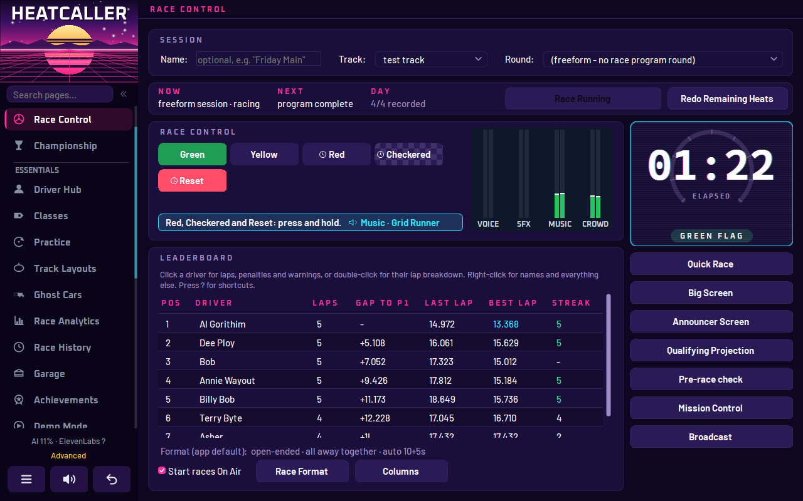

# HeatCaller

HeatCaller runs RC race nights from one Windows laptop. It times the laps from your decoder, runs the race from staging to the checkered flag, calls the action out loud like a trackside announcer, keeps every result, and builds your championship as the season goes. Racers can follow along on their phones — on the club Wi-Fi, or anywhere through your club's own online pages — and check themselves in with a QR check-in or a personal PIN.

!!! note "Beta"
    HeatCaller is in beta (version 0.60.0). Expect rough edges, and keep backups turned on.

## Where to start

| If you are... | Start here |
|---|---|
| New to HeatCaller | [What HeatCaller does](getting-started/index.md), then [Installing](getting-started/install.md) |
| Running your first race night | [Your first race night](getting-started/first-race-night.md) — a guided path from an empty install to your first heat |
| The race director on the night | [Running a race](race-control/running-a-race.md) and [Fixing mistakes and recovering](race-control/corrections-and-recovery.md) |
| Setting up the announcer | [Voice announcements](announcer/voice.md) |
| Putting results online | [Online pages](online/index.md) and [Setting up the Club Website page](online/setup.md) |
| The club's IT person | [Hosting the relay](admin/relay-hosting.md), [Security and privacy](admin/security-and-privacy.md) and [Backups](admin/backups.md) |

## What's in these docs

**Getting started** — what you need, installing, a tour of the window, Simple and Advanced mode, and a first-night walkthrough.

**Race day** — drivers, classes and venues; the track designer; race days, check-in and scrutineering at the desk; building the program, qualifying, mains and the timetable.

**Race control** — running a race, fixing mistakes, practice, ghost cars and handicaps, and results and championships.

**Announcer** — the voice (the HeatCaller voice, your own ElevenLabs account, or the free Kokoro voice), AI commentary (written by your club's relay or by a model built into HeatCaller), and sound effects, ambience and music.

**Timing** — connecting an EasyLap or I-Lap decoder, or one of the decoders in Beta (MyLaps P3, ZRound/RiCino, Cano/RCHourglass, OpenStint, EasyLap serial), and how transponders are handled.

**Screens** — the big screen for the pits, phones on the club Wi-Fi, and the looks and club logo.

**Online** — your club's public pages, set up on the **Club Website** page; online check-in with QR check-ins and personal PINs; driver sign-up; and emailing PINs to racers.

**Administration** — hosting the relay on Fly.io, security and privacy, backups, where data lives, and troubleshooting.

**Reference** — keyboard shortcuts, a glossary of racing and HeatCaller terms, and frequently asked questions.
