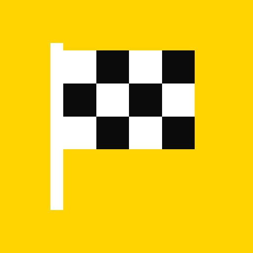

# The online relay

The online relay gives your club one web address that anyone can open, on any network, to see what's on track, today's schedule, results, standings, badges and track records. It also lets drivers check themselves in from their own phones. Use it when you want people off the venue's Wi-Fi (in the car park, at home, on mobile data) to follow the racing, or when you want results to stay up after the laptop is closed.

The relay is a small server your club (or whoever looks after your IT) hosts on the internet, usually on Fly.io. You turn publishing on from the **Club Website** page in HeatCaller. To set up the relay itself, see [Hosting the relay on Fly.io](../admin/relay-hosting.md). To connect the laptop to it, see [Setting up the Club Website page](setup.md).

## How it works

- **The laptop stays in charge.** HeatCaller on the timing laptop is the source of truth. It sends copies of what it already shows (the live race, results, standings and so on) to the relay. Nothing on the internet ever connects in to the laptop, so there's no port forwarding or firewall rule to set up at the venue.
- **The relay only publishes.** It keeps the latest copy of each thing the laptop sent and hands it to anyone who opens the club's pages.
- **The relay can never control a race.** There's no way to throw a flag or start or stop a race over the relay - that stays on the venue's own network, on the laptop or the phone remote (see [Local Screens](../screens/phone-and-web.md)). A club that turns on the race-day manager can let entries, the programme and saved results be changed through the relay too, from off the venue's Wi-Fi, guarded by its own PIN; see [Race-day manager](setup.md#race-day-manager).
- **Nothing on race day waits for the network.** If the venue's internet drops, racing carries on exactly as normal. Live frames that couldn't be sent are simply replaced by newer ones, and finished results wait in a queue and go up when the connection comes back.
- **One token per club.** The relay admin gives your club a club id and a publish token. The token only works for your club, so it can't publish to, or delete, anyone else's pages.
- **The relay can also speak.** If the person who runs it has set it up for your club, the same address and token give the announcer the [HeatCaller voice](../announcer/voice.md#the-heatcaller-voice) — a natural announcer voice with no ElevenLabs account, key or bill of your own. There's nothing extra to enter and nothing extra to publish. See [The relay also speaks](setup.md#the-relay-also-speaks).

## Your club's pages

Your club's address is the relay address followed by `/c/` and your club id, for example `https://your-relay.fly.dev/c/your-club`. That address is the one to hand out. It's the home page, and every page has the same row of tabs, so nobody hits a dead end. The club name in the heading of every page is the name the relay admin gave your club.

| Page | Address | What it shows | Refreshes |
|---|---|---|---|
| Home | `/c/<club>` | What's on track now (or on now, or up next), the next few sessions, the three latest results, and tiles for every other page. | Every 15 seconds |
| Live | `/c/<club>/live` | The race as it runs: state, countdown, flag, what's next, and the leaderboard. | Every 2 seconds |
| Schedule | `/c/<club>/schedule` | Today's running order, each line marked Done, On track or Next. A class picker appears when there's more than one class. | Every 15 seconds |
| Check in | `/c/<club>/checkin` | Online check-in. The tab only appears while online check-in is switched on. See [Online check-in](check-in.md). | Every 10 seconds |
| Results | `/c/<club>/results` | Finished sessions, newest first, grouped by day. Tap a session to see every finisher's laps, best lap and time, with their best sectors under the best lap when the session had a split loop. | Every 30 seconds |
| Standings | `/c/<club>/standings` | Championship points for each season, with a season picker when there's more than one. | Every 30 seconds |
| Badges | `/c/<club>/badges` | "Just earned", "Most collected" and "Every badge". | Every minute |
| Tracks | `/c/<club>/tracks` | Every track layout with its picture, lap record, sector records, length, typical lap and the ten best laps on it. Today's layout comes first, marked "Racing here today". | Every 5 minutes |

Pages only refresh while someone is looking at them. A phone left in a pocket with the page open stops asking, and catches up as soon as it's looked at again. Each page shows "Updated" with the time of its last refresh at the bottom.

### What each page is built from

- **Live** shows the same leaderboard columns as the Wi-Fi live page, which you choose with **Choose Web Columns** on the **Local Screens** page, with any transponder column taken out. On a phone, the board scrolls sideways if you picked more columns than fit.
- **Home** only says "On track now" while the live frame is fresh. If the laptop was closed in the middle of a heat, the home page stops claiming a race is running after about two minutes.
- **Schedule** comes from the day's timetable (the **Timetable** window, opened from the program on **Race Day → Next Steps**; see [The Timetable](../race-day/program-and-mains.md#the-timetable)). Heat line-ups (who is in each heat) and the "Find your name" box only appear if you publish the roster. See [What's published](#whats-published-and-what-never-is) below.
- **Standings** go up after each session is saved, and again whenever the Online settings change.
- **Tracks** follow the same rules as the **Personal Bests** page: rental transponders, drivers marked to be left out of records, ghost cars and demo sessions don't count, and a personal best reset hides laps from before it.

### Following a driver

Tap any driver's name on any page to follow them. Their name is highlighted on every page (live board, schedule, results, standings, badges and tracks), and a "Following" chip appears at the bottom of the screen. Tap the name again, or the **×** on the chip, to stop.

Who you follow is remembered on that phone only. It's never sent to the relay or the laptop.

### Add to Home Screen

The pages can be added to a phone's home screen like an app. In the phone's browser, use **Add to Home Screen** (Safari: the Share button; Chrome: the menu). The pages then open full screen on the club's home page, with the club's name under the icon.

The icon is your club logo if you've set one on the **Themes** page. Otherwise it's a checkered flag drawn in your look's colors.

### Looks and sharing links

The pages use the crowd-screen look and the club logo you choose on the **Themes** page (see [Looks and the club logo](../screens/looks-and-logo.md)), and the welcome line from the **Look** card on the Club Website page (see [Look](setup.md#look)). The same look is used on the Big Screen and the Wi-Fi pages, and it can be one of the built-in looks or one you made. The colors are applied before the page is drawn, so there's no flash of the wrong colors.

The logo sits in a block of its own beside the club's name, at the top of every page. If it would vanish on the page background, such as a black logo on a dark look, it's put on a plate.

When someone shares a page link in a chat app, the preview shows the club name, the page name and the page's description.

## What's published, and what never is

Once publishing is on, HeatCaller sends:

- the live race, while one is being staged, counted down or run
- each session's results as it's saved
- championship standings for every season
- today's schedule
- the badges drivers have earned, and the badge list with its artwork
- every track layout with its picture, lap record and best laps
- the site look (the look's colors, welcome line, logo)
- the online check-in list, if online check-in is on (never shown whole; see below)

These are **never** published:

| Never published | Why |
|---|---|
| Transponder numbers | A number that follows someone from meeting to meeting next to their name is a tracking key. Drivers are shown by name only. |
| Email addresses | They're used on the laptop to send racers their PINs, and never leave it except inside those emails. |
| PINs | The staff PIN and racers' personal PINs are only ever sent in scrambled (hashed) form, for the relay to check a typed PIN against. |
| Ghost cars | They're pace references, not entrants. |

A car nobody has named yet raced under its transponder number. Online, that name is replaced with "Unnamed driver" in results, standings and check-in, and left out of badges, tracks and line-ups.

The rest is your choice, on the Club Website page:

- **Short names.** "Shorten published names to a first name and an initial" is **on** by default, so "Dana Sloane" appears as "Dana S" everywhere online. If two drivers would end up looking the same, they get more letters until they differ.
- **The roster and heat line-ups** (who is entered, and who is in which heat) are **off** by default, with one checkbox for both. With it on, the Schedule page shows who is in each heat and gets a "Find your name" box. With it off, the schedule shows the heats but not who is in them. The roster itself (the list of who is entered and checked in) has no page of its own, and the relay only hands it out if the relay admin has also allowed it for your club, so both ends have to agree before that list is public.
- **Photos** only go into the online check-in list if you tick "Include photos (drivers can be children - off unless you're sure)". They're small thumbnails, and only someone holding the staff PIN, that driver's QR check-in or that driver's personal PIN can see them.

The online check-in list is private on the relay. It's never served whole to the public: the relay hands out one driver to a QR check-in link or a personal PIN, and the full list only to someone with the staff PIN. When you switch online check-in off, an empty list is published, which takes the names back off the relay.

## How often things are sent

The laptop only sends a document when it has changed, and re-sends everything periodically in case the relay lost something.

| What | When it's sent |
|---|---|
| Live race | Once a second while a race is staging, counting down or running, plus one final frame when it stops. Nothing while idle. |
| Results | As each session is saved. If the relay can't be reached, results queue on the laptop and go in order when it can. |
| Standings | After each session is saved. |
| Schedule, site look, check-in list | Checked every 2 seconds; sent when changed. |
| Badges earned, tracks | Checked every 30 seconds; sent when changed. |
| Badge list (with artwork) | Once at start-up, then hourly. |
| Roster (only if you publish it) | Checked every 2 seconds; sent when changed. |

Every 10 minutes, the schedule, site look, check-in list, badges earned, tracks and roster are sent again whether they changed or not, so a relay that restarted or lost a document catches up.

When the app starts, or when you change the address, club, token or short-name setting, HeatCaller re-sends standings and every session from the last 36 hours. That covers a meeting that ran past midnight, or a laptop reopened the next morning.

## How long results stay online

The relay keeps the newest **300** results per club. When the 301st arrives, the oldest is dropped. That's roughly ten race nights, depending on how many sessions you run. The laptop keeps every result it has ever recorded; the relay is a window, not the record.

Each club can hold 50 MB on the relay in total. If results would take the club past that, the oldest results are dropped to make room.

The race-day manager's traffic over the relay doesn't count toward those 50 MB. It has an allowance of its own: about 1 MB of requests waiting for the laptop, and 4 MB of answers waiting for phones to collect them. So however busy the manager is, it can't make results fail to publish or push old results off. When too many requests are waiting for the laptop, the manager's page says "The race-day manager is busy - the laptop has not caught up with recent requests yet. Try again shortly."

## Children and privacy

Many clubs race juniors, so the defaults are cautious, and it's worth deciding each of these on purpose:

- **Leave short names on** unless you're sure every family is happy with full names on a public page.
- **Leave the roster off** unless you need heat line-ups online. With it on, anyone with the address can see which children are entered and in which heat.
- **Leave photos off** unless you're sure. Photos are only visible behind a PIN or QR check-in, but anyone with the staff PIN sees every driver's face next to their name.
- **Club ids aren't secret.** They go on posters. Treat the club address as public, and assume anything published can be seen by anyone.
- **Staff PIN.** Share it with the people running the desk, not with the paddock. Racers get their own PINs, which only check in themselves.
- **You can take it all down.** **Delete Everything Published** on the Club Website page removes everything your club has on the relay and turns publishing off so it stays down (see [Deleting everything published](setup.md#deleting-everything-published)).

For the full security model, see [Security and privacy](../admin/security-and-privacy.md).
