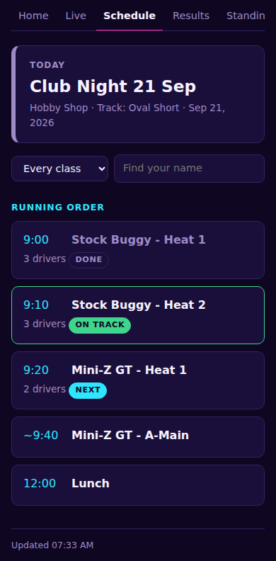

# The online relay

The online relay gives your club one web address that anyone can open, on any network, to see what's on track, today's schedule, results, standings, badges and track records. It also lets drivers check themselves in from their own phones, follow their own night, and send changes to the desk (see [Driver requests](driver-requests.md)). Use it when you want people off the venue's Wi-Fi (in the car park, at home, on mobile data) to follow the racing, or when you want results to stay up after the laptop is closed.

The relay is a small server your club (or whoever looks after your IT) hosts on the internet, usually on Fly.io. You turn publishing on from the **Club Website** page in HeatCaller. To set up the relay itself, see [Hosting the relay on Fly.io](../admin/relay-hosting.md). To connect the laptop to it, see [Setting up the Club Website page](setup.md).

## How it works

- **The laptop stays in charge.** HeatCaller on the timing laptop is the source of truth. It sends copies of what it already shows (the live race, results, standings and so on) to the relay. Nothing on the internet ever connects in to the laptop, so there's no port forwarding or firewall rule to set up at the venue.
- **The relay only publishes.** It keeps the latest copy of each thing the laptop sent and hands it to anyone who opens the club's pages.
- **The relay can never control a race.** There's no way to throw a flag or start or stop a race over the relay - that stays on the venue's own network, on the laptop or the phone remote (see [Local Screens](../screens/phone-and-web.md)). A club that turns on the race-day manager can let entries, the program and saved results be changed through the relay too, from off the venue's Wi-Fi, guarded by its own PIN; see [Race-day manager](setup.md#race-day-manager).
- **Nothing on race day waits for the network.** If the venue's internet drops, racing carries on exactly as normal. Live frames that couldn't be sent are simply replaced by newer ones, and finished results wait in a queue and go up when the connection comes back.
- **One token per club.** The relay admin gives your club a club id and a publish token. The token only works for your club, so it can't publish to, or delete, anyone else's pages.
- **The relay can also speak.** If the person who runs it has set it up for your club, the same address and token give the announcer the [HeatCaller voice](../announcer/voice.md#the-heatcaller-voice) — a natural announcer voice with no ElevenLabs account, key or bill of your own. There's nothing extra to enter and nothing extra to publish. See [The relay also speaks](setup.md#the-relay-also-speaks).

## Your club's pages

Your club's address is the relay address followed by `/c/` and your club id, for example `https://your-relay.fly.dev/c/your-club`. That address is the one to hand out. It's the home page, and every page has the same tabs, so nobody hits a dead end. See [Getting around](#getting-around). The club name in the heading of every page is the name the relay admin gave your club.

| Page | Address | What it shows | Refreshes |
|---|---|---|---|
| Home | `/c/<club>` | Changes with the night. While racing, what's on track now (or up next). Before a night, the club's preview. Between nights, "No racing right now" with when the club races, then a recap of the last race night: each final's winner, the fastest lap, the points leader and that night's new achievements, linking to that night's results. A phone that remembers its driver gets a **You** strip (best finish that night, standings place, newest achievement, **Open your night**); any other phone gets the club's **New here?** card. The club's tracks sit at the bottom, today's first. While online check-in is open, a **Check in: tap Me and type your PIN** line points drivers to **Me**. | Every 15 seconds (recap and tracks every 5 minutes) |
| Live | `/c/<club>/live` | The race as it runs: state, countdown, flag, what's next, and the leaderboard, at the top of the page. Under it, when the club has listening switched on, **Listen to the announcer** plays the announcer's voice; then a **Captions** button shows the announcer's words as text (see [Captions](#captions)), and **Lap times in my ear** reads out the laps of the driver you follow (see [Lap times in my ear](#lap-times-in-my-ear)). | Every 2 seconds (every second while lap times are being read out) |
| Schedule | `/c/<club>/schedule` | Today's running order, each line marked Done, On track or Next. A class picker appears when there's more than one class. | Every 15 seconds |
| Check in | `/c/<club>/checkin` | Online check-in, under the **Me** tab. Opened by the QR code on a driver's badge, and by the desk for its staff list. A driver with a personal PIN checks in by typing it on **Me**. See [Online check-in](check-in.md). | Every 10 seconds |
| Results | `/c/<club>/results` | Finished sessions, newest first, grouped by day. Tap a session to see every finisher's grid slot, laps and time, how far behind the car in front they were, and best lap, with their best sectors under the best lap when the session had a split loop, plus **View laps** for each driver and a lap-by-lap position graph (see [Lap by lap on the results](#lap-by-lap-on-the-results)). A small chip beside a time shows time added or warnings (see [Penalties on the results](#penalties-on-the-results)). | Every 30 seconds |
| Me | `/c/<club>/mynight` | The driver's own corner. A phone that remembers its driver goes straight to their night. Otherwise it's a box for their personal PIN: while online check-in is open, the right PIN checks them in and opens their night. See [Opening your night with your PIN](#opening-your-night-with-your-pin). | When opened |
| Standings | `/c/<club>/standings` | A tab under **Results**. Championship points for each season, with a season picker when there's more than one. | Every 30 seconds |
| Achievements | `/c/<club>/badges` | A tab under **Results**. "Just earned", "Most collected" and "Every badge". While you're [following a driver](#following-a-driver), a "Next for *name*" list at the top shows up to two badges they're close to, such as "2 more podiums for Podium Regular". | Every minute |
| Tracks | `/c/<club>/tracks` | Reached from **Our tracks** on Home (**Home** stays lit). Every track layout with its picture, lap record, sector records, length, typical lap and the ten best laps on it. Today's layout comes first, marked "Racing here today". | Every 5 minutes |

A few more pages are never in the tabs, because each is for one person:

| Page | Address | What it's for |
|---|---|---|
| A driver's night | `/c/<club>/night` | One driver's own evening, opened only with the code from their badge, their night email or their personal PIN. See [A driver's own night](#a-drivers-own-night). |
| Sign-up | `/c/<club>/signup` | A new driver, invited by the desk, signing themselves up. See [Driver sign-up](sign-up.md). |
| Manager | `/c/<club>/manage` | The race-day manager, behind the Manager PIN, when the club has let it be reached through the relay. See [Race-day manager](setup.md#race-day-manager). |
| One result | `/c/<club>/results/<session>` | The **Results** page opened on one session: the address **Share** hands out (see [Sharing a result](#sharing-a-result)). |

The club's links from the **Look** card (website, Facebook, Instagram and so on) are under "Find us" on Home and at the foot of every other page (see [Look](setup.md#look)).

### Getting around

Since 29 October 2026:

- **On a phone**, a bar along the bottom of every page has **Home**, **Live**, **Schedule**, **Results** and **Me**. It stays in place as the page scrolls.
- **On a laptop or tablet**, the same five tabs sit in one row at the top.
- **Results** has a row of its own tabs at the top, drawn as buttons: **Sessions** (the results themselves), **Standings** and **Achievements**. **Results** stays lit on all three. Since 30 October these replace the **Explore** tiles that used to sit at the bottom of Home. **Tracks** moved to Home on 30 October.
- **New here?** A club fills in **Where we race**, **When we race** and **How to join** in the **Look** card on HeatCaller's **Club Website** page (see [Look](setup.md#look)). Home shows them as a card to any phone that doesn't remember a driver, with **See our tracks**. Leave all three empty for no card. **When we race** also shows under "No racing right now".
- **Live** shows a small red dot while a car is on track, so you can see a race has started from any page.
- **Me** is a driver's own corner: the PIN box that opens their night, their night page itself, check-in and sign-up all light up **Me**. While online check-in is open, a driver's right PIN on **Me** checks them in and opens their night (since 30 October; there's no separate link to the check-in page).
- **Me remembers you.** Once a driver's night has opened on their phone (from their badge, their night email or their PIN), the phone remembers them, and **Me** goes straight to their night from then on, whether or not online check-in is open. **Sign out on this phone**, at the bottom of their night, forgets them and signs out **Your details** too. Only the code that opens their night is kept on the phone, never their PIN.
- **Your next race on Home.** On a phone that remembers its driver, Home opens with **Your next race**: how far off it is ("2 races before yours", "You're up next", "On track now") and the race's name, with **Open your night**. It checks once a minute, and only shows while the timing laptop has one of their races in the next few.
- **Watch live** and **See the running order.** On a driver's night, the **Right now** card has **Watch live** while their race is on track and **See the running order** (the Schedule page) while it's next. Home's **Your next race** has the same links.
- **Go to Me** sits under **You are in!** once the desk has accepted a sign-up, so new drivers learn where their own races open.
- **Following** a driver: the "Following *name*" chip sits just above the phone bar.
- **On a phone the pages refresh themselves**, so pulling down doesn't reload a page, and the browser's toolbars stay put instead of tucking away (since 31 October). A page you've opened before shows what your phone last saw there straight away, then updates (since 1 November). **Live** never reads out a lap from that saved copy.
- **From a home-screen icon** the bar along the bottom stays on screen while the pages change above it (since 1 November).
- **A wrong address** under your club (an old podium-video QR code, a link cut short) shows "That page isn't here" with your club's tabs and tiles for Home, Live and Results. An address with no club at it says "No club here", and the relay's own address says what it is, with a link to heatcaller.com.
- The manager page has a **Club page** link at the top.

Pages only refresh while someone is looking at them. A phone left in a pocket with the page open stops asking, and catches up as soon as it's looked at again. Each page shows "Updated" with the time of its last refresh at the bottom.

### What each page is built from

- **Live** shows the same leaderboard columns as the Wi-Fi live page, which you choose with **Choose Web Columns** on the **Local Screens** page, with any transponder column taken out. On a phone, the board scrolls sideways if you picked more columns than fit.
- **Home** only says "On track now" while the live frame is fresh. If the laptop was closed in the middle of a heat, the home page stops claiming a race is running after about two minutes.
- **Schedule** comes from the day's timetable (the **Timetable** window, opened from the program on **Race Day → Next Steps**; see [The Timetable](../race-day/program-and-mains.md#the-timetable)). Heat line-ups (who is in each heat) and the "Find your name" box only appear if you publish the roster. See [What's published](#whats-published-and-what-never-is) below.
- **Standings** go up after each session is saved, and again whenever the Online settings change.
- **Tracks** follow the same rules as the **Personal Bests** page: rental transponders, drivers marked to be left out of records, ghost cars and demo sessions don't count, and a personal best reset hides laps from before it.

### Captions

The **Live** page has a **Captions** button, under "The announcer's words as text. No sound needed." It's for someone who can't hear the PA, or is somewhere they can't play sound. Nothing is fetched until it's pressed.

- Tap **Captions** and the announcer's last few lines appear as text, newest at the bottom, up to six at a time. New lines are added every couple of seconds as the announcer speaks. A long line, such as the race recap, arrives a sentence or two at a time as the announcer reaches each part. Tap it again to close them.
- If the page can't reach the relay for a moment (a phone changing networks, say), it tries again by itself within about ten seconds; there's no need to reload.
- It works on its own, with or without the **Listen to the announcer** button. Listening plays the announcer's voice; captions need no sound at all.
- A screen reader reads each new line once, as it arrives.
- The button is on every club's live page, because the page can't tell whether captions are switched on. When there's nothing to show, it says "No captions just now. They show here as the announcer speaks, when the club has them switched on."

Captions are switched on with **Captions on the club's live page** on the Club Website page, and are off until you tick it (see [What gets published](setup.md#what-gets-published)). A line that mentions a driver who asked to be shown by initials only, by any of their names, is left out of the captions, as it is for people listening along from home. Race control's warning and black-flag calls are left out of both too, because they say the reason; the room still hears and sees them.

The Big Screen and the Wi-Fi pages have captions of their own, in the room; see [Captions on the Big Screen](../screens/big-screen.md#captions) and [Captions on the overlay and broadcast pages](../screens/phone-and-web.md#captions).

### Lap times in my ear

The **Live** page can read out the laps of the driver you follow, in your phone's own voice, the way the coach page and the live results do on the club's Wi-Fi. It works on any connection, at the track or away from it.

- Tap a driver's name on the board to follow them (see [Following a driver](#following-a-driver)). A **Lap times in my ear: off** button appears under the captions.
- Tap it and it changes to "on". The phone says "Lap times on", then after each new lap of that driver: "Lap 7, 9.42, best lap, P2, 0.4 seconds behind". The gap is to the car ahead. HeatCaller from 29 October 2026 sends it with every row of the board. With an older version it's read from the board's **Interval** column (or **Gap to P1** for the car in second), so it's only said when the club shows one of them.
- Tick **Time only** for just the time, and "best lap" on a new best: "9.42, best lap".
- A lap is said a second or two after the car crosses the line. While it's on, the page reads the board every second.
- It stays quiet for laps already run when you turn it on or follow someone new, and starts again from the next one. A new race starts the count again.
- Put earbuds in and you can hear your own laps from the driver's stand.

Keep the page open with the screen on: a phone stops a page talking when its screen locks or the browser goes to the background. While it's on, the page asks the phone to keep the screen on. If your phone won't, the page says so: set Auto-Lock to Never (iPhone: Settings, Display & Brightness) or the screen timeout to its longest (Android: Settings, Display) while you race.

If the page reloads, the button reads "Lap times in my ear: tap to resume" until you tap anywhere on the page, since phones only let a page speak after a tap. The phone remembers both settings. A driver whose name is on the board twice, or an **Unnamed driver**, is never read out, since it could be anyone's lap.

It reads only what the live board already has: the laps, and the gap to the car ahead, which anyone could work out from the board.

#### The HeatCaller lap voice

When the relay has the lap voice's clips, the laps are read out in one ElevenLabs voice, **Daniel** (a steady broadcaster), the same for every club whatever announcer a club picked in its Cast tab. The phone joins short recorded clips together: "Lap seven, nine forty-two, best lap, P two, four tenths back". Gaps are said the way the announcer calls a gap during a lap call: "half a second back", "a second and a half back", "a lap back". The time is said in full, the way the announcer says it and the screen shows it, with nothing rounded: 6.935 is "six nine thirty-five". The clips cover lap times from 3.000 to 19.999 seconds, laps 1 to 200, places 1 to 30, gaps up to 30 seconds or 9 laps, and up to 2 seconds under or off a target lap.

- If a lap needs a clip there isn't one for (a 2.40 lap, P31), or a clip doesn't arrive within a second, the phone's own voice says the whole line instead. You never hear half of each.
- Tick **Phone voice** to always use the phone's own voice. It only shows when the relay has the clips.
- The clips are recorded once, so a race night costs nothing, however many drivers listen. Nothing about any driver is sent to ElevenLabs.
- A relay without the clips reads every lap in the phone's own voice, as before.

The relay owner makes the clips once with `lap-voice-render.cmd` in the relay folder, on their own ElevenLabs key (about 37,000 characters, roughly $1.50 on ElevenLabs' Flash pricing, on a paid plan), then redeploys the relay. See the relay's README.

On a driver's own night, the same voice reads out their own laps with no one to pick, and their target lap too. See [Right now](#right-now).

### Lap by lap on the results

Each race on the **Results** page is laid out the way LiveRC lays out a heat:

- **Length**: "3:00 Timed" for a timed race, or "20 Laps" for a race to a lap count.
- **Pos**, the driver and their car, and **Qual**: where they started on the grid. **Qual** is empty when the grid wasn't known.
- **Laps/Time**: laps and the time they took, for example "20/3:10.513", or DNF, DNS or DQ.
- **Behind**: how far behind the car in front they finished, as a time ("0.342") or in laps ("2 Laps").
- **Best**: their best lap, with their best sectors under it on a split loop.
- **View laps**, under each driver: their lap stats (as on their own night, see [Race cards](#race-cards)) and every lap with its **Pace**, and in a race their **Pos** after that lap. Their best lap is highlighted. Pace is the laps and time they'd have done at their average so far, for example "18/3:02.034", and is only shown for a timed race.
- **Lap-by-lap position graph**, under the table: a colored line for each driver showing where they were running after every lap, starting from their grid slot, with a key of names under it. Practice and qualifying have no graph.

Results published by an older version of HeatCaller have no laps, so they show without **View laps**, **Qual** or the graph.

### Sharing a result

Each session on the **Results** page, and each day's heading, has a **Share** button. On a phone it opens the phone's own share sheet, with a line saying what the race was, at which club and when, but not who won, so a group chat isn't spoiled for anyone who hasn't looked. Where there's no share sheet, the link is copied ("Link copied."), or shown in a **Copy this link** box to copy by hand.

A shared session's link opens the **Results** page on that session. In a chat app, its preview is a picture of the podium in the club's colors. A session that's no longer on the relay still opens the page, which says "That result is not on the relay any more."

### Penalties on the results

On the **Results** page, a driver who had time added or a warning in a session has a small chip beside their time, for example "+5s", "1 warning" or "+10s · 2 warnings". Hold a finger or the mouse on it for "Time added or warnings from race control".

The chip has numbers only, never the reason. Race control's reasons ("Blocking", "jump start") are written about a named person, who may be a child, so they only appear on that driver's own night page (see [Race cards](#race-cards)) and on the Wi-Fi follow view in the room. Results published by an older version of HeatCaller have no chip.

### Podium videos

The top three's [highlight videos](../announcer/sounds-and-music.md#highlight-videos) aren't on the club's pages. From 21 to 28 October 2026 they were: a page per race from a QR code on the Big Screen, a **Videos** tab, and **Your podium videos** on a driver's night. Now every video stays on the race PC, in the night's **Highlights** folder, and **Share video** in a driver's drawer on Race Control opens theirs to send.

- An old QR code, link or bookmark to a podium video or the **Videos** tab opens the relay's "That page isn't here" page, with the club's tabs.
- Once the relay is redeployed (see [Updating the relay](../admin/relay-hosting.md#updating-the-relay)), it deletes the podium videos it was still holding the first time it starts.
- A driver's own race calls on their night page are separate and unchanged; see [A driver's own night](#race-cards).

### A driver's own night

Each driver has a page of their own on the relay, headed "Your night". It opens from a link that carries the code from their check-in badge: **See your racing from last time** on their own check-in card, or the link in their [night email](setup.md#drivers-nights-by-email). A driver who has a personal PIN can also open it from the club's **Me** tab (see [Opening your night with your PIN](#opening-your-night-with-your-pin)). Nobody without that code or that PIN can find or open it. It's switched on with **Give each driver their own night at a private address** on the Club Website page, which is off by default and needs online check-in set up (see [What gets published](setup.md#what-gets-published)).

!!! warning "The night link is private - don't share it"
    The link is the driver's own, like a door key. Anyone holding it can see when and where that driver races next, their marshal duty and their transponder, and send requests to the desk in their name. For a driver without a personal PIN it also checks them in or out; a driver with one is asked for it first (see [Checking in or out needs the driver's own PIN](check-in.md#checking-in-or-out-needs-the-drivers-own-pin)). Don't post it in a group chat, a social media post or a screenshot. To show someone how the night went, use **Make a picture to share** at the bottom of the page instead: the picture has no code in it. If a link has got out, **Reissue All QR Check-ins** on the Club Website page changes every driver's code (see [Reissue all QR check-ins](check-in.md#reissue-all-qr-check-ins)).

#### Opening your night with your PIN

Since 26 Oct 2026 the club's pages have had a way in with a PIN: the **Me** tab (called **My night** until 29 October), and, until 30 October, a **My night** tile on the home page while online check-in was switched on (now Home's **Check in: tap Me and type your PIN** line). The PIN only opens a night while online check-in is switched on. It's for a driver who doesn't have their badge or the club's email to hand.

1. The driver opens **Me**. The page says "Type the personal check-in PIN the club emailed you. It checks you in for tonight and opens your own night: your races, your report card and, once you are racing, your live card."
2. They type their six-digit personal PIN into **Your personal PIN** and tap **Check in**.
3. Since 30 October a right PIN checks them in, just as the check-in page would, and says "You are checked in. Opening your night...". A driver who's already checked in is left as they are. If the check-in doesn't go through (the desk's queue is full, say), their night still opens and its own **Check in** button can try again.
4. Their own night page opens - the same page their badge link opens. On a race night that's tonight: the live card, and their races as each one is filed (before their first race it says "Nothing is filed for you yet tonight."). Between race nights it's their most recent night. **Your details** on that page is already signed in for as long as the tab is open.

- There's no list of names to pick from: each racer's PIN is their own, so the PIN alone says who they are. A wrong PIN always gets the same answer ("That PIN is not right."), so the page never shows who is on the club's books.
- The PIN is checked exactly as on the check-in page, with the same [lockouts](check-in.md#lockouts): ten wrong from one connection, or fifty across the club, close PIN sign-in for a while. It's sent once, never put in the page's address, and never kept on the phone. The phone keeps only the code that opens their night (see [Getting around](#getting-around)), until they tap **Sign out on this phone**.
- The desk's staff PIN doesn't open anyone's night: "That is the club's desk PIN, not your own. Use the personal PIN the club sent you."
- It only works while online check-in is open, because that's where the racers' PINs are checked. Closed, it says "Signing in with your PIN only works while the club has online check-in open. Use the link on your check-in badge or in the club's email, or ask at the desk."
- A driver with no personal PIN is told "No personal PIN? Open your night with the link on your check-in badge or in the club's email - or ask at the timing desk."
- If the club doesn't give drivers their own nights, the night page says so in its usual words.

**Me** needs the relay redeployed (see [Updating the relay](../admin/relay-hosting.md#updating-the-relay)).

From top to bottom, the page shows:

1. **Right now**, a live card for the evening as it happens (see below).
2. **Your first night - what happens**, a short guide, on a driver's first night only.
3. The night itself: a bar of buttons that jumps to each part, the night at a glance, the night's facts, **Your races**, **Your report card**, **Driver score**, progress and their race calls (see [Finding your way round](#finding-your-way-round)).
4. **Make a picture to share** and **Save as a text file**, side by side.
5. **Your details**, with their battery pack (in **Right now** on race night) and, folded under it, the request to change how they're called and shown, when the club takes requests (see [Driver requests](driver-requests.md)).
6. **Sign out on this phone**, which makes the phone forget them (see [Getting around](#getting-around)).

Before their first race of the night, the night part says "Nothing is filed for you yet tonight. Your races show here after each one." The live card above it still works.

Everything on this page except the night's facts and the report card needs the relay redeployed after 22 Oct 2026 (see [Updating the relay](../admin/relay-hosting.md#updating-the-relay)). Until it is, the night page looks as it did before.

#### Right now

The **Right now** card is at the top of the page while HeatCaller is sending the driver's live details. That covers everyone in the grids of the next dozen races, their marshals, and anyone who has raced or checked in tonight. Ghost cars and rentals never get one. The card refreshes every 20 seconds while the page is on screen.

- **The call-up**, in large type: "You're up next", "2 races before yours", "Staged - go to the driver stand" or "On track now". Under it, the race and their grid slot, for example "Q2 Heat 1 (Stock Buggy) · grid slot 3". When none of their races is coming up soon: "None of your races is in the next few on the running order."
- **When it should start**, for example "about 7 min (19:42)", counting down between refreshes. It says "due now (19:42)" once the time has come, and "at about 21:10" for a race more than an hour and a half away. HeatCaller works it out from the time on the day's timetable plus how late the night is running, or, where the timetable has no time it can read, from how long tonight's races have been taking. With neither, no time is shown. The page goes by the relay's clock, so a phone whose clock is wrong still counts down to the right minute.
- **Turn on alerts**, with "Two beeps and a buzz when your race is next, and again when it is staged." Tap it and the phone beeps once to show it works, and says "Alerts on. Keep this page open on your screen." The button then reads **Alerts on - tap to turn off**. A phone only lets a page beep after a tap, and only while the page is open with the screen on. An iPhone can't buzz for a web page, so it only beeps.
- **Lap times in my ear**, with **Read out my laps**. Tap it and the phone says "Lap times on", then reads out each of the driver's own laps as they race, a second or two after the line: "Lap 7, 9.42, best lap, 0.2 under target, P2, 0.4 seconds behind". The target part is only said when race control has set them a target lap, as "under target", "off target" or "on target". Tick **Time only** for just the time, "best lap" and the target: "9.42, best lap, 0.2 under target". There's no one to pick: the page finds their own row on the live board, under any of their transponders, even if somebody else on the board has the same name. The button then reads **Reading out your laps - tap to stop**. While it's on and they're racing, the page reads the live board every second and asks the phone to keep the screen on. After a reload it reads **Tap to resume your lap times** until they tap anywhere. The rest works as it does on the Live page, in the HeatCaller lap voice when the relay has it, with the target as "point two under target" (see [Lap times in my ear](#lap-times-in-my-ear) and [The HeatCaller lap voice](#the-heatcaller-lap-voice)). It needs HeatCaller from 29 October 2026 on the race PC; with an older version the button isn't shown. A car on a club rental transponder isn't read out.
- **Your marshal duty**, when they marshal one of the coming races, on one line: the race, their post and how far off it is, for example "Your marshal duty: Q2 Heat 2 (Stock Buggy) - Turn 3 · 1 race before it." or "... · That race is next - head to your post." It's the same duty the announcer calls; see [Corner marshals](../race-day/program-and-mains.md#corner-marshals).
- **Check in**, while online check-in is open and they're on tonight's list: "One tap and the timing desk knows you are here." After the tap it reads **Checked in ✓**, with "Tap again if you need to check out." It works exactly like the button on their check-in card (see [Online check-in](check-in.md)). If check-in has closed, the phone says "Online check-in is closed just now - check in at the desk."
- **Your transponder**, with when the timing line last heard it and a **Check my transponder** button (see below).
- **Your battery pack**, when the club takes requests and the desk has packs on file for them: pick the pack in the car and tap **Tell the desk**. On race night it's here rather than in **Your details**, and a pack they've picked stays picked when the card refreshes.
- The race-day jobs, **Check in**, **Your transponder**, **Lap times in my ear** and **Your battery pack**, sit side by side on a wide screen and one under the other on a phone.
- **Your requests to the desk (2, 1 answered)**, once they've sent one: tap it to see how each is getting on (see [What the driver sees](driver-requests.md#what-the-driver-sees)). It stays open across the card's refreshes once tapped.

#### Finding your way round

The night is laid out so a driver at the track finds what they want in a tap or two:

- **The jump bar.** A row of buttons under the driver's name, **Right now**, **Races**, **Report card**, **Driver score**, **Progress**, **Race calls** and **Your details**, each going straight to that part. **Right now** goes back up to the live card, and is only there while the card is. Only the parts with something in them get a button. It stays at the top of the screen as they scroll. On a night of two cars it has a button for each car instead.
- **At a glance.** Four numbers above the night's facts: their **Best finish** and **Best lap**, each with the race it came in, and how many **Races** and **Laps** they did.
- **One race open at a time.** **Your races** is a list, one row per race: its name and time, where it left them ("3rd of 8"), its laps, and a red **Penalty** tag if it had one. Their latest race is open when the page opens. Tap another row to open it instead, or the open one to close it. What they opened stays open when new results come in.
- **Line the races up by a stat.** With more than one race, the buttons over the list (**Best lap**, **Avg. lap**, **Top 3 consec.**, **Consistency**) change the number at the end of every row, and the night's best of it is in green. Quicker is best for the lap times; higher is best for consistency.

#### Check my transponder

Under **Your transponder**, the card says when the timing line last heard the driver's transponder tonight, for example "Last seen at 19:40, signal good.", or "Not seen by the timing line tonight yet."

To check a transponder before a race:

1. Tap **Check my transponder**. The card says "Drive past the timing line now. This page is watching for it."
2. Drive the car over the timing line, in practice or between races.
3. Within about half a minute the card says, for example, "Seen at 19:42, signal good.", and the phone gives a short buzz.

| What it says after the time | What it means |
|---|---|
| "signal good" | Heard cleanly. |
| "signal weak - mount it higher and clear of carbon and wires" | Heard, but only just. Move the transponder before the race. |
| "signal not reported by this timing system" | Heard. The decoder doesn't report signal strength, so there's nothing to say about it. See [Signal strength](../timing/transponders.md#signal-strength). |

If it hasn't been heard after 3 minutes, the card says "Not seen in 3 minutes. Check it is switched on, charged and mounted where the timing line can see it, then try again - or ask at the timing desk."

Nothing needs doing at the desk for this. HeatCaller notes every pass over the line anyway, practice included, and the page just watches for one newer than the tap. Times are to the nearest ten seconds.

#### Your first night

On a driver's first night at the club (HeatCaller has no result for them before tonight, demo races aside), a folded section, **Your first night - what happens**, sits under the live card. Tapping it opens a short guide written for drivers:

| Heading | What it covers |
|---|---|
| This page | What the start time means, and turning on alerts. |
| Heats and mains | Heats first; how they do decides which main (final) they race in. |
| Your grid slot | Where the car starts. Slot 1 is the front. |
| Staged | Go to the driver stand with the radio, put the car on the track and wait for the start. |
| The start | The countdown, and why going early is a jump start that can add time. |
| Your transponder | Switched on and mounted before every race, and drive past the timing line once to check it. |
| Warnings | Race control can warn for blocking or rough driving, and more warnings add time. |
| Marshal after your race | Stand at your post and put back any car that flips or gets stuck. Everybody takes a turn. |
| Questions | "Ask at the timing desk. Everybody was new once." |

Under the guide, "Timing and race calls by HeatCaller." with **What's that?**, which opens the same short card about HeatCaller as the footer's mark.

The same guide is on their check-in card when they open it from their QR check-in (see [What the racer sees](check-in.md#what-the-racer-sees)).

#### Two cars on one night

A driver who races a second transponder as a car of its own gets one night page, not two. HeatCaller times a driver's other transponder as a separate row in the results when another of their cars is already on track in that race; otherwise its laps go in their main row. See [Alternate transponder](../timing/transponders.md#alternate-transponder).

When that happens, the night page splits into a section for each car, headed with the car and its name from the results, for example **Main car · B6.4** and **Second car · RC10 B7**. Each section has that car's own glance, facts, races, report card, improvement tonight, driver score and progress, and the jump bar has a button for each car. Nothing is added up across the two cars: a place, a best lap or an improvement only means something for one car. Badges within reach and the first-night guide are the driver's, so they appear once.

- **A race where the second transponder was merged** into the main row counts as the main car's, as it does on the result sheet.
- **Both cars in the same race** shows that race once in each car's section. **Something wrong?** under either one names the car in the message to the desk.
- **Only the second car raced** still gets a heading saying which car it was.
- **The night email** groups the races and report cards the same way, and goes to the driver once.

The car's name is the one saved with the result when the race was filed, so changing the garage later doesn't rewrite a past night. A driver whose results don't say which car gets "Main car" and "Second car" alone.

The sections need the relay redeployed after 22 Oct 2026 (see [Updating the relay](../admin/relay-hosting.md#updating-the-relay)). Until it is, the page shows the first car's facts and every race card in one list.

#### Race cards

**Your races** (or **Your race**) lists each race they ran tonight, in order. The open race shows:

- How it went, for example "2nd of 8 · started 4th · 12 laps · best 9.214", or "Disqualified" or "Did not finish". Ghost cars aren't counted in "of 8".
- Three tabs, as LiveRC's driver window has them:
    - **Lap stats**, first: **Fast lap**, **Avg. lap**, **Top 3 consec.** and **Consistency**, then **More stats** for **Avg. top 5**, **Avg. top 10** and **Avg. top 15** (the average of their quickest 5, 10 or 15 laps), **Top 2 consec.** (their quickest 2 laps in a row, added up) and **Std. deviation** (how far their laps strayed from their average). **Consistency** is 100% when every lap is the same. A figure needs enough laps: **Avg. top 10** needs 10.
    - **Lap times (12)**: every lap with its time, **Pace** in a timed race, and **Pos**, where they were running after that lap, in a race. Their best lap is highlighted. On a narrow phone the table scrolls sideways in its own box.
    - **Lap chart**: one line, a point for each lap, left to right, with quicker laps higher and the best lap marked. Under it: "Each lap, left to right - higher is quicker. Best 9.214 on lap 7." A lap far slower than the rest, such as a crash or a flipped car, is drawn along the bottom edge so the rest of the line isn't squashed flat. A race with fewer than two laps has no chart.
- A race filed before lap data was sent has no tabs, only how it went.
- **Penalties**, in red, one line each, with race control's reason: "Warning 1 - Blocking", "+5 s - Blocking (warning 2)", "+5 s - jump start", "Jump start (no time added)", or a change made after the race with the reason given for it. A penalty with no reason typed reads "no reason given". These lines are only ever on the driver's own night; the public results show numbers only (see [Penalties on the results](#penalties-on-the-results)).
- **The call of this race**, when the club shares drivers' clips: the announcer's call of that driver in that race, with a player and **Download the call (mp3)**.
- **Something wrong?**, when the club takes requests: a way to ask the desk to look at that result (see [Querying a result](driver-requests.md#querying-a-result)).

#### How the night went

After the races, as much of this as there's something to say about:

- **Your improvement tonight**, under the report card: their middle lap against their first race tonight, for example "Your middle lap is 0.40 s quicker than in your first race tonight (Q1 Heat 2)", or slower, or "the same pace as". It needs two races, and never compares them with anyone else.
- **Your progress on** *layout*: up to six bars, their best lap on each of their last nights on the layout of their latest race tonight, with tonight last and marked **Tonight**. A quicker night stands taller. Under it, when it applies, "Your best on Club Oval since 3 September 2026" or "Your best ever on Club Oval". Demo races and ghost cars don't count, and a personal best reset hides laps from before it.
- **Achievements in reach**: up to three badges they're close to, for example "2 more podiums for Podium Regular".
- **Your race calls**: any of the driver's clips that didn't go with a race.

The driver's clips go online only when **Put each driver's clip on their own night on the club's page** is ticked on **Club Website → Recording** (see [Highlight videos](../announcer/sounds-and-music.md#highlight-videos)). It's off by default. A clip is only ever on that driver's own night, never on a public page. Clips are kept for a week, and the relay keeps a driver's eight most recent.

#### The report card

Under the races, **Your report card**: a few lines of arithmetic about their laps tonight. See [The report card](../screens/phone-and-web.md#the-report-card) for what each line says. When the **Driver score** is shown just below it, the card leaves out its own driver rating line, which says the same.

- This page is the driver's own, so it's the one online place the card includes the **setup line**, what a setup change logged tonight did to their pace.
- The driver they're compared with in the last line is named the way your public pages name people, shortened to a first name and initial when **Shorten published names** is ticked.
- The card needs the relay updated. On a relay that hasn't been redeployed since 22 Oct 2026, the night page simply shows no card.

#### Driver score

Under the report card, **Driver score** is their driver rating for the night, out of 150: the same rating as the report card's line, Driver Hub and the leaderboard. Each race is rated from where they finished, a win, laps led, their best lap against the quickest in the race, the fastest lap, laps completed and places gained, less 5 for each warning.

- One race: its rating, for example "104.5 out of 150".
- More than one: the average, the best and which race it came in ("Average of 3 races. Best 118.5, in A-Main."), and a bar for each race.
- A race needs at least two cars to be rated. A night filed by an older HeatCaller has no **Driver score**; its report card still has the driver rating line.

#### Your details

When the club has ticked **Let drivers send changes from their phone**, a **Your details** card at the foot of the page has the driver's battery pack, and under it **Change how you are called and shown**, which opens the form to ask the desk to change how they're called and shown or to keep them more private online. Nothing changes until the desk approves it. See [Driver requests](driver-requests.md).

### Following a driver

Tap any driver's name on any page to follow them. Their name is highlighted on every page (live board, schedule, results, standings, badges and tracks), and a "Following" chip appears at the bottom of the screen. Tap the name again, or the **×** on the chip, to stop.

Who you follow is remembered on that phone only. It's never sent to the relay or the laptop.

### Add to Home Screen

The pages can be added to a phone's home screen like an app. In the phone's browser, use **Add to Home Screen** (Safari: the Share button; Chrome: the menu). The pages then open full screen on the club's home page, with the club's name under the icon.

The icon is HeatCaller's sun, a striped sunset over a pink grid, for every club, whether or not you've set a logo (since 30 October; it used to be your logo or a checkered flag). Your club logo still shows at the top of every page and in link previews.

### Looks and sharing links

The pages use the crowd-screen look and the club logo you choose on the **Themes** page (see [Looks and the club logo](../screens/looks-and-logo.md)), and the welcome line from the **Look** card on the Club Website page (see [Look](setup.md#look)). The same look is used on the Big Screen and the Wi-Fi pages, and it can be one of the built-in looks or one you made. The colors are applied before the page is drawn, so there's no flash of the wrong colors.

The logo sits in a block of its own beside the club's name, at the top of every page. If it would vanish on the page background, such as a black logo on a dark look, it's put on a plate.

When someone shares a page link in a chat app, the preview shows the club name, the page name and the page's description.

Every page says **on HeatCaller** under your club's name, with a small sun, and ends with a HeatCaller mark in the footer. Tap the mark for a short card about HeatCaller, with **Bring HeatCaller to your track** (to heatcaller.com) and **Close**. While a race is staging, counting down or running, the **Live** page shows a small **LIVE** badge with the sun in the top corner. Pictures made to share, from a result link or **Make a picture to share** ("Timed and called by HeatCaller"), carry the sun too. Your club's name, logo and colors stay in charge of the page; the HeatCaller mark is always on. The relay's own address, "No club here" and a paused club are drawn in HeatCaller's own look.

## What's published, and what never is

Once publishing is on, HeatCaller sends:

- the live race, while one is being staged, counted down or run
- each session's results as it's saved
- championship standings for every season
- today's schedule
- the badges drivers have earned, and the badge list with its artwork
- every track layout with its picture, lap record and best laps
- the site look (the look's colors, welcome line, logo)
- the online check-in list, if online check-in is on (never shown whole; see below)
- the announcer's words as captions, if you tick **Captions on the club's live page**
- each driver's own night, if you tick **Give each driver their own night at a private address** (only ever served to that driver's code; see [A driver's own night](#a-drivers-own-night))

These are **never** published:

| Never published | Why |
|---|---|
| Transponder numbers | A number that follows someone from meeting to meeting next to their name is a tracking key. Drivers are shown by name only. |
| Email addresses | They're used on the laptop to send racers their PINs and nights, and never leave it except inside those emails. When the club takes [driver requests](driver-requests.md), a driver's own night page shows a masked form of their address, such as "s•••@gmail.com", so they can see which one is on file. |
| Penalty reasons | What race control typed about a driver is shown only on that driver's own night. Public results carry the numbers: seconds added and how many warnings. |
| PINs | The staff PIN and racers' personal PINs are only ever sent in scrambled (hashed) form, for the relay to check a typed PIN against. |
| Ghost cars | They're pace references, not entrants. |

A car nobody has named yet raced under its transponder number. Online, that name is replaced with "Unnamed driver" in results, standings and check-in, and left out of badges, tracks and line-ups. A line the announcer says with that number as the car's name is left out of the captions and isn't sent to people listening along at home. The same number used as a count stays in, so a short transponder number such as `3` doesn't take "Heat 3 to the drivers stand", "5 minutes to Stock Q1 Heat 2" or "3 laps to go" off the captions.

The rest is your choice, on the Club Website page:

- **Short names.** "Shorten published names to a first name and an initial" is **on** by default, so "Dana Sloane" appears as "Dana S" everywhere online. If two drivers would end up looking the same, they get more letters until they differ.
- **The roster and heat line-ups** (who is entered, and who is in which heat) are **off** by default, with one checkbox for both. With it on, the Schedule page shows who is in each heat and gets a "Find your name" box. With it off, the schedule shows the heats but not who is in them. The roster itself (the list of who is entered and checked in) has no page of its own. The relay only shows the line-ups, or hands out the roster, if the relay admin has also allowed it for your club, so both ends have to agree before any of those names are public. Until they do, the Schedule page shows the heats without who is in them, even with the box ticked.
- **Photos** only go into the online check-in list if you tick "Include photos (drivers can be children - off unless you're sure)". They're small thumbnails, and only someone holding the staff PIN, that driver's QR check-in or that driver's personal PIN can see them.

The online check-in list is private on the relay. It's never served whole to the public: the relay hands out one driver to a QR check-in link or a personal PIN, and the full list only to someone with the staff PIN. When you switch online check-in off, an empty list is published, which takes the names back off the relay.

## How often things are sent

The laptop only sends a document when it has changed, and re-sends everything periodically in case the relay lost something.

| What | When it's sent |
|---|---|
| Live race | Once a second while a race is staging, counting down or running, plus one final frame when it stops. Nothing while idle. |
| Results | As each session is saved. If the relay can't be reached, results queue on the laptop and go in order when it can. |
| Standings | After each session is saved. |
| Schedule, site look, check-in list | Checked every 2 seconds; sent when changed. |
| Badges earned, tracks | Checked every 30 seconds; sent when changed. |
| Badge list (with artwork) | Once at start-up, then hourly. |
| Roster (only if you publish it) | Checked every 2 seconds; sent when changed. |
| Captions (only if you switch them on) | Within a second of each line the announcer says. |
| Drivers' live cards (only with drivers' own nights on) | At most every 10 seconds, and straight away when a race is staged, starts or ends. |

Every 10 minutes, the schedule, site look, check-in list, badges earned, tracks and roster are sent again whether they changed or not, so a relay that restarted or lost a document catches up.

When the app starts, or when you change the address, club, token or short-name setting, HeatCaller re-sends standings and every session from the last 36 hours. That covers a meeting that ran past midnight, or a laptop reopened the next morning.

## How long results stay online

The relay keeps every result you publish, so drivers can look back through past seasons on the **Results** page. There's no limit on how many, only on space (below). A session with every driver's laps is about 3 to 6 KB: a heat of 8 drivers over 20 laps is about 3 KB, a 12-car main of 35 laps about 6 KB. The laptop still keeps every result it has ever recorded, so it stays the record.

Each club can hold 50 MB on the relay in total. If results would take the club past that, the oldest results are dropped to make room. A club racing one night a week keeps about three years of results; a very busy club racing three nights a week, with 40 heats and 20 practices a night, keeps about a year.

The race-day manager's traffic over the relay doesn't count toward those 50 MB. It has an allowance of its own: about 1 MB of requests waiting for the laptop, and 4 MB of answers waiting for phones to collect them. So however busy the manager is, it can't make results fail to publish or push old results off. When too many requests are waiting for the laptop, the manager's page says "The race-day manager is busy - the laptop has not caught up with recent requests yet. Try again shortly."

## Children and privacy

Many clubs race juniors, so the defaults are cautious, and it's worth deciding each of these on purpose:

- **Leave short names on** unless you're sure every family is happy with full names on a public page.
- **Leave the roster off** unless you need heat line-ups online. With it on, anyone with the address can see which children are entered and in which heat.
- **Leave photos off** unless you're sure. Photos are only visible behind a PIN or QR check-in, but anyone with the staff PIN sees every driver's face next to their name.
- **One driver can ask for more.** Each driver profile has three **Online privacy** ticks: leave their photo out, no podium videos of them (always met now, since no podium video goes online), and initials only. They cover everything the relay shows, captions included, and nothing in the room. A driver or a parent can ask for them from the night page; only the desk can turn one off. See [Online privacy](../race-day/drivers-and-classes.md#online-privacy).
- **Night links are private.** A driver's night link opens their next race, their marshal post and their check-in. Tell drivers and families not to share it (see [A driver's own night](#a-drivers-own-night)).
- **Club ids aren't secret.** They go on posters. Treat the club address as public, and assume anything published can be seen by anyone.
- **Staff PIN.** Share it with the people running the desk, not with the paddock. Racers get their own PINs, which only check in themselves.
- **You can take it all down.** **Delete Everything Published** on the Club Website page removes everything your club has on the relay and turns publishing off so it stays down (see [Deleting everything published](setup.md#deleting-everything-published)).

For the full security model, see [Security and privacy](../admin/security-and-privacy.md).
