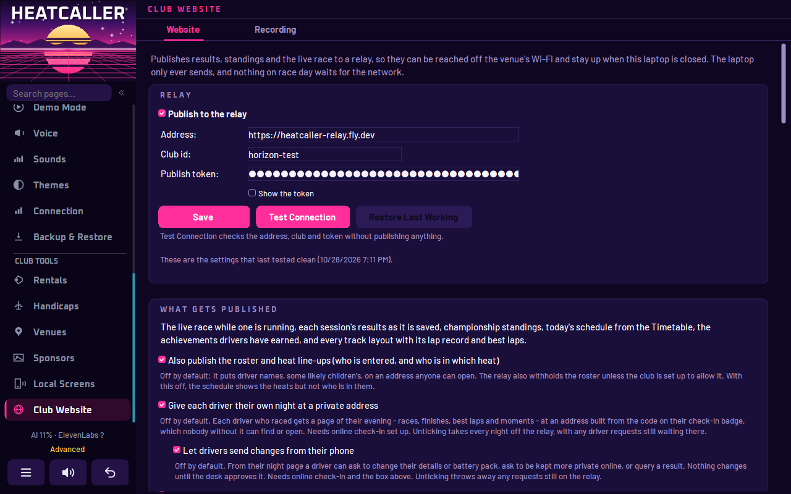

# Setting up the Club Website page

The **Club Website** page is where you point the laptop at your club's relay, choose what gets published, set the pages' welcome line, and check that everything is getting through. You'll use it once to set up, and then mostly to glance at the **Status** card. For what the relay is and what it publishes, see [The online relay](index.md).

You can also reach this page from **Local Screens**, which shows a one-line relay status and a **Club Website Settings** button.

The page has two tabs. Everything below is on the first, **Website**. The second, **Recording**, holds the race recordings, the drivers' clips and their highlight videos on the **Recording the night** card, and the pieces the commentary writes from the evening on the **Written from the night** card. It moved here from **Sounds** on 26 October 2026; see [Race recordings](../announcer/sounds-and-music.md#race-recordings) and [Written from the night](../announcer/commentary.md#written-from-the-night).

In Simple mode, the **Recording** tab, the relay **Address:** row and the **What gets published**, **Look**, **Personal PINs**, **Email (for racer PINs)**, **Race-day manager** and **Room & Web** cards are hidden, along with **Include photos** on the **Online check-in** card. They keep their settings and go on working; turn on Advanced mode to change them. See [Simple and Advanced mode](../getting-started/simple-and-advanced-mode.md).

## Before you start

You need three things from whoever runs your club's relay (see [Hosting the relay on Fly.io](../admin/relay-hosting.md)):

- **The relay address**, for example `https://your-relay.fly.dev`.
- **Your club id**, for example `acme-rc`.
- **A publish token**, which starts with `hg_`.

The token is a password for publishing as your club. Anyone who has it can publish to your pages or delete them, so keep it private.

## Turn on publishing

1. Open the **Club Website** page.
2. In the **Relay** card, fill in **Address:**, **Club id:** and **Publish token:**.
3. Click **Test Connection**. It checks the address, club and token without publishing anything.
4. When the result says `Connected as <your club name>. Saved.`, tick **Publish to the relay**.
5. Watch the **Status** card. Within a few seconds it should say **Publishing**.
6. In the **Share** card, click **Open** to see your club's home page.

## Relay

| Setting | What it does |
|---|---|
| **Publish to the relay** | The main switch. Nothing is sent while it's unticked. |
| **Address:** | The relay's address. See [Address rules](#address-rules). |
| **Club id:** | Your club's id on the relay. See [Club id rules](#club-id-rules). |
| **Publish token:** | The token from the relay admin. Hidden as you type; tick **Show the token** to see it. |
| **Save** | Saves the three fields without testing them. |
| **Test Connection** | Checks the address, club and token, and saves them if they work. |
| **Restore Last Working** | Puts back the address, club and token that last passed a test. |

### Address rules

- The address must start with `https://`. The token goes with every request, and HeatCaller won't send it unencrypted over the internet.
- Plain `http://` is allowed only for a relay on this laptop (`localhost`) or at a private IP address (such as `192.168.x.x` or `10.x.x.x`). A name - a bare computer name, or one ending in `.local`, `.lan` or `.home.arpa` - needs `https://`, because any device on the Wi-Fi can answer to a name and would be handed the token.
- If you leave off `http://` or `https://`, HeatCaller adds `https://`, or `http://` for `localhost` or a private IP address.
- You can paste a page link instead of the bare address, such as your club's live page or a QR check-in link. HeatCaller trims it back to the relay's address, and the box shows the tidied address after a successful test.

### Club id rules

A club id is 3 to 32 characters: lowercase letters, digits and single hyphens, starting and ending with a letter or digit, for example `acme-rc`. Capital letters you type are turned into lowercase when you save. The club id appears in every address on your club's pages, so it goes on posters and badges. It isn't a secret.

If you save a club id the relay could never hold, it's kept in the box but nothing is published, and the page says:

> That club id is not one the relay can hold. Use 3 to 32 lower-case letters, digits and single hyphens, starting and ending with a letter or digit - for example acme-rc.

### The publish token

The token is stored encrypted on the laptop, tied to your Windows account. A copy of the settings file taken to another PC doesn't carry a usable token. Backups carry it separately, protected by your backup password (see [Backups](../admin/backups.md)).

If you lose the token or think it has leaked, ask the relay admin to mint a new one. The old one stops working as soon as the new one is in place. Paste the new token here and test again.

### Test Connection and "last working" settings

**Test Connection** tests exactly what's in the boxes, even if you haven't saved it. When the test passes, the settings are saved straight away and remembered as the set that last worked. If you change the boxes while the test is running, the result says "Not saved - the boxes were changed during the test. Test again."

The line under the test result tells you where you stand:

- "Nothing has tested clean yet. A successful test remembers what it used."
- "These are the settings that last tested clean (*date and time*)."
- "Changed since the last clean test (*date and time*): *club* at *address*." **Restore Last Working** is now available, so a mistyped address or token never costs you a working setup.

Test results you might see:

| Message | What it means |
|---|---|
| `Connected as <name>.` | Everything works. |
| `Could not reach <address>. ...` | The address is wrong, the laptop is offline, or the relay is down. |
| `Reached <address>, but it does not look like a relay (HTTP <code>).` | Something answered at that address, but not a relay. Check the address. |
| `The relay does not recognize that token.` | The token is wrong or has been replaced. Check for missing characters, or ask for a new one. |
| `That token belongs to a different club. Check the club id.` | The token is real, but for another club id. |
| `The relay has no club called "<club>".` | The relay doesn't know that club id. Check the spelling with the relay admin. |
| `This relay is running an older build that has no /whoami. ...` | The relay needs updating. Pass this to your relay admin. |
| `The relay address must start with https:// ...` | See [Address rules](#address-rules). |

A relay that has been idle may take a second or two to wake up. The test and publishing both ride that out.

## What gets published

The **What gets published** card lists what's always sent: the live race while one is running, each session's results as it is saved, championship standings, today's schedule (from the day's timetable), the badges drivers have earned, and every track layout with its lap record and best laps. Demo races are never published, in results or in track best laps.

| Setting | What it does | Default |
|---|---|---|
| **Also publish the roster and heat line-ups (who is entered, and who is in which heat)** | Adds who is in each heat to the Schedule page, and sends the list of who is entered. The relay only shows either if your relay admin has also allowed it for your club; until then the Schedule page shows the heats without who is in them. | Off |
| **Give each driver their own night at a private address** | "Each driver who raced gets a page of their evening - races, finishes, best laps and moments - at an address built from the code on their check-in badge, which nobody without it can find or open." Needs online check-in set up. Unticking takes every night off the relay, with any driver requests still waiting there. See [A driver's own night](index.md#a-drivers-own-night). | Off |
| **Let drivers send changes from their phone** | A step in, under the nights tick. From their night page a driver can ask to change their details or battery pack, ask to be kept more private online, or query a result. Nothing changes until the desk approves it. Grayed out until drivers' nights and online check-in are on. Unticking throws away any requests still on the relay. See [Driver requests](driver-requests.md). | Off |
| **Offer drivers their night by email** | Drivers who asked for it on their profile are emailed their races, their report card and a link to their night page. See [Drivers' nights by email](#drivers-nights-by-email). | Off |
| **Send automatically when the race day closes** | A step in, under the email tick: sends tonight's night emails by itself "When tonight's race day is closed on Race Day. Otherwise, press Email Tonight's Nights." Grayed out until **Offer drivers their night by email** is ticked. | Off |
| **Captions on the club's live page** | "What the announcer says, as text on the live page, for anyone who can't hear the PA - no sound needed. Lines about drivers who asked to be shown by initials are left out." See [Captions](index.md#captions). Unticking takes the captions back off the relay, and lines said while it was off are never sent later. | Off |
| **Shorten published names to a first name and an initial** | Shows "Dana S" instead of "Dana Sloane" everywhere online. Only the last name is shortened, and a one-word name is left alone. Affects what's sent from now on: standings and the last 36 hours of results are re-sent with the new names, but older results already on the relay keep the names they were sent with. It also shortens names in announcer lines sent to the HeatCaller voice or ElevenLabs; the Kokoro voice still says them in full (see [Shortened names on the paid voices](../announcer/voice.md#fix-a-line-that-came-out-wrong)). | On |
| **Say full names aloud with the online voices** | Just under it, and only while it's ticked. The announcer says full names with the HeatCaller voice and ElevenLabs too, so those names are sent to them. The club's pages and captions still show the short name, and a line that says a full name isn't sent to people listening along at home. | Off |

The roster and short names are decisions about children's names; see [Children and privacy](index.md#children-and-privacy). Each driver can also be kept more private online than the club's settings, from their profile; see [Online privacy](../race-day/drivers-and-classes.md#online-privacy).

The drivers' nights, requests, night emails and captions need the relay redeployed since 22 Oct 2026. Update it before you tick them; see [Updating the relay](../admin/relay-hosting.md#updating-the-relay).

A driver's own race calls can go on their night page too, with a tick on this page's other tab: **Put each driver's clip on their own night on the club's page** on **Club Website → Recording**. See [Highlight videos](../announcer/sounds-and-music.md#highlight-videos).

### Drivers' nights by email

With **Offer drivers their night by email** ticked, HeatCaller can email each driver their night after racing. Only drivers who want one get it: tick **Email them their night** on their driver profile (see [Profile fields](../race-day/drivers-and-classes.md#profile-fields)), or the driver asks for it from their night page. They need an address in **Email:** on their profile.

The emails go from this laptop through the **Email (for racer PINs)** card, the same mailbox that sends racers their PINs, so set that up first (see [Emailing racer PINs](email.md)).

The email is headed "Your night at *club* - *Tuesday 22 October*" and has:

- a greeting by first name and the night's date;
- "YOUR RACES": the night's facts, as on their night page;
- "YOUR REPORT CARD": the same report card as on their night page;
- a link to their night page, with "This link is yours - it can also check you in, so don't share it." and "Open it once on your phone and Me, on the club's pages, brings you back to it from then on." (see [Getting around](index.md#getting-around));
- "Live timing, the running order and results:" with your club's home page address;
- "You're getting this because you asked for your night by email. To stop, ask at the desk."
- a last line, "Timing by HeatCaller - heatcaller.com".

The link, the Me line and the club's home page address are only there while **Give each driver their own night at a private address** is ticked. The email never carries a transponder number.

The line under the ticks says where things stand, for example "6 drivers want their night by email · 0 emailed tonight", or "Off. Nobody is emailed their night.", or "Set up the Email card below to send drivers their nights."

#### Email Tonight's Nights

1. After the last race, click **Email Tonight's Nights**.
2. HeatCaller works out who would get one and asks, for example "Email 6 drivers their night?". It also says how many already had tonight's and won't get it again, and how many asked but have no usable address. "An email can't be taken back once it has gone - Undo won't recall it."
3. Click **Yes**. They go one at a time, a second or two apart, and the line under the ticks shows how far it has got. Everything else keeps working meanwhile.

Only drivers who raced tonight and asked are sent one, and nobody is sent the same night twice, even if you press the button again or the automatic send runs too. If there's nobody to send to, it says "Nobody to email tonight." and why.

#### Sending automatically

With **Send automatically when the race day closes** ticked, the emails go by themselves when you close tonight's race day with **Close Day** on **Race Day → Setup** (see [Close, reopen and delete a race day](../race-day/events-and-entries.md#close-reopen-and-delete-a-race-day)). Undoing the close doesn't send them again. The console says how it went, for example "[email] Race day closed - drivers' nights: ...".

## Look

The **Look** card holds the welcome line, the **New here?** card and the club's links. Changes reach the pages within a few seconds, and there's no Save button.

<!-- screenshot: Club Website page, Look card with the Welcome line box, Club links and the Open Themes button -->

**Welcome line:** One line of plain text, up to 160 characters, shown under the club's name on the home page, for example "Racing every Tuesday from 6pm - all welcome". It's also the description used when the pages are added to a phone's home screen. Leave it blank for the standard line.

**New here? card:** three lines for somebody who has found the club but never raced there, shown as a card on the club's home page to any phone that doesn't remember a driver. **Where we race:** and **When we race:** take up to 160 characters each, **How to join:** up to 300. **When we race** also shows under "No racing right now" between nights. Leave all three empty for no card.

**Club links:** a box each for **Website:**, **Facebook:**, **Instagram:**, **YouTube:**, **TikTok:**, **X / Twitter:**, **Discord:** and **WhatsApp:**. They're shown under "Find us" on the club's home page and at the foot of every other page. Paste the full address, or just `@yourclub` for Instagram, YouTube, TikTok and X; an address without `https://` gets it added. Leave a box empty to leave that one off. A link that can't be used is named in red under the boxes, with "It won't be shown until it's fixed.", and isn't published meanwhile.

The pages' colors and the club logo used to be set here too. Since 0.48 they're on the **Themes** page, shared with the app, the Big Screen and the Wi-Fi pages; the card says "Colors and club logo are set in the Looks card on the Themes page (shared with the app, Big Screen and Wi-Fi pages)." Click **Open Themes** to go there. See [Looks and the club logo](../screens/looks-and-logo.md).

- **Colors:** the online pages use the crowd-screen look, set in **Crowd screens:**. Any look works, including the ones you make yourself. The choice you'd made here before 0.48 carries over.
- **Logo:** choose it with **Choose Logo** in the **Club logo** card. The online pages always show it, in a block of its own beside the club's name, drawn between 72 and 180 pixels across depending on the screen, and on a plate if it would vanish on the page background. Link previews use it too. A new logo shows straight away. The home-screen icon is HeatCaller's sun for every club, logo or not (see [Add to Home Screen](index.md#add-to-home-screen)).

!!! note
    The larger logo, its plate and the instant logo change need the relay updated for 0.48. See [Updating the relay](../admin/relay-hosting.md#updating-the-relay).

## The relay also speaks

Once the **Relay** card is filled in and testing clean, the same address, club id and token give the laptop the [HeatCaller voice](../announcer/voice.md#the-heatcaller-voice): natural announcer voices on HeatCaller's own ElevenLabs account, so your club needs no account, no key and no bill.

There's nothing to set up here for it. Choose it under **Speak with** on **Voice → Voice**, pick an announcer voice in **HeatCaller voice:** at the top of **Voice → Cast**, and **Voice Settings** shows your club's allowance for the month. Until the **Relay** card is filled in, **Voice Settings** says "Set the club up on the Club Website page first - the HeatCaller voice speaks through the same relay, with the same token."

A few things follow from sharing the relay:

- **A new token stops the voice too**, until you paste the new one in here. The announcer falls back to the free Kokoro voice meanwhile, and says so in the console.
- **Your club has to be switched on for the voice on the relay.** It isn't automatic, and publishing works perfectly well without it. Ask whoever runs your relay; see [The HeatCaller voice](../admin/relay-hosting.md#the-heatcaller-voice).
- **Spoken lines don't count against your 50 MB.** The relay keeps rendered audio in a store of its own, and a line with no driver's name in it is kept once for every club.
- **You don't have to tick Publish to the relay** to use the voice. The three boxes and a clean test are enough.
- **Listening to a voice needs no token at all.** With only the address filled in, **Hear It**, at the top of **Voice → Cast**, still plays a sample of every HeatCaller voice, free, so you can choose one before your club is switched on. **Preview**, which says your own words, needs the club and token. Both need the relay redeployed; see [Hearing a voice before choosing it](../admin/relay-hosting.md#hearing-a-voice-before-choosing-it).

## Online check-in, Personal PINs and Email

These three cards set up drivers checking themselves in from their own phones:

- **Online check-in** turns it on and sets the staff PIN. See [Online check-in](check-in.md).
- **Personal PINs** gives every racer a six-digit PIN of their own. See [Personal PINs](check-in.md#personal-pins).
- **Email (for racer PINs)** sets up the club's mailbox for emailing those PINs. See [Emailing racer PINs](email.md).

## Race-day manager

The race-day manager - entries, the program and results, run from a phone - lives on the **Local Screens** page; see [Race-day manager](../screens/phone-and-web.md#race-day-manager). This card on the **Club Website** page is only about reaching that same page through the relay, from off the venue's Wi-Fi.

- **Let the race-day manager be reached through the relay** is off by default. It needs **Publish to the relay** on too, and a Manager PIN set on **Local Screens** - without one, the manager refuses every request rather than opening to anyone.
- **Set Manager PIN** jumps to the **Local Screens** page, since one PIN guards the manager on both the Wi-Fi page and the relay.
- **Open Manager Page** opens the manager in your browser, once the tunnel is on and the club's address is known.
- The line underneath says where things stand - open and working, publishing off, no usable PIN yet, or locked after too many wrong guesses - and what to do about it.

However it's reached, the manager can never start a race or throw a flag; that stays on the venue's own network, from the laptop or the phone remote. Wrong guesses at the Manager PIN over the relay are rate-limited and tracked separately from the check-in PIN's own count; see [PINs and rate limits](../admin/security-and-privacy.md#pins-and-rate-limits).

Signing in with the Manager PIN is all a phone needs. The phone signs every request with a key made from that PIN, and the laptop checks it before running anything, so there's nothing to set up at the desk. After you change the Manager PIN, phones have to sign out and sign in again with the new one. See [Race-day manager PIN](../admin/security-and-privacy.md#race-day-manager-pin).

On the relay's manager page, the **Manager PIN** box shows dots and is emptied after every sign-in answer, right or wrong. Over the relay, a Manager PIN can be 6 to 32 digits long. Messages appear in a box at the foot of the screen: good news clears itself after 4 seconds, and an error stays until your next tap or a change of tab. On the sign-in screen, the message is a line under **Sign in** instead. As on the Wi-Fi page, results show the winner's name under a small "Winner" caption, and on **Program** the class list has the full width, with **Seed Mains** and **Bump Ups** sharing the line below.

The relay keeps a separate allowance for the manager's requests and answers, so a busy manager never gets in the way of publishing results (see [How long results stay online](index.md#how-long-results-stay-online)). If requests pile up because the laptop isn't collecting them, the page says "The race-day manager is busy - the laptop has not caught up with recent requests yet. Try again shortly." Check that HeatCaller is running with publishing on.

The laptop keeps its answers to the relay's manager requests through changes on this page, such as a new token, **Test Connection**, or switching the manager or publishing off and on again, so a request whose answer hasn't reached the relay yet isn't run a second time. They're only dropped when the relay address or the club changes, or after **Delete Everything Published**.

## Share

The **Share** card shows your club's home page address once an address and club id are saved. It's the address to hand out: it works from anywhere, on any network.

- **Open** opens it in your browser.
- **Copy Link** copies it to the clipboard.
- **Show Poster** opens a poster with the heading "FOLLOW THE RACING", a QR code for the home page, and the line "Scan with your phone camera. Live timing, schedule and results - and your own races under Me." **Print** prints it, and **Full screen** fills the screen with it (press <kbd>Esc</kbd> to leave full screen). The poster window stays open while you carry on working, so you can leave it on a second screen.

## Room & Web

The **Room & Web** card, under **Share**, holds what the people in the room, and people at home, can send in or hear through the club's Wi-Fi and web page. Everything on it is off until you switch it on, and none of it needs AI commentary: with commentary off, you read the notes and the vote out yourself.

| Part | Switches | See |
|---|---|---|
| **Club notes** | **Take them from phones on the club's Wi-Fi** (the `/shoutout` page on the laptop) and **Take them from the club's own web page**. A dedication, a birthday or the raffle, said once between races. Every one waits on Race Control until you approve it. | [Club notes](../announcer/commentary.md#club-notes-the-things-the-timing-cant-know) |
| **The room's vote** | **Let phones on the club's Wi-Fi vote** (the `/vote` page on the laptop) and **Let the club's own web page vote**. The room picks who wins; after the race the announcer says how it did. No running tally is ever shown to a phone. | [The room's vote](../announcer/commentary.md#the-rooms-vote) |
| **Listening along** | **Let people listen along on the club's web page**. A **Listen to the announcer** button on the club's **Live** page plays the race call a few seconds behind the room, in the voice you've chosen. It needs **Publish to the relay** on too. | [Your club's pages](index.md#your-clubs-pages) |

<!-- TODO: confirm where on the club's relay pages people send a note or vote: the relay takes them, but no relay page seems to offer a form for either -->

A line under each part says where things stand, for example "Messages can come in on the club Wi-Fi at /shoutout under this PC's own address. Every one waits on Race Control until you approve it." Switching a web-page route off tells the relay straight away: it stops taking notes or votes, or stops offering the announcer, and throws away what it was holding.

Listening along puts your chosen voice, even one cloned from somebody at the club, on an address anyone with the link can play. Switch it off and the button goes.

## Status

The **Status** card updates every second.

| Status | What it means |
|---|---|
| **Not publishing** | **Publish to the relay** is unticked. |
| **Not configured** | An address, a club id and a publish token are all needed (and a valid club id). |
| **Check these settings** | The relay settings came from a restored backup, with an address this laptop hadn't used. Nothing is published or collected until you check the address and press **Save** or **Test Connection**. See [Addresses in a restored backup](../admin/security-and-privacy.md#addresses-in-a-restored-backup). |
| **Waiting for the first publish** | Set up, but nothing has got through yet. |
| **Publishing** | The last attempt reached the relay and was accepted. |
| **Offline** | Something got through earlier, but the last attempt failed. HeatCaller keeps trying, waiting a little longer each time, up to 30 seconds between attempts. |

The line under it gives the detail, for example "Last published 12 seconds ago.", how many items are "waiting to go", how many "could not be published", and the last error in plain words. Common errors:

| Error | What to do |
|---|---|
| "The relay does not recognize this token." | Paste the token again, or ask for a new one. |
| "This token belongs to a different club." | Check the club id. |
| "The relay has no club called "*club*". Check the club id." | Check the club id with the relay admin. |
| "The relay is an older build that cannot take this. Redeploy it." or "The relay has no "*channel*" channel - it may need updating." | Ask the relay admin to update the relay. |
| "A *channel* payload was too large to publish." or "The relay refused the payload as too large." | Something was too big to send. The rest keeps publishing. <!-- TODO: confirm what a race director should do about an oversized payload --> |

Race day never waits on any of this. While the relay can't be reached, the live board simply isn't updated online, and results queue on the laptop until the connection is back.

## After a restart

Results waiting to go are held in memory, so closing the app with some still queued would lose them online. To cover that, every time HeatCaller starts (and whenever you change the address, club, token or short-name setting) it re-sends championship standings and every session from the last 36 hours. The relay keeps one copy per session, so re-sending one it already has changes nothing.

Older results stay on the laptop. If you move to a new relay, only the last 36 hours appear there at first.

## Deleting everything published

**Delete Everything Published** in the **Status** card removes everything your club has on the relay: results, standings, the live race, the schedule, badges, tracks, the look and the online check-in list. It asks first. Nothing on the laptop is touched.

Before it deletes anything, it unticks **Publish to the relay** and stops any upload that was already on its way, so the relay stays empty. Nothing goes back up, not even after a restart, until you tick **Publish to the relay** again. When you do, everything is sent again, including the last 36 hours of results.

If the delete fails (for example the relay can't be reached), **Publish to the relay** is turned back on as it was, and nothing has been removed.

## Troubleshooting

**The Share card says "Save a relay address and club id to get the club's page."**
Nothing is saved yet. Fill in the **Relay** card and click **Save** or **Test Connection**.

**Test Connection works, but the status says "Not publishing".**
Tick **Publish to the relay**.

**The pages show old results, or "Nothing has been published yet".**
Check the **Status** card. If it says **Publishing**, results appear as each session is saved; standings and the last 36 hours of results are re-sent when the app starts.

**The pages show "Could not reach the relay. This page will keep trying."**
That's the visitor's phone failing to reach the relay, not the laptop. If it happens for everyone, tell your relay admin (see [Troubleshooting](../admin/troubleshooting.md)).

**A change of look or logo doesn't show.**
Reload the page on the phone. Changes are sent within a few seconds. If a new logo still shows the old one, or the logo is small, the relay needs updating for 0.48.
