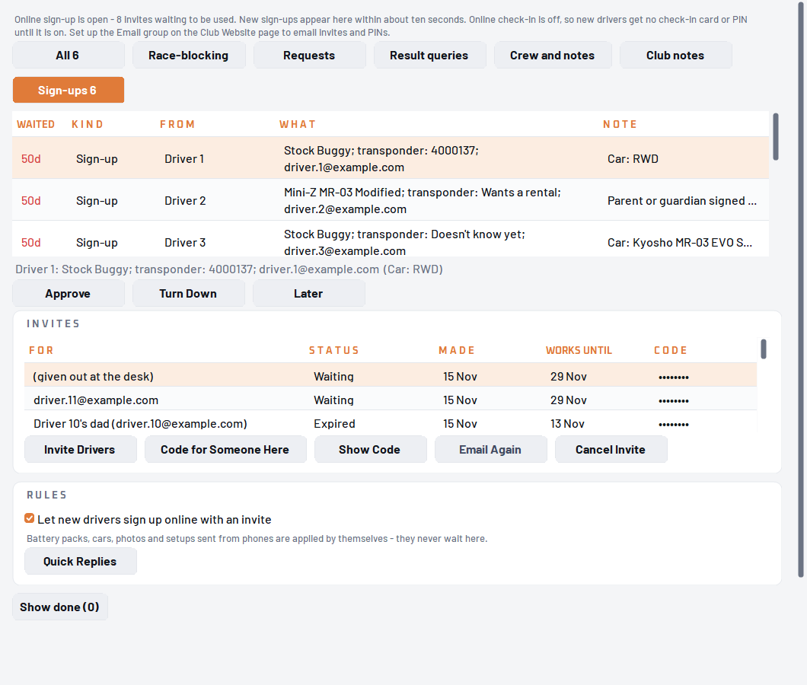

# Driver sign-up

Driver sign-up lets a new driver put themselves on your club's books from their own phone. You invite them, they fill in their name, class and transponder on your club's sign-up page, and the sign-up waits on the laptop for you to approve it. Approving it makes their driver profile, can add them to today's event and check them in, and emails them their own check-in PIN.

Nobody can sign up without an invite. Each invite is a single-use eight-digit code for one person, emailed to them with a link, or read out to someone standing at the desk.

## Before you start

- Publishing to the relay must be set up and working. See [Setting up the Club Website page](setup.md).
- The relay must be new enough to have sign-up. If it isn't, the line at the top of the Inbox's **Sign-ups** chip says "The relay answered "not found" for driver sign-up." Redeploy it (see [Updating the relay](../admin/relay-hosting.md#updating-the-relay)).
- To email invites and PINs, set up the club mailbox. See [Emailing racer PINs](email.md). Without it you can still give out codes at the desk.
- For a new driver to get a check-in card and their own PIN, [online check-in](check-in.md) must be on, with **Give every racer their own PIN** ticked.

## Open the Inbox on Sign-ups

Sign-ups wait in the **Inbox**, on its **Sign-ups** chip (see [The Inbox](../race-control/inbox.md)). Until 15 November 2026 they had a window of their own, **Online Sign-ups**.

Go to **Race Day → Who's Racing** and click **Inbox: Sign-ups**, under the list on the **Drivers** card. When sign-ups are waiting, the button shows how many, for example **Inbox: Sign-ups (2)**, and so does a count beside **Race Day** in the sidebar. The cyan **Inbox** button on Race Control counts them too; click it, then the **Sign-ups** chip.

On the **Sign-ups** chip:

- The line at the top says whether sign-up is working.
- The list has the sign-ups the desk hasn't answered yet, with **Approve**, **Turn Down** and **Later**.
- **Invites** lists every invite made, and where it stands.
- **Let new drivers sign up online with an invite** is under **Rules**.

The Inbox can stay open while you work. A sign-up made while it's open appears within about ten seconds.

## Turn it on

Tick **Let new drivers sign up online with an invite**. The line under it should say "Open", with how many invites are waiting to be used.

Unticking it closes the sign-up page and takes every code off the relay. Invites you've already made aren't canceled; they work again when you tick it again, as long as they haven't expired.

## Invite drivers by email

1. Click **Invite Drivers**.
2. Type one email address per line. To remember who's who, add a note after a comma, for example `sam@example.com, Sam's dad`.
3. Click **Send Invites**.

Each person gets an email from the club mailbox, "Your invite to race with *club*", with a link to your sign-up page and their code. The link fills the code in for them. Their invite appears under **Invites** as "Waiting" once it's been emailed.

To send one again, select it and click **Email Again**.

## A code for someone at the desk

For a driver standing in front of you with no invite:

1. Click **Code for Someone Here**.
2. Optionally type who it's for, then click **Make Code**.
3. The code is shown on screen. Read it out, and point them at the sign-up page address shown with it.

They sign up on their own phone and the sign-up appears on the Inbox's **Sign-ups** chip.

## What the new driver does

1. They open the link in their invite, or the sign-up page, and type their code if asked.
2. They fill in **Driver's name**, **Class** (from today's event's classes, or all of your classes if the event names none), **Transponder**, **Car** (optional) and **Email**.
3. For **Transponder** they choose **I have my own** and type the number, **I'd like to rent one from the club**, or **I don't know yet**.
4. A parent or guardian signing up a younger driver ticks **I am a parent or guardian signing up a driver under 18**.
5. They tap **Send to the timing desk**.

Their phone then says their sign-up is with the timing desk, and updates by itself once you've answered. Until you do, they can tap **Change my details** and send it again.

## Approve a sign-up

1. Select the sign-up on the **Sign-ups** chip and click **Approve** (or double-click it, or press <kbd>A</kbd>).
2. Check the details. Everything they typed can be changed.
3. Make sure **Transponder** is filled in:
    - If they have their own, it's already there.
    - If they asked to rent one, pick one of the club's rentals in **Lend a rental**. It's lent to them on the **Rentals** page when you approve.
    - If they don't know yet, type it in once they're at the desk. Or click **Not Yet**: the sign-up keeps waiting until you approve it.
4. Click **Approve**.
5. HeatCaller asks "Add *name* to *event* and check them in?" (or "Check *name* in for today?" when no event is open). Click **Yes** to check them in now, or **No** to add them without checking them in.

If their class isn't one of the event's classes, the question says so, and answering **Yes** adds the class to the event.

When you approve, HeatCaller:

- Adds their driver profile, marked "Signed up online." (or "Signed up online by a parent or guardian.") in **Notes**.
- Checks them in, if you said **Yes**.
- Gives them their own check-in PIN and emails it to them, if online check-in and personal PINs are on and the club mailbox is set up. This happens even if **Email automatically when PINs change** is off, because the sign-up page told them it would come.
- Tells their phone. It shows "You are in!" and, when online check-in is on, **Open my check-in card**, which checks them in at every meeting. Under it, "Your own races and results open under Me, at the bottom of the page on a phone." with **Go to Me**.

A transponder that already belongs to another driver is refused, with the same message as adding a driver by hand. Change it, or click **Not Yet**.

<!-- screenshot: Approve dialog for a driver who asked for a rental -->

## Turn a sign-up down

Select it, click **Turn Down**, optionally type why or what to do instead, and click **Turn Down**. Their phone shows "Not signed up" with your message.

For 10 seconds after you approve or turn down a sign-up, the line under the buttons has **Undo**.

## Invites

| Status | What it means |
|---|---|
| Waiting | Not used yet. It works until the date under **Works until**. |
| Not emailed yet | Made, but the email didn't go. Select it and click **Email Again**. |
| Signed up | Used, and you approved the sign-up. |
| Turned down | Used, and you turned the sign-up down. |
| Canceled | Canceled before it was used. |
| Expired | Not used within 14 days. |

- **Code** shows dots until you select an invite and click **Show Code**, which shows its code for reading out.
- **Cancel Invite** stops a code working at once. A sign-up already made with it is turned down. **Undo** on the line under the buttons, for 10 seconds, takes it back.
- An invite works once, for 14 days. Answered and expired invites drop off the list after 60 days.

## Troubleshooting

**The line at the top is red.**
It says what's wrong. "Publishing to the relay is off" means the relay isn't set up on the **Club Website** page. A "not found" message means the relay needs redeploying.

**A driver says their code doesn't work.**
Check the invite under **Invites**. If it says "Expired" or "Canceled", make them a new one. If sign-up is switched off, their phone says "Sign-up is not open right now."

**"The sign-up invites file (signups.json) couldn't be read".**
Another program, usually a backup or sync tool, had the file open when HeatCaller started. So that the invites in it aren't lost, nothing on the Inbox's **Sign-ups** chip can be changed until HeatCaller is restarted: the tick box, **Invite Drivers** and **Code for Someone Here** are grayed out. Invites you've already made keep working, and sign-ups made with them wait on the relay. Close anything that might have the file open and restart HeatCaller.

**"The invites couldn't be saved".**
HeatCaller couldn't write `signups.json`, so no invite was made and nothing was emailed. Close anything that might have the file open and try again.

**"Sign-up codes are locked after too many wrong guesses".**
Someone typed many wrong codes. The relay closes code sign-in for a while, longer each time it happens. Phones that already signed in keep working. To reopen it at once, cancel every open invite and make new ones.

**A new driver didn't get their PIN email.**
Check that online check-in and personal PINs are on and the **Email (for racer PINs)** card is filled in, and that the email address in their profile is right. Then use **Email PINs** on the **Club Website** page. See [Emailing racer PINs](email.md).
