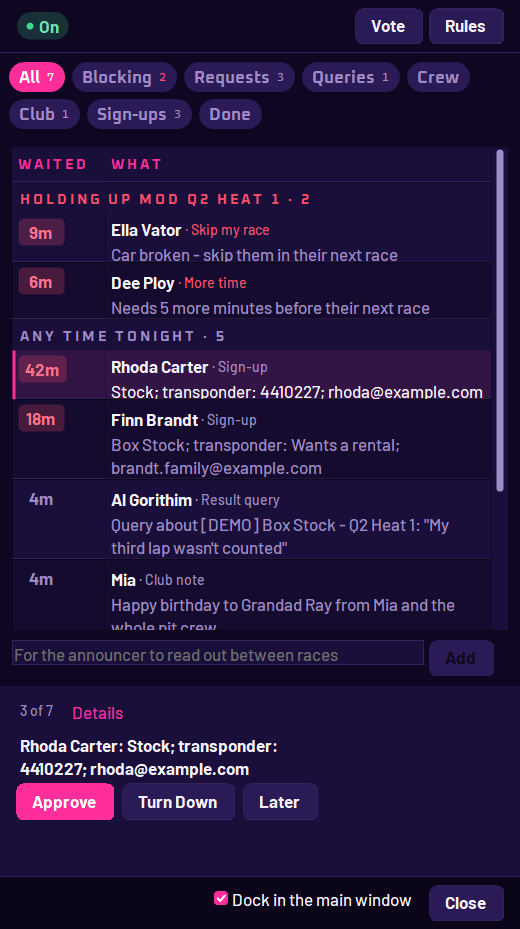

# The Inbox

The **Inbox** is one window for everything that waits for the desk on a race night: drivers' requests from their phones, their result queries, crew picks, club notes from the room, tonight's room vote and online sign-ups. You answer them all in one place, with whatever holds up the next race at the top, and most of it can be done from the keyboard.

It replaced four windows on 15 November 2026: **Driver Requests**, **Tonight's club notes**, **Tonight's room vote** and **Online Sign-ups**. Everything each of them did is in the Inbox now.

## Opening the Inbox

- **On Race Control**, the cyan **Inbox** button at the end of the flag row (called **Requests** before 15 November, and **Desk** before that). It's there while anything is waiting: driver requests, club notes from the room or online sign-ups. Its badge says how many. The badge is red only while something holds up the next race: a driver asking for **More time**, **Skip my race**, a marshal swap, or a result query inside its race's protest window. Otherwise it's dark. See [The flag row after the flag](running-a-race.md#the-flag-row-after-the-flag).
- **In the Broadcast window**, **Notes** opens the Inbox on its **Club notes** filter, and **Votes** opens it with the **Room vote** card open. See [Club notes](../announcer/commentary.md#club-notes-the-things-the-timing-cant-know) and [The room's vote](../announcer/commentary.md#the-rooms-vote).
- **On Race Day → Who's Racing**, **Inbox: Requests (2)** and **Inbox: Sign-ups (1)** under the **Drivers** card open it on the **Requests** or **Sign-ups** filter. They were **Driver Requests** and **Online Sign-ups**.

The Inbox isn't a dialog. Keep it open beside Race Control while you work: it updates itself every second, and its title on the taskbar says how many are waiting, for example "Inbox (3)". Or dock it in the main window (see [Docking it in the main window](#docking-it-in-the-main-window)).

## What's in the window

The window has a bar along the top, three columns, and a strip of keys along the foot.

- **The top bar.** On the left, whether requests and sign-ups are working: a green **On**, a plain **Off**, or a red **Needs a look**, then a line saying more, for example "Requests from drivers' phones appear here within about 15 seconds." When something is wrong, this is where it says so (see [Troubleshooting](../online/driver-requests.md#troubleshooting)). On the right, **Rules** and **Room vote**: each opens a card under its button (see [Rules](#rules) and [The room vote](#the-room-vote)).
- **The filters**, down the left, each with how many are waiting and the number key that picks it: under **WAITING**, **All** (<kbd>1</kbd>), **Race-blocking** (<kbd>2</kbd>), **Requests** (<kbd>3</kbd>), **Result queries** (<kbd>4</kbd>), **Crew and notes** (<kbd>5</kbd>), **Club notes** (<kbd>6</kbd>) and **Sign-ups** (<kbd>7</kbd>); under **TONIGHT**, **Room vote** (<kbd>V</kbd>) and **Done** (<kbd>H</kbd>). In a window between about 760 and 1,100 pixels wide, the column folds to just the keys and counts; hover over one for its name.
- **The list**, in the middle, of what's waiting under the filter you picked, with the columns **Waited**, **Kind**, **From**, **What** and **Note**. Under it, on the **All** and **Club notes** filters, **Your own note:** with **Add**, and on the **Sign-ups** filter, the **Invites** section.
- **The picked item**, on the right, in full, with its answers (see [The picked item](#the-picked-item)).
- **The foot.** The keys, as a reminder (↑ ↓ move, Ctrl + click several of one kind, Enter main answer, 1–7 filters, V vote, H done), then **Close** and **Dock in the main window**.

## The list

The list comes in groups, each under a caption with its count:

- **HOLDING UP** the next race, in red, named from Race Control, for example "HOLDING UP Q2 HEAT 3 · 2", or "HOLDING UP THE NEXT RACE" when no round is picked.
- **ANY TIME TONIGHT**: everything else, oldest first.
- **LATER**: what you've put off with **Later** (see [Later](#later)).

**Waited** says how long each one has waited: "now", "4m", "1h 5m". It turns amber, then red, the longer it waits:

| Kind | Amber at | Red at |
|---|---|---|
| Race-blocking (**More time**, **Skip my race**, a marshal swap, a query in the protest window) | 2 minutes | 5 minutes |
| Everything else | 5 minutes | 15 minutes |

**Kind** says what it is, for example **More time**, **Their details**, **Result query** or **Club note**, in red when it's race-blocking. **From** is the driver; for a club note, the name it was sent under, "The room" when it had none, or "You" for one typed at the desk. **What** is what they asked for, and **Note** is anything the desk should know, such as "Checked by their personal PIN".

When nothing is waiting, the list says "All clear - nothing is waiting for you." With nothing waiting and nothing picked, the right-hand side shows your last three answers under **LAST ANSWERED**.

## The picked item

Click a row (or move with <kbd>Up</kbd> and <kbd>Down</kbd>) and the right-hand side shows it in full, from the top:

- How long it has waited, for example "Race-blocking · waited 3m", "Waited 4m" or "Just in", and where it is in the list, for example "1 of 6".
- What kind it is, then who and what in one line, then the note, or the time it was sent.
- For a driver's request, **THEIR PHONE WILL SAY**: the words the driver's phone shows for the main answer, for example "Yes, 5 more minutes", and under them what a decline would say instead, for example "If you decline: Can't hold your race, with your reply under it."
- The answer buttons. The main answer comes first, the width of the column, in the theme's main color; the others are under it. Each shows its key.
- For a request that can be declined, the club's quick replies as buttons under **DECLINE REPLIES** (see [Declining with a quick reply](#declining-with-a-quick-reply)).
- After an answer, what was done, with **Undo** (see [Undo](#undo)).

## Answering

Pick a row and click an answer. Double-clicking a row, or pressing <kbd>Enter</kbd>, gives its main answer: **Approve**, or **Noted** where approving doesn't apply (a result query, for example).

| Picked | The answers |
|---|---|
| A driver's request | **Approve**, **Noted**, **Decline**, **Later**, and **Discard** for a request from a badge nobody on this laptop has |
| A club note | **Let the announcer say it**, **Later** and **Remove** |
| A sign-up | **Approve**, **Turn Down** and **Later** |

What each answer does for a driver's request: see [Answering requests at the desk](../online/driver-requests.md#answering-requests-at-the-desk). For a club note, nothing from the room is said until you've pressed **Let the announcer say it**: see [Club notes](../announcer/commentary.md#club-notes-the-things-the-timing-cant-know). For a sign-up, see [Driver sign-up](../online/sign-up.md).

### Keys

While you're not typing in a box:

| Key | What it does |
|---|---|
| <kbd>A</kbd> | **Approve** |
| <kbd>D</kbd> | **Decline**, with the quick replies |
| <kbd>N</kbd> | **Noted** |
| <kbd>S</kbd> | **Later** |
| <kbd>Delete</kbd> | **Discard**, or **Remove** for a club note |
| <kbd>Enter</kbd> | The main answer: **Approve**, or **Noted** |
| <kbd>Ctrl</kbd>+<kbd>Z</kbd> | **Undo** the answer just given, while it's offered |
| <kbd>1</kbd> to <kbd>7</kbd> | The filters, in order down the left |
| <kbd>V</kbd> | Opens the **Room vote** card |
| <kbd>H</kbd> | **Done**, and back again |
| <kbd>Esc</kbd> | Back to the list from **Done** (or from **Details** when docked) |

The answer keys do nothing while **Done** is showing.

### Later

**Later** (<kbd>S</kbd>) moves the picked item down to the **LATER** group, with "Later" in its **Waited** column, until the race on track now finishes, or for 10 minutes at most. Then it comes back to its place. Press <kbd>S</kbd> on it again to bring it back sooner.

### Declining with a quick reply

**Decline** (<kbd>D</kbd>) shows the club's quick replies first. To start with they're:

- "Ask at the desk"
- "After this heat"
- "Already changed"
- "Not tonight"

Click one, or press its number (<kbd>1</kbd> to <kbd>9</kbd>) while the menu is open, and the request is declined with it as the reason, shown on the driver's phone. The same replies are buttons under **DECLINE REPLIES** on the right, one click each. Under them in the menu, **Other reason...** (<kbd>O</kbd>) opens the box to type your own, and **Change the quick replies...** lets you write the club's own.

You can have up to eight quick replies, one per line, in the **Quick replies** window. Leave the box empty to go back to HeatCaller's own. **Quick Replies** on the **Rules** card opens the same window.

A junior only ever gets one of HeatCaller's own four replies: for a request from a junior, **Other reason...** is grayed out and the menu says "Juniors get a set reply - tell the parent in person if you need to say more."

### Several at once

Ctrl-click or Shift-click to pick several rows of the same kind. The right-hand side then lists them, and the buttons say who they go to: **Approve both** or **Approve all 3**, **Decline both**, **Noted, both**. A quick-reply decline goes to them all too. A details change and a crew request are answered one at a time, because each opens its own form. If the rows you've picked are of different kinds, the Inbox says so, and only **Later** works on them.

### Undo

After an answer, a line under the buttons says what was done, for 10 seconds, with **Undo** (or <kbd>Ctrl</kbd>+<kbd>Z</kbd>) when it can be undone. These can:

- approving a club note, until the announcer has said it;
- approving a change to a driver's details, or their crew;
- approving a battery pack change;
- **Noted**;
- a decline;
- approving or turning down a sign-up;
- canceling an invite.

**Undo** there only works while that answer is still the newest thing done. If something else has been done since, it says to use **Undo** in the main window instead.

Because a battery pack can be undone, approving one by hand doesn't ask "Approve it?" first. A driver's **More time**, **Skip my race**, a marshal swap and hiding a race video still ask before they're done, because they can't be undone from here.

Approving a change to a driver's details still opens the form to check each change, with **Hear It** for a new announcer name, and approving a crew still asks about the words the announcer will say. See [Approving a change to their details](../online/driver-requests.md#approving-a-change-to-their-details) and [Their crew and notes](../online/driver-requests.md#their-crew-and-notes).

## Your own note

On the **All** and **Club notes** filters, type a note for the announcer in **Your own note:** and click **Add** (or press <kbd>Enter</kbd>). It's added as yours, ready to be said: "Added. The announcer works it in between races." <kbd>Enter</kbd> in that box only ever adds your note; it never answers the row picked in the list.

## The room vote

**Room vote** in the top bar (or <kbd>V</kbd>, or **Room vote** under **TONIGHT** on the left) opens the **Room vote** card under the button. The button itself says where the vote is without opening it: **Vote open · 4:12 left** in the main color while the room is voting, and **Vote · closed** once it's done.

The card says where tonight's vote is:

- "No vote has been opened tonight. The room votes on who wins, and after the race the announcer says how the room did. New vote asks the room anything else." until you open one.
- "Voting is OPEN on Mod Buggy A-Main - 4 votes in: Sam 3, Dev 1" while one is open, with a bar for each driver that moves as the votes come in.

Under that, a line says where the room votes, then the buttons:

- **Open voting on *race*** opens a vote on the race about to run. It's grayed out with no race picked, or with fewer than two cars staged. If tonight's vote already has votes in, it asks before starting again.
- **New vote** asks the room anything else, such as the best paint job tonight: type the **Question** and the **Answers**, one a line (2 to 16), and click **Open voting**. The announcer never says how it came out, and it stops itself after 20 minutes.
- **Stop voting** closes it. A vote on a race also stops by itself at the start of the race.
- **Show the tally** lists the votes so far: **Driver** (or **Answer**), **Votes** and **Share**. It then reads **Hide the tally**.

See [The room's vote](../announcer/commentary.md#the-rooms-vote).

## Sign-ups and invites

On the **Sign-ups** filter the list holds the sign-ups waiting for you, with **Approve**, **Turn Down** and **Later**, and an **Invites** section opens under it. The top bar then also says how online sign-up stands, for example "Online sign-up is open - 2 invites waiting to be used."

The invites list has the columns **For**, **Status**, **Made**, **Works until** and **Code**. Codes are hidden as dots until you pick one and click **Show Code**. The buttons are **Invite Drivers**, **Code for Someone Here**, **Show Code**, **Email Again** and **Cancel Invite**. See [Driver sign-up](../online/sign-up.md).

## Rules

**Rules** in the top bar opens a card with the switches that decide what waits here:

- **Marshal swaps from phones need the desk's OK**. Untick it and a driver's yes to cover another's post is made by itself. See [Marshals from their phones](../online/driver-requests.md#marshals-from-their-phones).
- **Let new drivers sign up online with an invite**. See [Turn it on](../online/sign-up.md#turn-it-on).
- A line: "Battery packs, cars, photos and setups sent from phones are applied by themselves - they never wait here. 12 changes handled for you tonight." See [Changes HeatCaller makes by itself](../online/driver-requests.md#changes-heatcaller-makes-by-itself).
- **Quick Replies**, the club's replies for **Decline**.

## Done

**Done** (<kbd>H</kbd>), under **TONIGHT** on the left with how many it holds, shows what's been answered in the list's place:

- drivers' requests you've answered, kept for 30 days, newest first, with the answer in green for a yes and red for a no;
- tonight's club notes you've approved or the announcer has said, marked "Ready to be said" or "Said". **Remove Note** takes one off.

Its columns are **Sent**, **Kind**, **From**, **What**, **Answer** and **Ref**. **Hide done**, <kbd>Esc</kbd>, <kbd>H</kbd> again or picking a filter goes back to what's waiting.

## Docking it in the main window

Tick **Dock in the main window** and the Inbox moves into a panel down the right of the main window, beside Race Control. The small button beside **Expand** at the foot of Race Control's leaderboard, and the same button beside **Expand** under Practice's **This session** table, does the same in one press, and opens the Inbox first if it's closed. It has a picture of a window with a panel down its right-hand side, and its tooltip reads **Dock Inbox**. Drag the splitter between them to make it wider or narrower; the width is remembered.

Narrower than about 760 pixels, it rearranges itself to fit:

- The filters become a row of chips across the top, with shorter names (**Blocking**, **Queries**, **Crew**, **Club**).
- Each row in the list is two lines: who and what kind, then what.
- The picked item is a bar under the list with its answers. **Details** opens it out over the list, with everything the wide window shows; **Back to the list** (or <kbd>Esc</kbd>) closes it.
- The top bar shows just the **On** or **Off** pill, and the words only when something needs a look.

While the Inbox is docked, the panel in the button's picture is filled in and its tooltip reads **Undock Inbox**. Press it, or untick **Dock in the main window**, to make the Inbox a window of its own again. **Close** closes the docked Inbox, and the button goes back to **Dock Inbox**.
