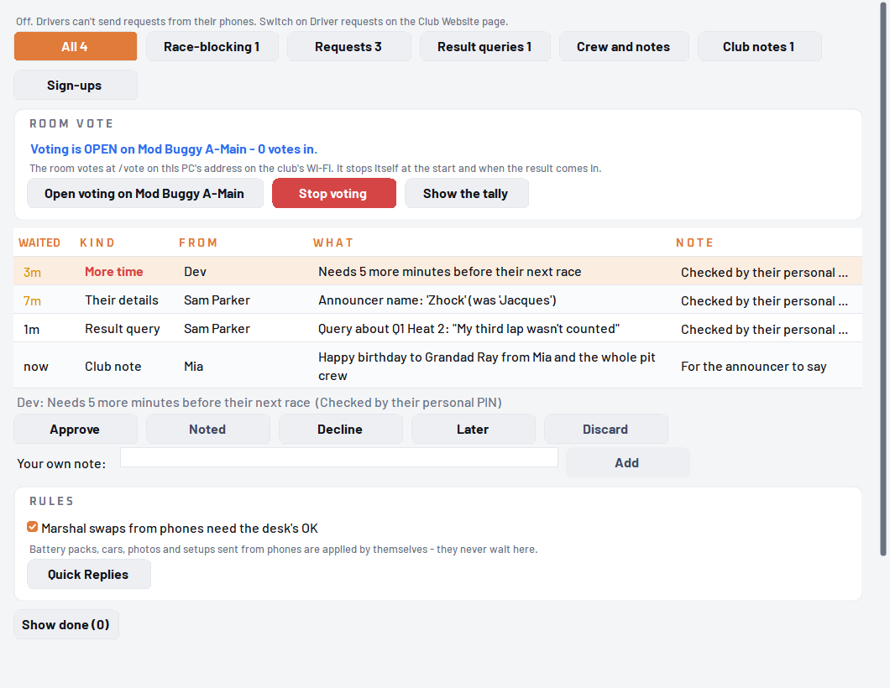
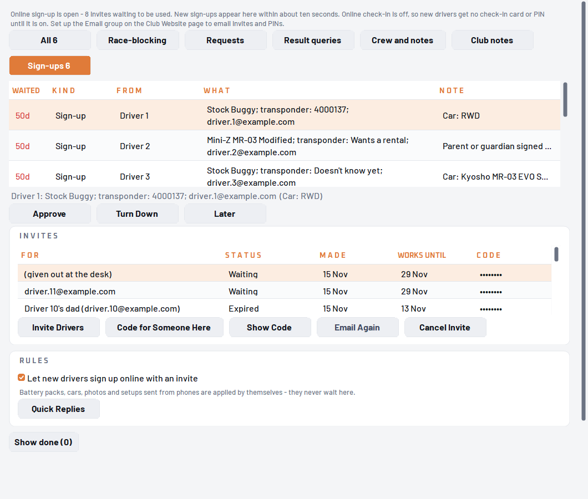

# The Inbox

The **Inbox** is one window for everything that waits for the desk on a race night: drivers' requests from their phones, their result queries, crew picks, club notes from the room, tonight's room vote and online sign-ups. You answer them all in one place, oldest first, with whatever holds up the next race at the top.

Since 15 November 2026 it replaces four windows: **Driver Requests**, **Tonight's club notes**, **Tonight's room vote** and **Online Sign-ups**. Those windows are gone. Everything each of them did still works the same; it's just in the Inbox now.

## Opening the Inbox

- **On Race Control**, the cyan **Inbox** button at the end of the flag row (called **Requests** before 15 November, and **Desk** before that). It's there while anything is waiting: driver requests, club notes from the room or online sign-ups. Its badge says how many. The badge is red only while something holds up the next race: a driver asking for **More time**, **Skip my race**, a marshal swap, or a result query inside its race's protest window. Otherwise it's dark. See [The flag row after the flag](running-a-race.md#the-flag-row-after-the-flag).
- **In the Broadcast window**, **Notes** opens the Inbox on its **Club notes** chip, and **Votes** opens it at the **Room vote** card. See [Club notes](../announcer/commentary.md#club-notes-the-things-the-timing-cant-know) and [The room's vote](../announcer/commentary.md#the-rooms-vote).
- **On Race Day → Who's Racing**, **Inbox: Requests (2)** and **Inbox: Sign-ups (1)** under the **Drivers** card open it on the **Requests** or **Sign-ups** chip. They were **Driver Requests** and **Online Sign-ups**.

The Inbox isn't a dialog. Keep it open beside Race Control while you work: it updates itself every second. Or dock it in the main window (see [Docking it in the main window](#docking-it-in-the-main-window)).

## What's in the window

From the top:

1. **The state line**, saying whether requests and sign-ups are working, for example "On. Requests from drivers' phones appear here within about 15 seconds." When something is wrong, this is where it says so. See [Troubleshooting](../online/driver-requests.md#troubleshooting).
2. **The chips**, each with how many are waiting: **All**, **Race-blocking**, **Requests**, **Result queries**, **Crew and notes**, **Club notes** and **Sign-ups**. Click one to see only those.
3. **The Room vote card.** See [The room vote](#the-room-vote).
4. **The list** of what's waiting, with the columns **Waited**, **Kind**, **From**, **What** and **Note**.
5. **A line under the list** with the picked item in full, note and all.
6. **The answer buttons**: **Approve**, **Noted**, **Decline**, **Later** and **Discard**. For a club note, **Approve** reads **Let the announcer say it** and **Discard** is **Remove**. For a sign-up they're **Approve**, **Turn Down** and **Later**.
7. **Your own note:**, a box with **Add**, on the **All** and **Club notes** chips. Type a note for the announcer and click **Add** (or press <kbd>Enter</kbd>).
8. **Invites**, under the **Sign-ups** chip only. See [Sign-ups and invites](#sign-ups-and-invites).
9. **Rules.** See [Rules](#rules).
10. **Show done (n)**, a fold with what's been answered. See [Show done](#show-done).
11. At the foot, **Dock in the main window** and **Close**.

## The list

Whatever holds up the next race comes first, then the rest, oldest first.

**Waited** says how long each one has waited: "now", "4m", "1h 5m". It turns amber, then red, the longer it waits:

| Kind | Amber at | Red at |
|---|---|---|
| Race-blocking (**More time**, **Skip my race**, a marshal swap, a query in the protest window) | 2 minutes | 5 minutes |
| Everything else | 5 minutes | 15 minutes |

**Kind** says what it is, for example **More time**, **Their details**, **Result query** or **Club note**. **From** is the driver; for a club note, the name it was sent under, "The room" when it had none, or "You" for one typed at the desk. **What** is what they asked for, and **Note** is anything the desk should know, such as "Checked by their personal PIN".

When nothing is waiting, the list says "All clear - nothing is waiting for you."

## Answering

Pick a row and click an answer button. Double-clicking a row, or pressing <kbd>Enter</kbd>, gives its main answer: **Approve**, or **Noted** where approving doesn't apply.

What each answer does for a driver's request is the same as before: see [Answering requests at the desk](../online/driver-requests.md#answering-requests-at-the-desk). For a club note, the button is **Let the announcer say it**: nothing from the room is said until you've pressed it. See [Club notes](../announcer/commentary.md#club-notes-the-things-the-timing-cant-know). For a sign-up, see [Driver sign-up](../online/sign-up.md).

### Keys

While you're not typing in a box:

| Key | What it does |
|---|---|
| <kbd>A</kbd> | **Approve** |
| <kbd>D</kbd> | **Decline**, with the quick replies |
| <kbd>N</kbd> | **Noted** |
| <kbd>S</kbd> | **Later** |
| <kbd>Enter</kbd> | The main answer: **Approve**, or **Noted** |

### Later

**Later** (<kbd>S</kbd>) moves the picked item to the foot of the list, marked "Later", until the race on track now finishes, or for 10 minutes at most. Then it comes back to its place. Press <kbd>S</kbd> on it again to bring it back sooner.

### Declining with a quick reply

**Decline** (<kbd>D</kbd>) shows the club's quick replies first. To start with they're:

- "Ask at the desk"
- "After this heat"
- "Already changed"
- "Not tonight"

Click one and the request is declined with it as the reason, shown on the driver's phone. Under them, **Other reason...** opens the box to type your own, as before, and **Change the quick replies...** lets you write the club's own.

You can have up to eight quick replies, one per line. Leave the box empty to go back to HeatCaller's own. **Quick Replies...** under **Rules** opens the same list.

### Several at once

Ctrl-click or Shift-click to pick several rows of the same kind. **Approve**, **Noted** or a quick-reply **Decline** then answers them all. A details change and a crew request are answered one at a time, because each opens its own form. If the rows you've picked are of different kinds, the Inbox says so.

### Undo

After an answer, a line under the buttons says what was done, for 10 seconds, with **Undo** when it can be undone. These can:

- approving a club note, until the announcer has said it;
- approving a change to a driver's details, or their crew;
- approving a battery pack change;
- **Noted**;
- a decline;
- approving or turning down a sign-up;
- cancelling an invite.

**Undo** there only works while that answer is still the newest thing done. If something else has been done since, it says to use **Undo** in the main window instead.

Because a battery pack can be undone, approving one by hand no longer asks "Approve it?" first. A driver's **More time**, **Skip my race**, a marshal swap and hiding a race video still ask before they're done, because they can't be undone from here.

Approving a change to a driver's details still opens the form to check each change, with **Hear It** for a new announcer name, and approving a crew still asks about the words the announcer will say. See [Approving a change to their details](../online/driver-requests.md#approving-a-change-to-their-details) and [Their crew and notes](../online/driver-requests.md#their-crew-and-notes).

## The room vote

The **Room vote** card sits above the list. It says where tonight's vote is:

- "No vote has been opened tonight..." until you open one.
- "Voting is OPEN on Mod Buggy A-Main - 4 votes in: Sam 3, Dev 1" while one is open.

Under that:

- **Open voting on *race*** opens a vote on the race about to run. It's grayed out with no race picked, or with fewer than two cars staged. If tonight's vote already has votes in, it asks before starting again.
- **Stop voting** closes it. It also stops by itself at the start of the race.
- **Show the tally** lists the votes so far: **Driver**, **Votes** and **Share**.

A line under the buttons says where the room votes, as before. See [The room's vote](../announcer/commentary.md#the-rooms-vote).

## Sign-ups and invites

On the **Sign-ups** chip the list holds the sign-ups waiting for you, with **Approve**, **Turn Down** and **Later**, and an **Invites** section opens under it.

The invites list has the columns **For**, **Status**, **Made**, **Works until** and **Code**. Codes are hidden as dots until you pick one and click **Show Code**. The buttons are **Invite Drivers**, **Code for Someone Here**, **Show Code**, **Email Again** and **Cancel Invite**. Each works as it did in the old window: see [Driver sign-up](../online/sign-up.md).

## Rules

The **Rules** section holds the switches that decide what waits here:

- **Marshal swaps from phones need the desk's OK** (ticked to start with). Untick it and a driver's yes to cover another's post is made by itself. See [Marshals from their phones](../online/driver-requests.md#marshals-from-their-phones).
- **Let new drivers sign up online with an invite**, on the **Sign-ups** chip. See [Turn it on](../online/sign-up.md#turn-it-on).
- A line: "Battery packs, cars, photos and setups sent from phones are applied by themselves - they never wait here. 12 changes handled for you tonight." See [Changes HeatCaller makes by itself](../online/driver-requests.md#changes-heatcaller-makes-by-itself).
- **Quick Replies...**, the club's replies for **Decline**.

## Show done

**Show done (n)** at the foot opens a fold with what's been answered:

- drivers' requests you've answered, kept for 30 days, newest first;
- tonight's club notes you've approved or the announcer has said, marked "Ready to be said" or "Said". **Remove Note** takes one off.

## Docking it in the main window

Tick **Dock in the main window** and the Inbox moves into a panel down the right of the main window, beside Race Control. Drag the splitter between them to make it wider or narrower; the width is remembered. When it's narrow, the **Note** column hides, and the line under the list still shows the note in full.

Untick **Dock in the main window** to make it a window of its own again.
