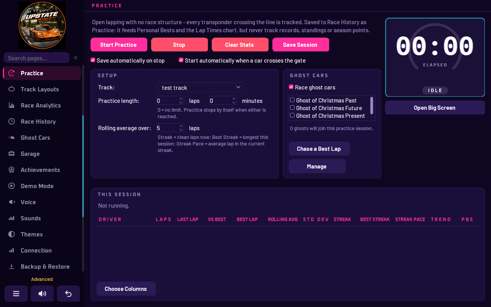
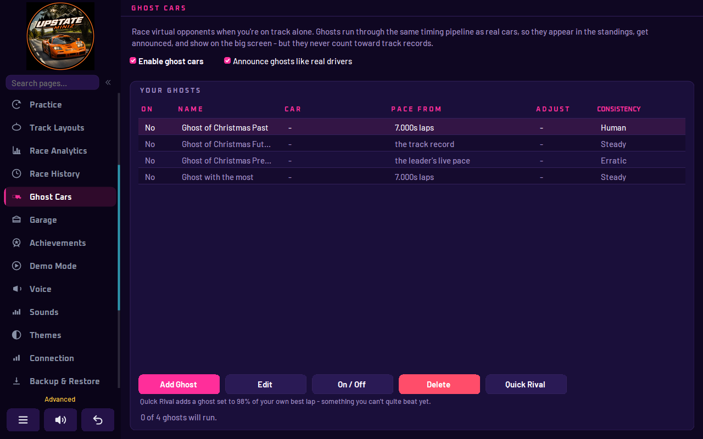
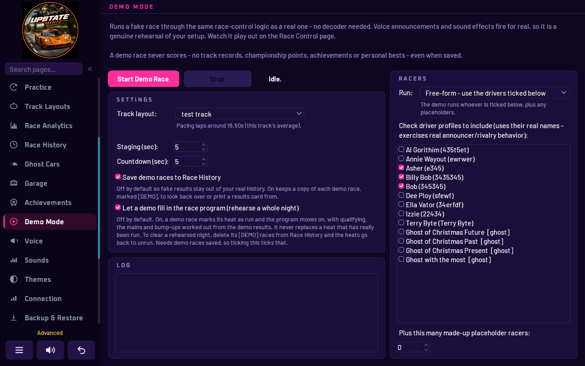
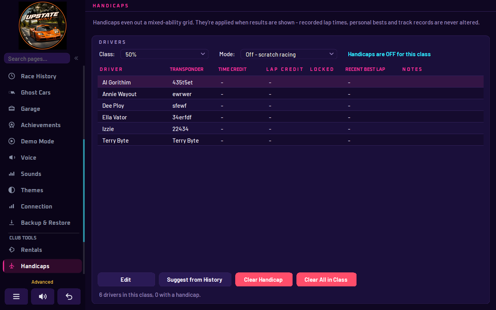

# Practice, ghosts, demos and handicaps

This page covers four features that sit around racing:

- **Practice** for open lapping.
- **Ghost Cars**, virtual opponents to race when you're on your own.
- **Demo Mode**, which runs a simulated race so you can try HeatCaller without a decoder.
- **Handicaps**, for evening out a mixed-ability grid.

## Practice

The **Practice** page is for open lapping with no staging, flags or finish. Every transponder that crosses the line is timed, and the table shows live lap stats instead of a finishing order. It's the quickest way to run an open practice night or a tuning session.

### Run a practice session

1. On the **Practice** page, choose the **Track:** in the **Setup** card.
2. Set a **Practice length:** if you want one (see the settings table below).
3. Press **Start Practice**. The status line reads "Practice running - lap the track freely".
4. When you're done, press **Stop**.
5. To keep the laps, press **Save Session**, or tick **Save automatically on stop** before you stop.

!!! note "Practice and races share the timing session"
    Practice and races use the same timing session, so HeatCaller keeps them apart:

    - **Start Practice** is refused while a race is staged, counting down or running: "Finish the race (checkered flag) or reset it on Race Control first, then start practice." It's refused during a race's warm-up too: press **Reset** on Race Control to cancel the warm-up first. If a finished race is still showing on the **Race Control** board, it asks before clearing it.
    - While practice is running, **Stage**, **Countdown**, **Green**, **Yellow**, **Red**, **Checkered**, **Reset**, starting a round from the program or the Next Up bar, **Start as Demo...** and Demo Mode's start are all refused: "Stop practice first on the Practice page".
    - **Start automatically when a car crosses the gate** only starts practice when nothing else is going on.
    - When practice stops, the next race goes back to its own lap or time limit and start type.

### Practice settings

| Setting | What it does | Default |
|---|---|---|
| **Save automatically on stop** | Saves the session to **Race History** when you press **Stop**. The status line confirms how many drivers were saved. A session with no laps is skipped without a message. | Off |
| **Start automatically when a car crosses the gate** | Starts practice when a car crosses the line and nothing else is running. It never interrupts a race, a countdown or a practice session that's already going. The crossing that starts it counts as that car's first pass, so that car doesn't lose a lap. When HeatCaller opens with an unfinished race to offer back, it waits until you've answered that question. It also waits while the split loop's **Line Up** window is open. | Off |
| **Race ghost cars** | In the **Ghost cars** card, beside **Setup**. Adds the ticked ghosts to the session. This is the same switch as **Enable ghost cars** on the **Ghost Cars** page. **Manage** opens that page. | Off |
| **Track:** | The track layout the session is saved against. It's remembered between sessions. | (none) |
| **Choose Columns** | Under the **This session** table. Picks the columns for the table. See [Running a race](running-a-race.md#columns) for what each column shows. | See below |
| **Practice length:** | A lap target (based on the driver with the most laps) and a time target. Practice stops by itself when either is reached. **0** means no limit. | 0 / 0 |
| **Rolling average over:** | How many recent laps the **Rolling Avg** column averages (2 to 50). This isn't remembered between sessions. | 5 |

The **This session** table is sorted by best lap, fastest first, and its columns share its width. By default it shows **Driver**, **Laps**, **Last Lap**, **vs Best**, **Best Lap**, **Rolling Avg**, **Std Dev**, **Streak**, **Best Streak**, **Streak Pace**, **Trend** and **PBs**.

**Choose Columns** and **Rolling average over:** are shown in Advanced mode only. In Simple mode the table keeps the columns last chosen and the average stays at 5 laps. See [Simple and Advanced mode](../getting-started/simple-and-advanced-mode.md).

Practice uses the minimum lap time from the race format that's currently in force on **Race Control**. It always uses a standard start, even if that format has a staggered or qualifying start. Its clean runs use the practice streak threshold, which is set separately from races on **Sounds → Effects**.

**Clear Stats** empties the table and starts the lap counts again. During a running practice, laps keep being counted: the session restarts straight away with a fresh timer. When practice isn't running, it only clears the practice table and doesn't touch **Race Control**.

### What happens to practice laps

A saved practice session goes into **Race History** as a Practice session named "Practice". Its drivers are ordered by best lap.

- **Counts toward:** personal bests (**Race Analytics → Personal Bests**), the **Lap Times** chart and ghost pace.
- **Never counts toward:** track records, championship points or achievement badges.
- **Ghosts:** never saved.
- **Online:** a saved practice session tonight shows on each driver's own night page, marked **Practice**, with no place (see [A driver's own night](../online/index.md#a-drivers-own-night)).

Practice is never kept for crash recovery. If you close HeatCaller while practice is running, it asks "Practice is running. Close HeatCaller anyway?". Choosing **Yes** stops practice the same as pressing **Stop**, so it's saved if **Save automatically on stop** is ticked. Practice and demos never mark a line on the timetable as started.

The announcer doesn't call flags during practice, because practice has none.

**Open Big Screen** on the Practice page opens the same audience display as Race Control. See [Big Screen](../screens/big-screen.md).

## Ghost Cars

A ghost is a virtual opponent: a car with no transponder that laps at a pace you choose. It shows up on the leaderboard, the Big Screen and the announcer's calls like a real car, so someone practicing alone has something to chase.

Ghosts run in any session once it's racing, whether that's practice or a race, as long as ghosts are switched on.

!!! note
    Ghosts never score. They're left out of every saved result, so they never:

    - take a finishing position or push a real driver down a place
    - count toward championship points or achievement badges
    - set a track record or a personal best.

    When a race is saved, the console confirms how many ghost cars were left out.

### Set up a ghost

The fastest way to get a ghost:

1. On the **Ghost Cars** page, press **Quick Rival**.
2. In **Build a rival from whose best lap?**, choose a driver and press **Add**.

This adds a ghost named "*driver*'s ghost" that runs at 98% of that driver's best lap (2% quicker than their best) with **Human** consistency. It's something you can't quite beat yet.

To build a ghost by hand:

1. Press **Add Ghost**.
2. Enter a **Name:** (required, because it's what the announcer calls it). You can also enter a **Car:**.
3. Under **PACE**, choose **Based on:** and fill in the fields that appear.
4. Set **Pace adjust:** and **Consistency:**, then press **Save**.
5. Make sure **Enable ghost cars** is ticked.

| Page control | What it does | Default |
|---|---|---|
| **Enable ghost cars** | Master switch. Ghosts only join a session when this is on. | Off |
| **Announce ghosts like real drivers** | The announcer calls ghosts, including when you pass a ghost or a ghost passes you. | On |
| **Add Ghost** / **Edit** | Create or change a ghost. You can also double-click a row to edit it. | |
| **On / Off** | Turns the selected ghosts on or off. You can select several at once. | |
| **Delete** | Deletes the selected ghosts. You can undo this. | |

The **Your ghosts** list shows **On**, **Name**, **Car**, **Pace from**, **Adjust** and **Consistency** for each ghost.

### Pace sources

| **Based on:** | The ghost laps at |
|---|---|
| **A fixed lap time** | The **Lap time:** you enter, in seconds. |
| **A driver's personal best on this track** | That driver's best saved lap on the track in **Track:** on the Race Control **Session** row, or on any track if none is selected. It respects personal-best resets. |
| **A driver's best tonight (or ever, before tonight's)** | That driver's best lap tonight on this layout, from the session running and anything saved tonight, or their best ever on it before they've set one tonight. Fixed for the run: unlike the live pace, it doesn't speed up the moment they beat it. It respects personal-best resets. This is what **Chase a Best Lap** sets up (below). |
| **A driver's personal best within a date range** | That driver's best lap set between the two dates in **Laps set between:**. |
| **A driver's recent average pace** | That driver's average lap from the most recent session they raced in. The lap from the start to their first crossing, and stops such as a battery change, are left out. |
| **The track record for this layout** | The all-time record on the track layout in **Track:** on the Race Control **Session** row. |
| **Live: a driver's pace in this session** | The driver's pace in the session that's running, re-read every lap. **Follows:** picks their best lap so far or their recent average. The ghost gets faster as the driver does. |
| **Live: whatever the leader is running** | The pace of the leading real car, re-read every lap. |

During practice, ghosts take their track from the Practice page's own **Track:** instead, and in a demo from the Demo Mode page's **Track layout:**. The speed columns and the live track map use the same track.

A live ghost has nothing to follow until laps come in, so it starts at the driver's personal best, or at the time in **Until laps come in:**.

- **Pace adjust:** scales the pace. 100% is exactly the source pace, below 100 is quicker ("something to chase") and above 100 is slower ("something to stay ahead of").
- **Consistency:** controls how much the ghost varies from lap to lap:
    - **Metronome**: identical every lap, good as a pace target.
    - **Steady**: small variation.
    - **Human**: the odd scrappy lap.
    - **Erratic**: fast laps and bad ones.

If a ghost's pace can't be worked out when the session starts, that ghost sits out, and the console says why. For example, the driver may have no personal best on this track yet, or no track is selected for a track-record ghost. Each ghost that does start is listed in the console with the lap time it's running.

Ghosts don't slow down for a yellow or stop for a red. Their laps aren't counted while the red flag is out.

Switching a ghost off during a session (with **On / Off**, **Enable ghost cars** or **Race ghost cars**) takes it off the track and off the board at once. Switching one on during practice puts it on track straight away. During a race, a ghost you switch on joins straight away if other ghosts are already racing; otherwise it waits for the next race. A ghost that joins a race part-way through doesn't count for **Ghost Buster** or **Shadow Boxer**.

Ghosts from the previous race stop as soon as you stage the next race. If you undo that **Stage** (or a **Countdown** over a running race, or a **Reset**), the old race comes back with its ghosts carrying on mid-lap, on their own rhythm, as though they had kept lapping. The crossings they would have made in the gap aren't counted, the same as for real cars, so each ghost's lap across the gap comes out long. The console says, for example, "[ghost] *name* back on track at 6.500s, carrying on from 12 laps - ...".

### Chase your own best

**Chase a Best Lap**, on the Practice page's ghost cars card, puts a ghost of a driver's own best lap into practice, so they can see on every lap whether they're gaining on it. It's also on Race Control's right-click: **Coach *name*** → **Chase *name*'s best (ghost)**.

In practice, the ghost's row sits just under its driver on the board, wherever it is in the order, so the two are read side by side, and the ghost's gap column shows its gap to them. In a race nothing is moved: the board is the running order. **Coach *name*** → **Gap to their ghost** has the announcer say where the ghost is on the track each time the driver crosses the line.

1. Click **Chase a Best Lap** and pick the driver from **Whose best lap should the ghost run at?** Drivers on the board are listed first.
2. Click **Chase**. A ghost called, for example, "Sam's best" joins the practice at their best tonight on this layout, or their best ever on it before they've set one tonight. Ghost racing is switched on with it, and in a running practice it goes straight on track.
3. When they beat it, pick the same driver again: the ghost is brought up to their new best from its next lap, rather than a second ghost being added.

It's a ghost like any other: it's on the board and the Big Screen, it can be edited or switched off in the ghost list, and it's kept out of records, results, points and badges. One **Undo** takes back only what the chase did: a new ghost comes off, a brought-up ghost goes back to the best it was running, and ghost racing is switched off again if the chase switched it on. Other ghosts, and anything you changed after the chase, are left alone. A driver with no lap on the layout at all has nothing to chase, so the ghost sits out and the console says why. "Nobody to chase" means there are no driver profiles yet.

## Demo Mode

**Demo Mode** runs a fake race through the same race logic as a real one, with no decoder needed. Announcements, sound effects, the leaderboard and the clock all work for real, so it's a full rehearsal of your setup before race day. Switch to the **Race Control** page to watch it.

### Run a demo

1. In the **Settings** card, choose a **Track layout:**. If the layout has an average lap time set, the demo paces laps around it. Otherwise it uses a made-up pace.
2. Set **Staging (sec):** and **Countdown (sec):**.
3. In the **Racers** card, choose what to **Run:**:
    - **Free-form - use the drivers ticked below**: tick driver profiles (using real profiles tests real names and rivalry lines), and add up to 8 made-up placeholder racers. Ghost cars are in the list too, marked "[ghost]". Only the drivers and ghosts you tick run in the demo.
    - A round from today's program: runs the drivers already in that round. It reads the round but never changes it. A round with nobody assigned uses placeholders.
4. Press **Start Demo Race**. The demo's log starts with who's in it, for example "In this demo: ... Ghost cars run only if ticked under Racers."

A demo can't start while practice is running ("Stop practice first on the Practice page"), or while a real race is staged, counting down or running. A demo of ghost cars only is refused with **Nobody to race** when none of them can run, because ghost cars are switched off or none of the ticked ghosts is switched on.

The demo uses the race format in force on **Race Control**, so it ends at the lap or time limit like a real race. With no limit, it runs until you press **Checkered** (once the demo has gone green; during its staging and countdown **Checkered** is refused, as for any start) or **Stop**. The flag buttons work during a demo: a yellow slows the field and a red stops it.

Now and then the demo sends a pass that's too quick, to show the minimum lap time filter at work.

You can also right-click a round in the program on **Race Day → Next Steps** and choose **Start as Demo...**. It's refused while a real race is staged, counting down or running ("A race is running. Starting a demo would wipe it. Finish it or reset it on Race Control first."), before anything is changed. See [Program and mains](../race-day/program-and-mains.md).

### Stop a demo safely

Press **Stop** on the Demo Mode page. It stops the simulation at whatever step it's at, resets the timing session and clears any queued announcements, so you don't hear a backlog after it ends. A demo that finishes on its own clears the queue too.

**Stage**, **Countdown**, **Reset** or a first **Green** on **Race Control**, or starting a round from the program or the Next Up bar, also ends the demo, so a real race can take over. The Demo Mode page goes back to idle and says "Stopped - Race Control took over the session." A demo ended this way isn't saved to **Race History**, even with the save box ticked, and **Undo** doesn't bring it back. Once the demo is racing, **Green** after a caution and **Checkered** act on the demo as usual.

**Stop** on the Demo Mode page only ever stops the demo. It never resets a real race.

### Demo results

Demo races are never offered back after a crash. By default they aren't saved either. To save them to **Race History**, for example so you can look at a finished demo afterwards, tick **Save demo races to Race History** in the **Settings** card on the Demo Mode page.

A saved demo is marked as a demo and is never scored:

- In **Race History** its type is **Demo**, and its detail title reads "Demo race (not scored)".
- By default it's never linked to a heat and never moves the program on, even if a round is selected on **Race Control**, and running a round with **Start as Demo...** leaves that round unrun. To rehearse a whole night, tick **Let a demo fill in the race program (rehearse a whole night)** in the **Settings** card (it ticks **Save demo races to Race History** too): a demo race then marks its heat as run and the program moves on, with qualifying, the mains and bump-ups worked out from the demo results. A demo never replaces a heat that has really been run. To clear a rehearsed night, delete its demo races from **Race History** and the heats go back to unrun.
- It never counts toward championship points (even if you tick it into a championship by hand), badges and achievements, personal bests, track records, ghost pace, handicap suggestions, Race Analytics totals, trends and head-to-head, the event report, or battery pack pace. It counts toward qualifying only when it's been let fill in the program, as above.
- It isn't published to the online relay, neither in results nor in track best laps. The one place it goes online is each driver's own night page, marked **Demo** and counted for nothing, so they can look at their lap stats after a rehearsal (see [A driver's own night](../online/index.md#a-drivers-own-night)).
- In the results JSON export it has an `"isDemo"` field.

So you can use real driver profiles in a demo without affecting anyone's records.

## Handicaps

The **Handicaps** page evens out a grid where drivers have very different pace. A handicap is a scoring decision, not a measurement. Recorded lap times, personal bests and track records are never changed. The handicap is applied when results are shown.

### Set up handicaps for a class

1. On the **Handicaps** page, choose the **Class:**.
2. Choose the **Mode:**:
    - **Off - scratch racing**: no handicap (the default). The page shows "Handicaps are OFF for this class".
    - **Time credit (seconds off total)**: takes each driver's credit off their time. See [How time credits are scored](#how-time-credits-are-scored).
    - **Lap credit (whole laps added)**: adds whole laps to each driver's lap count.
3. Select a driver and press **Edit** (or double-click the row). Set the **Time credit:** (0 to 600 seconds) or the **Lap credit:** (0 to 20 laps). Only the one that matches the class's mode is used.
4. Press **Save**.

The grid lists everyone in the class, with **Driver**, **Transponder**, **Time credit**, **Lap credit**, **Locked**, **Recent best lap** and **Notes**. **Clear Handicap** removes the selected driver's handicap, and **Clear All in Class** removes everyone's, including locked ones. All changes can be undone.

### Suggested credits

**Suggest from History** works out time credits from recent pace:

1. Set **Use last:** (how many of each driver's recent sessions to use, default 5) and **Typical race:** (laps, default 20).
2. HeatCaller averages each driver's best lap across those sessions. It gives each driver the gap to the quickest driver's average, multiplied by the typical race length. The quickest driver is scratch. The aim is for everyone to finish together.
3. Tick the suggestions you want (the **Apply** column) and press **Apply Ticked**.

Nothing is applied until you tick it, and **Apply Ticked** is off while nothing is ticked. Drivers you've marked **Locked - leave this driver alone when suggesting** start unticked. At least two drivers in the class need a recorded best lap. Applied suggestions note how they were worked out in **Notes**.

### How time credits are scored

A time credit is usually worked out as a driver's gap over a whole race, so on a timed race a slower driver finishes laps down, not just seconds behind. HeatCaller allows for that:

1. Each driver who was still running at the end has their time projected to the winner's lap count, at their own average pace. For example, 297 seconds for 27 laps becomes 330 seconds for 30.
2. Their credit comes off that projected time. Time penalties are added on as they are, not scaled.
3. Drivers are ranked on the result, so a credit can make up laps, not only break a tie.

When everyone finishes on the same lap, this is simply the credit off their total time. Drivers who stopped before the end (retired) are ranked behind everyone still running, by laps and then time. Drivers marked **DNF** come after the finishers, then drivers with no laps, and drivers marked **DQ** go last.

The winner's lap count and the end of the racing are taken from the finishers only. A **DNF** or **DQ** driver can't set them, so a disqualified car that ran a lap more than the winner doesn't change who wins on handicap.

A handicap (pursuit) start isn't scored this way: its credits were already used as the head start on track.

### Where handicaps show

- **Race History** adds a **Handicap Pos** column when the session's class has a handicap mode. It shows the adjusted position and the credit, for example "P2  (-12.5s)". The raw position stays in **Pos**, so you can check the result.
- The **Event Report** shows a **Handicap pos** column and marks the handicap winner as the class winner.

Handicaps apply only to races tied to a round, because that's how HeatCaller knows the class. Freeform races are always scratch. The live leaderboard always shows the raw order. Championship points are scored on the raw finishing order.

### Handicap (pursuit) starts

Instead of adjusting the result, you can give slower drivers a head start. Set **Start:** to **Staggered - handicap** in the class's race format. The biggest time credit goes first, on the green, and the scratch drivers wait longest. See [Running a race](running-a-race.md#handicap-pursuit-start).

!!! warning
    Use one or the other, not both. With a handicap start and the class's mode also set to **Time credit (seconds off total)**, each credit counts twice. For a handicap start, set the class's **Mode:** to **Off - scratch racing**.
