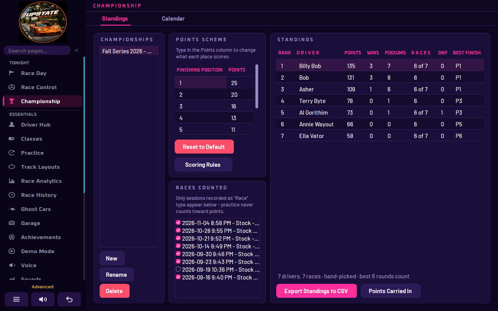
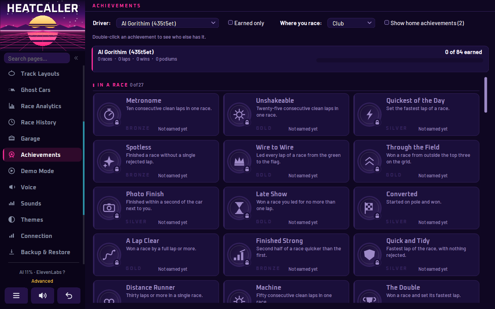

# Results and championships

Every finished race is saved automatically. This page covers where results go and what you can do with them:

- **Race History**: exports, results cards, replays and the event report.
- **Championship**: points tables and standings.
- **Race Analytics**: records, personal bests and pace.
- **Achievements**: badges drivers earn.

## What gets saved, and when

When a race finishes (see [Running a race](running-a-race.md#finishing)), HeatCaller:

1. **Saves the result to Race History** straight away, with every driver's laps, lap times, best lap, total time, rejected passes, laps led and starting position.
    - Ghost cars are left out, and the places close up behind them.
    - The saved name is the session name you typed, or the round's name, or "Race".
2. **Links the race to its round**, so the race program on **Race Day → Next Steps** shows the round as run and qualifying can use the result.
3. **Works out badges** (see [Achievements](#achievements)).
4. **Saves a results card image** to a **HeatCaller Results** folder in your Documents folder. The console shows the full path.

Practice sessions are only saved when you save them from the **Practice** page. Demo races aren't saved unless you turn that on, and a saved demo is never scored and never counts toward anything on this page. (It only marks a heat as run when **Let a demo fill in the race program** is ticked on Demo Mode.) See [Practice, ghosts, demos and handicaps](practice-and-ghosts.md).

Corrections made on the **Race Control** board after the checkered flag change the board but not the saved result. To correct a saved result, use **Edit Result** on **Race History**. See [Correcting a saved result](corrections-and-recovery.md#correcting-a-saved-result).

## Race History

The **Race History** page has its buttons in one bar across the top, the **Sessions** card down the left, and the **Results** card taking the rest of the width.

**Sessions** opens with a month calendar. Every night with saved sessions has a dot under its date and can be clicked; the other days are grayed out. Click a night and its sessions are listed under the calendar, with a line such as "Friday 14 Nov · 6 sessions". Each session shows **When** (its start time) and **Session** (its type and name, for example "Race · Stock A-Main"); hover over one for the full date, time and name. Tick **Every night** to list every saved session instead, with the date in **When**. With the calendar picked, <kbd>Left</kbd> and <kbd>Right</kbd> go to the night before or after, <kbd>Page Up</kbd> and <kbd>Page Down</kbd> go back or on a month, and <kbd>Home</kbd> goes to the latest night.

A night runs from 6 a.m. to 6 a.m., so mains that ran past midnight stay on the night they belong to. Opening the page shows the latest night, and one session is always picked, so the results are never blank.

Four tiles over the results sum up the race picked: **Winner** (with their laps; **Handicap winner** in a class with handicaps), **Fastest lap** and who set it, **Best ideal lap** (with a split loop) and **Warnings** (how many, and how many drivers had them).

The results show **Pos**, **Driver**, **Car**, **Laps**, **Fastest Lap** and **Lap Times**. The race's fastest lap is picked out in its **Fastest Lap** cell. **Lap Times** draws each driver's laps as a line, quicker laps higher, all on the same scale so the lines can be compared, with a dot on their best lap; hover over it for their lap count and best lap. Some columns only appear when the race needs them:

- **Handicap Pos** when the class uses handicaps.
- **Warnings** when anyone was warned: the number of warnings a driver was given (for example "⚠ 2"), or "Black flag" with the count when one of them was a black flag. Hover over it to see each warning.
- **Best Sectors** and **Ideal Lap** when the session was run with a [split loop](../timing/decoders.md#a-split-loop). Each best sector is shaded by how close it came to the race's best through that sector.
- **Class Place** for a heat shared by more than one class: each driver's class and their place in it.

In a narrow window, **Lap Times** goes first and then **Car** (it's still in the hover over the driver's name), so the results fit without scrolling sideways. They come back when there's room.

A saved demo race shows **Demo** as its type, and its detail title reads "Demo race (not scored)". A race brought in with **Paste a Result** shows **Imported**, and its detail title reads "Imported from LiveRC (not scored)", or "Imported from another results page (not scored)" when it wasn't copied from LiveRC.

Use Ctrl+click or Shift+click to select several sessions, for exporting, printing or deleting.

After the checkered flag, **Edit Result** on Race Control's flag row opens the race just run here, already selected, with **Edit Result** open. See [The flag row after the flag](running-a-race.md#the-flag-row-after-the-flag).

Below the results is a notes box, for the weather, the track surface, incidents or anything else worth remembering. Notes are saved when you click away from the box, or when you close HeatCaller.

The buttons, left to right across the top: **Replay**, **Pace**, **Share Results Card**, **Event Report**, **Print Results**, **Export Results**, **Export Session**, **Edit Result** and **Paste a Result**, with **Delete Session** on its own at the right-hand end. In a narrow window the bar wraps onto a second line.

| Button | What it does |
|---|---|
| **Replay** | Plays the race back as a running order over time. |
| **Pace** | Opens the pace table for the race (see [Pace](#pace)). |
| **Share Results Card** | Saves the result as an image to share. |
| **Event Report** | Builds a one-page report for a whole race day. |
| **Export Session** | Saves the selected session as a CSV file. |
| **Export Results** | Exports results or laps for many sessions, as CSV or JSON. |
| **Print Results** | Prints the selected races' results, with a preview first. See [Printing results](#printing-results). |
| **Paste a Result** | Brings in a race result copied from another timing program's results page, such as LiveRC. See [Pasting a result from LiveRC](#pasting-a-result-from-liverc). You can undo this. |
| **Edit Result** | Corrects a saved race: laps, time and lap penalties, or an outcome such as DNF or DQ, with a reason. Needs **Allow corrections to saved results** ticked on **Local Screens**. You can undo this. See [Correcting a saved result](corrections-and-recovery.md#correcting-a-saved-result). |
| **Delete Session** | Deletes the selected sessions after you confirm. A heat whose race you delete goes back to unrun on the race program, so it can be run again. You can undo this. |

Right-click a driver in the results and choose **Report Card for *name*...** for that driver's report card for the night of that race: their best and ideal lap, their driver rating (out of 150), consistency, the sector that costs them most, how they compare with last time on the layout, what a setup change logged that night did to their pace, and how far off the quickest driver they raced with they were. It's the full card, setup line included, since it's on the club's own laptop. See [The report card](../screens/phone-and-web.md#the-report-card) for each line. "Nothing to report for that night - no laps were filed for this driver. The card fills in from the laps of a night they raced." means there's nothing saved to work it out from.

The card opens in its own window with **Print** (a Letter page, with a preview), **Save Image** (the same page as a PNG to send on) and **Copy** (the lines as text, to paste into a message).

Tonight's card is also on **Driver Hub**: right-click a driver in the roster and choose **Report Card for *name*...**. It says the same "Nothing to report for that night" line when nothing has been filed for them yet tonight.

### Replay

**Replay** plays a finished race back as the running order over time. Each driver has a lane, and the lanes cross when positions change. The window doesn't show cars moving around a track: the decoder only records when each car crossed the line, so drawing anything in between would be made up.

Press **Play**, drag the slider to move through the race, and choose a speed from 1x to 16x.

Races saved before lap-by-lap times were recorded can't be replayed.

### Results card

**Share Results Card** makes an image of the result: title, date, track and the top eight finishers, with **POS**, **DRIVER**, **LAPS** and **FASTEST LAP**. Each driver's car is under their name, and a DNF or DQ from **Edit Result** shows in the laps column. When there are more than eight drivers, a line says how many aren't shown ("+3 more not shown"), and names any DNF or DQ among them. At the foot it says "Timed and called by HeatCaller" beside HeatCaller's sun. It's ready to paste into a group chat or a social post.

1. Select a session and press **Share Results Card**.
2. Choose a **Style:**:
    - **Print friendly - white background, dark ink**
    - **Monochrome - white background, gray lines (mono printers)**
    - **Match the app's look - as shown on screen**
3. Check the **Preview** card and press **Save**. The results card always comes out the same size, so there is no **Size:** list here.
4. Choose where to save the PNG file.

The style you pick is remembered for next time.

The card saved automatically at the end of a race uses the app's own on-screen style. It also lists any badges the race unlocked, under **UNLOCKED**.

<!-- TODO: confirm whether the style of the automatic end-of-race card can be changed anywhere in the UI; no setting was found. -->

### Exporting results

**Export Session** saves one session as a CSV file with the columns **Position**, **Driver**, **Car**, **Laps**, **Fastest Lap (s)**, **Elapsed**, **Status** and **Laps Counted By Hand**.

**Export Results** opens the **Export Results** dialog:

1. Choose a **Format:**:
    - **Results CSV - one row per driver, per session**. Columns: SessionDate, SessionTime, SessionLabel, Round, Class, Track, Position, Driver, Transponder, Car, Laps, TotalTimeSeconds, BestLapSeconds, Status, LapsCountedByHand. **Status** is the driver's result status, for example DNF or DQ after a correction. **LapsCountedByHand** is how many of the laps were added by hand (see [Laps counted by hand](#laps-counted-by-hand)). A driver skipped and scored DNS (see [Skip a driver in the next race](running-a-race.md#skip-a-driver-in-the-next-race-dns)) has a row after the race's finishers with their name and transponder, **Status** DNS, and Position, Car, Laps and the times empty.
    - **Lap CSV - one row per lap**. Columns: SessionDate, SessionTime, SessionLabel, Round, Class, Driver, Transponder, LapNumber, LapSeconds, CumulativeSeconds. Lap 1 is the start lap, which runs from the green to the car's first crossing. When any exported lap has sector times, there's also a column for each sector, S1Seconds, S2Seconds and so on, empty for a lap without them.
    - **JSON - complete structured data**. One object per session, each with its results, and each result with its full list of lap times. Each session has an `isDemo` field, so you can filter out demo races, and an `importedFrom` field that names where a pasted race came from ("LiveRC", say; `null` for a race HeatCaller timed). Each result has a `status`, a `lapsCountedByHand` count, and an `outcome` of `DNF` or `DQ` when a correction set one (`null` otherwise). With a split loop, each result also has `sectorTimesSeconds`: each lap's sectors, in step with its lap times (`null` for a lap without them, or for the whole result when it has none). Each session ends with `didNotStart`: the drivers scored DNS, each with `driver`, `transponder` and `status` `DNS` (an empty list when nobody was). The Lap CSV has no rows for them: they never turned a lap.
2. Under **Sessions**, choose **Selected only** or **All recorded sessions**. Each shows how many sessions it covers. With nothing selected, **Selected only** reads "Selected only (nothing selected)" and can't be chosen.
3. Press **Export** and choose where to save the file.

All CSV exports are:

- **UTF-8 with a byte order mark**, so Excel shows accented names like "Zoë" and "Müller" correctly.
- **Written with a decimal point**, whatever your Windows region settings are.
- **Formula-safe.** A text field that starts with `=`, `+`, `-` or `@` (a driver name typed as a formula, for example) is saved with a leading apostrophe, so a spreadsheet treats it as text rather than running it. Numbers, including negative ones, are left as they are.

### Printing results

Select one race, or several with Ctrl or Shift, and press **Print Results**. Pick the printer, check the preview, and print from the preview's toolbar. The races print oldest first on letter-size pages, black on white, with **Pos**, **Driver**, **Car**, **Laps**, **Best lap**, **Total** and **Status**. Drivers scored DNS are listed in grey under the finishers, with **DNS** for their position and status and a dash for the rest. A race that would fit on a fresh page starts on one rather than being split; a race too long for any page carries on with "(continued)". With nothing selected, it says so.

### Pasting a result from LiveRC

Races run before your club used HeatCaller can be brought into Race History from their results page on LiveRC, or from another timing program that shows results as a table.

1. On the results page, select the whole result, from the **Pos** heading down to the last driver, and copy it (<kbd>Ctrl</kbd>+<kbd>C</kbd>). Taking in the race's name above the table ("Race 33: Stock Buggy A-Main") lets HeatCaller fill in the class and round for you.
2. On **Race History**, press **Paste a Result**.
3. Check **Class:**, **Round:** and **Run on:** (the day and time the race was run; it starts at now), and look over the drivers as they'll come in: **Pos**, **Driver**, **Laps**, **Time** and **Fast lap**. **Profile** says "Matched" when a driver was matched to one of your driver profiles by name, or "None, by name". A line under the list counts the drivers with no profile, and any rows that couldn't be read and were left out.
4. Press **Import**.

The race is saved with the class and round as its name ("Stock Buggy A-Main"), or "Imported race" when both are blank.

If the clipboard holds no result table, it says "There's no race result on the clipboard." Select the whole table again, headings and every driver's row, and copy it.

What to know:

- **It never scores.** A pasted race is kept for the record only. It doesn't count toward personal bests, track records, badges, championships, qualifying, the **Overview**, **Head to Head** and **Trends** on Race Analytics, or the Event Report, the commentary never talks about it, and it isn't sent to the online results. It isn't linked to a round on **Race Day** either, so no round is marked as run.
- **Drivers are matched by name.** A driver whose name is the same as one profile's (capitals don't matter) gets that profile's name, transponder and car. One with no profile, or a name two profiles share, comes in by name alone. Names in capitals ("COLTON FURNARI") are written the usual way, a car number in front of the name is left off, and a name LiveRC shows twice ("FURNARI, COLTONCOLTON FURNARI") is put back to one.
- **What comes in.** Finishing order, laps, total time and fast lap. A time written with a decimal comma ("17,234", "10:10,631") is read whole, the same as one with a point. Lap-by-lap times and transponders aren't in LiveRC's results table, so they don't come in.
- **It can't be corrected with Edit Result.** To change a pasted race, delete it and paste it again.
- **Nothing is fetched.** HeatCaller only reads what you copied. It never opens LiveRC or signs in to it.

### Laps counted by hand

When a transponder stops being read and you add laps with **+1 Lap** (or the keyboard shortcut) during the race, or with **Edit Result** afterwards, the result remembers how many laps were counted by hand. Scoring doesn't change; the count is there so a result built partly by hand can be trusted and questioned.

The lap count shows with a star, for example **12\***, wherever results are shown: the leaderboard, Race History, the Event Report, printed results, the OBS overlay on the club's Wi-Fi and the live board on the club's online pages, each with the line "\* includes laps counted by hand". In Race History, hover over the count to see how many. On Race Control, the driver's lap strip ends "+2 by hand", and the optional **By Hand** column (see [Columns](running-a-race.md#columns)) shows the count. Taking a lap off removes a hand-counted one first.

The club's website (the relay) doesn't show the mark yet: its live board and results show the plain lap count.

### Event Report

**Event Report** builds one HTML page covering a whole race day. You can print it, email it or open it on a phone.

1. Choose the **Day:**. Only days with saved sessions are listed.
2. Enter an **Event name:**. The default is "Club Race Day".
3. Under **Include**, tick what you want:
    - **Qualifying standings**
    - **Tech inspection summary**
    - **Rental transponders not returned**
    - **Every lap time (makes the report much longer)** (off by default).
4. Press **Generate**, choose where to save the report, and choose whether to open it.

The line above the buttons says how many sessions the chosen day has, and how many rentals are still out.

The report starts with the day's totals: sessions, drivers, laps run and the fastest lap. **Night pace** comes next (see below). With an entry fee on the race day, **Money at the desk** follows: cash and card taken, comps, and who still owes (see [Money at the desk](../race-day/events-and-entries.md#money-at-the-desk)). Rentals still out come after that, so they get noticed. After that come the qualifying standings (worked out the same way as the race program's **Standings**, which is **Tonight's Standings** on a club night; see [Qualifying standings](../race-day/program-and-mains.md#qualifying-standings)), the results grouped by class, the fastest laps of the day, the tech inspection summary and, if you ticked it, every lap. Races with no round are listed under "Other sessions". Each result shows the driver name saved with it, so a transponder that has since changed hands still shows who raced.

**Night pace.** How quickly the night ran, worked out from the races saved. It starts with the race director's two measures:

- **Entries close to heats posted:** from the **Entries close at:** time on **Race Day → Setup** to the moment you posted the heats. Aim for under 5 minutes. If you didn't post the heats, it's measured to the first green instead, and the card says "(heats not posted)". Heats posted before entries closed are shown as how long before.
- **Doors open to first green:** from the first check-in of the night to the first race's green. The first check-in is noted by itself, however the driver was checked in: at the desk, on a phone, or with **Check In All**. Practice doesn't count as the first green.

Then the numbers from the races themselves:

- **Green to green (typical):** how far apart the races started. It's the median, so one long break doesn't hide a quick night.
- **Worst green to green:** the two races that started furthest apart, and what HeatCaller saw in the gap between them.
- **Finish to next green (typical):** the usual time from one race's finish to the next race's green. This is the dead time between races.
- **Finish to result saved (typical)** and **Call-up to green (typical):** the two parts of that gap HeatCaller can see. They're shown once races have been saved and called up with this version.
- **Of the night on track:** the share of the time from the first green to the last finish when cars were racing.
- **Races run:** how many of the race day's heats and mains have a race, out of the program.
- **Longest gaps:** the three longest waits between races, and what happened in each one.

What happened in a gap, most telling first:

- *a planned break (10 min)*: a break you added with **Breaks...** on **Setup**.
- *held 3 min at the desk*, *pushed back 2 min (+1 min)*, *5 min more for a driver who asked*: Auto start's **Hold**, **+1 min** and a driver's **Need 5 minutes** from their phone.
- *waited 2 min for the time drivers were given*: Auto start held the race back to its posted time (see [Auto start between races](running-a-race.md#auto-start-between-races)).
- *building heats*, *building the finals*, *correcting a result*.
- *saving the result took 4:10*: 3 minutes or more from the checkered flag to the result being saved.
- *waiting at the grid*: the time from staging the race to its green, when that's 3 minutes or more.

When none of those happened, HeatCaller names the gap by its length. A gap of 20 minutes or more is *a break*. A gap at least 5 minutes longer than Auto start's gap is *idle director*: nothing was going on, and nobody started the next race. If the race was called up, it says how long after the flag that was. A shorter gap says "nothing recorded".

Practice, demo races and pasted results aren't counted. A break of more than 3 hours (an afternoon session, then an evening program) splits the night in two and doesn't count as a gap. The section is left out with fewer than two races and nothing to measure. When every round has been run, the same numbers appear on one line on the race program's next-step card, and on the **Close the Night** checklist under its headline. Times at the grid, call-ups, saves and what the desk did are saved from the versions that added them, so older races show the other causes only.

**On the club's results page.** With results published to the [club website](../online/index.md), each race night on the **Results** page has a line under its date: "Night pace: Green to green 6:10 (worst 14:20) · 31% on track · 18 of 18 races run". Only the numbers go online, never what happened in the gaps, so nobody's quiet moment at the desk is on a public page.

**Which races the report covers.** When a race day (event) set up on **Race Day → Setup** raced on the chosen day, the report covers that race day's own rounds, including any that ran past midnight. Practice and races with no round are included when they ran on a day that race day raced. Otherwise the report covers everything saved on that date. If more than one race day raced on the chosen date, the report covers everything recorded on the date and says so at the top. The tech inspection summary always covers the same races as the rest of the report. Saved demo races and pasted results are always left out (and a day with only those isn't offered under **Day:**), and ghost cars never appear in the fastest laps or the driver count.

When a class uses handicaps, the results show a **Handicap pos** column, and the handicap winner is marked as the winner.

## Championship

The **Championship** page has two tabs, **Standings** and **Calendar**. The **Standings** tab is where you build a championship (a season) and see its table. Your championships are cards down the left, each with its class, how far through the season it is ("Stock · round 7 of 8", with a bar) and who leads, or who won once it's over. Pick one and it fills the rest of the page: its name, its rules in a line ("mains only · best 6 count · new races added automatically"), **More** (**Rename** and **Delete Championship**), and four views to switch between: **Standings**, **Races**, **Points & Rules** and **Carried In**. **Standings**, **Races** and **Carried In** each say how many they hold. See [Championship → Calendar](../race-day/events-and-entries.md#championship-calendar) for the **Calendar** tab.

### Create a championship

1. Under **Championships**, press **+ New Championship** and enter a **Season name:**.
2. On **Points & Rules**, press **Edit Scoring Rules** and set what counts (see below). The rules in force are listed beside the points, a line each.
3. Check the points table under **Points scheme**, on **Points & Rules**. The default is 10-9-8-...-1 for positions 1 to 10, and positions below 10 score nothing. Type in the **Points** column to change what a place scores. A value has to be a whole number of 0 or more: a negative one is refused with "Points can't be below 0 - a place scores 0 at the least. Fix it, or press Esc to put back what was there.", so racing a round can only ever add to a driver's total. (A negative value in a file from an older version scores 0.) **Use the Default Points** puts the default table back, and **Undo** puts your own back.
4. Check the races ticked on **Races**.

**More → Rename** and **More → Delete Championship** work on the championship picked. Deleting a championship doesn't delete any races, and you can undo it.

### Scoring rules

**Edit Scoring Rules** opens the rules for the championship picked. Tiles across the top sum them up as you change them (**Races join**: **Automatic** or **By hand**; **Race days**; **Rounds counted**), and the settings are in three cards: **What counts**, **How it adds up** and **For the announcer**.

| Setting | What it does | Default for a new championship |
|---|---|---|
| **Add new races to this championship automatically** | Races that match the rules below join the championship as they're recorded. When it's off, you tick every race by hand. Turning it off keeps the races it already counted ticked, so the table stays as it was. Turning it back on hands those races back to the rules, so a later change to the rules drops the ones that no longer match. | On |
| **Class:** | Only count races from this class, or **(every class)**. If the class is no longer on the **Classes** page (it was deleted, say), it shows as "(missing class) *name*" and the championship keeps it. Renaming a class carries the new name to its championships. | (every class) |
| **Only count mains - leave qualifying heats out** | Leaves qualifying heats out. | On |
| **Count every race day** | Untick it to choose which race days count, by ticking them in the list of race days. A race day whose **Championship:** on **Race Day → Setup** names this championship counts either way, and is marked ✓ in the list. | On |
| **Count each driver's best:** | "Best N rounds": only each driver's N highest-scoring rounds count. **0** counts every round. | 0 |
| **Rounds in the season:** | How many rounds the championship is *scheduled* to run. It changes no points and no standings. It's the one figure that lets the announcer, and the **Can they still win?** card, say what's still possible: "nobody can catch him now", "three rounds left and these two are level", "a win today and it's his". **0** means you haven't said. | 0 |
| **Announcer's note:** | One sentence about the season in your own words, up to 60 characters, for example "two rounds left and four points covering the top three". **Only the announcer uses this.** It's read out as typed at the Tonight Open and in the sign-off numbers, on a night with a race this championship counts. Leave it empty to say nothing. See [The top and tail of the night](../announcer/commentary.md#the-top-and-tail-of-the-night). | Empty |

With **Count every race day** unticked, at least one race day has to be ticked. Pressing **Save** with none ticked says "No race days ticked" and asks you to tick the days, or tick **Count every race day**.

The rules read each race's round to find its class and whether it was a main. A freeform race with no round can't match a class or mains-only rule, but you can still tick it by hand.

Championships created before the rules existed stay hand-picked until you turn the rule on.

!!! note
    **Rounds in the season** isn't something HeatCaller can work out, which is why it has to be typed. A championship here is a set of races that have *happened*, plus a rule that takes more in as they're recorded — there's no calendar in it. And **Count each driver's best** looks like a season length but isn't: it's a drop cap, a rule about each driver's own rounds. See [what the championship still has riding on it](../announcer/commentary.md#what-the-championship-still-has-riding-on-it) for what the announcer does with it.

### Ticking races in and out

The list on **Races** shows every saved race with its date, time, name and track, marked with its class and kind (or "(freeform)"). A tick means the race counts.

- Untick a race the rule included (a rained-off round, say) to force it out. It stays out even if the rule would include it later.
- Tick a race the rule doesn't include to force it in.

Only sessions recorded as "Race" appear here. Practice sessions, demo races and pasted results aren't listed, and never count toward points.

### How points are worked out

- **Points** come from each driver's finishing position in each counted race, using the points table.
- **Ghost cars** are left out before positions are worked out, and the drivers behind them move up. This applies to older races that still have ghosts in them, too.
- **One score per driver per race.** If a driver appears twice in one race (a spare transponder, or a car swapped mid-meeting), only their better placing counts.
- **Excluded drivers.** A driver whose profile has **Exclude from track records and points** ticked is left out, and the drivers behind them close up, like ghosts. This applies on the **Championship** page, in the standings export and on the club's online pages.
- **DNF.** A driver who is in a race but completed zero laps scores no points, and that race doesn't count as one of their rounds. It's shown in the **DNF** column instead. A DQ set with **Edit Result** takes the driver's laps away, so it scores the same way. A driver marked DNF with **Edit Result** keeps their laps and the points for the place they were given, but the race is counted in the **DNF** column, and never as a win, a podium or their best finish.
- **Best N rounds.** With **Count each driver's best:** set, only each driver's N highest scores count. The **Races** column then shows how many counted, for example "5 of 7". A driver who has raced N rounds or fewer drops nothing.
- **Points carried in** from before the championship ran in HeatCaller are added on top, after the best-N rule. See [Points carried in](#points-carried-in).
- **Ties** are broken by more wins, then by the better best finish, then by more podiums. Drivers still level after that are listed by name.

!!! note
    Championship points use the raw finishing order. Handicaps don't change them.

The **Standings** table shows **Rank**, **Driver**, **Points**, **Gap** (points behind the leader), **Carried In**, **Wins**, **Podiums**, **Races**, **DNF** and **Best Finish**. **Carried In** shows only when somebody has points carried in (see below). The line under it summarizes the rules in force, for example "12 drivers, 6 races · Stock, mains only · best 5 rounds count" ("hand-picked" when races aren't added automatically). It adds "· 2 forced out" when you've unticked races the rules included, and ends "· 8 drivers carrying points in" when some are.

Drivers are matched by the name saved with each result, so keep driver names consistent through a season.

### Can they still win?

Beside the standings, **Can they still win?** says, for the season as it stands, who can still win the championship:

- A line on top: "2 rounds left, up to 10 points each. 3 drivers can still win it.", "1 round left, and nobody can catch Billy Bob now.", or once the season is over, "The season is over. Billy Bob is champion." (or "The season is over, with 2 level at the top." when it ended in a tie).
- A row for each driver with their place, their gap to the leader, and **Leading**, **Still in it** or **Out of reach** (**Champion** once it's over). Everyone who can still win is listed, then the first three out of reach, then "and 6 more out of reach".

A driver is **Still in it** while they can still at least draw level with the leader, with **Count each driver's best** applied. A driver close on points can be out of reach when their best rounds are already full and a win would only replace their worst.

It needs **Rounds in the season** set in the scoring rules, and says so when it isn't. It also says so when it can't be worked out.
If a race counts toward a championship and the recap is on, the end-of-race recap includes how the championship table moved. See [Commentary](../announcer/commentary.md).

### Points carried in

A club that switches to HeatCaller part way through a season can bring its standings with it. Each driver's points from the old software become their starting total: they're added to what the driver scores in HeatCaller and shown in the **Carried In** column. They aren't a round, so **Count each driver's best** never drops them, and a driver who has carried points in but not raced yet is in the table on those points alone.

There are two ways to carry points in:

- **Import them with the drivers.** Import the old software's standings with **Import from CSV** on **Driver Hub**, with the points column set to **Points so far**. See [Import drivers from a spreadsheet](../race-day/drivers-and-classes.md#import-drivers-from-a-spreadsheet).
- **Type them in.** Pick the championship, open **Carried In** (it lists who carries what) and click **Edit Points Carried In**. Type a driver and their points on each row, then click **Save**. Use each name exactly as the standings show it, since that's how the points are matched to the driver's results; the list offers the names the table already knows as you type. Delete a row, or clear its points, to carry nothing in for that driver, and **Clear All** empties the list.

Either way, the sidebar **Undo** button puts the points back as they were.

### Export standings

**Export Standings to CSV** saves the table with **Rank**, **Driver**, **Points**, **Wins**, **Podiums**, **Sessions Counted**, **DNF**, **Best Finish** and **Carried In**. The file is UTF-8 with a byte order mark and formula-safe, like the other exports.

## Race Analytics

**Race Analytics** reads your saved history. Each tab refreshes when you open it, so it's up to date as soon as a race finishes. It reads every saved session, including races run before this version.

Every tab works the same way: it opens with a sentence on what the figures add up to, then the chart or table that shows it, and most end with a **Try this** line: one thing to try next time out. The figures are all still there, under the reading.

<!-- screenshot: Race Analytics → Overview with the At a glance tiles and Track records filled in, taken on the made-up club (the old picture showed a real club logo, 25 Nov 2026) -->
<!-- screenshot: Race Analytics → Overview with the headline, the From the last race night news and the Track records card with its Next closest column -->

### Car lengths

Where a track layout has a **Track length (ft):** set on **Track Layouts**, Race Analytics gives gaps in car lengths as well as seconds, for example "+0.214s (2 car lengths)", because a driver can feel a car length and can't feel a tenth. A gap under three quarters of a car length reads "under a car length". With no length set, gaps are in seconds only; nothing is guessed.

The length of a car depends on its scale, so set **Car scale:** on the layout too, beside its length: **1/8 (buggy, truggy)**, **1/10 (buggy, touring)**, **1/12 (pan car)**, **1/18**, **1/24** or **1/28 (Mini-Z)**. A layout with none set is counted in 1/10 cars, as every layout was before the setting. The layout's **Length** tile on **Track Layouts** shows the scale under the length, for example "1/10 cars". See [Drivers, classes and venues](../race-day/drivers-and-classes.md).

### Overview

The Overview tells you what happened at the club lately.

- **The headline** on top. With two months of racing to compare, it says how the club's month went on its busiest layout, for example "The club got quicker this month: the typical best lap on Club Oval is down 0.120s on the month before." (the typical best lap is the middle driver's best). Otherwise it sums up the last night: how many drivers ran how many sessions, and any new track records and PBs. Before anything has been raced it says "Nothing raced yet. Run a race and the news from the night starts here."
- **From the last race night**: the night's date and the layouts raced on it, then up to five pieces of news, each with a short badge (**REC**, **PB**, an up arrow or **!**):
    - a new track record, with how much it took off the old one, or how long the old record has stood and who came closest to it that night. A layout's first night isn't news: its first lap is a record by default.
    - the biggest PBs of the night, "Sam took 0.214s off their Club Oval best", with how many more PBs there were.
    - the driver who got quickest through a race, with how much quicker their last third was than their first.
    - a driver whose mistakes cost them most in a race, when the mistakes were the story of it and cost a second or more.

    A night with none of those says "A quiet night: no records, PBs or standout races to report."
- **Track records**: each track layout with its **Lap record**, **Held by**, **Set**, **Next closest** (the quickest lap by anybody else and how far off it is, in car lengths too where the layout has a length) and **Races here**. Under the table, a line gives the quickest lap anywhere, who set it and where, and how many races and laps have been run. With nothing raced yet, the card says "No races recorded yet - run one and the records start here."

**Races here** and the race total count races only. The laps, the quickest lap and the track records include saved practice sessions too. Ghosts, demo races and pasted results are never counted. The quickest lap and the track records never go to a rental transponder or to a driver with **Exclude from track records and points** ticked. A lap that equals a record only ties it: the record stays with whoever set it first.

A renamed track layout starts a new row, because the app can't tell whether the track itself was changed too.

### Personal Bests

Each driver's best-ever lap on each track, across every saved session, and how real each one is. Pick the driver in **Driver:**; the tab is one driver at a time, because the reading is said to them. This is separate from the all-time track record on the **Track Layouts** page: it tracks each driver's own progress.

A sentence on top says which PB is their real pace and which is soft, for example "Your Club Oval PB is the real thing. Your Indoor PB is a one-off you haven't been near since 3 Sep, so that is where the easiest time is." The **Personal bests** table has a row for each track:

| Column | Shows |
|---|---|
| **Track** | The track layout. |
| **PB** | Their best lap there. |
| **How real is it?** | A pill: **Solid** (within a tenth of it in most of their last five races there), **In reach** (within three tenths sometimes, not most of the time), **One-off** (never within three tenths of it in the races since), or **Fresh** (fewer than three races there, too early to say). |
| **Races near it (last 5)** | Five dots, one for each of their last five races there, filled for the ones that came within a tenth of the PB. |
| **Gap to the record** | How far the PB is off the track record, in seconds and car lengths, or "You hold the record" / "Equals the record". A PB quicker than the record that can't hold it (a rental, or a driver left out of records) says "(not counted for the record)". |
| **What it means** | The reading in a sentence. |

**Try this**, under the table, gives one thing to aim for, keyed to the softest PB on the list.

#### Resetting a personal best

After a big change (a new car, a rebuilt track), you can start a driver's personal best again. Pick the row, then:

- **Reset This Track** ignores the driver's laps set before now on that track.
- **Reset All Tracks** does the same on every track.
- **Clear Reset** brings back the driver's full history on every track.

A reset never deletes race history. Results, track records and championship points aren't affected. **What it means** ends "Counting since the reset on 3 Nov." while a reset is in force, and a track with no laps since its reset says "No laps here since the reset on 3 Nov." A ghost based on a driver's personal best chases the same number this tab shows. Resets can be undone.

### Lap Times

Lap-by-lap pace for one saved race, read for one driver. Choose the **Session:**, and the driver in **Focus on:**. Tick other drivers in the **Drivers** list, down the left, to put them on the chart too, fainter, to compare against.

The sentence over the chart sums up the focused driver's race, for example "Quick through the middle, one big mistake, then you faded by about a tenth a lap." The **Lap times** chart marks their best lap, each mistake (a lap well off their best that stands out from the laps around it) with what it cost, and where a fade starts, over a shaded band for laps **At your limit (within 1.5% of your best)**. Hover over the chart to read a lap.

**Three things in this race**, beside the chart, gives up to three findings: their longest run of laps at the limit, their biggest mistake against any fade, and how their last laps compared with the rest. **Try this** follows. The **Consistency** table under it all shows each ticked driver's **Best**, **Average**, **Avg-Best** and **Std Dev**. **Save Chart as Image** exports the chart.

Sessions saved before lap-by-lap times were recorded, and pasted results, have no chart data: the line beside **Session:** says "This session has no lap-by-lap data recorded."

### Head to Head

Who beats whom at the club, in races they both ran. A race one of them missed doesn't count.

The **Who beats whom** grid has a row and a column for each regular (a driver who has raced at least three times against someone else), up to twelve; rentals and drivers kept out of records are left out of it. Each square is the row driver's wins and losses against the column driver: green when they win 60% or more, red at 40% or less. Regulars the grid has no room for are named under it. Above the grid, **Count:** chooses what a win is (**Finishing ahead** or **Quicker best lap**), and **Since:** how far back to look (**All time**, **This year** or **Last 3 months**).

Click a square to open that pair in the **Matchup** card beside it: the score, then **Quicker best lap**, **Finished ahead**, **Fastest lap of the race**, **Last 5** and the **Best-lap gap** on the track they have raced together most (in car lengths too, where it has a length), and a sentence on what they add up to. To compare drivers the grid leaves out, pick them under **Or pick any two drivers:** in **Driver A:** and **Driver B:**.

Under the grid and the matchup:

- **Session by session** lists each shared race with its **Date**, **Track**, both positions (**A Pos**, **B Pos**), both best laps (**A Best**, **B Best**) and who was **Ahead**.
- **Career comparison (shared sessions only)** covers sessions won and win rate, current and longest win streaks, recent form (last 5), best laps, average laps and consistency, average finish position, podiums and winning margins, pace gap, improvement over time, strongest track, and more.

### Trends

One driver's best lap per session over time, and where they are on their curve. Choose the **Driver:** and a **Track:**. **Include practice sessions** is on by default.

The sentence on top says whether they're still improving and how their pace now compares with earlier. The **Trend** chart draws the curve their points are following behind them, and **Where you are on the curve** says where on it they are now, from their last few sessions, and how far their best is off the track record (in car lengths too, where the layout has a length). **Try this** follows. **Save Chart as Image** exports the chart.

**(all tracks)** in **Track:** plots every track together, but there's no reading then: comparing layouts would only show which track is faster, not whether anyone is improving. The page says so and asks you to pick one track. It takes a few sessions over more than a week before it can place a driver on the curve.

### Pace

The pace read for any saved race. Choose it in **Race:**. Pasted results aren't listed: they have no lap times. The same read opens from **Pace** on **Race History**.

**Whose race:** picks the driver it reads, the winner to start with. Under a headline for their race, three gauges show **Consistency**, **Left on the table** and **Fade** against colored zones, so a figure reads as good or bad without knowing the scale. **Everyone's verdict** gives every driver's **Fin**, **Best 3 in a row** and **Read** (what their race adds up to); click a line to read that driver's race. **Try this** follows, then **All the numbers**, the full table, with a line on who stood out (quickest single lap, tidiest, most left on the table).

**All the numbers** is sorted by each driver's best three laps in a row, the pace they could actually hold, rather than by result. Where the two orders disagree, a driver lost time somewhere other than outright speed.

Hover over a column heading for an explanation.

| Column | Shows |
|---|---|
| **Fin** | Where they finished. |
| **Laps** | Counted laps, not including the start lap. |
| **Best** | Quickest single lap. |
| **Best 3 in a row** | Average of the quickest three consecutive laps. |
| **Best 3 any** | Average of the three quickest laps, wherever they came. |
| **Average** | Average of every counted lap. |
| **Off best** | How far off their own best a typical lap was. |
| **Consistency** | Spread of lap times. Under about 1.5% is driving at the limit, over 4% is scrappy. |
| **Fade** | Last third of the race against the first. Positive means they slowed down. |
| **Left on table** | What repeating their best lap every lap would have been worth. |
| **Read** | A one-line summary of what the numbers add up to. |

## Achievements

Drivers earn badges for what they do on track. Badges are worked out once each race is saved, and the announcer calls up to three of them at the end of the race. Any more are still awarded and listed in the console, but not announced. Each badge can be earned once per driver.

On the **Achievements** page:

1. On the **Whose achievements** card, choose a **Driver:** to see their badges. Four tiles sum them up: **Earned** (for example "12 of 84"), **Complete** (as a percentage), **Rarest earned** and **Latest earned**. Earned badges are shown in color. Badges not yet earned are grayed out, with the rule that earns them.
2. Tick **Earned only** to hide the rest.
3. **Where you race:** is **Club** or **At home**. See [At a club or at home](#at-a-club-or-at-home).
4. Double-click a badge to see who else has it. The window's **Who has it** list puts whoever earned it first at the top, marked FIRST, with everyone after them under it. Double-click a driver there to see their badges.

Each badge has a tier (Bronze, Silver, Gold or Legend) and belongs to one of four groups:

| Group | Examples |
|---|---|
| **In a race** | **Metronome** (ten clean laps in a row), **Quickest of the Day** (fastest lap of a race), **Spotless** (no rejected laps), **Wire to Wire** (led every lap), **Through the Field** (won from outside the top three on the grid), **Photo Finish**, **The Double** (won and set the fastest lap), **Hat-trick**, **Last Lap Hero**. |
| **Career** | **First Timer**, **Regular**, **Veteran**, **Winner**, **On the Box** (first podium), **Record Holder** (set an all-time track record), **Anniversary**, **Night Owl** (raced after ten at night). |
| **Progress** | **New Heights** (beat your own best on a layout), **Big Step** (by a quarter of a second), **On the Up** (improved three meetings running), **Swiss Watch** (every lap within 5% of your average), **Unbroken**. |
| **Against others** | **Bragging Rights** (finished ahead of a rival), **Knows Everyone** (raced ten different drivers), **Full House** (won with six or more on track). |

### At a club or at home

One set of badges serves a club and a home track. Each badge is either one a driver can earn alone, one that needs another car in the race, or one that needs a club-sized field (five or six cars) or roster (ten or more opponents). **Where you race:** on the **Achievements** page decides which are on offer. It's asked in the first-run wizard, and changing it saves straight away.

| | **Club** | **At home** |
|---|---|---|
| **Badges on offer** | All but the home-only ones (**Practice Makes Perfect**, **Regular at the Track**) | All but the club-sized ones (**Full House**, **Comeback Kid**, **Knows Everyone**, **Circuit Regular**, **The Whole Club**) |
| **Practice** | Earns nothing | Earns the badges you can earn alone: clean-lap runs, **Machine**, **Swiss Watch**, **Unbroken**, personal bests (**New Heights**, **Big Step**, **On the Up**, **Hot Streak**, **Sharpshooter**), lap totals, and the new badges below. Never a race count, a win or **Record Holder**. |
| **Personal bests** | Measured against races | Measured against races and practice |

A badge a driver has earned always shows, whichever you choose. To see the ones not on offer, tick **Show club achievements** (at home) or **Show home achievements** (at a club); the number beside it is how many there are. The count above the wall is out of what's on offer. The club website's badges page follows the same setting.

| Group | Badge | Tier | How to earn it |
|---|---|---|---|
| Progress | **Ghost Buster** | Silver | Beat a ghost running your own best lap at full pace or quicker. In a race, finish ahead of it; in practice, set a quicker best lap. |
| In a race | **Shadow Boxer** | Silver | Finish a race ahead of a live-pace ghost (one whose pace moves as the race goes). |
| Career | **Practice Makes Perfect** | Silver | A hundred laps in one practice session. At home only. |
| Career | **Regular at the Track** | Gold | Practiced on ten different days. At home only. |
| Progress | **Dialed In** | Silver | A personal best within three sessions of logging a setup on that car in the **Garage**. |
| Progress | **Fresh Legs** | Bronze | A personal best on a pack other than the one you run most (run at least three times). |
| Progress | **Garage Tour** | Gold | Personal bests in three different cars. |
| Career | **Pack Rotation** | Bronze | Ran three or more of your own battery packs in one day. |
| Progress | **Back to Back** | Silver | New personal bests on two days in a row. |

A driver needs five laps for beating a ghost to count.

### Badges added in 0.48.2

| Group | Badge | Tier | How to earn it |
|---|---|---|---|
| In a race | **Rocket Start** | Silver | Quickest opening lap of the race, from third on the grid or further back. |
| In a race | **Nail-Biter** | Gold | Won by less than two tenths of a second. |
| In a race | **Grand Slam** | Legend | Pole, the win, the fastest lap, and led every lap. |
| In a race | **Comeback Kid** | Gold | Started last of five or more and still made the podium. |
| In a race | **Never Say Die** | Bronze | Last at the flag, but within a lap of the winner. |
| In a race | **By a Country Mile** | Silver | Won by five seconds or more, on the same lap as second place. |
| In a race | **Slow and Steady** | Silver | Won while two or more rivals had a quicker best lap. |
| In a race | **Pace Setter** | Gold | Fastest lap of the race, three races running. |
| Career | **Rookie Sensation** | Gold | Won a race within your first five. |
| Career | **Double Trouble** | Silver | Won two races on the same day. |
| Career | **Iron Driver** | Silver | Five races in a single day. |
| Career | **Weekend Warrior** | Bronze | Raced on a Saturday and again on the Sunday. |
| Career | **Early Bird** | Bronze | On track before nine in the morning. |
| Career | **Friday the 13th** | Silver | Raced on a Friday the 13th. |
| Career | **Festive Spirit** | Silver | Raced on December 24, 25, 26 or 31, or January 1. |
| Career | **Globetrotter** | Bronze | Raced on three different track layouts. |
| Career | **Car Collector** | Bronze | Raced three different cars (the car on your profile at the time of each race). |
| Career | **King of the Hill** | Legend | Ten race wins on the same layout. |
| Career | **Always the Bridesmaid** | Silver | Five second-place finishes. |
| Career | **Four-Leaf Clover** | Bronze | Three fourth-place finishes. |
| Progress | **Hot Streak** | Gold | Beat your own best on a layout three times in one race. |
| Progress | **Sharpshooter** | Gold | Set personal bests on three different layouts. |
| Progress | **Clean Slate** | Bronze | A race with no rejected laps straight after one with three or more. |
| Progress | **Bounce Back** | Bronze | Back on the podium after five races off it. |
| Against others | **Giant Killer** | Silver | Finished ahead of the club's top race winner (five wins or more). |
| Against others | **Streak Breaker** | Gold | Beat a driver who had won their last three races. |
| Against others | **Payback** | Bronze | Beat the winner of your last race, the very next time out. |
| Against others | **Old Friends** | Silver | Twenty races against the same driver. |

Some notes on how badges are earned:

- **Only races count at a club.** At home, practice earns the badges you can earn alone (see above). Demo races never earn badges.
- **A race alone isn't a win.** First place counts as a win, and the top three as a podium, only with another real car in the race.
- **Ghosts are left out** before badges are worked out. A ghost can't earn badges or take one away from a real driver.
- **A driver needs at least one lap** in a race for it to count toward anything. Cars that never turned a lap don't count as opponents or grid places either.
- **A disqualified driver's laps don't count against anyone.** A DQ keeps its fast lap in the result, but it's never the race's fastest lap, its record lap or the quickest opening lap for badges, so the driver with the best legal lap still earns **Quickest of the Day** and the badges built on it.
- **Record Holder follows Track Layouts.** It goes to the driver whose lap is the record shown on **Track Layouts**, so a lap Race Control refused as a phantom never earns it, and after **More → Reset Record** the next record does. The first race on a new layout doesn't earn it.
- **Some badges need newer races.** **Spotless**, **Wire to Wire**, **Through the Field**, **Converted**, **Late Show**, **Quick and Tidy**, **Grand Slam** and **Clean Slate** need data that only races saved by newer versions carry (rejected passes, laps led and grid positions).
- **Some badges need a grid.** Badges about where a driver started (**Through the Field**, **Converted**, **Through the Pack**, **Rocket Start**, **Comeback Kid**, **Grand Slam**) need a known grid, which comes from the round's roster or the previous race's result.
- **Rivals** for **Bragging Rights** are set on **Voice → Race Calls**. See [Rivalries](../announcer/voice.md#rivalries).
- **The rarest badges are announced first.** When a race earns several, Race Control reads out the rarest.
- **Earned before you updated?** Badges aren't worked out again for old races. Most of the career badges (such as **Globetrotter**, **Car Collector** and **Old Friends**) count your earlier races, so they arrive at your next race that qualifies.
- **Badges are tied to the transponder.** They follow the transponder, not the name on the profile.

The number of badges a driver has can be shown on the leaderboard with the **Achievements** column. See [Running a race](running-a-race.md#columns).
