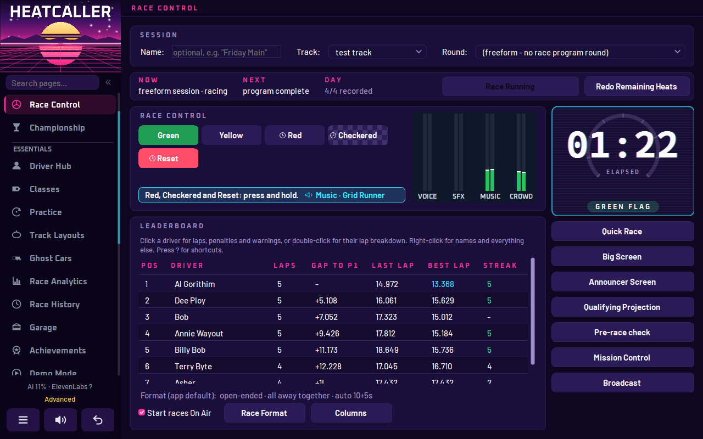

# Running a race

The **Race Control** page is where you run every race: you pick what's about to run, call the cars to the grid, start the race, throw flags, and watch the live leaderboard. This page walks through a race from start to finish and explains each part of the screen.

!!! note
    HeatCaller runs its own race control, reading the decoder (EasyLap or I-Lap) directly. See [Decoders](../timing/decoders.md).

## The page at a glance

From top to bottom, the page has:

- **The Session row.** Choose the round, the track and the session name.
- **The Next Up bar.** Shows what's running now, what's next, and how the day is going.
- **The Race Control card.** Holds one row of flag buttons, all the same width and centered over the On Air bar under them, with the level meters at the right, reaching from the card's title down to the foot of the On Air bar (see [Level meters](#level-meters)). The lit flag button and the board show where the race is. Only the buttons that mean something at that moment are shown (see [The flag row](#the-flag-row)). The lit button shows the flag in effect. **Red**, **Checkered** and **Reset** have to be pressed and held for a second (see [Press and hold](#press-and-hold)); the line under the row says so, and shows the hold as it fills. The same line is the **On Air bar** while anything is going out (see [The On Air bar](#the-on-air-bar)).
- **The Leaderboard card.** Takes up the rest of the page. Click a driver to open their corrections drawer under their row (see [The leaderboard](#the-leaderboard)). Along its foot are the format chip, the **Start races On Air** tick box, **Race Format** and **Columns**. **Start races On Air** and **Columns** are shown in Advanced mode only (see [Simple and Advanced mode](../getting-started/simple-and-advanced-mode.md)).
- **The clock column** on the right. It holds the race clock, then **Quick Race**, **Big Screen**, **Announcer Screen**, **Qualifying Projection**, **Pre-race check**, **Mission Control** and **Broadcast**.

## The flag row

The row changes with the race, so the buttons you need are the only ones there:

| When | Buttons on the row |
|---|---|
| Before the green: from a cold start, through On Air, a warm-up, staging and the countdown | **Stage**, **Countdown**, **Green**, **Reset**. The row doesn't change until the race goes green. |
| Racing | **Green**, **Yellow**, **Red**, **Checkered**, **Reset**, the same five under a yellow or a red. **Green** restarts the race after a caution. |
| After the flag (finished) | **Skip**, **Hold Talk**, **Call Up**, **Edit Result**, **Reset**: the buttons for the talk between races (see [The flag row after the flag](#the-flag-row-after-the-flag)). **Edit Result** opens the race just run in **Race History** with **Edit Result** open, for a penalty, a missed lap or a DNF. The next race starts from **Start Next** on the Next Up bar. |
| Practice | None: practice is run from the Practice page |

On Air has no button on the row: <kbd>F1</kbd>, **Start Next** and the other starts go through it (see [On Air](#on-air)), and <kbd>0</kbd> starts it by hand. **Reset** takes the row back to the set before the green. A yellow or a red before the green is <kbd>F4</kbd> or <kbd>F5</kbd>.

The function keys and the phone remote still reach every button, shown or not, exactly as before.

### The flag row after the flag

Once a race is finished, the row is for the gap before the next one: what the announcer says, and when.

| Button | What it does | Key |
|---|---|---|
| **Skip** | A click stops the line on air and moves the show on to its next part (the On Air bar names it at its right, for example "Skip: Race Recap"): a recap goes on to the honors, the gap to its next line. Press and hold for a second to end the whole recap show, as the **Broadcast** window's **Skip** does. Grayed out when nothing is on air. | <kbd>F9</kbd> (a click) |
| **Hold Talk** | Stops everything between races: the commentary's lines, sponsor reads, the hand-over, call-ups and the automatic countdown. It turns amber and reads **Resume Talk** until you press it again, and the On Air bar says "Between-race talk held - press Resume Talk or F10". Let go, talk picks up after the **Space between lines**, not the instant it comes off. The race itself is never held: flags, the countdown to green and the finish calls still play. With commentary on, it's the same hold as the **Broadcast** window's **Hold**, so either shows on both. | <kbd>F10</kbd> |
| **Call Up** | Calls up the next race now, and the marshals with it when **Marshals to their posts** is ticked. Grayed out when the program has nothing next. A second press while the last call-up is still waiting to be said, or within 30 seconds of it, says nothing: the console answers, for example, "Already called up A-Main 7s ago." Right-click it for **Push the next race back 1 minute** (its run-sheet time, the countdown and the next call-up move with it), **Call up two races out**, **Marshals only** and **Not checked in**. | <kbd>F12</kbd> |
| **Edit Result** | Opens the race just run in **Race History** with **Edit Result** open. | |
| **Reset** | Press and hold, as always. Takes the row back to the set before the green. | <kbd>F7</kbd> |

**Next Heat** and **Results** used to be on this row. **Next Heat** did what **Start Next** on the Next Up bar does, and **Results** opened the same race as **Edit Result**, so both went on 31 Oct 2026 to make room. What the gap says, and how often, is set on the **Between races** card (see [Between races](../announcer/commentary.md#between-races)). To keep the old row (**Edit Result** and **Reset**, with **Stage** when nothing is next in the program), untick **Show Skip, Hold Talk and Call Up on the flag row after the flag** on that card. The keys work either way.

The phone remote has the same three under **BETWEEN RACES**: **SKIP**, **HOLD TALK** and **CALL UP**.

### Press and hold

**Red**, **Checkered** and **Reset** can't be taken back in the middle of a race, so a click on them does nothing: press and hold the button for about a second. Each of them has a small clock beside its caption, and the line under the row names the ones on the row, for example "Red, Checkered and Reset: press and hold." While you hold, a bar fills along the foot of the button and the line under the row says "Keep holding to throw the red flag…" (or "to end the race", "to reset the race") with "let go to cancel". Let go before it fills, or slide off the button, and nothing happens: the line says "Let go too soon - nothing was done." for a moment.

**Yellow**, and every other button, is still one click.

The keys don't need holding: <kbd>F5</kbd> throws the red, <kbd>F6</kbd> the checkered, and <kbd>F7</kbd> resets, asking first if a race is under way, as before. The phone remote acts straight away too.

On a touch screen, hold your finger on the button. HeatCaller turns off Windows' "press and hold for a right-click" on these three buttons so the hold reaches them.

### Level meters

At the right of the row are four level meters, like a radio board's channel strips:

- **VOICE**: the announcer speaking.
- **SFX**: sound effects, lap beeps, imaging, and recordings played back (a replayed moment, a driver's own clip).
- **MUSIC**: the music.
- **CROWD**: the crowd and ambience bed.

They run from the top of the card's **RACE CONTROL** title to the foot of the On Air bar. If the window is too narrow, they're hidden so the flag buttons keep their room.

Each strip has a left and a right bar, from -40 dB at the foot to 0 at the top. They are green to -9 dB, amber to -3 dB and red above. They move like a VU meter: each bar follows how loud the sound is over a fraction of a second, not every peak, and settles on a new level in about 300 ms, up or down. A full-scale tone reads 0. A white line marks the highest the bar has reached and holds there for a second and a half. The strips move with what the room hears, not ahead of it, and drop as soon as music or the crowd is stopped or paused. They show the level HeatCaller sends out, after its own volumes and ducking, not the volume set on the PC or the speakers. A sponsor video's sound on the Big Screen isn't on them. They only run while they're on screen.

### The On Air bar

While anything is going out, the line under the row is the **On Air bar**, in cyan. It runs from the left of the card to just short of the level meters. It names the segment on air, for example **On air: Race Recap** or **On air: Driver Intros**, and stays up while anything is going out: the announcer speaking, the recap show (named as on the **AI Commentary** page's **Recap show** card when you've typed a name there), a replayed moment, an imaging piece or bed, a sponsor video, the music or the crowd. While On Air is live, between the jingle and staging, it reads **On air** between segments and shows "hold 0 to skip to Stage" at its right. While On Air is writing and voicing the opening, it's On Air's red bar, filling as the work gets done. When nothing is going out, it goes back to the hint about which buttons to hold. A press-and-hold still takes over the whole line while you hold. Double-click the bar to open the **Broadcast** window.

Inside the bar, after the segment, a small speaker and **Now playing** in cyan name the imaging element the room is hearing: a jingle, sweeper, bumper or stinger (with the point it was played for, for example "Top of the race · Classic station ID"), a music bed, the recap show's opener, bed or sting, a replay, a sponsor video with its sound, the music, or the crowd. When more than one is going out, a piece is named over a sponsor video, a sponsor video over a bed, a bed over the music, and the music over the crowd. When nothing is playing, it's left out.

## Before you start

- Your decoder is connected. See [Decoders](../timing/decoders.md).
- Your drivers have profiles, so the board shows names instead of transponder numbers. See [Drivers and classes](../race-day/drivers-and-classes.md).
- If you're running a structured day, your rounds are on **Race Day → Next Steps**. See [Program and mains](../race-day/program-and-mains.md). You don't need a program: **Quick Race** works without one.

## Choose what's about to run

Use the **Session** row at the top of the page:

| Control | What it does |
|---|---|
| **Name:** | An optional name for a freeform session, for example "Friday Main". The saved race uses this name. It's hidden while a round is chosen. |
| **Track:** | The track layout. HeatCaller uses it for track records and saves it with the result. |
| **Round:** | Any round from the program that hasn't run yet, shown as `[Class] Round (Kind)`. Choose **(freeform - no race program round)** to run without one. |

When you choose a round, HeatCaller fills in the track and the name (as "Class - Round") and locks them; the **Name:** box is hidden, since the round says it already. The finished race is saved against that round, so the program shows it as run. **Reset** clears the round and the name as well as the race (see [Reset and undo](corrections-and-recovery.md#reset-and-undo)).

If you don't choose a round and **Start the next race automatically** is ticked on **Race Day → Setup** (it is by default), HeatCaller ties the finished race to the next round that hasn't run yet. By default it picks from the class that was racing. See [Which round a race counts for](../race-day/program-and-mains.md#which-round-a-race-counts-for).

### The race format

The format chip at the foot of the leaderboard shows which rules apply to the next race and where they come from. For example: `Format (Stock class):  5 min · all away together · auto 15+5s`.

HeatCaller uses the first of these that exists:

1. The round's own override.
2. For a qualifying round, the class's **Qualifier Format**.
3. The class's **Race Format**.
4. The app default.

**Race Format** opens the format that's currently in force, wherever it comes from, so you always edit the one you can see. Class formats are also set on the **Classes** page. If you change the format while a race is running, the chip updates straight away, but the running race keeps the rules it started with.

| Setting | What it does | App default |
|---|---|---|
| **Lap limit (0 = none):** | Ends the race after the leader completes this many laps. | 0 |
| **Time limit, min (0 = none):** | Ends the race after this many minutes of racing. | 0 |
| **Min valid lap (ms):** | Ignores a pass that comes sooner than this after the car's previous pass. See [Minimum lap time](#minimum-lap-time). | 3000 |
| **Streak window ±%:** / **faster too** | How much a lap can differ from the one before it and still extend a clean run. If **faster too** is ticked, a much quicker lap also ends the run. | 25, ticked |
| **Start:** | How the field is released. See [Start types](#start-types). | Standard |
| **Stagger gap (s):** / clock | The gap between releases for a staggered start, and whether each car gets its own clock (**Clock: own release**) or everyone shares one (**Clock: shared green**). | 5, own release |
| **Warm-up (s, 0 = none):** | Free laps before the race, up to 30 minutes. See [Warm-up](#warm-up). | 0 (off) |
| **Run the start sequence automatically (Stage → Countdown → Green)** | When you press **Stage**, the start runs through to the green on its own. | Ticked |
| **Stage (s):** / **Countdown (s):** | How long each step lasts in the timed Quick Race sequence. With the announcer muted, also how long staging and the countdown last at least in the automatic start sequence. | 15 / 5 |
| **Leader takes the flag, others finish their lap** | Changes how a race ends. See [Finishing](#finishing). | Ticked |

For a class or a round, untick **Use a custom format (untick to follow the app default)** to go back to the app default.

In Simple mode the format shows only the lap limit, the time limit and **Start:**. The rest keep their values and keep working; turn on Advanced mode to see them (see [Simple and Advanced mode](../getting-started/simple-and-advanced-mode.md)).

## Start the race

1. Pick the round (or leave the session freeform).
2. Press <kbd>F1</kbd> (or <kbd>0</kbd>), or **Start Next**. The show opens the race like a radio station: the soundscape's jingle or sweeper, the opening (the race intro), the throw down to pit lane and the driver introductions when they're switched on, a bumper, and then the race is staged. See [On Air](#on-air).
3. When staging starts, the board clears, the announcer calls the cars to the grid and **Stage** lights up.
4. Press **Countdown** (<kbd>F2</kbd>). **Countdown** lights up. From now on, a car that crosses the line counts as a [jump start](#jump-starts).
5. Press **Green** (<kbd>F3</kbd>). The race starts and the clock begins counting.

**Stage** on its own skips On Air: it stages straight away with just the call to the grid. The race intro, the pit lane throw and the driver introductions all belong to On Air, so a race started with **Stage** has none of them.

### On Air

On Air is the normal start. With **Start races On Air** ticked at the foot of the leaderboard (it is by default), <kbd>F1</kbd>, **Start Next**, the program's **Start**, the phone and the day schedule all go through On Air first. Unticked, they stage straight away. The **Stage** button always stages straight away, whatever the tick box says.

While On Air gets the opening ready, the strip under the flag row shows it the way it shows a press and hold: the step it's on ("On Air: writing the opening…", "On Air: voicing the opening…", "On Air: voicing the driver intros…"), a red bar filling from left to right, and the seconds it expects to need, learned from your last few openings, for example "about 12s · hold 0 to skip to Stage". The first few times there's no countdown yet, just the step. Once the show is live the strip turns cyan and reads "On air - the show is going out".

- **Hold <kbd>0</kbd> for a second** while it runs to skip the rest and stage straight away. The strip fills as you hold, the same as holding **Red** or **Reset**. Let go early and nothing happens. A tap only shows "Let go too soon - nothing was done." on the strip, and <kbd>F1</kbd> only puts a reminder to hold <kbd>0</kbd> in the log, so a stray press can't cut the show short. The press that started On Air never counts as the skip, however long you hold it: let go and hold <kbd>0</kbd> again. When you skip, the announcer stops at once, even mid-word, and the staging call is the next thing heard. The opening, the driver introductions and pit lane are all dropped, and so is anything the announcer was still finishing when On Air started, such as the last line of the recap.
- **Anything else that moves the race on** (Stage, Countdown, Green or Reset) calls On Air off, and your press wins. The announcer stops at once here too.
- **Yellow or Red between races** doesn't call On Air off; it only stops the automatic start.
- **During a demo's On Air**, a flag press skips the rest of the opening and starts the demo, which stages and goes green by itself. The opening stops at once.

Between races, HeatCaller writes the next opening and voices it ahead, so On Air usually starts the jingle at once. If you change the voice in between, the lines voiced ahead are dropped and voiced again.

With **Run the start sequence automatically (Stage → Countdown → Green)** ticked (the default), you only need to press **Stage**. HeatCaller moves on to the countdown when the staging announcement finishes, and drops the green when the countdown announcement finishes. It follows the audio rather than a fixed timer, so the start never talks over itself or leaves a silence. With the announcer muted there's no audio to follow, so staging lasts **Stage (s):** and the countdown **Countdown (s):** from the race format instead.

The chain stops if anything else happens first. Pressing **Stage**, **Countdown**, **Green**, **Yellow**, **Red** or **Reset** stops the automatic sequence, and your button press wins. **Checkered** doesn't: before the green it's refused and changes nothing, so the start carries on, automatic green included (see [Flags](#flags)).

A yellow or red thrown during staging or the countdown also stops the automatic start (and **Quick Race**). The log says the start stopped because the flag is out: "Press Green when the track is ready, or Stage again to restart the sequence." The race still hasn't started, so the green you press next is a start, not a restart: the start horn and the **Race started** call play when it drops.

!!! warning
    **Green** starts a race straight away even if you haven't staged. A green with no countdown gives the jump-start check nothing to watch. Use **Stage** for a proper start.

The green always waits for the countdown announcement to finish, however the start was triggered. If you press **Reset**, **Stage** or **Red** during that wait (or a demo is stopped), the green is canceled and your later decision stands. The log says "Green flag not dropped - " and what happened. **Checkered** pressed during the wait is refused and leaves the green alone.

### Other ways to start

- **Quick Race** runs a race with whoever is on track, using the app default format and no round, event or check-in. It names the session "Quick Race HH:mm" and runs Stage, Countdown and Green on a timer, using **Stage (s):** and **Countdown (s):**. If the app default format has a warm-up, that runs first.
- **Start Next** on the Next Up bar loads the next round from the program and presses **Stage** for you. With the start sequence running automatically, the start then runs through to the green. See [The Next Up bar](#the-next-up-bar).
- You can also start a round from **Race Day → Next Steps**, and throw flags from the phone remote. See [Phone and Web](../screens/phone-and-web.md).

**Quick Race** and **Start Next** do nothing while a session is already under way. Finish or reset the current session first.

**Stage** and **Countdown** pressed while a race is running ask first, because they would abandon the running race without saving it. Starting a round from **Race Day → Next Steps** asks too, before anything is announced. To end a race and keep its result, use **Checkered**. Once you confirm, the abandoned race's flag goes with it, so a new start made over a race under yellow or red runs on to its automatic green like any other. See [Staging over a running race](corrections-and-recovery.md#staging-over-a-running-race).

While practice is running, **Stage**, **Countdown**, **Green**, **Yellow**, **Red**, **Checkered**, **Reset** and starting a round from the program or the Next Up bar are refused with "Stop practice first on the Practice page". See [Practice](practice-and-ghosts.md#practice).

During a demo, **Stage**, **Countdown**, **Reset** or a first **Green** on Race Control ends the demo so a real race can take its place. Starting a round from the program or the Next Up bar ends a demo too. Once the demo is racing, **Green** after a caution and **Checkered** still act on the demo. See [Demo Mode](practice-and-ghosts.md#demo-mode).

If the round's class runs tech, staging it (or pressing **Green** from idle) also checks that everyone in it has passed tech today. Anyone who hasn't is listed in a "[tech] WARNING" line in the log. It's only a reminder; the race starts as normal. See [Tech warnings on Race Control](../race-day/events-and-entries.md#tech-warnings-on-race-control).

### Warm-up

A race format can give the cars some free laps before the race: set **Warm-up (s, 0 = none):** in the format. It's off (0) unless you set it.

With a warm-up set, pressing **Stage** (or **Quick Race**) between races opens the warm-up first. The race clock shows **WARM-UP**, the announcer says the warm-up is open and how long it lasts, and laps aren't counted. On a warm-up longer than a minute, it calls "Thirty seconds left in warm-up." When the time runs out, the race is staged as usual. To cut it short, press **Stage** (or **Quick Race**) again: the rest of the warm-up is skipped and the race is staged straight away.

**Reset** cancels a warm-up. A warm-up never opens during practice, or over a race that's staged, counting down or running.

## Start types

Choose the start type in **Start:** in the race format.

| Start | How it works |
|---|---|
| **Standard - all away together, one clock** | Everyone goes on the green. |
| **Staggered - grid order** | Cars are released one at a time, **Stagger gap (s):** apart. The first car on the grid goes first. |
| **Staggered - reverse grid** | The same, but the last car on the grid goes first, so the quick drivers have to come through the field. |
| **Staggered - handicap** | A pursuit start based on each driver's handicap time credit. See below. |
| **Qualifying - own clock from 1st crossing** | Everyone goes on the green, but each driver is timed from their own first crossing. See below. |

### Where the grid comes from

A staggered start needs a grid order. HeatCaller uses the selected round's roster, in the order the drivers were assigned. With no round selected, it uses the finishing order of the last race. If neither exists, it starts everyone together and says so in the console.

The grid also records where everyone started, which the **Gained** column uses. See [The leaderboard](#the-leaderboard).

### Own release or shared green

For a grid-order or reverse-grid stagger, you choose which clock each car runs on:

- **Clock: own release.** Each car's clock starts when that car is released, so everyone gets the same amount of racing and the result comes down to pace. In a timed race, cars released later keep running after the leader's time is up, until their own time runs out.
- **Clock: shared green.** Everyone runs on one clock that starts at the green. A car released later simply has less time, and the first car across the line wins.

The board grays out cars that are waiting to be released. The announcer calls each release when it's due.

### Handicap (pursuit) start

**Staggered - handicap** uses the time credits on the **Handicaps** page. The driver with the biggest credit (the slowest driver) goes first, on the green. Everyone else waits for the difference between the biggest credit and their own. Scratch drivers, with no credit, wait the longest.

A handicap start always runs on one shared clock from the green, whatever the format says. On each driver's own clock the head start would count for nothing. The format's own clock setting applies again for the next race.

!!! warning
    If the class's handicap mode is also **Time credit (seconds off total)**, each credit counts twice: once as the head start and again off the result. HeatCaller warns you in the console. For a handicap start, set the class's mode to **Off - scratch racing**. See [Handicaps](practice-and-ghosts.md#handicaps).

### Qualifying start

With **Qualifying - own clock from 1st crossing**, everyone leaves the grid on the green, but each driver's clock starts at their own first crossing of the line. The run from the grid to the timing loop costs nobody anything, and each driver is measured over their own laps only.

That first crossing counts as the driver's start lap, with a time of 0.000. The time limit still runs from the green.

The hint in the format dialog explains the two qualifying conventions. **All away together** is a grid start on one shared clock, where the run to the loop counts against your time. **Own clock from 1st crossing** is the IFMAR convention.

## Jump starts

HeatCaller checks for jump starts only during the **Countdown**. While cars are being staged, they're carried out and rolled over the loop to their grid slots, so passes during **Staging** are ignored.

A **Countdown** or **Green** pressed without **Stage** first still starts a fresh jump-start check with the class's own rules. Nothing carries over from the previous race.

A car that crosses the line during the countdown is flagged as a jump starter. In a staggered start, a car that crosses before its own release time is flagged too. Each car is flagged at most once per race.

A car left sitting on the loop isn't a jump start. The decoder keeps reporting a car parked on the loop every couple of seconds. If it has been seen there three times in a row, no more than 3 seconds apart, by the time of its pass in the countdown, the console says it's sitting on the loop and it isn't flagged. Move it back behind the line. A car still on the loop at the green is treated like any car already past the line. One moved back behind the line starts like everyone else: its first crossing just after the green is its start lap. A car moved onto the loop during the countdown is still flagged at its first pass.

When a car jumps the start:

- The announcer calls it.
- Its row on the leaderboard is tinted red for the rest of the race.
- If the class sets a penalty, it's added to the driver's time on their first counted lap. It shows in the **Penalty** column, and **Clear Penalties** removes it like any other penalty.

You set the jump-start rules on the class:

| Class setting | What it does |
|---|---|
| **Detect jump starts (crossing before the green)** | Turns jump-start detection on or off. It's on for freeform races, which have no class. |
| **Automatic penalty:** | Seconds added to the driver's time. **0** flags the jump without a penalty (the default for freeform races). |
| **A jump start also costs the lap** | Off by default. When it's off, a car that was already past the line when the green dropped is credited with its start lap, so the jump costs only the time penalty. This doesn't apply to staggered starts or qualifying starts. |

## Flags

| Button | Key | What happens |
|---|---|---|
| **Yellow** | <kbd>F4</kbd> | Caution. Laps still count and the clock keeps running. |
| **Red** | <kbd>F5</kbd> | Press and hold the button (see [Press and hold](#press-and-hold)). Stops the race. The clock pauses and shows **PAUSED**, laps are not counted, and cars waiting to be released stay held. A timed race can't run out while the red flag is out. |
| **Green** | <kbd>F3</kbd> | During a race, this resumes racing after a yellow or red. Laps and times are kept. If a lap added by hand under the red brought a driver to the lap limit, the checkered flag comes out instead. |
| **Checkered** | <kbd>F6</kbd> | Press and hold the button. Ends the race now, for everyone, and saves the result. Only works while a race is running. |
| **Reset** | <kbd>F7</kbd> | Press and hold the button. Clears the race, and the round and name on the **Session** row. Everything going out stops at once: the announcer mid-sentence, everything queued to be said, the recap show, a replayed moment, every jingle and bed, the sponsor spot on the Big Screen (a video with its sound), the music and the crowd. The next race brings the music and the crowd back up as usual. The key asks first if a race is under way. See [Corrections and recovery](corrections-and-recovery.md#reset-and-undo). |

Going from red to yellow also restarts the race clock, because laps count under yellow.

The presses below are refused and change nothing. No box appears: the log gives the reason after "Checkered not thrown." or "Green not thrown." The phone remote shows it too, for example "CHECKERED not done: The race has already finished.", and so does the race-day manager's **Race** tab.

| Press | When | Reason given |
|---|---|---|
| **Checkered** | During staging or the countdown. The start carries on, automatic green included. | "The race hasn't gone green yet. To call off this start, press Reset." |
| **Checkered** | After the race has finished. | "The race has already finished." |
| **Checkered** | With nothing staged. | "No race is running." |
| **Green** | On the last lap, with the checkered flag out. | "The checkered flag is out - the race is finishing." |

**Green** pressed while the race is already green does nothing at all: no horn and no call. The log says "Green pressed - the race is already green, so nothing changed.", and the phone remote shows "Already green."

The lit flag button always shows the flag in effect, however it was thrown: a button, a function key, the phone remote or the automatic start. **Stage** and **Countdown** light up while the start is at that step. The word at the left of the row says where the race is, and the buttons on the row follow it the same way (see [The flag row](#the-flag-row)).

The function keys work only while the **Race Control** page is showing, and only on their own. Alt+F4, or an F-key with Ctrl or Shift, never throws a flag. See [Keyboard shortcuts](../reference/keyboard-shortcuts.md).

## Lap-limited and timed races

- **Lap limit:** The clock's progress ring and the text under the clock count laps: "5 LAPS TO GO", then "1 LAP TO GO". The announcer calls the last lap when the leader starts it.
- **Time limit:** The ring and the text count down the time, for example "02:30 REMAINING". The announcer calls the final minute. Tick **Minutes left** and **Last minute countdown** on **Voice → Race Calls** to also hear the minutes left (the last five, unless you change it) and every 15 seconds of the last minute: see [Every announcement](../announcer/voice.md#every-announcement).
- **Both:** The race ends at whichever limit is reached first, and the clock shows the laps remaining. The announcer's time calls (final minute, minutes left, last minute countdown) are only made while the clock is set to end the race first. Once the leader's pace shows the lap limit will come first, they stay quiet rather than call "two minutes to go" in a race that's three laps from the flag.
- **Neither:** The race runs until you press **Checkered**.

Everything the announcer says about how much of a race is left follows what ends it. A timed race is talked about in time ("about a minute and a half left"), never as a number of laps, and a race run to a lap count is talked about in laps. The AI commentary is told which kind of race is on track before it writes each line.

The clock always shows elapsed racing time. Time under a red flag isn't counted.

## Finishing

With **Leader takes the flag, others finish their lap** ticked (the default), a race ends the way real racing does:

- **Lap limit.** When the leader completes the last lap, the checkered flag comes out and the leader has finished. Every other car finishes the next time it crosses the line.
- **Time limit.** When time runs out, the checkered flag comes out and every car finishes the next time it crosses the line. On a staggered start with **Clock: own release**, cars released later keep racing until their own time is up.
- When every car on the board has taken the flag, the race is over and the result is saved.
- **Stragglers.** If a car has stopped on track, HeatCaller doesn't wait for it forever. It ends the race 60 seconds after the checkered flag came out (longer on an own-release staggered start). If you throw a red flag during the last lap, the 60 seconds start again when racing resumes.

With the box unticked, the race stops for everyone the moment a limit is reached.

Pressing **Checkered** while a race is running always ends it immediately.

When a race finishes, HeatCaller:

- saves it to **Race History**, leaving out ghost cars
- links it to its round
- works out any badges earned
- saves a results card image
- plays the teaser and the race recap, if they're set up.

See [Results and championships](results-and-championships.md). If transponders without a profile were on track, HeatCaller asks whether to name them after the race. See [Transponders](../timing/transponders.md).

## Minimum lap time

A transponder sitting near the timing loop can trigger the decoder over and over, and a car that crashes on the line can read twice. **Min valid lap (ms):** filters these out. A pass that comes sooner than the minimum after that car's previous pass isn't counted as a lap. The previous pass counts even if it was also rejected.

Rejected passes:

- break the driver's clean run
- are counted in the saved result
- show up in the **Clean %** column.

Set the minimum a little under the quickest real lap anyone could do on your track.

!!! tip
    The first counted pass after the green is the start lap. Its time runs from the green to the line, so it counts toward the lap total but never counts as a best lap. In the lap breakdown it's labeled **START**.

## The leaderboard

The board orders drivers by most laps, then by lowest total time. Total time includes penalties.

- **Click** a driver to open their drawer under their row: **+1 Lap**, **−1 Lap**, **+5s**, **+10s**, **⚠ Warning**, **Clear Penalties**, **Share video** and **Lap breakdown**. Click the same driver again to close it, or another driver to move it. See [Corrections and recovery](corrections-and-recovery.md).
- **Double-click** a driver to open their lap breakdown, drawer or not. The breakdown shows every lap with a pace bar, how far off their best it was, and their clean run. With a [split loop](../timing/decoders.md#a-split-loop), each lap's sector times replace the pace bar, the driver's best in each sector is in green, and the line at the foot gives their **Ideal lap**. It updates live, so you can leave it open for a whole race. Each driver's breakdown is a small window of its own, so you can have several open at once: drag one by the driver's name to move it, onto a second monitor if you have one, and drag its bottom edge to show from 4 to 40 laps (no more than fit on your tallest screen). Close it with the **X** in its corner, **Esc**, or by double-clicking the driver again. Each window opens where the last one in its place was left, never on the monitor the Big Screen fills. With two or more open, right-click a driver for **Line up lap windows**, which sets them in neat columns in the running order; with any open, the same menu has **Close all *n* lap windows** (or **Close the lap window** when there's one). They all close when the next race is called, so each heat starts on a clean screen. Flag keys F1 to F8 still work while one is in front.
- **Right-click** a driver for more options: edit or assign a driver, the lap breakdown, line up or close the lap windows, show or hide their recent laps on the board, **Coach *name*** (target lap, consistency, tones and up or down at the split, for one driver at a time; see [Coaching a driver](#coaching-a-driver)), lap and penalty corrections, their battery pack, **Exclude from records**, and **Copy transponder ID**. The pack item lists the driver's packs and the club's, with the one in use ticked. During a race it reads ***name*'s pack in the car**: picking one puts it in their car, so the race is recorded on it. Once the race is saved it reads ***name*'s pack for this race**: picking one records it for the race just run, or **No pack recorded**, and a pack also goes in their car. See [A driver's batteries](../race-day/drivers-and-classes.md#a-drivers-batteries).
- **Show {name}'s laps on the board** opens a strip of recent lap times under the driver's row. You can open strips for several drivers at once to compare them. In the strip, a star (★) marks a lap inside a clean run, and a broken circle (◌) marks the lap where a run ended.
- The driver with the fastest lap of the race has their **Best Lap** highlighted.

### Columns

Press **Columns**, at the foot of the leaderboard, to choose the columns and their order. In the dialog, click the left edge of a row to show or hide that column, and use **Move Up** and **Move Down** to reorder them. **Restore Defaults** puts back **Pos**, **Driver**, **Car**, **Laps**, **Best Lap**, **Gap to P1** and **Streak**.

| Column | Shows |
|---|---|
| **Pos** | Running position. |
| **Driver** | Driver name, or the transponder number if there's no profile. |
| **Car** | Car model from the driver's profile. |
| **Transponder** | Transponder number. |
| **Laps** | Laps completed. A star (**12\***) means some were added by hand - see [Laps counted by hand](results-and-championships.md#laps-counted-by-hand). |
| **By Hand** | How many laps were added by hand this race with **+1 Lap**, shown as +2. Not shown by default. |
| **Last Lap** | Most recent counted lap. |
| **Best Lap** | Fastest lap this session. Highlighted when it's the quickest of anyone. |
| **S1**, **S2**, **S3**, **S4** | With a [split loop](../timing/decoders.md#a-split-loop): each sector of the last lap. S1 runs from the line to the split loop, S2 from the split loop back to the line. Highlighted when it's the quickest of anyone this session, green when it's the driver's own best. |
| **Ideal Lap** | The driver's best sectors added up: their lap with every sector at its best. |
| **S1 mph**, **S2 mph**, **S3 mph**, **S4 mph** | Average speed through each sector on the last lap. Needs the split loops placed on the layout's plan in the Track Designer, so the sectors' lengths are known. |
| **Top Speed** | The fastest the driver has gone through any sector this session, in mph. Highlighted for the fastest on the board. With the split loop a few feet past the line, this is a speed trap. |
| **At Split** | Live, the moment a car crosses the split loop: how far up (green, −0.08) or down (red, +0.12) it is on its own best lap to that point. |
| **Achievements** | How many achievement badges this driver has earned. |
| **vs Best** | How far the last lap was off this driver's own best. Shows **BEST** when it was their best. |
| **Qual** | During a qualifying round: where this driver would qualify overall if the heat ended now, and how many places this heat has moved them. |
| **Gap to P1** | Time or laps behind the leader, for example +2.345 or +1L. |
| **Interval** | Gap to the car directly ahead. |
| **Best Pace Gap** | How far this driver's best lap is off the quickest lap of the session. |
| **Average** | Mean of every counted lap after the start lap. |
| **Rolling Avg** | Mean of the last five laps. |
| **Std Dev** | Lap-time spread. Lower means more consistent. |
| **Streak** | Consecutive clean laps right now. Turns green at the streak threshold. |
| **Best Streak** | Longest clean run this session. |
| **Streak Pace** | Average lap within the current streak. |
| **Trend** | The second half of the session compared with the first: ▲ finding time, ▼ fading, or "level". Needs at least six laps. |
| **Time Lost** | Total time given away against this driver's own best lap. |
| **Gained** | Places made up (+) or lost (−) since the grid. Shows a dash when the grid wasn't known. |
| **Clean %** | Share of this driver's passes that counted as laps. |
| **Led** | Laps completed while leading. |
| **Rating** | The driver rating for this race, 0 to 150: finish, laps led, pace against the race's best lap, the fastest lap, distance and places gained, less 5 a warning. Live until the flag. |
| **PBs** | How many times this driver has beaten their own best this session. |
| **Penalty** | Time penalties applied. |
| **Warnings** | Warnings from race control this race: ⚠ and the count, or the count and **⚑ BLACK** after a black flag. See [Driver warnings](corrections-and-recovery.md#driver-warnings). |
| **Total Time** | Elapsed race time for this driver. |

The same column list is available for the Big Screen and web pages. See [Big Screen](../screens/big-screen.md).

### Streaks and callouts

A clean run (streak) is a run of counted laps in a row. A run breaks on a rejected pass, or on a lap outside the **Streak window ±%:** of the lap before it. With **faster too** ticked, a much quicker lap also breaks it. Each lap is compared with the one before it, not with an average, so a driver who slows a little every lap can't keep a run going forever.

The number of laps that counts as a streak comes from **Sounds → Effects** (**Streak threshold - races:**). The **Streak** column turns green at that number, the same point where the announcer starts calling it.

During a race, the announcer also calls:

- a driver beating their own best lap (not on their first flying lap)
- a new fastest lap of the race (not the first one)
- a driver on track-record pace (within 2% of the record, called once per driver per race)
- a new track record.

A lap that beats the record by an implausible margin doesn't set the record. The console explains why and the lap still counts in the race. Demo and practice laps never set records, and neither do drivers marked **Exclude from records** or rental transponders. **Exclude from records** also takes the driver out of championship points; the log says the driver is "excluded from track records and championship points". See [Voice announcements](../announcer/voice.md).

## Coaching a driver

Right-click a driver on the board and open **Coach *name*** to coach them while they drive. It reads **Coaching *name*** while they are the one being coached. Ghost cars can't be coached.

| Item | What the driver hears |
|---|---|
| **At the split** | With a [split loop](../timing/decoders.md#a-split-loop): "Up a tenth at the split.", "Down two tenths at the split." or "Level at the split." against their own best lap this session, each time they cross it. Only shown with a split loop. See [Hearing the splits](../timing/decoders.md#hearing-the-splits). |
| **Target lap...** | Asks for a lap time in seconds, for example 9.20 (it starts at their target, or their best lap). Each lap is then said against it: "On target." (within a twentieth of a second), "Two tenths off." or "A tenth under." Once set, the item reads **Target lap (9.20s)...**. |
| **Clear target** | Takes the target away. Only shown when one is set. |
| **Consistency** | Every five clean laps, how far apart those laps were: "Last five within a tenth - that's your rhythm.", "Last five within three tenths." or "Spread's six tenths over the last five - settle it down.", with "tighter than the five before" or "looser than the five before" when it changed by a tenth or more. |
| **Tones instead of words** | A short, quiet tone at the line instead of the target words: a high note when the lap was quicker than the target, a middle note when it was on it, a low note when it was slower, and two rising notes for a new best lap. Without a target, the tone is against their best lap. With **At the split** ticked, the split gets a tone too. The consistency line is still spoken. |
| **Gap to their ghost** | Once they have their own-best ghost on track: at the line, where the ghost is on the track - "Two tenths behind your ghost.", "A tenth ahead of your ghost." or "Level with your ghost." Every lap. Only shown while their ghost is running. |
| **Chase *name*'s best (ghost)** | Puts on a ghost of their own best lap, "Sam's best" - the same as **Chase a Best Lap** on the Practice page (see [Chase your own best](practice-and-ghosts.md#chase-your-own-best)). Pick it again once they've beaten it and the ghost comes up to their new best. One **Undo** takes it back off. |
| **Stop coaching *name*** | Ends the coaching. Only shown while they're being coached. |

- **One driver at a time.** None of these lines says whose lap it was, so coaching a second driver moves the coaching to them, and the console says so.
- **The target stays with the driver for the night.** Coaching can move to someone else and back without typing it again. It's forgotten when HeatCaller closes, and never saved.
- **When coaching ends:** at **Reset**, when the race they were coached in is saved, with **Stop coaching**, or when nothing is left ticked. In practice it lasts until **Reset**. The target lap is kept.
- A lap half as long again as their best (a spin, a marshal stop) is never coached on.
- The tones play the moment the car crosses, never queued behind the announcer, at the sound effects' volume but quieter. They stop only when the announcer is muted.
- The words are lines on **Voice → Race Calls**, **Target lap (coach)**, **Consistency (coach)** and **Gap to their ghost (coach)**, ticked for practice and not for races in a new install. When one is switched off, the console says so as you pick it. See [Every announcement](../announcer/voice.md#every-announcement).
- A driver can also follow their own laps, their target and their report card on their phone: see [Coach](../screens/phone-and-web.md#coach).

## The Next Up bar

The bar across the top of the page has three parts, and a fourth when timing goes wrong:

- **TIMING**: when HeatCaller thinks laps aren't being counted, or won't be. The whole bar then turns into an alarm. See [Timing warnings](#timing-warnings).
- **NOW**: the round or session that's running and its state, for example "Q1 Heat 2 (Stock) · racing".
- **NEXT**: the next round that hasn't run yet, how many drivers are in it, how many of them aren't checked in (shown in amber), and who marshals it (the heat before). When there are no rounds left it says "program complete". With no program it says "no program - Quick Race is one press away".
- **DAY**: how many rounds have been recorded, for example "6/14 recorded". If the timetable gives the next round a time, it also shows how far ahead or behind you are, once that's 3 minutes or more. Once drivers in the next round's class have raced twice tonight, it also shows how the track has changed for that class, for example "Stock: track 0.31s quicker since Q1 Heat 1". See [Track evolution](../screens/big-screen.md#track-evolution).

If the next round's class runs tech and someone in it hasn't passed tech today, **NEXT** also shows "· N not through tech", ahead of time. See [Tech warnings on Race Control](../race-day/events-and-entries.md#tech-warnings-on-race-control).

**Start Next** loads the next round and stages it (the announcer makes the grid call first). While a session is running, the button reads **Race Running** and is grayed out, so a stray click can't launch the next heat.

If something is owed before the next race can go out, the bar says so in place of the next round and the button does it instead: **Move the top finishers up** when a lower main has finished and its bump-ups are due, or **Build the finals from qualifying** when a class has finished qualifying. That way the upper main can't go out before its bump-ups. See [Program and mains](../race-day/program-and-mains.md#the-next-step-card).

**Redo Remaining Heats** rebuilds the rosters of every qualifying heat that hasn't run yet from the drivers checked in right now, after asking. Use it for a no-show or a late entry. When part of a round has already run, that round's remaining heats get only the drivers who haven't raced it yet. Recorded heats and mains aren't changed, and **Undo** puts the old rosters back. See [Events and entries](../race-day/events-and-entries.md).

## Timing warnings

During a race, HeatCaller watches for timing going wrong without anyone noticing, the kind of fault that otherwise only shows when the results are wrong. When it spots one, the whole Next Up bar turns into an alarm: it glows red and slowly pulses, with yellow-and-black hazard stripes moving down its left end and the warning in white under **TIMING**. **NOW** and **NEXT** give way to it until timing is right again. The console also gets a line starting `[timing] WARNING:`. When things are right again, the bar goes back to normal and the console says so.

<!-- screenshot: Race Control with the Next Up bar showing the red timing alarm -->

The decoder being unplugged is also caught **before** the green: as soon as a race is staged or counting down, the alarm says "The decoder isn't connected - laps won't be counted. Connect it before the green, on the Connection page." This also applies to practice, while a race is held under a red flag, and before anyone has been released. It doesn't apply to Demo Mode, or when nothing is running.

It checks these, most serious first, and shows only the first that fails:

| Warning | What it means | What to do |
|---|---|---|
| `The decoder isn't connected - no laps are being counted. Connect it on the Connection page.` | The decoder in use says it isn't connected. | Check its cable, then connect it on the **Connection** page (or let **Auto-connect** find it). |
| `Nothing from the decoder for 8s - check its USB cable.` | An EasyLap sends a signal once a second, and it has stopped, even though Windows hasn't said the decoder has gone. | Check the USB cable and the decoder's power. |
| `No car has crossed the line for 45s - check the loop and its cable.` | The decoder is working, but no car has crossed for three typical laps (and at least 30 seconds). | Check the loop cable at the decoder. |
| `Not seen: Frank (25s) - stopped, or a flat transponder?` | A car that has crossed in this race hasn't crossed again for three of its typical laps (and at least 20 seconds) while the others keep crossing. | Look for the car on track. If it's running, its transponder may be flat or loose. |

It only watches real races while they're running: not practice, not a demo, not under a red flag, and not before anyone has been released in a hand-released or staggered start. A car released later is only expected from its own release. After a red flag, or once the decoder is back after a warning, every count starts again. Once the checkered is out, cars that have finished aren't expected to cross, so only a car still out there and silent is named. A black-flagged driver isn't expected either.

A car whose transponder was flat before the race never crosses at all, so it can't be missed: use **Pre-race check** before the heat for that. See [Transponders](../timing/transponders.md).

## Mission Control

Mission Control puts every check that matters before a green flag in one window, as a wall of tiles that are green when all is well, amber when something is worth a look, and red when laps or results are at risk. A red tile glows and pulses so it's seen from across the room. A tile for something you're not using tonight, such as a split loop, is dimmed.

Open it with the **Mission Control** button at the bottom of the clock column, from **Connection → Mission Control**, or from **Mission Control** in the **Pre-race check** window. It isn't a dialog: it can stay open beside Race Control, or on a second screen, all night. It checks everything again once a second. Opening it again brings the open one to the front.

The headline over the tiles sums it up: "All clear. Ready to race.", "Ready to race - 2 to keep an eye on." or "1 problem to fix before the green."

| Tile | Green | Amber | Red |
|---|---|---|---|
| **Decoder** | Connected. | Still connecting. | Not connected, or an error: no laps are being counted. |
| **Heartbeat** | The EasyLap's once-a-second signal is arriving. | | Nothing for 5 seconds or more: check the USB cable. Only the EasyLap sends a heartbeat, so this tile is dimmed for any other decoder. |
| **Split loop** | Connected. | Not connected: laps are still timed, sectors aren't. | |
| **Cars heard** | How many transponders the decoder has heard in the last 12 minutes, and when the last pass was. | Some of them were only just caught. | |
| **Next race** | Every car in the next race has been heard ("8 of 8"). | Names the cars not heard yet. | |
| **Timing** | Nothing looks wrong. | | The current [timing warning](#timing-warnings). |
| **Transponders** | None reading weaker than usual. | Names the transponders that are fading. See [Signal over time](../timing/transponders.md#signal-over-time). | |
| **Website** | Online and up to date, or updates on their way. | Switched on but not set up, or offline with results waiting. | |
| **Sound** | The announcer will be heard. | The announcer is muted. | |
| **Cloud backup** | The last backup reached every cloud service you ticked. | No copy has gone up yet, the last one is over two weeks old, or one of several services isn't signed in. | No service is signed in here, or the last copy failed - the tile says which and what to do. Dimmed when you keep no cloud copies. See [Copies in the cloud](../admin/backups.md#copies-in-the-cloud). |
| **Allowances** | How much of this month's allowances is used, for example "AI 42%". | One is running low (80% or more), or the AI commentary's lines are used up and the model on this PC is writing instead. | The HeatCaller voice or your own ElevenLabs key is used up, or the commentary's lines are gone with no model on this PC to take over. Dimmed when nothing on this PC is metered. See [This month](../announcer/commentary.md#this-month-every-allowance-in-one-place). |

**Next race** uses the same drivers as the pre-race check: the selected round's roster, or the drivers on the leaderboard when no round is selected.
## Photo finish

A webcam pointed along the finish line, and HeatCaller keeps the frames from a second before to half a second after each car takes the checkered flag. When a finish is too close to call, or a lap may have been missed, you can look.

<!-- screenshot: Photo Finish window with a list of shots and a frame of two cars at the line -->

1. Plug a webcam into the timing laptop and point it along the line.
2. Start the web server on the **Local Screens** page, if it isn't running.
3. On the **Connection** page, next to **Finish camera:**, click **Open Camera Page**. It opens in the laptop's browser. Allow the camera when the browser asks, and pick the camera from the list at the top if you have more than one.
4. Leave that page open all night, and on screen: a small window in a corner is fine, but the browser slows a minimized or hidden window down and frames are missed. The page says "Ready" and how many shots it has kept, or warns you when its window is hidden.

The camera page only works on the timing laptop itself: browsers only let a page use a camera when it comes from the same computer. It keeps the last 4 seconds of the camera, at 15 frames a second, with the time written on each frame.

By default it keeps each car's crossing as it takes the checkered flag, including the crossing that brought the flag out. Ghost cars aren't kept. If HeatCaller is restarted, the camera page carries on by itself. Tick **Keep every crossing** to keep every lap. The console says "Photo finish kept for ..." as each one is kept.

To look at them, click **Photo Finish** next to **Finish camera:**. Pick the night and a shot (each is listed with its time, position, driver and lap). The frame nearest the moment the line counted the car is shown first; drag the slider, or press <kbd>Left</kbd> and <kbd>Right</kbd>, to step a frame at a time. A new shot appears in the list by itself. **Open Folder** opens the shot's folder, to copy a picture out.

The frames are kept in the `photo-finish` folder in HeatCaller's data folder, a folder for each night. They aren't part of backups, so they don't come across to a new laptop with a restore: copy that folder yourself to keep them. See [Data files](../admin/data-files.md).

Practice and Demo Mode don't keep shots.

## The clock column buttons

- **Quick Race** (<kbd>F8</kbd>) runs a race with whoever is on track. See [Other ways to start](#other-ways-to-start).
- **Big Screen** (<kbd>B</kbd>) opens the audience display. See [Big Screen](../screens/big-screen.md).
- **Announcer Screen** (<kbd>A</kbd>) opens the Announcer screen in a window of its own, beside this one or on a second monitor. Its **Race Control** button brings the main window back to the front. See [Announcer screen](../announcer/voice.md#announcer-screen).
- **Qualifying Projection** opens or closes a window that shows where the class would qualify if the running heat ended now. See [Program and mains](../race-day/program-and-mains.md#qualifying-projection).
- **Pre-race check** (<kbd>R</kbd>) checks which cars in the round (or on the board) the decoder has heard. Its **Mission Control** button opens [Mission Control](#mission-control). See [Pre-race check](../race-day/events-and-entries.md#pre-race-check) and [Transponders](../timing/transponders.md).
- **Mission Control** opens [Mission Control](#mission-control).
- **Broadcast** opens the broadcast's controls in a window of their own: **Hold**, **Play again**, **Replay Moment**, **Skip**, **Notes** and **Votes**, with what the announcer is doing said in full under them. The button reads **Broadcast · HELD** in amber while a hold is on, and **Broadcast · 3 notes** when notes from the room are waiting for you, so neither is missed with the window shut. See [The Broadcast window](../announcer/commentary.md#the-broadcast-window).

## Tips

- You can leave the **Race Control** page during a race. Timing, time limits and the finish keep running in the background.
- A lap or penalty correction can be undone with **Undo** (<kbd>Ctrl</kbd>+<kbd>Z</kbd>), or reversed with the opposite correction. See [Corrections and recovery](corrections-and-recovery.md).
- To rehearse the whole flow without cars, use [Demo Mode](practice-and-ghosts.md#demo-mode).
