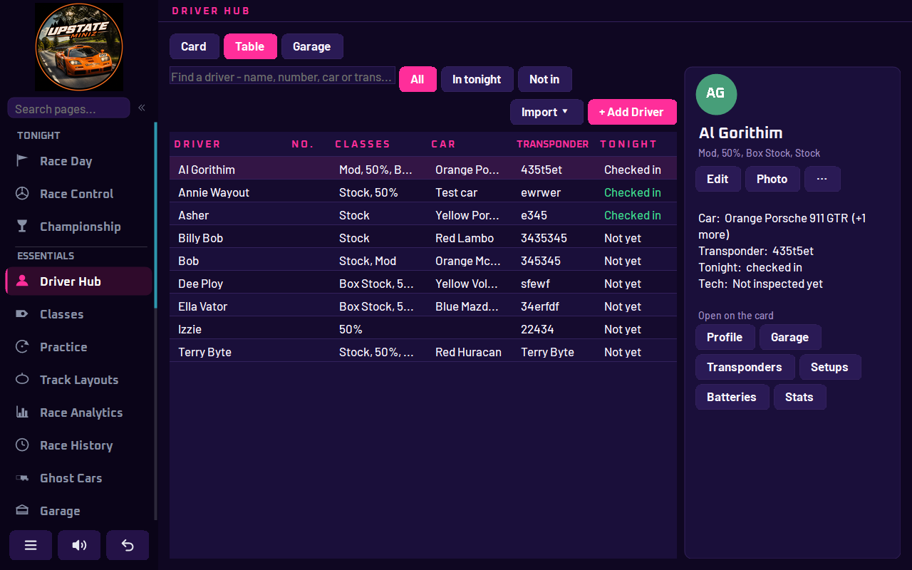
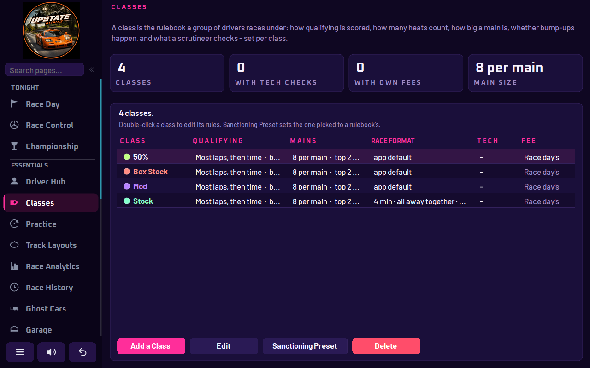
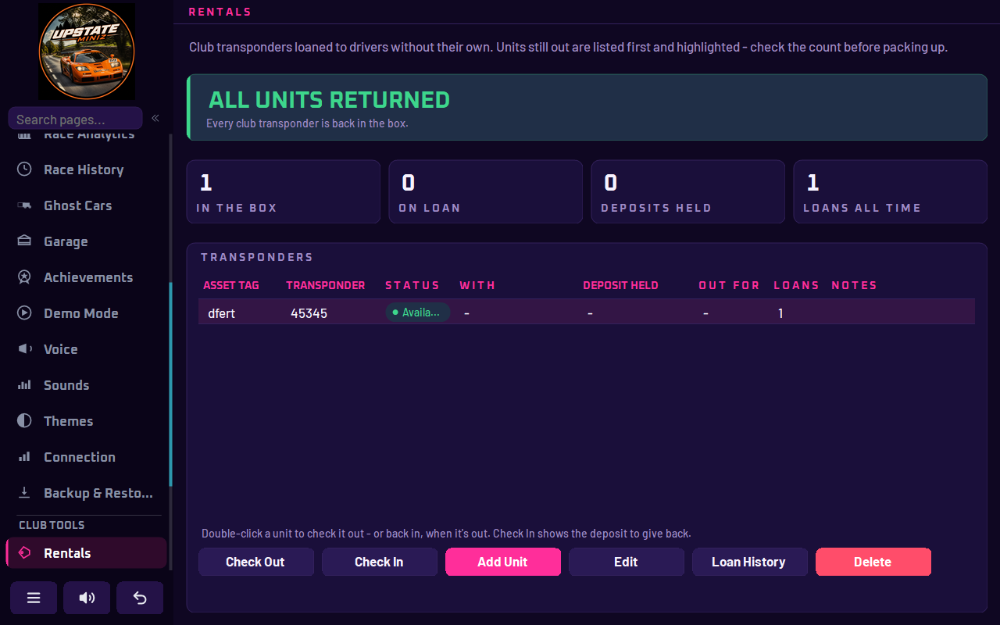
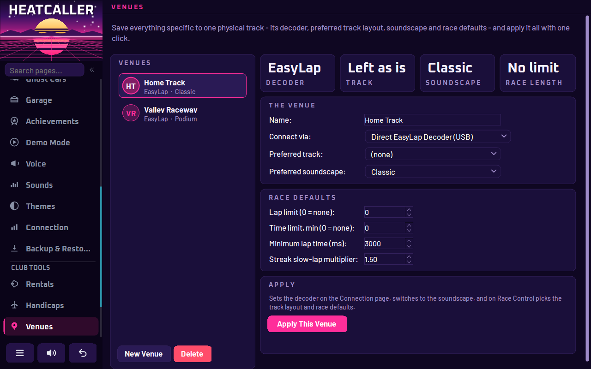
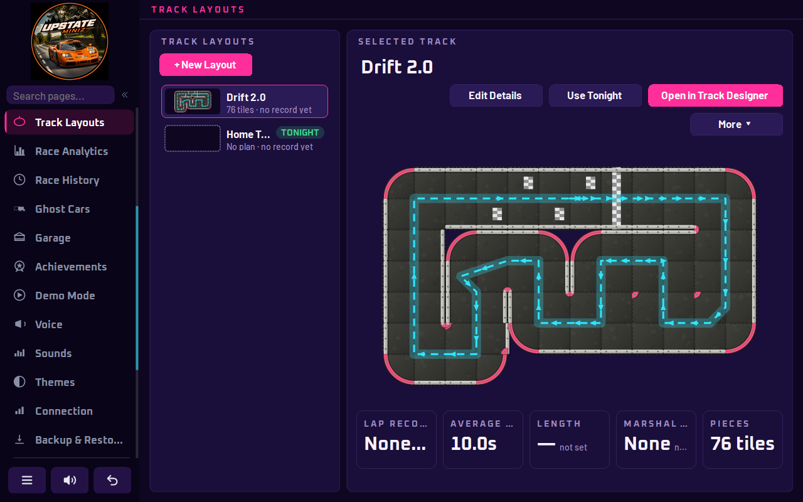
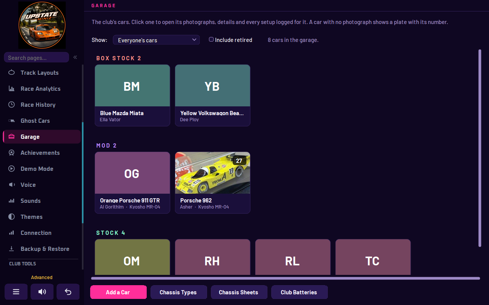

# Drivers, classes and equipment

This page covers the reference data you set up once and then keep up to date: the drivers who race, the classes they race in, and the club's gear — rental transponders, battery packs, venues, track layouts and car setups. Everything on the Race Day pages is built from this data, so it's worth getting right before your first race night.

The pages covered here are all in the sidebar: **Driver Hub**, **Classes**, **Rentals**, **Venues**, **Track Layouts** and **Garage**. Battery packs are on each driver's page in **Driver Hub**, and the club's own packs are on the **Garage** page.

## Driver Hub

A driver profile ties a transponder to a person. When the decoder reports a transponder, HeatCaller looks up its profile to get the name the announcer says, the class the driver races in, and everything shown on screens and results.

The page has three views: **Card**, **Table** and **Garage**, in the upper left. The page opens on the one you used last. The banner for [unknown transponders](../timing/transponders.md#unknown-transponders) is across the top of all three.

### Card view

The roster is down the left and the driver you pick is beside it.

**The roster** lists your drivers by name and number. **+ Add** at its top adds a driver (see [Add a driver](#add-a-driver)). The search box filters it as you type: it matches the driver name, announcer name, any of their transponders, race number, class, team, sponsors, home track and any car in the driver's garage. You can select several rows with <kbd>Ctrl</kbd>+click or <kbd>Shift</kbd>+click (useful for deleting several drivers at once). Under the list it says how many drivers there are and how many are checked in tonight.

**Import** under the roster opens a menu of jobs for the whole list: **Paste a Table**, **Import from CSV** and **Download Template** (see [Import drivers from a spreadsheet](#import-drivers-from-a-spreadsheet)), and **Check Names**, which reads the roster's names out loud in the club's announcer voice so you can hear what will be said tonight (see [Check how names are read](#check-how-names-are-read)).

**The driver's header** shows their photo (or initials), then their name and, as chips, their number, class (in the class's color), and whether they're checked in tonight, a rental or outside records and points. A name the announcer says differently shows under it. Click the photo to change it. Beside the name:

- **Edit** opens the profile form. Double-clicking a driver in the roster does the same.
- **Photo** changes their photo.
- **⋯** has **Report Card** for tonight and **Delete**, for the drivers selected.

Under the header, four tiles show **Tonight** (checked in or not), **Tech**, **Race days** and **Best lap**.

The driver has six tabs:

- **Profile**: what's on their profile — car, number, class, team, sponsors, home track, skill level, transponders — their handicap and setup sheets, and notes, beside when they were added and first timed and their honors. On a narrow window it's one column. Empty fields are left out.
  - **Track records** lists each layout whose lap record is theirs now, with the lap and when it was set, and the layouts they've held it on before.
  - **Sector records** lists the [sector records](#track-layouts) they hold now, layout by layout, for example "S1 3.41".
  - **Badges** shows every badge they've earned as medallions, then the latest twelve with what each was for and when; the rest are on the **Achievements** page.
- **Garage**: the driver's cars, as cards. See [A driver's garage](#a-drivers-garage).
- **Transponders**: every transponder the driver has. See [A driver's transponders](#a-drivers-transponders).
- **Setups**: every setup logged for the driver's cars or under their name, newest first, with the columns **Date**, **Car**, **Track** and **Setup**. Double-click one, or select it and click **Open Car**, to open its car. A setup with no car shows "(no car)"; double-click it, or select it and click **Link to Car**, to pick the car it was for (see [Setups without a car](#setups-without-a-car)).
- **Batteries**: the driver's battery packs, which one is in the car, the pack each session was run on, and pace by pack. See [A driver's batteries](#a-drivers-batteries).
- **Stats**: the driver's record — their results, recent form, personal bests and championships. With a [split loop](../timing/decoders.md#a-split-loop), **Best sectors** lists each layout's best time through each sector and their ideal lap there (their best sectors added up), for example "S1 3.41  S2 6.02  ·  ideal 9.43".

On the **Stats** tab, under the driver's recent form, **Recent activity** lists the latest eight things they've done, newest first: each race with their place, the size of the field and their best lap (or "did not finish"), each personal best, and each setup logged under their name in the **Garage** with what it changed from the setup before it on the same car. Personal bests are in the theme's heading color.

### Table view

Every driver in one table, with the columns **Driver**, **No.**, **Classes**, **Car**, **Transponder** and **Tonight**. It's the quickest way to scan a big roster on race night.

- Click a column heading to sort by it; click it again to sort the other way.
- **All**, **In tonight** and **Not in** show every driver, only those checked in tonight, or only those who aren't.
- The search box filters the table the same way the Card view's does.
- **+ Add Driver** and **Import** are at the top right.
- Double-click a driver to edit them, or press <kbd>Delete</kbd> to delete them.

The driver you pick is in a panel on the right: their photo, name, number and classes, **Edit**, **Photo** and **⋯**, their car, transponder, and tonight's check-in and tech. **Open on the card** has a button for each of the driver's tabs; it switches to the Card view on that tab.

### Garage view

One driver's cars fill the page. Pick whose in **Driver** at the top left, where the search box is in the Card view; the Card and Table views follow, so switching back shows the same driver. It's the same garage as the **Garage** tab, only bigger. Their transponders are on the **Transponders** tab in the Card view.

**Driver** also has **Everyone's cars** and **The club's own cars** at the top of its list. They show every car in the garage, or the club's own, as cards that say whose each car is, as on the [Garage](#garage) page. Retired cars are left out. **Add a Car** adds a car for the club, or for a driver you pick in **Owner:**. Picking one of these doesn't change the driver in the Card view, and switching to the Card view and back shows that driver's cars again.

### A driver's garage

Each of the driver's cars is a card, grouped under its class, with how many they have above them. Under the cars, a **Batteries** line lists their packs and which one is in the car, with **Batteries** and **Add a Car** beside it. **Batteries** opens their [Batteries tab](#a-drivers-batteries). Under the car's name, the card says whether it's their **Active** car (the one they're announced and recorded in), which of their transponders are fitted to it, when it last had a setup logged, who it's lent to tonight, and whether it's **Retired**. Retired cars are always shown here, so you can still open them.

- Click a car to open it, the same window as on the [Garage](#garage) page: photos, details, lending, setups.
- Right-click a car for **Open**, **Make Active Car** and **Transfer**. **Make Active Car** changes the car the driver is announced in. Undo puts back the car they had.
- **Add a Car** adds a car for this driver, in their class.

Their garage is where their cars come from. If you rename a car, the driver is announced in the new name. If you retire, delete or transfer their active car, their oldest other car takes its place, or none if they have no other car; undoing it puts them back in the car.

### Transfer a car

When a car changes hands for good — sold or given — transfer it. A car lent for one night is **Lend Out** instead.

1. Open the car (on the **Garage** page or in the driver's garage), click **More** and pick **Transfer**. In a driver's garage you can also right-click the car.
2. Pick who gets it: a driver, or **The club**. Type in **Find:** to narrow the list.
3. If any of the owner's transponders are fitted to the car, they're listed with a tick. Untick any that stay with the owner. A transponder that stays with them moves between their cars from now on. The owner's main transponder always stays with them, because their results are filed under it. A transponder can't go to the club. Split transponders fitted to the car always go with it to a driver; going to the club, they stay with the owner.
4. Click **Transfer to *name***.

The car's photos, notes and setups go with it, and setups the old owner logged still show on their **Setups** tab. The car window shows who it was **Transferred from:** and when. If the new owner had no active car, this one becomes it, unless it's retired. Undo puts the car and its transponders back with the old owner.

Races already run stay with whoever ran them, except where a transponder that goes with the car was timed as a car of its own. Those races are saved under the transponder itself, so they count for the new owner, as when a [transponder is transferred](#transfer-a-transponder) on its own. If there are any, HeatCaller lists them before anything moves and asks **Transfer *car* anyway?**. Click **No** to leave everything as it was. To keep those races with the old owner, transfer the car again with that transponder unticked.

A car's owner can only be picked when it's added. After that, use **Transfer**.

### A driver's transponders

The list shows each transponder the driver has, which car it's **Fitted to** (or "moves between cars" for a personal transponder they move from car to car), and whether it's their main one or retired.

- **Fitted to:** sets which of the driver's cars the selected transponder is in.
- **Add Transponder** adds another one: a second car's, a spare or a replacement.
- **Retire** marks the selected one as no longer used, after asking "Are you sure you want to retire transponder *number*?". It stays the driver's, and so does everything timed on it. **Bring Back** puts it back in use.
- **Transfer** gives the selected one to another driver for good: sold, given or swapped. See [Transfer a transponder](#transfer-a-transponder).
- **Remove** takes a transponder off the driver altogether; laps already timed on it no longer count as theirs. The main transponder can't be removed.
- **Add Split Transponder** adds one the [split loop](../timing/decoders.md#a-split-loop) reads, listed as "split loop". Drive the car over the split loop first, and its number is filled in. It's fitted to the driver's car when they have only one; otherwise pick the car in **Fitted to:**. A split transponder never counts a lap and can't be transferred on its own. Its number only has to be different from other split transponders, since it's a different decoder's.

Each change is saved straight away, and Undo takes it back. A transponder that's already another driver's is refused, with a "Transponder already in use" message naming them.

### Transfer a transponder

When a transponder changes hands for good, transfer it. A transponder that goes with a car is moved when the car is [transferred](#transfer-a-car), so this is for one on its own.

1. On the old owner's **Transponders** tab, select it and click **Transfer**.
2. Pick who gets it. Type in **Find:** to narrow the list.
3. Under **Where is it?**, pick **In one of their cars:** and the car, or **Their own transponder - it moves between cars**.
4. If it replaces one of theirs, pick it in **It replaces:**. That one is retired: it stays theirs, and so does everything timed on it.
5. Click **Transfer *number* to *name***.

It leaves the old owner's list and joins the new owner's, in use. Laps timed on it from then on count for the new owner. A driver's main transponder can't be transferred, because their results, check-ins and badges are filed under it. Undo puts it back with the old owner.

Races already run aren't changed, but whose they count as depends on how the transponder was timed in them:

- Where its laps went into the old owner's own row (one of their cars out at a time), the race stays theirs.
- Where it was timed as a car of its own, for example with two of the old owner's cars out together, the race is saved under the transponder itself, and qualifying and the mains count it for whoever the transponder belongs to now: the new owner.

If it was timed as a car of its own in any race already run, HeatCaller lists those races (up to eight, then how many more) before anything moves, and asks **Transfer it anyway?**. Click **No** to leave it with the old owner.

### A driver's batteries

The **Batteries** tab answers one question: is the driver slower on a particular pack? Packs belong to the driver, not to a car, so they move between their cars. There's no charge logging.

<!-- screenshot: a driver's Batteries tab with Packs, Recent sessions and Pace by pack -->

**Packs** lists the driver's packs with their **Type**, how many **Sessions** they've run on each, the **Avg best lap** (the average of each session's best lap) and **Notes**. The pack in the car now is in bold, marked "in the car". A club pack shows here while it's in their car.

- **Add Pack** adds one: a **Label:** (whatever's written on it, like "3" or "Blue tape"), a **Type:** (NiMH, LiPo, LiFe, Alkaline, or type your own) and **Notes:**. A driver's first pack goes straight in the car.
- **Use This One** puts the selected pack in the car. On the pack that's in, it reads **Take Out of the Car**.
- **Edit**, **Retire** (or **Bring Back**), **Transfer** and **Delete** act on the selected pack. **Retire** asks "Are you sure you want to retire pack *label*?" first, with **No** as the default; **Bring Back** is one click. A retired pack keeps its history but isn't offered any more, and comes out of the car. Deleting a pack removes it from every session it's recorded on, so its pace history is lost: retire it instead to keep the history. **Transfer** gives it to another driver or the club for good; the sessions run on it stay recorded.

Every change can be undone.

**The pack in the car is what gets recorded.** When a race or practice session is saved, each driver in it is recorded as running the pack in their car. You can set it in five places:

- **Use This One** on this tab.
- The **Pack** column on **Race Day → Who's Racing** at check-in. See [The Drivers card](events-and-entries.md#the-drivers-card).
- Right-click the driver on the **Race Control** leaderboard and choose their pack. During a race it puts the pack in the car, so the race is recorded on it. After the flag, it records the pack for the race just run and puts it in the car too. See [Running a race](../race-control/running-a-race.md).
- **Pack in the car** under the driver on the phone race manager's **Entries** tab. See [Phone and web](../screens/phone-and-web.md).
- The driver, from **Garage** on their own phone (see [A driver's garage from their phone](#a-drivers-garage-from-their-phone)).

Changing the pack in the car never changes sessions already recorded.

**Recent sessions** lists the driver's sessions, newest first, with the **Pack** each was run on and **Recorded by**: **In the car** (the pack in the car when it was saved), **Race Control**, **By hand** (picked here), **Phone** (picked by the driver on their phone), **Before** (from before packs were per driver) or **Whole session** (see below). Double-click a session, or select it and click **Set Pack**, to pick a different pack or **No pack recorded**. A pack picked by hand always wins over the one in the car.

**Pace by pack** compares the driver's pace across packs, on the layout picked in **Layout:** (**All layouts** to start with): **Races**, **Best**, **Median** (the median clean lap), **Consistency** (how steady its laps are, for example "±0.120s"), **Fade** (the last third of a race against the first) and the **Gap** from each pack's median to the quickest pack's. A gap of a tenth of a second or more is in red, and the quickest pack is in green. A pack with fewer than 3 races is marked "(few races)" and grayed out, since that's too few to trust. **Chart:** draws the packs under the list, as **Fade through a race** or **Median lap over time**.

<!-- screenshot: a driver's Batteries tab with Pace by pack and the Fade through a race chart -->

### A driver's garage from their phone

A driver signed in to their night on the club's relay pages can look after their own garage from **Garage** on **Me**, and what they change lands in **Driver Hub** by itself within seconds, with no approval at the desk: their battery packs (added, edited, retired, brought back or removed, which is a retire instead once a pack has races), the pack in the car and the pack each race was run on, their cars (details, racing tonight and photos) and setups filled in on the car's setup sheet. Each change is an **Undo** step of its own, headed "Phone:". Only a driver's own packs and cars can be changed this way, never the club's or one lent to them, and a driver with a personal PIN needs it. If the desk set a race's pack after the phone asked, the desk's choice stays.

<!-- TODO: confirm whether phone garage changes need Driver Requests (Club Website) turned on, and link a relay page section once online/ documents the phone Garage -->

The laptop needs the [relay](../online/index.md) set up and running for this; with HeatCaller closed, the changes wait on the relay until it's back.

Before this version a pack was recorded for a whole session, not for each driver. Those packs still count for every driver in the session (**Whole session**). The first time you start this version, a session one driver ran alone becomes that driver's own (**Before**), and a pack only ever recorded for one driver becomes theirs. Every other pack becomes the club's.

### Add a driver

1. On the **Driver Hub** page, click **+ Add** at the top of the roster (in the Table view, **+ Add Driver**).
2. Enter the **Transponder:** number exactly as your decoder reports it. This is the only required field.
3. Fill in the other fields you want (see below).
4. Click **Save**.

If the transponder (or one of the others on the **Transponders:** line) is already another driver's, you get a "Transponder already in use" warning naming that driver, and the dialog stays open so you can fix the number. Nothing is replaced.

You can also add a driver from a transponder that crossed the line with no profile: click **New Driver** on its line in the unknown-transponders banner, and this dialog opens with the transponder already filled in and locked. See [Unknown transponders](../timing/transponders.md#unknown-transponders).

### Edit or delete a driver

- To edit, double-click a driver in the roster or the table, or pick one and click **Edit** beside their name.
- To delete, select one or more drivers and choose **Delete** from the **⋯** menu beside their name (in the Table view, select one and press <kbd>Delete</kbd>). You can bring them back with the **Undo** button in the sidebar. A deleted driver's photo file is kept so that Undo can restore it.

Undo never overwrites a driver who has one of the deleted driver's transponders now, as their main or alternate transponder, and never puts two drivers on one transponder. A deleted driver whose transponder has been taken since stays deleted:

- When you deleted several, the others come back, and a **Some drivers not restored** message names each one left out and who holds its transponder. To have one back, free the transponder first, then add the driver again.
- When none of them can come back, nothing changes, and the console says why ("[undo] FAILED to undo ..." and "Nothing was changed.").

If racers have their own check-in PINs (see [Online check-in](../online/check-in.md#personal-pins)), a driver brought back more than a moment after the delete may be given a new PIN.

!!! note
    Once a profile is saved, its transponder can't be changed from the edit dialog — the field is locked. The transponder is what links the driver to their lap history.

### Profile fields

The dialog is titled **Add Driver Profile** or **Edit Driver Profile**. The left column holds the organizer's details. The right-hand strip holds the parts that are shown to the crowd.

| Field | What it's for |
|---|---|
| **Transponder:** | Required. The transponder number the decoder reports. Locked after the profile is saved. |
| **Driver name:** | The driver's name, as shown on screens, results and heat sheets. |
| **Announcer name:** | What the announcer reads instead of their real name: a nickname the crowd knows, or the name spelled the way it sounds, which is how you fix a name the voice says wrong. Leave it blank to use the driver name. It takes effect straight away, and **Hear It** under the box reads it back to you. See [The name the announcer says](#the-name-the-announcer-says). |
| **Pronouns:** | How the AI commentary refers to them — pick he/him, she/her or they/them, or type their own (like she/they). It's handed to the AI beside their name whenever it writes about them, so it uses these instead of guessing from the name. Leave it blank if you don't know; blank changes nothing. |
| **About them:** | One line in the driver's own words for the AI commentary, up to 120 characters, for example "racing since I was eight; my dad builds the cars". The commentary is handed it as something they said about themselves. It's never shown publicly. Drivers can ask to change it from their phone (see [Driver requests](../online/driver-requests.md)). |
| **Active car:** | The car they race in now — the one that's announced and recorded. Pick one of their cars from the list. To add a new car, type its name and click **Add**; it's added to their garage when you save (a name you type but don't add is saved too). To retire a car or give it to someone else, use their [garage](#a-drivers-garage). |
| **Race number:** | Racing number. Shown as a chip on the driver card, on Race Control, and on the online check-in list. |
| **Home track:** | Home club or town. |
| **Skill level:** | Free text, for example "Novice / Intermediate / Expert". |
| **Contact:** | For organizer use only. It's never announced. |
| **Email:** | Where the driver's personal check-in PIN is sent, and their night if they want it. It's never shown publicly. See [Emailing racer PINs](../online/email.md). |
| **Email them their night** | When the club sends night emails, this driver is sent their races, their report card and a link to their night page after racing. It's grayed out until **Email:** has an address. See [Drivers' nights by email](../online/setup.md#drivers-nights-by-email). |
| **Transponders:** | The driver's other transponders: a second car's, a spare, a replacement. Type a number and click **Add**. Pick one and click **Retire** when it's no longer used (what was timed on it stays theirs), or **Remove** for one added by mistake. The main transponder is listed first and can be retired too. See [Alternate transponder](../timing/transponders.md#alternate-transponder). |
| **Class:** | The driver's main class, or **(none)**: the one their card, the check-in sheet, results and badges give as their class. Click **Manage** to open the class list if the class you need doesn't exist yet. |
| **Also races:** | Any other classes the driver races besides their main one. Click **Choose** and tick them. See [A driver in more than one class](#a-driver-in-more-than-one-class). |
| **Setup configuration:** | Free-text notes about the car's setup. For structured setup sheets, log setups against the car in the [Garage](#garage). |
| **Rental / loaner transponder** | Marks this transponder as a club loaner. |
| **Exclude from track records and points** | Keeps the driver out of all-time records and championship points. Use it for guests, staff cars and loaners. |
| **Visiting from another club** | Marks the driver as a visitor. The announcer's Tonight Open counts these, and only these: "41 drivers across 6 classes, 7 of them visiting". Changes no points or records. See [The top and tail of the night](../announcer/commentary.md#the-top-and-tail-of-the-night). |
| **Notes:** | Free text. Shown at the bottom of the driver card. |
| **Team / club:** | The team or club the driver runs under. |
| **Sponsors:** | Who backs the driver, for example "Kyosho, PN Racing". Shown on the driver card. |

Team and sponsors are also available to announcement templates as `{team}` and `{sponsors}`. See [Voice announcements](../announcer/voice.md).

If the driver has earned any achievements, a **Badges** line appears at the bottom of the dialog.

!!! note
    Both **Rental / loaner transponder** and **Exclude from track records and points** stop the driver from setting an all-time track record, and keep them off the records published online.

    **Exclude from track records and points** also takes the driver out of championship points: on the **Championship** page, in the standings export and on the club's online pages, the drivers behind them close up and score as if the excluded driver hadn't been there. When an excluded driver finishes a race, the Race Control log says they're "excluded from track records and championship points".

### The name the announcer says

**Announcer name:** on a driver's profile changes the name the announcer says, and nothing else about the driver. It has two uses, and the hint under the box names both:

> Read out instead of their real name: a nickname, or the name spelled the way it SOUNDS to fix one the voice gets wrong ("Jacques" as "Zhock"). Their real name is used everywhere else. Hear It plays it as the announcer will say it.

The second use is the one clubs miss: the box takes a phonetic spelling. Put "Zhock" in it and the announcer says Jacques properly, while he stays Jacques on the heat sheet, in the results and on the club's website. Nothing checks that what you type is a real name, because a respelling isn't one. When the announcer name differs from the name on screen, the driver card shows it under their name as `Announced as "Zhock"`, so you can see at a glance which drivers have one.

To try a spelling before you save it:

1. Open the driver's profile: pick them in the roster and click **Edit** beside their name, or double-click them.
2. Type the name the way it sounds in **Announcer name:**.
3. Click **Hear It**, under the box.
4. Not right? Change the spelling and click **Hear It** again. Click **Save** when it is.

**Hear It** reads whatever is in the box at that moment, in the voice the club is set up with. Nothing is saved first and no race is involved, and it speaks even while the announcer is muted, so you can try a spelling in the middle of a race night. With **Announcer name:** empty it reads the **Driver name:** instead, and with no name at all the transponder number — which is what the announcer would say for that driver as things stand. With every one of those fields still blank there's nothing to read, and a **Nothing to read** message says so.

**Hear It** is on the **Add Driver Profile** dialog too, which is where you'll be glad of it: a transponder nobody recognizes gets a name at seven o'clock on a race night, and you can hear how that name comes out before the driver's first heat.

For the voices themselves and how one is chosen, see [Voice announcements](../announcer/voice.md).

### Check how names are read

**Check Names**, in the **Import** menu under the roster, opens **Check How Names Are Read**: the roster with the name the announcer will say for each driver, read out one press at a time. Do it before the doors open, so a name that comes out wrong is found by you and not by a room full of people.

<!-- screenshot: Check How Names Are Read, the roster listed with the line saying what is being read under it -->

1. On the **Driver Hub** page, click **Import** under the roster and choose **Check Names**.
2. Leave **Only the drivers checked in tonight** ticked to hear just tonight's drivers, or untick it for everyone in the list.
3. Click **Say the Next One** over and over to work down the list. To hear one driver, pick their row and click **Say It** — double-clicking the row does the same.
4. Note the ones that come out wrong, click **Close**, and fix each in that driver's **Announcer name:** box (see [The name the announcer says](#the-name-the-announcer-says)).

The list has three columns:

| Column | What it shows |
|---|---|
| **Driver** | The driver's name, or their transponder in brackets when they haven't got one. An unnamed profile is worth finding here, because the announcer reads the number out. |
| **What the announcer says** | The words handed to the voice: the announcer name when there is one, otherwise the driver name, otherwise the transponder. It's the same name the race calls use, not a second opinion on it. |
| **Spelling set** | "Yes" when there's something in that driver's **Announcer name:** box. It means somebody has had a go at this driver, not that the spelling differs from their real name. |

Under the list, a line says what is being read, word for word — "Saying: Zhock" — and "Nothing read yet." before you've started. Under that, a count reads like "40 drivers - 3 with a spelling set."

A few things worth knowing:

- The window is handed the drivers the roster is showing, in the order it shows them. So the **Find** box above the roster narrows what gets checked — type a class to walk that class's drivers — and **Only the drivers checked in tonight** narrows it again.
- That tick box is only there when the race day you have open has a check-in sheet with somebody on it, and it starts ticked when it is. Nobody is going to sit through two hundred saved drivers to find the three that matter tonight.
- **Say the Next One** follows the order on screen and goes back to the top at the end, so clicking a column heading to re-sort changes the order you walk — sort on **Spelling set** to go through the ones already respelled.
- The window changes nothing and saves nothing. It's the ear, not the editor: the fixes are made on the driver's profile.
- If you hear nothing from **Say It** or from **Hear It**, the club's voice isn't set up yet or can't be reached. See [Voice announcements](../announcer/voice.md).

!!! tip
    This is a before-the-doors-open job: five quiet minutes with the PA down, not something to start mid-program. The names worth listening to are the new drivers and anything that isn't spelled the way an English reader would say it — the rest the voice usually gets right. Three names fixed at ten to seven is the whole point of it.

### Photos

Each driver can have a photo. It appears in the roster, on the driver card and, if you turn photos on, on the online check-in page (see [Online check-in](../online/check-in.md)). A driver without a photo gets a colored initials disc that's always the same color for the same name.

To add or change a photo:

- In the profile dialog, click **Choose Photo**. Click **Remove Photo** to go back to the initials disc.
- Or, to swap photos quickly without opening the whole profile, pick the driver and click **Photo** at the bottom, or their photo at the top. This is handy when you're taking photos of a whole class at the pit table.

You can pick JPG, PNG, BMP or GIF files. HeatCaller makes its own copy of the picture: it rotates phone photos the right way up, scales them down so the longest side is 640 pixels, and stores the copy in its own data folder. Moving or deleting the original file afterwards doesn't affect the profile.

The picture is checked before it's opened. A file over 50 MB, a picture over 20000 pixels across or down or over 64 million pixels in all, and anything that isn't a PNG, JPEG, GIF or BMP picture are turned away. That leaves room for a phone's full-resolution photos, 48 or 50 megapixels included, since the photo is shrunk as it comes in.

If a picture can't be used, a **Photo not added** message says **Couldn't use that picture:** and why, for example "That picture is 12000 x 9000 pixels, too big to use as a driver photo. It can be up to 20000 pixels across or down, and 64 million pixels in all - save a smaller copy and choose that." The profile keeps its existing photo.

### Online privacy

Under the profile's fields, the **PRIVACY** group has three ticks on its **Online:** row. They're for a driver, or a parent, who wants less of them on the internet. All three start unticked.

| Tick | What it changes online |
|---|---|
| **Leave their photo out** | Their photo is left out of the online check-in list, which shows their initials instead. |
| **No podium videos of them** | Always met: since 28 October 2026 no podium video goes on the club's page - they all stay on this PC. The tick is kept so a driver's ask still has somewhere to go. Their own race calls on their private night page aren't affected. |
| **Initials only ("Sam Parker" shows as "S.P.")** | Everywhere on the club's pages - live, results, standings, schedule, badges, tracks and check-in - they're shown by their initials. Lines the announcer says about them are left out of the captions on the club's page and aren't sent to people listening along from home. Their own night page still uses their full name. |

The hint under them says: "Online is only what goes on the internet: the club's relay pages. In the room those change nothing - the Wi-Fi pages, the Big Screen and the announcer still use their name and photo. A driver can ask for them from their phone; only the desk can turn one off. Big Screen keeps their photo off the driver introductions; their name still shows." The **Big Screen:** row under them is the one switch in the group that changes the room; see [Keeping a photo off the Big Screen](#keeping-a-photo-off-the-big-screen).

- **A driver can turn them on from their phone; only the desk can turn them off.** From their night page, a driver can ask for any of the three (see [Driver requests](../online/driver-requests.md)). Nothing changes until the desk approves it. A phone can never untick one: to turn one off, untick it here and click **Save**.
- **It's quick, but not instant.** Once the profile is saved, the club's live pages follow within a few seconds. HeatCaller then re-sends every saved result the driver is in, a few at a time so results from tonight aren't held up. For a driver with a long history this takes a few minutes, and it carries on after a restart if HeatCaller is closed first. The console says "[privacy] A driver's online privacy changed - the club's page is being brought in line." and then "[privacy] The club's page now shows the drivers' latest privacy choices."
- **Lines about them are matched widely.** A line is left out of the club's captions and kept from listeners at home when it has any of the driver's names in it, or any word of one, so a line about another driver with the same first name may be held back too.

### Keeping a photo off the Big Screen

The same **PRIVACY** group has a **Big Screen:** row with one tick, **Keep their photo off it (a young driver, say)**. It starts unticked.

- **What it changes.** During the [driver introductions](../screens/big-screen.md#driver-introductions), the Big Screen shows this driver's name, grid spot, number and home club as usual, with their initials in a colored disc where the photo would be. Their name is never hidden.
- **What it doesn't.** It's for the driver introductions on the Big Screen. Their photo stays everywhere else in the room as before, and the online ticks above are separate.
- **Only the desk sets it.** It isn't one of the requests a driver can make from their phone.

### Import drivers from a spreadsheet

If you have your drivers in a spreadsheet, or in the timing software your club used before, you can import them from a CSV file instead of typing each one in. Any CSV will do: HeatCaller shows you the file's columns first and you say what each one is. If your old software exports its championship standings, the points can come in too, as each driver's starting total.

1. Click **Import** under the roster, choose **Import from CSV** and pick the file. Comma-, semicolon- and tab-separated files all work; the first row must be the column headings.
2. HeatCaller shows the file's first rows, with a list at the top of each column. Each list has a guess at what that column is, taken from its heading. Change any that are wrong, and set the columns you don't want to **(ignore)**.
3. If a column is **Points so far**, pick the championship they go into under **Points so far go into:**. With a **Class** column picked, you can choose **The championship for each driver's class**.
4. Click **Import**.

<!-- screenshot: the import preview with a list above each column and Points so far go into -->

**From a web page or a spreadsheet, without a file:** if your old timing software only shows its driver list on a web page, select the whole table there and copy it (Ctrl+C), or copy the rows out of a spreadsheet. Then click **Import** and choose **Paste a Table**. HeatCaller reads the table from the clipboard and opens the same preview as a CSV file, so steps 2 to 4 are the same. A few things it does for you:

- If the copy took in more than one table, the biggest one is used, along with every other table that has the same headings (a page with one table per class).
- Links, bold and line breaks inside a cell become plain words.
- Blank rows, a heading row repeated part way down, and a one-cell class title across the table ("Stock - A-Main") are skipped.
- A class title with an entry count ("10th Scale Entries: 16") isn't thrown away: when the table has no class column of its own, a **Class** column is added with the class each driver was listed under.
- The first row is used as headings when it looks like headings. Otherwise the columns are called "Column 1", "Column 2" and so on, and you pick each one from its list.

**From your LiveRC entry list:** if your club posts to LiveRC, open one of your own events there, go to its **Entry List**, select everything from the first class's title to the last driver, and copy it. **Paste a Table** reads every class on the page in one go:

- Each driver's class comes from the title over their table, and **Transponder #** is picked as the transponder.
- LiveRC has each name in the page twice ("BLACK, KALEB" and "KALEB BLACK"), so a copy reads "BLACK, KALEBKALEB BLACK". HeatCaller puts it back to one name, written the usual way: **Kaleb Black**.
- The **#** column only counts the drivers in each class, so it's called **Row count** and set to **(ignore)**, not taken for race numbers.
- A driver entered in two classes comes in once, in both classes.

You can also copy one class tab at a time. Only copy your own track's lists, and check the preview before you click **Import**. LiveRC's numbers are MyLaps transponder numbers. HeatCaller reads EasyLap and I-Lap decoders, not MyLaps, so after the import change each driver's transponder to the one your decoder reads.

If nothing usable is on the clipboard, a **Nothing to paste** message says how to copy the list.

What each column can be:

| Choice | What it fills in |
|---|---|
| **Transponder** | The transponder number. This is how drivers are matched: rows without one are skipped. |
| **Driver name** | The driver's name. |
| **First name**, **Last name** | Put together into the driver's name, for files that keep them apart. Ignored when a **Driver name** column is picked. |
| **Announcer name** | The name the announcer says. |
| **Race number** | The driver's race number. |
| **Class** | The driver's class. |
| **Car** | The car. |
| **Team**, **Sponsors**, **Email**, **Notes** | Those fields on the profile. |
| **Points so far** | The driver's championship points before switching to HeatCaller. See below. |
| **(ignore)** | Nothing. The column isn't imported. |

Each choice can be picked for one column only. The guesses come from common headings, such as "TX" or "MyLaps Transponder" for **Transponder**, "Surname" for **Last name**, "Category" for **Class** and "Pts" or "Total" for **Points so far**. A file saved from **Download Template** is guessed right every time.

How the import treats drivers who already exist:

- A transponder that isn't in HeatCaller yet becomes a new profile.
- A transponder that already has a profile is **updated, not replaced**. Only the columns that are picked *and* filled in on the sheet change anything. The driver's photo and every other field not on the sheet are left alone, and a blank cell never wipes out an existing value.
- A second row for the same transponder and driver name with a different **Class** is a driver entered in two classes: that class is added to their [other classes](#a-driver-in-more-than-one-class) instead of replacing the first row's, and a different **Car** is added to their cars. Their main class and the car they're announced in stay the first row's. A class or car they already have changes nothing, so importing the same sheet again leaves a driver in both classes.
- A row is skipped, and nothing is changed for it, when its transponder is another driver's alt transponder, when it gives a different driver name for a transponder that's already in use, or when it repeats an earlier row's transponder with a different name.

When it finishes, **Import complete** tells you how many profiles were imported and how many were new or updated, and how many drivers' points were carried in. Rows with no transponder, rows skipped because of a transponder clash, and rows whose points couldn't be carried in are listed (up to ten of each). The whole import is one step for the sidebar **Undo** button, points included.

#### Points so far

A **Points so far** column brings each driver's championship points in with them, so a club switching part way through a season keeps its table. The points become the driver's starting total in the championship you pick: they're added to what the driver scores in HeatCaller, shown in the standings' **Carried In** column, and never dropped by **Count each driver's best**. See [Points carried in](../race-control/results-and-championships.md#points-carried-in).

- A cell like `45`, `45.0`, `45 pts` or `1,234` is read as a number; a blank or anything else carries nothing in for that row. A fraction is rounded to a whole point.
- The points go under the driver's name as HeatCaller has it, which is how the standings match them to the driver's results.
- With **The championship for each driver's class**, each driver's points go into the championship set up for their class (the **Class** on the row, or else the class on their profile). A driver whose class has no championship, or more than one (last season's and this season's, say), gets no points and is listed in **Import complete**: import again and pick the championship for them.
- Importing again replaces the points of every driver on the sheet. Drivers not on it keep theirs.
- There's no transponder column? Then only the points are imported, matched by driver name, and no profiles change. Names that match no driver in HeatCaller are listed in **Import complete**, in case one is spelled differently from the driver's results: a name the standings don't know gets a line of its own.

!!! tip
    Because blank cells never overwrite anything, you can use a sheet with just a transponder and an email column to add email addresses to drivers you've already set up.

## Classes

A class is the rulebook a group of drivers races under: how qualifying is scored, how many heats count, how big a main is, whether bump-ups happen, what a scrutineer checks, and how the races are run. Every setting is per class, because clubs rarely run two classes the same way.

The **Classes** page lists every class in a grid, so you can compare them side by side:

| Column | Shows |
|---|---|
| **Class** | The class name, in the class's color. |
| **Qualifying** | How qualifying is scored, for example "Most laps, then time · best heat" or "Best 3 consecutive · best 2 heats". |
| **Mains** | Main size and bump-ups, for example "8 per main · top 2 bump up" or "10 per main · no bump-ups". |
| **Race format** | The class's race format, or "app default". If the class has a separate qualifier format, it's shown after `quals:`. |
| **Tech** | How many items are on the class's tech checklist, or "-" if there's none. |

Use **Add a Class**, **Edit** (or double-click a row), **Sanctioning Preset** and **Delete**. You can also reach the same list from a driver profile by clicking **Manage** next to **Class:**.

When you delete a class, drivers keep the class name on their profile, but it no longer appears in the class list. You can undo a delete with the **Undo** button.

### A driver in more than one class

A driver who races two cars in two classes, a stock car and a modified one, say, keeps one profile, so their history and personal bests stay in one place.

1. In **Driver Hub**, pick the driver and click **Edit** beside their name.
2. Pick their main class in **Class:**.
3. Click **Choose** beside **Also races:**. The **Other Classes** window lists the club's classes except the main one: tick the others they race and click **Save**.
4. Click **Save** on the profile.

From then on:

- **Heats:** building the program deals them into every class they race. With **Only include drivers who have checked in** on, one check-in covers them all.
- **Their main class** is still the one their card, the check-in sheet, results headings, badges and the announcer give as their class.
- **Driver Hub** shows a chip for each class they race, the main one first, and **Find** finds them by any of them.
- **Tech:** **Who's Racing** and the phone look at every class they race that runs tech, and show them cleared only once they're cleared in each, so they agree with the tech warning on Race Control. See [Who still needs inspecting](events-and-entries.md#who-still-needs-inspecting).
- **The phone race manager** lists them under each class they race. Setting a driver's class there changes their main class only, and keeps the others.
- **Import from CSV:** a second row for the same driver with a different class adds that class to their others. See [Import drivers from a spreadsheet](#import-drivers-from-a-spreadsheet).
- **Shared heats:** when two classes they race share a heat, they race in it once, in the class whose heat they came from, and only count for that class. A heat that has them in both classes can't be run together. See [Mixed-class heats](program-and-mains.md#mixed-class-heats).

Changing the main class never drops the others. A class they're ticked for that has since been deleted stays on the list, ticked, until you untick it.

### Rename a class

Change the **Name:** in **Edit** and click **Save**. The new name is carried to everything that uses the class: drivers (as their main class or one of their [other classes](#a-driver-in-more-than-one-class)), garage cars, rounds (including heats it [shares with another class](program-and-mains.md#mixed-class-heats)), championships, tech inspections, race days, a race day's **Next race is:** when it's set to that class, handicap modes, run sheet lines and remembered filters. A **Class renamed** box counts what moved (drivers, rounds, championships, tech inspections, race days, run sheet lines, cars and race days' auto-advance pins), and one **Undo** puts the old name back everywhere.

Undoing a rename only puts back the name. Other changes you've made to the class since the rename are kept. Drivers, rounds, championships, tech inspections, race days and run sheet lines added under the new name go back to the old name with it. Race days, run sheet lines, cars, and drivers' main or other classes that already used the new name before the rename are left as they were, and a race day that listed both names keeps both. The class keeps its own handicap mode through a rename, and the undo restores it. Undoing several renames in a row puts back every handicap mode they replaced.

If a new class has been given the old name since the rename, the undo is refused and nothing changes, because two classes can't share a name. The console says why ("[undo] FAILED to undo ..."). Rename or delete the new class, then rename this one back by hand.

Class names must be unique, ignoring capitals: "stock" and "Stock" are the same class. A name that's already used is refused with "There is already a class called ...".

### Class settings

The **Add Class** / **Edit Class** dialog has these settings:

| Setting | What it does | Default |
|---|---|---|
| **Name:** | Required. The small colored square beside the name is the class color — click it to change it. | — |
| **Notes:** | Free text. | Empty |
| **Qualifying:** | **Most laps, then lowest time**, **Best consecutive laps (fastest clean run)**, or **Points per round (1st = 1 point, fewest wins)**. See [How qualifying ranks drivers](program-and-mains.md#how-qualifying-ranks-drivers) and [Points per round](program-and-mains.md#points-per-round). | Most laps, then lowest time |
| **Consecutive laps to count:** | For best-consecutive scoring only: how many laps in a row make a run (2–20). | 3 |
| **Heats that count:** | How many of each driver's best heats are totaled (1–20). Set 2 for "best 2 of 3". Leave at 1 to count only their single best heat. For **Points per round**, it's how many rounds count. | 1 |
| **Drivers per main:** | The largest a main can be when mains are seeded (2–40). Qualifying is split into A, B, C mains of this size. | 8 |
| **Bump up:** | How many finishers from each main move up into the main above (0–10). Set 0 to turn bump-ups off. | 2 |
| **A-main:** | **Single A-main**, or a double or triple A-main and how many legs count: **best 1 of 2**, **both legs count**, **best 2 of 3** or **all 3 legs count**. See [Double and triple A-mains](program-and-mains.md#double-and-triple-a-mains). | Single A-main |
| **Detect jump starts (crossing before the green)** | Watches for cars crossing the line before the green flag. | On |
| **Automatic penalty:** | Seconds added to a jump-starter's time (0–120). **0** means flag only: the jump start is logged, announced and shown, but what to do about it is up to you. | 0 |
| **A jump start also costs the lap** | When on, a car that jumps the start loses the lap it jumped on as well as any time penalty. When off, it's credited with the start lap at the green like everyone else. | Off |
| **Warn when a driver in a heat hasn't passed tech today** | When a heat is staged, Race Control warns about drivers in it who haven't been cleared by scrutineering today. It never stops the race. See [Tech warnings on Race Control](events-and-entries.md#tech-warnings-on-race-control). | On |

The row of buttons under the settings opens the class's sub-editors: **Tech Checklist**, **Race Format**, **Qualifier Format**, **Color**, **Sanctioning Preset** and **Warnings**. Changes made in them are kept when you click **Save** on the class. **Cancel** on the class throws them away too, including a sanctioning preset or checklist change. **Tech Checklist**, **Qualifier Format** and **Warnings** are shown in Advanced mode only; in Simple mode they're hidden but keep working (see [Simple and Advanced mode](../getting-started/simple-and-advanced-mode.md)).

!!! note
    Classes don't have a points scale. Points are set per championship — see [Results and championships](../race-control/results-and-championships.md).

### Race format and qualifier format

A race format is how a class's races are run: limits, the start procedure and streak rules. Click **Race Format** to set the class's format, and **Qualifier Format** if its qualifying heats should run differently (the common "five-minute quals, eight-minute mains" setup).

HeatCaller picks the format for a race in this order:

1. A format set on that one round (done from Race Control — see [Running a race](../race-control/running-a-race.md)).
2. For a qualifying heat, the class's qualifier format, if it has one.
3. The class's race format.
4. The app default format.

In the format dialog, **Use a custom format (untick to follow the app default)** decides whether the class has its own format. Unticked, the class follows the app default, and keeps following it when the default changes. Ticked, you set:

| Setting | What it does | Default |
|---|---|---|
| **Lap limit (0 = none):** | Race ends after the leader completes this many laps. | 0 |
| **Time limit, min (0 = none):** | Race ends after this many minutes. | 0 |
| **Min valid lap (ms):** | Passes quicker than this are treated as decoder noise, not laps (100–60000). | 3000 |
| **Streak window ±%:** and **faster too** | How far a lap can differ from the previous one and still count toward a lap streak, and whether a much faster lap also breaks the streak. | 25, on |
| **Start:** | The start procedure (see below). | Standard |
| **Stagger gap (s):** and **Clock:** | For staggered starts: seconds between releases, and whether each car's clock starts at its own release (**Clock: own release**) or at the green (**Clock: shared green**). | 5, own release |
| **Warm-up (s, 0 = none):** | Free laps before the race, which aren't counted (0–1800, in steps of 30). See [Warm-up](../race-control/running-a-race.md#warm-up). | 0 (off) |
| **Run the start sequence automatically (Stage → Countdown → Green)** | Staging runs straight into the countdown and the green by itself. | On |
| **Stage (s):** | Staging time (1–300). | 15 |
| **Countdown (s):** | Countdown time (1–60). | 5 |
| **Leader takes the flag, others finish their lap** | When the limit is reached, the leader takes the checkered flag and everyone else finishes the lap they're on. | On |

The **Start:** choices are:

- **Standard - all away together, one clock** — a simultaneous grid start on one shared clock. The run from the grid to the timing loop counts toward everyone's time.
- **Staggered - grid order**, **Staggered - reverse grid** and **Staggered - handicap** — cars are released one at a time.
- **Qualifying - own clock from 1st crossing** — each driver's clock starts at their own first crossing of the line, so the run to the loop doesn't count (the IFMAR convention).

A format that was set to hand-released starts in an older version shows **Hand released (no longer offered)**. It still works, but you can't choose it for anything new.

For what each start type looks like on race day, see [Running a race](../race-control/running-a-race.md).

### Tech checklist

Click **Tech Checklist** to set what a scrutineer checks for this class. Each item becomes an OK / FAIL / not-checked row when a car is [inspected](events-and-entries.md#inspect-a-car).

Use **Add**, **Rename**, **Remove**, **Move Up** and **Move Down** to build the list. **Add Common** adds six starting suggestions you can edit: "Body secure and undamaged", "Motor legal for class", "Tires legal for class", "Ride height", "Transponder fitted and working" and "No loose parts". An empty checklist means you don't run tech for this class.

If you do run tech for the class, **Warn when a driver in a heat hasn't passed tech today** in the class settings makes Race Control point out drivers who haven't been through tech yet. See [Tech warnings on Race Control](events-and-entries.md#tech-warnings-on-race-control).

### Warnings

Click **Warnings** to set the class's warning ladder: what a driver's first, second, third (and so on) warning in a race costs them. There are five rows, **1st warning:** to **5th warning:**. For each one, pick:

- **Warning only**: logged, announced and shown, nothing more.
- **Time penalty**, with the number of **seconds** (1 to 600) added to the driver's time.
- **Black flag (DQ)**: announced as a black flag, and the saved result is marked DQ.
- **(end)**: the ladder stops here. Rows after it are grayed out.

After the last step, that step repeats for any further warning. The first row must have an action. **Use Default** puts the class back on the default ladder (warning, +5s, +10s, black flag), and **Save** keeps your ladder. Like the other sub-editors, it's saved when you click **Save** on the class.

Giving and taking back warnings on the night is covered in [Driver warnings](../race-control/corrections-and-recovery.md#driver-warnings).

### Class color

Every class has a color, used on its name in lists and as a band on its printed heat sheets, so you can tell class sheets apart on the pit table. By default the color is worked out from the class name, so the same class is the same color on every computer at the club.

Click **Color** (or the square next to the name) and choose **Choose a Color...** to pick your own, or **Use the Color from the Name** to go back to the automatic color.

### Sanctioning presets

A sanctioning preset applies a governing body's published rules to a class. It only changes the settings the rulebook actually states, and leaves everything else as you set it.

To apply one:

1. Select a class on the **Classes** page and click **Sanctioning Preset** (or click the same button inside the class editor).
2. Pick a preset from the list. The right side explains **WHERE IT CAME FROM**, **WHAT IT SETS** and **WHAT IT DOES NOT SET** — read the last one before you apply it.
3. Click **Apply to This Class**, check the list of changes, and click **Yes**.

| Preset | What it sets |
|---|---|
| **PN Racing - PNWC 2026 qualifying and mains** | Qualifier format: standard start, 5 minutes, no lap limit. Race format: standard start, 8 minutes, no lap limit. Most laps then time, best 2 heats count, 10 drivers per main, bump-ups off. |
| **IFMAR - IFMAR-style qualifying clocks** | Qualifier start type set to own clock from first crossing, and most laps then time. Nothing else. |
| **BRCA - BRCA on-road qualifying (duration NOT set)** | Qualifier start type set to own clock from first crossing, and most laps then time. The qualifier length is deliberately left for you to set. |

!!! warning
    - None of the presets set a points scale, and the PNWC preset sets the length of one leg only — HeatCaller doesn't model multi-leg mains. Read **WHAT IT DOES NOT SET** for each one.
    - If the class was following the app default format, a preset that sets a duration gives the class its own format. Later changes to the app default won't reach it any more. The other settings in that new format start from HeatCaller's built-in values (for example a 3000 ms minimum lap), not from your app default, so check **Race Format** afterwards.
    - Applied from the **Classes** page, the preset is saved as soon as you click **Yes**. Applied from inside the class editor, it's saved when you click **Save** on the class.

## Rentals

The **Rentals** page keeps track of the club's loaner transponders — who has each one, what deposit you're holding, and above all what hasn't come back yet.

A large banner at the top shows **ALL UNITS RETURNED**, or how many are still out (for example **2 UNITS STILL OUT**) with a slow pulse. The sidebar shows the same count as a badge on **Rentals**, so you can see it from any page. Check it before you pack up.

The grid lists units that are out first. Its columns are **Asset Tag**, **Transponder**, **Status** (**OUT**, **Available** or **Retired**), **With**, **Deposit Held**, **Out For**, **Loans** and **Notes**.

### Add a rental unit

1. Click **Add Unit**.
2. Enter the **Transponder ID:** exactly as the decoder reports it. It can't be changed after you save, because it ties the unit to its loan history.
3. Enter an **Asset tag:** — what people call it at the counter, such as "R4" or a sticker number.
4. Add any **Notes:** and click **Save**.

Tick **Retired (out of service - keeps its history)** on a unit that's damaged or lost. A retired unit can't be loaned out, but its history is kept. Deleting a unit removes its loan history too.

### Lend and take back a unit

1. Select an available unit and click **Check Out** (or double-click it).
2. In **Loan to:**, pick a saved driver or just type a name — a walk-in doesn't need a profile.
3. In **Deposit held:**, note what you're holding (a car key, a license, cash).
4. Click **Check Out**.

When it comes back, select it and click **Check In** (or double-click it). The prompt reminds you what deposit to give back and asks for any notes on the unit's condition. Click **OK** to file the loan.

**Edit** changes the selected unit's asset tag, notes and **Retired** tick. A unit that's already out can't be checked out again — issuing one transponder to two drivers would mix their laps. **Loan History** lists every completed loan for the selected unit. Check-outs, check-ins and edits to a unit can be undone with **Undo**.

!!! note
    The Rentals page is separate from the **Rental / loaner transponder** checkbox on a driver profile. The checkbox is what keeps a loaner out of track records; the Rentals page is for tracking the hardware.

The event report also lists any units still out. See [Results and championships](../race-control/results-and-championships.md).

## Venues

A venue saves everything specific to one physical track so you can switch it all over with one click — useful if your club races at more than one place.

The **Venues** page is in the sidebar in Advanced mode only. In Simple mode a button that would open it asks to turn on Advanced mode first. See [Simple and Advanced mode](../getting-started/simple-and-advanced-mode.md).

Click **New Venue**, then fill in **Venue settings**, beside the list. Changes save as you go (the status line shows **Saved.**).

| Setting | What it does |
|---|---|
| **Name:** | The venue's name. |
| **Connect via:** | Which decoder this venue uses. See [Decoders](../timing/decoders.md). |
| **Preferred track:** | A saved track layout to select, or **(none)**. |
| **Preferred soundscape:** | A soundscape to apply, or **(none)**. |
| **Lap limit (0 = none):** | Race default for this venue. |
| **Time limit, min (0 = none):** | Race default for this venue. |
| **Minimum lap time (ms):** | Race default for this venue. |
| **Streak slow-lap multiplier:** | How far a lap can differ from the previous one and still extend a streak. It's converted to the streak window when applied: 1.5 becomes ±50%. |

To use a venue, select it and click **Apply This Venue**, then confirm. HeatCaller then:

- sets **Connect via:** on the **Connection** page (a venue saved for Next Level Timing, which was retired in 0.50.0, gets the EasyLap decoder, and the console says so);
- selects the preferred track layout, if it still exists;
- applies the preferred soundscape, if it still exists, the same way **Apply** on **Sounds → Soundscapes** does: this PC's playback volume, wireless-speaker setting, output format and **Speak with** choice stay as they are (see [Soundscapes](../announcer/sounds-and-music.md#soundscapes));
- writes the race defaults into the **app default** race format.

Because the race defaults go into the app default, a class or round with its own format still uses its own settings.

A venue can't be applied while a race or practice is running, since switching the decoder would disconnect the one timing it: a **Race running** message says to apply it once the race has finished. **Undo** puts the decoder, track, soundscape and race defaults back as they were (again, not while a race or practice is running).

## Track Layouts

Mini-Z and RC tracks are rebuilt often, so HeatCaller lets you name and describe each layout. The track layout also holds the all-time lap record for that layout and how many corner marshal posts it needs.

The list shows **Name**, **Record**, **Attachment** and **Plan** (how many tiles the drawn plan has). Selecting a layout shows its name and picture beside the list, under **Selected track**.

### Add or edit a layout

Click **Add** or **Edit**. The **Add Track Layout** / **Edit Track Layout** dialog has:

| Field | What it's for |
|---|---|
| **Name:** | Required. |
| **Track length (ft):** | Optional, for information only. |
| **Average lap time (sec):** | Optional. Used to pace Demo Mode races on this track. See [Practice, ghosts and demo mode](../race-control/practice-and-ghosts.md). Under 8 seconds, the note under the box turns into a warning: the announcer skips more calls and gets more of them wrong, and Race Control shows the same warning while this track is picked; see [On a short track](../announcer/voice.md#on-a-short-track). |
| **Corner marshal posts:** | How many marshal posts the layout needs (0–20). **0** means marshals aren't tracked. Posts are named Corner 1, Corner 2 and so on. See [Marshal assignments](program-and-mains.md#corner-marshals). |
| **Notes:** | Free text. |
| **Photo or drawing:** | Click **Attach File** to attach a photo or drawing (PNG, JPG, BMP, GIF, PDF, DWG or DXF). **Open** opens it; **Remove** detaches it. Attaching a new file replaces the old one. **Attach File** and **Remove** only take effect when you click **Save**; **Cancel** keeps the old picture. |
| **Main picture:** | Choose **Uploaded photo** or **Track plan** — which picture stands for this track wherever one is shown. Both are kept. |

HeatCaller keeps its own copy of the attached file, so you can move or delete the original. If a new file can't be attached, the layout keeps its old one. Images get a preview; PDF and CAD files can only be opened.

A photo is checked as soon as you pick it: a file over 50 MB, a picture over 20000 pixels across or down or over 40 million pixels in all, and a file that isn't a PNG, JPEG, GIF or BMP picture are turned away with "Couldn't attach that file:" and the reason. A track photo is kept just as it's picked, so its pixel limit is lower than a driver photo's, and a phone's 48 or 50 megapixel full-resolution photo is too big. Save a smaller copy and attach that. PDF and drawing files attach without that check. A track photo already stored that's over those limits isn't shown, on the **Track Layouts** page or on the club's online tracks page, and the track's plan shows instead if it has one. Nothing is deleted.

### Reset a track record

Each layout keeps its all-time fastest lap and who set it. With a [split loop](../timing/decoders.md#a-split-loop), it also keeps a **sector record** for each sector: the quickest anyone has gone through it in a race, by the same rules as the lap record (no practice, demo, ghost, rental or excluded drivers). The **Record** column shows them after the lap record, for example "S1 3.41, S2 5.80", and hovering over the row shows who holds each. Sector records belong to where the split loops are. Move a split loop to another tile on the layout's plan, or add or remove one, and the records set with the old placement are put aside: they show again if you put the loops back. Records set before you drew the split loops on the plan move to the first placement you draw. Redrawing the racing line or changing the tile size doesn't affect them. A sector more than a quarter quicker than its record, or than that sector usually takes in the race, is treated as a misread and doesn't count. A driver's best sectors on the **Stats** tab only use laps run with the split loops where they were on their latest night on that layout. If you change the physical layout, select it and click **Reset Record** to clear the lap record and the sector records. You can undo this.

### Draw the layout in the Track Designer

Select a layout and click **Track Designer** to draw its plan: an RCP-style tile track with its rails, turns, markings and racing line. The plan becomes the layout's picture, gives Race Control its sector lengths and the Big Screen its track map, and can be printed to scale with a parts and build list. See [Track Designer](track-designer.md).

## Garage

The **Garage** page shows all the club's cars. One driver's cars are also on their own page, in **Driver Hub** (see [A driver's garage](#a-drivers-garage)). Both show the same cars.

The **Garage** page shows the club's cars as cards, grouped under their class. A car with a photo shows it; one without gets a plate with its number. **Show:** picks whose cars are on the wall (**Everyone's cars**, **The club's own cars**, or one driver's), and **Include retired** adds retired cars. The buttons under the wall are **Add a Car**, **Chassis Types** (the list of chassis a car can be), **Chassis Sheets** (see [Chassis sheets](#chassis-sheets)) and **Club Batteries** (see [Club batteries](#club-batteries)).

Click a car to open it. Across the top is the car: a small picture, its details, and the buttons **Edit**, **Photos** and **More**. **More** holds **Lend Out**, **Transfer** (see [Transfer a car](#transfer-a-car)), **Retire** and **Delete Car**. Under that is every setup logged for the car.

- Click the picture to see the car's next photo. When there's more than one, its corner says which one is showing, such as **2 / 5**. A car with no photos says **Add a photo**, and clicking it opens **Photos**.
- **Photos** adds pictures with **Add a Photo**, takes one off with **Remove**, and **Make it First** makes the selected one the car's main picture. Pictures are copied into HeatCaller, so they stay with the car.
- **Edit** (or **Add a Car**) has the car's **Name:**, **Owner:**, **Class:**, **Chassis:**, **Shell:**, **Race number:** and **Notes:**. **Owner:** can only be picked when the car is added.
- **Lend Out** lends the car to another driver for the race day you have open, in **Lend it to:**. The loan is for that day only: the car goes back to its owner when the day ends, and **Nobody - it stays with its owner** takes it back sooner. While no race day is open it's grayed out and reads **Lend Out (open a race day first)**. The car shows who has it as **On loan to:**.
- **Retire** keeps a car you no longer run out of the way without losing it. It asks "Are you sure?" first, with **No** as the default. On a retired car it reads **Put Back**, which is one click.
- **Delete Car** asks first. Setups logged against the car stay in the log, without the car.

Each of these can be undone. A driver can also change their own cars from their phone; see [A driver's garage from their phone](#a-drivers-garage-from-their-phone). A car window left open on the laptop doesn't save an older copy over a change made from the phone.

**Chassis Types** on the **Garage** page is the club's list of chassis a car can be. Each has a **Name**, a **Maker** and a **Setup sheet to use**: logging a setup for a car on that chassis opens on that sheet. **Add** makes a new one, **Save Changes** keeps your edits, **Retire** keeps one nobody runs any more (after an "Are you sure?"), and **Delete** removes it.

Setups are logged against a car: open a car, and its setups are listed under **Setups**. A setup records what was in the car and can be linked to the session it ran in, so the session's best lap shows right next to it. Over time it shows which changes actually made the car quicker.

<!-- screenshot: a car in the Garage, its setups as a timeline of cards, each with what changed -->

The setups are cards down a timeline, newest first. Each card shows the date, then the driver, the track, the chassis sheet, how many fields are **filled** and the **best lap**, leaving out any that are empty. Under that it shows what changed. Click a card to open it and see **Whole setup**, every value filled in. Click it again to close it.

Each card's **⋯** (or a right-click on the card) has **Edit**, **Duplicate** and **Delete Setup**. Double-clicking a card also opens it for editing. With the list selected, the arrow keys move between cards, **Space** opens or closes one, **Enter** edits it and **Delete** deletes it.

**Changed:** shows what's different from the setup logged before it, so a run of tuning sessions reads as a run of changes at a glance: for example "Pinion 22T → 23T, Front springs Soft → Medium". A value that was set for the first time shows as "Front springs → Hard", and one that was cleared as "Pinion 22T → (none)". Every change is listed, wrapping onto more lines when there are many. A setup identical to the one before it says **No changes from the one before**, and the oldest says **First setup for this car**. Notes aren't counted, and neither are differences in capitals or spaces, or the same options ticked in a different order. A setup filled in on a chassis sheet isn't compared with one from before chassis sheets, since they share no fields: the first sheet setup after an older one says **First on a setup sheet**.

The same changes are what the winner's Technical Lead talks about in pit lane at the flag, after a main (and after heats, if that's ticked). See [Technical Lead and Team Principal](../announcer/commentary.md#technical-lead-and-team-principal).

### Log a setup

1. Click **Log a Setup**.
2. Choose the **Driver:** and **Track:**. **Car:** is the car whose window you're in; pick another of the garage's cars if the setup was for that one.
3. Pick a **Chassis sheet:** — the template of fields to fill in.
4. In **Ran in session:**, pick the session this setup ran in, or leave it at **(not linked to a session)**. Linking it is what fills in **Best Lap**.
5. Fill in the fields. Click a callout on the chassis diagram to jump to its field; filled callouts are highlighted.
6. Click **Save**.

Most changes are small tweaks, so **Duplicate** copies a setup as a starting point for the next one. The copy keeps the driver, track, car, chassis sheet and values, but not the date or the session link. **Delete Setup** removes one setup after asking; **Undo** brings it back.

Setups saved before chassis sheets existed say **(older entry)** where the chassis sheet would be. When you open one, its old values are copied into the matching fields of the sheet.

### Setups without a car

Every setup belongs to a car. Setups logged before that, which only have a driver's name and a car as somebody typed it, were linked to their car the first time this version started — wherever only one of that driver's cars has that name or shell. A setup whose car was deleted has no car either.

When there are any left, the **Garage** page has a **Setups Without a Car** button with how many. It lists them with the date, driver, car as it was typed and track. Select one and click **Link to Car** (or double-click it), and pick the car it was for; the driver's own cars are listed first, and one that matches the typed name is already picked. **Delete** removes the ones you don't want. Undo takes back either. You can also link them from the driver's **Setups** tab.

### Club batteries

**Club Batteries** on the **Garage** page lists the club's own packs, with how many **Sessions** each has run on and whose car each is **In the car of**. **Add Pack**, **Edit**, **Retire** (or **Bring Back**), **Transfer** and **Delete** work as on a driver's [Batteries tab](#a-drivers-batteries), and can be undone. **Transfer** gives a pack to a driver for good.

Any driver can run a club pack: put it in their car on their **Batteries** tab, at check-in, on **Race Control** or from the phone. No loan is recorded; the sessions run on it say who had it.

### Chassis sheets

A chassis sheet is the template a setup is filled in against: a diagram of the car with callouts, plus a list of fields. HeatCaller comes with a **Kyosho MR-04 / MR-03** sheet.

Click **Chassis Sheets** to manage them. **New** starts a new sheet from the Kyosho one, **Duplicate** copies the selected sheet, **Edit** opens it, and **Delete** removes it (setups that used it are kept, and say "(sheet deleted)" where the chassis sheet would be; Undo can restore the sheet).

In the sheet editor (**Chassis Diagram**):

- **Chassis name:** names the sheet.
- **Set Diagram Image** uses your own picture of the chassis; **Use Built-in Outline** goes back to the drawn outline. The picture gets the same size and type check as a track photo (see [Add or edit a layout](#add-or-edit-a-layout)), and an **Image not set** message says why one is turned away. A diagram already stored that's over the limits isn't opened: the sheet shows the built-in outline instead.
- Click a dot on the diagram to select a callout, or double-click empty space to add one. **Add Point**, **Delete Point** and **Edit Field** manage callouts.
- **Other tuning fields (not on the diagram)** holds things with no place on a picture, such as motor, gearing and battery. Use **Add**, **Rename**, **Edit Field** and **Remove**.

**Edit Field** sets a field's **Label:**, **Unit:** (for example mm), whether to **Show as a callout on the chassis diagram**, and how it's **Filled in as:**:

- **Pick one option (dropdown)**
- **Tick any options (checklist)**
- **Number with a unit**
- **Free text**
- **Yes / no tickbox**

For the dropdown and checklist kinds, build the **Options:** list with **Add**, **Rename**, **Remove**, **Move Up** and **Move Down**.

Because setup values are stored as text, you can edit a sheet's fields later without losing setups already saved against it.
