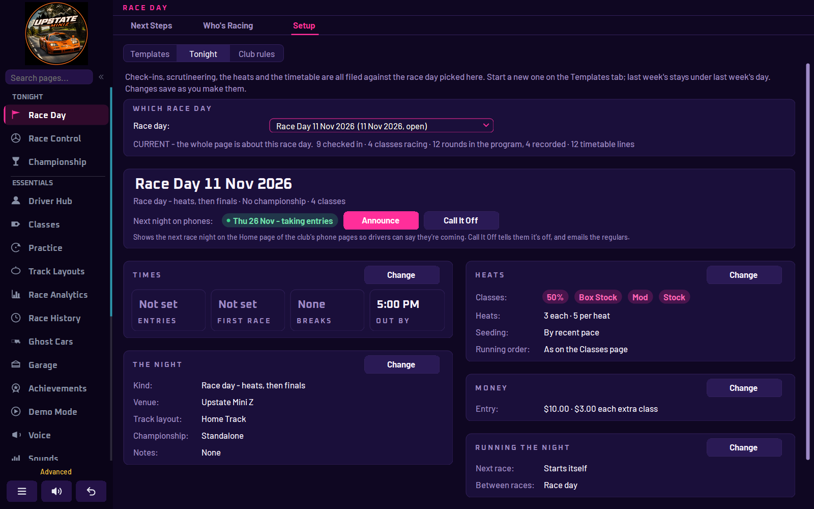
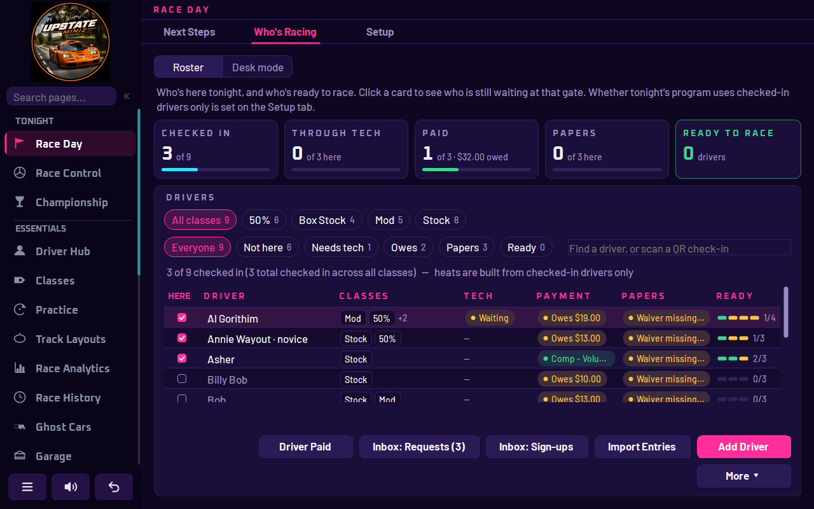
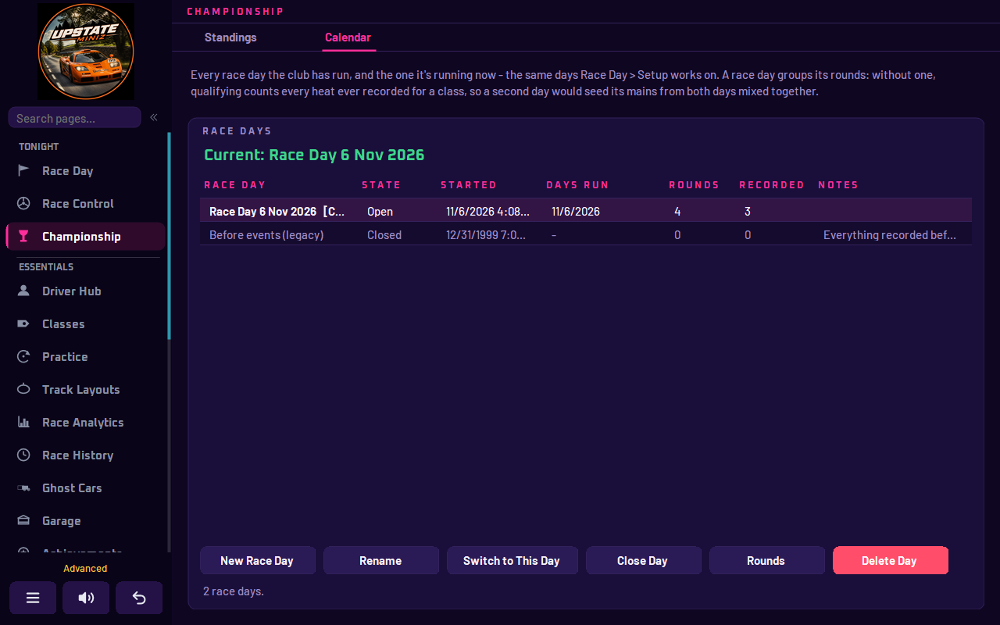

# Events, entries and check-in

This page covers the start of a race day: creating the event, getting drivers checked in at the desk, printing QR check-ins, scrutineering cars, and checking that every transponder is being heard before the first race.

The **Race Day** page has three tabs: **Next Steps**, **Setup** and **Who's Racing**. This page covers **Setup** (the race day itself), **Who's Racing** (check-in and scrutineering) and the **Scrutineering log** window you open from it. **Next Steps**, with tonight's program under it, and the **Timetable** window are covered in [Program, heats and mains](program-and-mains.md).

## How events work

An event (a race day) is what keeps one meeting's records separate from the next. Check-ins, tech inspections, the program and the timetable are all filed against the **current** event. Starting a new race day starts all of them fresh, and last week's records stay filed under last week's event instead of being cleared away.

Events matter most for qualifying. Qualifying only counts the rounds that belong to the event, so a second race day doesn't seed its mains from both days' heats mixed together. This holds even on a brand-new race day before any heats have run: earlier days' results aren't borrowed. Seeding mains, bump-ups, marshal assignments and heat sheets also only look at the current race day's rounds. With no race day open, everything recorded is used.

Anything recorded before you started using events lives in a built-in **legacy event**. You can look at it, but you can't edit it, and it's never the default.

While a race day is open, the sidebar lifts **Race Day**, **Race Control** and **Championship** into a **TONIGHT** group at the top. See [The pages](../getting-started/tour.md#the-pages).

### Race day or club night

Every race day is one of two kinds, chosen when the day is started (**What kind of night is it?** in the **Start a race day** window, **What kind of night:** in the wizard) and changeable afterwards in **What kind of night:** on **Setup**. It decides what the program offers.

| Kind | What it means |
|---|---|
| **Race day - heats, then finals** | Qualifying heats, then finals (mains) built from them. Heats are built from drivers who have checked in. |
| **Club night - just races** | A flat list of races: no finals, no seeding, no bump-ups. Everyone in a racing class is in them. |

On a club night, the program builds races instead of heats (named "Race 1", or "Race 1 Heat 2" when a class is too big for one go), the finals commands and **Move the Top Finishers Up** aren't offered, and **Standings** becomes **Tonight's Standings**. See [Program, heats and mains](program-and-mains.md).

A club's first day of each kind sets **Only include drivers who have checked in** from the kind of night: on for a race day, off for a club night. After that, each new day keeps whatever the last day of the same kind had, so a club night that runs a sign-on desk keeps it on. You can change it on **Setup** at any time.

## Start a race day

There are three ways in, and they all make the same kind of race day:

- **New Race Day** on **Race Day → Setup** (or **New Race Day** on **Championship → Calendar**) asks two questions and starts the day.
- **Set Up Tonight** on **Race Day → Setup** walks you through the whole evening, step by step. See [The Set Up Tonight wizard](#the-set-up-tonight-wizard).
- **Start a Race Day**, offered on **Next Steps** and on **Who's Racing** when no race day is open, opens the Set Up Tonight wizard at the first step that isn't done yet.

### New Race Day

1. Go to **Race Day → Setup**.
2. Click **New Race Day**. The **Start a race day** window opens.
3. Choose **What kind of night is it?**: **Race day - heats, then finals** or **Club night - just races**.
4. Under **Which classes are racing?**, tick the classes running today.
5. Click **Start the Day**.

The new day becomes current straight away, and the cursor goes to the **Name:** box so you can give it a proper name. Everything the window didn't ask about starts from your last race day: the venue, the track layout, the championship, the number of heats each driver gets, the drivers per heat and the entry fees. From the last day of the same kind, it also keeps **First race at:**, **First round seeded:**, **Share a heat under (drivers):**, **Between-race talk:** and **Only include drivers who have checked in**. From the last day at the same venue, it keeps **Out of the venue by:**, **Entries close at:** and the breaks. So a club that runs the same night every week has nothing to retype. The name is today's date, for example "Race Day 21 Sep 2026" (or "Club Night 21 Sep 2026").

On a club's first race day, every class starts ticked. After that, the classes from the last race day start ticked. If there are no classes yet, you can still start the day: **Next Steps** then walks you through setting them up.

**Undo** takes a new race day away again, as long as nothing has been done with it yet. Once it has rounds, check-ins or timetable lines, the undo is refused; close the day instead if it isn't wanted.

### The Set Up Tonight wizard

**Set Up Tonight** on **Race Day → Setup** opens a window that walks through everything a race night needs, in order. You can also open it with <kbd>Shift</kbd>+<kbd>S</kbd>. HeatCaller also offers it once, on a start with no race day under way ("Would you like a hand setting up a race night?"): no race day open, or only one with no classes picked and no rounds, such as the one a new install opens by itself. The wizard then sets up that day rather than starting another.

The steps are listed down the left: **Tonight**, **The day**, **Classes**, **Drivers**, **Program** and **All set**.

| Step | What you do |
|---|---|
| **The day** | Choose what kind of night it is (it starts on the kind your last race day was), what to **Call it:**, the **Venue:** and **Track layout:**, and the sound for tonight under **Sound:**: **Keep what's set now**, one of the soundscapes, or **Lap times only** (see [Choosing the sound in the setup wizards](../announcer/sounds-and-music.md#choosing-the-sound-in-the-setup-wizards)). The **Sound:** row is only there while **Ask which sound to use in Set Up Tonight** is ticked on **Sounds → Soundscapes**. With no race day open, moving on from here opens the day; with one open, changes here are made to it. Either way the sound is applied. |
| **Classes** | Tick the classes out tonight (**Add Class** for a new one), then how many times each driver races, how many drivers go out at once, **First race at** if you want to give the day a time, and the race format each class runs. These are saved on the day, so with no race day open they're grayed out until you open one on **The day**; **Add Class** and the race formats still work. |
| **Drivers** | Tick everyone who has turned up, a class at a time if you like, or tick **Only those not in yet**. **Check In All Shown** ticks in everyone in the list, **Clear All** checks out everyone shown (after you confirm), and **Add Driver** puts someone new on file and checks them in. **Only build races from drivers who have checked in** is the same setting as **Only include drivers who have checked in** on **Setup**. **Open the full check-in page** closes the wizard and goes to **Race Day**. |
| **Program** | Builds tonight's races from the classes and drivers above. **Build It** builds them; **Back** lets you change anything first. If something the program needs is missing (no open day, no classes ticked, or nobody checked in), the step says which, the step on the left is marked with a red !, and the button reads **Skip for Now**. |

Every step can be skipped, and **Skip setup** leaves the wizard at any point. A step is saved when you move off it with **Next**, **Back** or a step name on the left. **Skip setup**, or closing the window, doesn't save the step you're on, but the steps you've already left are kept. Anything left to do is shown on **Next Steps**.

<!-- screenshot: Set Up Tonight wizard on the Classes step -->

## Race Day → Setup

**Setup** is the race day itself: which day the app is working on, what the day is, and how its program gets built.

There's no Save button. Every change saves itself as you make it, and a **Saved** note appears for a moment after the **Close Day** and **Delete Day** buttons. Typing in a box is saved when you pause or move to another field, and a run of typing is one step for **Undo**.

### Which race day

| Field | What it does |
|---|---|
| **Working on:** | The race day the whole page is about. Real race days are listed newest first, with their date and whether they're open or closed; the legacy event is always last. **Picking a day here makes it the current race day**, so check-in, scrutineering, the heats and the timetable all follow it. **Undo** switches back. |

Beside the picker are **New Race Day** and **Set Up Tonight** (see [Start a race day](#start-a-race-day)).

The line under the picker shows what the selected day already holds, for example: "CURRENT - the whole page is about this race day.  14 checked in · 2 classes racing · 12 rounds in the program, 4 recorded · 12 timetable lines".

!!! tip
    Scrolling the page with the mouse wheel never changes **Working on:**. The box only changes when you click it and pick a day.

### About the day

| Field | What it does | Default |
|---|---|---|
| **Name:** | The race day's name. | "Race Day" (or "Club Night") and the date |
| **What kind of night:** | **Race day - heats, then finals** or **Club night - just races**. See [Race day or club night](#race-day-or-club-night). | As chosen when the day was started |
| **Venue:** | Where it's being run. Pick a saved venue or type any name — you don't need a venue profile. | From the last race day |
| **Track layout:** | The layout every generated round starts on. Pick a saved layout or type a name. | From the last race day |
| **Championship:** | The championship this race day counts toward, or **(standalone - no championship)**. See [Results and championships](../race-control/results-and-championships.md). | From the last race day |
| **First race at:** | When the first race goes out. Tick **Set** to give the day a time; unticked, the day has none. **Fill In the Times...** on the Timetable starts from it, and writes back the time you use there. See [The Timetable](program-and-mains.md#the-timetable). | From the last day of the same kind, or not set |
| **Out of the venue by:** | When the club has to be out of the building. Tick **Set** to give the day one. The next-step card on **Next Steps** then says whether tonight finishes in time, and what would help if it won't. See [When the night finishes](program-and-mains.md#when-the-night-finishes). A new race day takes the time from the last day at the same venue. | From the last day at the venue, or not set |
| **Entries close at:** | When entries close. Tick **Set** to give the day one. Ten minutes before, the announcer says "Entries close in 10 minutes", and as it passes, "Entries are now closed" (only before the first race has run). Until the heats are built, **Next Steps** counts down to it. After it, **Who's Racing** says that anyone checked in now is a late entry. They go into the heats still to run without moving anyone else, and once the heats are posted **Next Steps** asks first (see [Checked in late](program-and-mains.md#checked-in-late)). Nobody is stopped from checking in. A new race day takes the time from the last day at the same venue. | From the last day at the venue, or not set |
| **Next night on phones:** | What the phones' Home page says about the next race night. **Announce...** sets it: the night, what it's called, the venue, the classes on, the first race and when entries close, and whether drivers can say they're coming from their phones. It starts from the last race day a week on. **Publish** puts it on the phones, and **Take Down** takes it off. **Call It Off...** marks it as off with your message, and can email every regular with an address (drivers who raced in the last 8 weeks, or said they're coming) through the club's mailbox. See [Who said they're coming](#who-said-theyre-coming). Needs the club website switched on, and the relay updated. | Not announced |
| **Breaks:** | Breaks planned into the night, such as watering the track after Q2. **Breaks...** changes them. The finish time, the estimated starts and Auto start all allow for them. See [Planned breaks](program-and-mains.md#planned-breaks). A new race day takes them from the last day at the same venue. | From the last day at the venue, or none |
| **Notes:** | Free text about the day. The same notes show on **Championship → Calendar**. | Empty |

### Building the program

| Field | What it does | Default |
|---|---|---|
| **Heats each driver gets:** | How many qualifying rounds each class runs (1–10). On a club night it reads **Races each driver gets:**. | 3, or the last race day's |
| **Classes racing:** | Tick the classes running today. **Next Steps** builds tonight's heats (or races) for every one of them in one press. | As ticked when the day was started |
| **Drivers per heat:** | How many drivers share a heat when the program is built (2–20). | The last race day's, or 8 on a club's first race day |
| **First round seeded:** | How the first qualifying round is split into heats: **By recent pace** (similar pace together, from each driver's best lap in the class over the last 60 days), **Alphabetical** (dealt in turn, as before 11 Nov 2026), or **Random** (the same random for the same race day, so a rebuild gives the same heats). See [Build the qualifying program](program-and-mains.md#build-the-qualifying-program). | From the last day of the same kind, or By recent pace |
| **Share a heat under (drivers):** | A class with fewer drivers than this shares a heat with another small class when you build, and each class is still scored on its own (0 to 19, 0 for never). See [Mixed-class heats](program-and-mains.md#mixed-class-heats). | From the last day of the same kind, or 0 |
| **Entry fee:** | What a driver pays for their first class tonight, for [Money at the desk](#money-at-the-desk). Leave it at 0 if the club doesn't track money in HeatCaller; nothing about money is shown then. | The last race day's, or 0 |
| **Each extra class:** | What a driver pays for each class after their first tonight (often less). | The last race day's, or 0 |
| **Only include drivers who have checked in** | When ticked, building the program only uses drivers checked in on **Who's Racing**. When unticked, it uses every driver in the class. | From the last day of the same kind; on a club's first day of each kind, on for a race day and off for a club night |
| **Start the next race automatically** | When a race finishes without a round picked on **Race Control**, it's recorded against the next round that hasn't run yet, so you can work through the program without picking each round by hand. See [Which round a race counts for](program-and-mains.md#which-round-a-race-counts-for). | On |
| **Next race is:** | Which round that is: **the class that was racing**, **any class, in program order**, or **only "*class*"**. Grayed out while **Start the next race automatically** is unticked. Only shown in Advanced mode (see [Simple and Advanced mode](../getting-started/simple-and-advanced-mode.md)); in Simple mode the day keeps whatever it's set to. | the class that was racing |
| **Class running order:** | Which class goes first in each round. **Order...** lists tonight's classes with **Move Up** and **Move Down**, and **Turn the order round each round** makes Q2 start with the second class, Q3 with the third, and so on. It decides who marshals for whom and when each class finishes, so juniors first has them done early. Used the next time the heats are built. See [Build the qualifying program](program-and-mains.md#build-the-qualifying-program). | From the last day of the same kind, or as on the **Classes** page |
| **Between-race talk:** | How much the announcer says between races on this day: **The club's Between races settings**, or one of the presets (**Club night**, **Race day**, **Big event**, **Just the call-ups**) over them for this day only. See [Between races](../announcer/commentary.md#between-races). | From the last day of the same kind, or the club's Between races settings |
| **Post the heats before the first race** | Once the heats are built, **Next Steps** offers **Post the heats...** before the first race: it prints the heat sheets and the marshal list, tells the room, and lists any car the loop hasn't heard tonight. After that, moving drivers between heats asks first. This is the club's setting, for every night. See [Post the heats](program-and-mains.md#post-the-heats). | On |
| **Build the heats when entries close** | With **Entries close at:** set, the heats build themselves as it passes (if they haven't been built yet), and **Next Steps** moves on to posting them. **Undo** takes the build back. The club's setting. | On |
| **Add late check-ins to posted heats without asking** | A driver who checks in after the heats are built goes into them by **Add a Late Entry**'s rule, which moves nobody else. Before posting that always happens by itself; after posting, **Next Steps** asks first unless this is ticked. See [Checked in late](program-and-mains.md#checked-in-late). The club's setting. | Off |
| **Ask every driver for a signed waiver** | Who's Racing shows a **Papers** column, and **Post the heats** lists anyone without a signed waiver. A junior's is signed by a parent or guardian, and a waiver lasts 12 months. See [Papers: waivers and memberships](#papers-waivers-and-memberships). The club's setting. | Off |
| **Check memberships** | The same for memberships: the club's own, or a national body's for its racing insurance. A driver with none on file, or one that has run out, shows. The club's setting. | Off |
| **Close the night with a checklist** | When every race has run, **Next Steps** offers **Close the night...**, a list of what's left to tick off. Unticked, the card just says what's left in one line. This is the club's setting, for every night, not just this one. See [Closing the night](program-and-mains.md#closing-the-night). | On |

!!! tip
    If your club doesn't run a sign-on desk, untick **Only include drivers who have checked in**. With it on and nobody checked in, the program has no one in it, and **Next Steps** says "Nobody has checked in yet."

The legacy event can be selected and made current, to look at older records, but its fields can't be edited.

### Close, reopen and delete a race day

- **Close Day** stops new rounds joining the selected race day. HeatCaller asks first (**No** is the default), saying how many rounds on the program haven't been run yet, and refuses while one of the day's rounds is on track. Its results and standings are kept and can still be reported. If you close the current day, no race day is current until you open or start another. The button changes to **Reopen Day** for a closed day. Reopening a day makes it current again if no other day is.
- **Delete Day** deletes the selected race day. See below.

Both can be undone with **Undo**.

#### Delete Day

**Delete Day** opens the **Delete race day** window. The day always goes, and so do the heats and finals on it. Its check-in sheet, scrutineering and timetable are kept rather than erased, so **Undo** can bring them back with the day. If races were saved on the day, you choose what happens to them:

- **Delete the *N* saved races from Race History** — their finishing order, lap times and notes. Personal bests, pace charts and head-to-head read from these, so those go too. Leave it unticked and the races stay; they just stop belonging to a race day.
- **Also clear *N* track records set in them** — a lap record lives on the track layout, so it survives unless you clear it here. Cleared means no record; it isn't worked out again from the races that are left.
- **Also take them out of *N* championships that picked them by hand** — for a championship where someone picked the races one by one. Deleting the day already stops its races counting toward a championship that scores by race day.
- **Also take back *N* achievements earned in them** — milestones (race, lap, win and podium counts) are kept, since the profile totals that earned them are left as they are.

The three "Also" choices can only be ticked while the races themselves are being deleted. A day can't be deleted while one of its rounds is on track. Click **Delete** to go ahead; **Cancel** is the default, so <kbd>Enter</kbd> never deletes a day. **Undo** puts all of it back, but only until a few more changes are made or the app is closed. The legacy event can't be deleted. The same delete is on **Championship → Calendar**, where you can delete several days at once.

## Race Day → Who's Racing

**Who's Racing** is the sign-on desk: who's here today, and whether their car has passed tech. It's also where scrutineering happens: the **Tech** column is the gate, and the **Scrutineering Log** button opens the full record.

If no race day is open, a banner at the top says "No race day is open." Check-ins made then aren't kept with tonight's racing, and the heats can't be built from them. Click **Start a Race Day** in the banner to set one up.

If the current race day is closed (say you picked last week's day to look at its results), the banner says "This day is closed." The list then shows who was checked in that day, and it won't take check-ins or check-outs, from the desk, the scanner or drivers' phones. Start tonight's race day, or reopen that one on **Setup**, to change them.

### The Drivers card

Each row is a driver profile. The class shown is the class on the driver's profile — to move a driver to another class, edit their profile on the [Driver Hub](drivers-and-classes.md#driver-hub) page.

| Column | What it shows |
|---|---|
| **Checked In** | Tick when the driver arrives. |
| **Driver** | The driver's name. |
| **Class** | The driver's class. |
| **Tech** | The result of the inspection that counts for this driver: **Passed**, **FAILED**, **Passed (note)**, or **-** if they haven't been inspected. A driver in more than one class that runs tech shows as cleared only once they're cleared in each (see [A driver in more than one class](drivers-and-classes.md#a-driver-in-more-than-one-class)). Passes are green, fails red. Double-click the cell to inspect the car. |
| **Pack** | The battery pack in the driver's car, which each race they run tonight is recorded on. Click the cell to pick one of their packs or the club's, or **No pack in the car**. It reads **Pick...** when they have packs and none is in, and is blank when there are none to pick. See [A driver's batteries](drivers-and-classes.md#a-drivers-batteries). |

A single click on a checkbox ticks or unticks it straight away. Check-ins are kept per race day, so a new race day starts with an empty sheet.

### Several drivers at once

Pick more than one driver, then double-click any of them to deal with them all together:

1. Hold <kbd>Ctrl</kbd> and click each driver you want, or click one and hold <kbd>Shift</kbd> as you click another to pick everyone in between. <kbd>Ctrl</kbd>+<kbd>A</kbd> picks the whole list. While <kbd>Ctrl</kbd> or <kbd>Shift</kbd> is held, a click only picks the row: it doesn't tick **Checked In** or open the **Pack** menu.
2. Double-click any of the picked rows. A menu opens with:
    - **Check In *n* Drivers** ticks them all in. Drivers already checked in stay checked in, and the line under **Scan to Check In** says how many were new.
    - **Log Inspection for *n* Drivers...** records one inspection for all their cars. See [Inspect several cars at once](#inspect-several-cars-at-once).

You can keep <kbd>Ctrl</kbd> held for the double-click: on a picked driver it still covers everyone picked, and on a driver who isn't picked yet it adds them to the rest. The drivers stay picked afterwards, so you can check them in and then log their inspection with two double-clicks. A double-click on a driver who isn't one of the picked ones works as it always has: on their **Tech** cell it inspects that one car.

Above the list:

- The **Class:** filter shows one class at a time, or **(all classes)**. HeatCaller remembers your choice.
- **Only those not through tech** narrows the list to the cars still to be cleared: not inspected, or failed. With **(all classes)** in the **Class:** filter, it covers every class at once. See [Who still needs inspecting](#who-still-needs-inspecting).
- The summary reads, for example, "9 of 12 checked in (21 total checked in across all classes)", followed by how tonight's program is built: "heats are built from checked-in drivers only" or "everyone in a racing class is in the heats, checked in or not" (on a club night, "tonight's races").

The buttons under the list:

- **Add Driver** opens the **Add a driver** window for someone who isn't on file yet: **Name**, **Transponder** and **Class**. Click **Add Driver** and they're saved with the drivers on file and checked in straight away.
- **Import Entries** brings in tonight's entry list from a CSV file or a table you copied, such as an RCSignup export or a LiveRC entry list. See [Import entries](#import-entries).
- **Check In All Shown** ticks in every driver currently in the list (so it respects the filters).
- **New drivers** show beside their name: "Max Power · first night" for a driver first seen today, or "· novice, mentor Al Gorithim" for one ticked **New to racing** on their profile (see [Drivers and classes](drivers-and-classes.md)).
- **Click a driver's Class** to change the classes they race, without going to **Driver Hub**. The menu lists tonight's classes (every class, when the day has none picked) with theirs ticked. Click one to put them in it or take them out. The **Class** column shows every class a driver races, for example "Stock + Mod". It changes their profile, so it lasts beyond tonight, and **Undo** puts it back. If tonight's heats are already built, put them in the new class's heats with **Add a Late Entry** on the program (see [A late entry](program-and-mains.md#a-late-entry)).
- **Check Out Everyone** clears all check-ins for the current race day, after you confirm. You can undo it with **Undo**: the drivers are checked back in to the race day they were checked out of, and anyone who checked in since stays checked in. You don't normally need it — a new race day already starts with an empty sheet.
- **Inspect Selected Car** opens a tech inspection for the selected driver. See [Inspect a car](#inspect-a-car). With more than one driver picked it reads **Inspect Selected Cars** and logs one inspection for all of them. See [Inspect several cars at once](#inspect-several-cars-at-once).
- **Scrutineering Log** opens the full list of inspections. See [The Scrutineering log](#the-scrutineering-log).
- **Online Sign-ups** opens the drivers who have signed up online, waiting to be approved. The button shows how many are waiting, for example **Online Sign-ups (3)**. See [Driver sign-up](../online/sign-up.md).
- **Driver Requests** opens the changes drivers have asked for from their phones, and their result queries, waiting for the desk. The button shows how many are waiting, for example **Driver Requests (2)**. It's only there while the club takes requests, or while some are still waiting. See [Driver requests](../online/driver-requests.md).

### Papers: waivers and memberships

With **Ask every driver for a signed waiver** or **Check memberships** ticked on **Setup**, **Who's Racing** has a **Papers** column. It shows **OK**, or what isn't in order:

- "Waiver missing", or "Guardian's waiver missing" for a driver marked under 18.
- "Waiver ran out 12 Nov", once a waiver is 12 months old.
- "Junior: no guardian named on the waiver".
- "Membership missing", until a driver has a membership number or a date on file.
- "Membership expired 3 Oct", the day after it runs out.

Click a driver's **Papers** to fill them in: **Waiver signed on** (today, or the date on the paper), **Under 18** with the parent or guardian who signed, and the **Membership no.** with the date it **Runs out on**. It's saved on the driver's profile, so next week it's already there. **Undo** puts it back.

**Post the heats** lists anyone on tonight's heats whose papers aren't in order. Nobody is stopped from checking in or racing: it's the desk's call. Papers are recorded by hand, for the club's own records. HeatCaller doesn't take signatures or check anybody's membership, and the papers never leave the laptop.

### Who said they're coming

When the club has announced the next race night (**Next night on phones:** on **Setup**) and drivers have said from their **Me** page that they're coming, **Who's Racing** shows a line on that night: "12 said they're coming · 9 here · still to come: Al Gorithim, Hugh Turn and 1 more." It updates as drivers check in.

A driver's answer is filed by itself, and their phone is told "You're down for Tue 18 Nov: Stock and Mod. Check in when you arrive." Saying they're coming doesn't check them in or put them in the heats: they still check in when they arrive. Only classes on the announced night are kept, and **Not coming after all** takes them off the list. **Driver Requests** lists each answer as "Coming next race night". This needs online check-in on, and the relay updated.

### Import entries

If your drivers enter before the night somewhere else, such as RCSignup, LiveRC or a spreadsheet, you can bring that list in instead of ticking everyone by hand. Each row of the list is one driver entered in a class. HeatCaller matches each row to a driver already here, makes a profile for anyone new, adds the class to the classes they race, and can check them all in to tonight's race day. Nothing changes until you've seen what will happen.

1. Click **Import Entries** and choose **From a CSV File...** or **Paste a Table (LiveRC Entry List)...**.
    - For a file: comma-, semicolon- and tab-separated files all work, and the first row must be the column headings. An RCSignup or LiveTime export is fine as it comes.
    - For a table: select the whole list on the web page or in the spreadsheet, headings and every row, and copy it (<kbd>Ctrl</kbd>+<kbd>C</kbd>) first. A LiveRC entry list is read one class table at a time, with each table's class as the row's class, as on [Driver Hub](drivers-and-classes.md#import-drivers-from-a-spreadsheet).
2. The **Import entries** window shows the first rows with a list above each column, guessed from its heading. Headings are matched whatever their capitals, so "FIRST NAME", "Car Number", "AMB #" and "Class" are all recognized. Put any wrong guess right, set columns you don't want to **(ignore)**, and click **Next**. You need a **Transponder** column, a **Driver name** column, or **First name** and **Last name**. **Points so far** isn't used here.
3. The next window lists every row with what will happen to it, and a line at the top that counts them, for example "3 new drivers, 12 updated, 20 already here with nothing to change, 1 row skipped."
4. Choose the two ticks, then click **Import**.

How each row is matched:

- **By transponder** when the row has one. The driver with that transponder (as their main one or one of their others) is the match. If their name is different from the row's, the row is skipped: it's a mistake on the sheet or a transponder that changed hands, and you decide which.
- **By name** when the row has no transponder. Capitals, dots and apostrophes don't matter, and "Black, Kaleb" matches "Kaleb Black". A name nobody here has, or one two drivers share, is skipped.
- **A new driver** when the transponder is new and nobody here has the name. If somebody here already has the name on another transponder, the row is skipped instead of making a second profile. Add the new transponder on their [transponders](drivers-and-classes.md#a-drivers-transponders), or fix the sheet.

What a row changes:

- **Classes.** The row's class is added to the classes the driver races. Their main class stays as it is, so a Stock driver entered in Mod tonight races both. A driver with no class yet gets the row's class as their main one. A class cell can hold more than one class, separated by semicolons, or by commas when each one is a class you have. A class that isn't on the **Classes** page is entered as the sheet spells it and named under the list: add or rename it on **Classes** before you build the heats.
- **Other details** (race number, car, announcer name, team, sponsors, email and notes). A blank one on the profile is filled in. One the profile already has is kept, and the row says so, for example "keeps race number 12 (the sheet says 7)". Tick **Replace details that differ** to use the sheet's instead. A different car is added to the driver's garage either way; with the tick, it also becomes the car they're announced in.
- A driver's name is never changed.

The two ticks:

| Tick | What it does | Default |
|---|---|---|
| **Check everyone on the list in to** *race day* | Checks in every driver on the list who wasn't skipped. Drivers already checked in stay checked in. With no race day open it reads **Check everyone on the list in on Who's Racing**. While the current race day is closed it's off and can't be ticked. | On when a race day is open, off when none is |
| **Replace details that differ** | Puts the sheet's race number, car, team, sponsors, email and notes in place of different ones already on a profile. | Off |

When it's done, **Entries imported** says how many drivers were new, updated and checked in. The whole import is one step for the sidebar **Undo** button: the drivers it added are removed, the drivers it changed go back to how they were, and only the check-ins it made are taken off.

!!! note
    Moving from LiveTime? [Switching from LiveTime](../getting-started/switching-from-livetime.md) maps LiveTime's screens to HeatCaller's and walks through bringing your drivers across.

### Drivers checking themselves in

Drivers can also check in from their phones, with their own personal PIN, and their check-ins appear on this tab as they arrive. Staff can check anyone in from the full list with the staff PIN. Phones can check in two ways:

- On the club Wi-Fi, from the laptop's own check-in page. See [Local Screens](../screens/phone-and-web.md) and the [self check-in poster](#self-check-in-poster) below.
- Over the internet, from your club's online check-in page. See [Online check-in](../online/check-in.md).

Online taps reach the laptop a few seconds late. If the desk changes a driver's check-in, an online tap that was made *before* the desk's change but arrives after it won't undo what the desk did. This holds even if the laptop's clock is wrong, because HeatCaller allows for the difference between its clock and the relay's.

### Scan QR check-ins

The **Scan to Check In** card lets you check drivers in by scanning their QR check-in with a USB barcode scanner. Scanners plug in and type like a keyboard, so there's nothing to set up.

1. Click in the box that says **Waiting for scan...**.
2. Scan a driver's QR check-in.

The driver is checked in immediately, and the card tells you what happened:

| Message | Meaning |
|---|---|
| **Checked in: *name*** | Done. |
| ***name* was already checked in.** | Nothing changed. |
| **Not checked in: this day is closed ("*day*"). Start tonight's race day first.** | The current race day is closed. See [Race Day → Who's Racing](#race-day-whos-racing). |
| **No driver profile found for transponder *number*.** | The QR check-in is for a transponder that has no profile. |
| **That QR check-in is out of date - print a new one.** | An online QR check-in whose code no driver here has any more: printed before **Reissue All QR Check-ins** was used, printed on another laptop's QR check-in key, or for a driver since deleted. Print a new QR check-in. |
| **That doesn't look like a HeatCaller QR check-in.** | Whatever was scanned isn't a HeatCaller QR check-in — for example a product barcode. |

The scanner reads both kinds of QR check-in described below, so QR check-ins you printed earlier keep working, except online QR check-ins printed before **Reissue All QR Check-ins** was used (see [Reissue all QR check-ins](../online/check-in.md#reissue-all-qr-check-ins)).

### Print QR check-ins

1. On **Who's Racing**, set the **Class:** filter to the drivers you want QR check-ins for (or all classes).
2. Click **Print QR Check-ins** and choose where to save.
3. Print the saved images, cut the QR check-ins out and hand them to drivers.

HeatCaller saves the QR check-ins as PNG images sized for letter paper, 12 QR check-ins (3 across, 4 down) per page, with dashed cut lines. If there's more than one page, each page is saved as its own file, numbered after the name you chose (`qr-check-ins-page1.png`, `qr-check-ins-page2.png` and so on). Each QR check-in shows a QR code, the driver's name, and their class and transponder.

There are two kinds of QR check-in, and HeatCaller picks one automatically:

- **Desk QR check-in.** The QR code holds the driver's transponder in a form only HeatCaller's scanner reads. This is what you get when online check-in isn't set up.
- **Online QR check-in.** When online check-in is set up — on the **Club Website** page, **Publish to the relay** and **Let drivers check in from their own phones** are both ticked and the relay address and club are filled in — the QR code is a web link to your club's online check-in page for that driver. Drivers can scan it with their own phone camera — no app needed — and the QR check-in says **Scan with your phone camera to check in**. The desk scanner still reads it too. See [Online check-in](../online/check-in.md).

!!! note
    If you turn online check-in on or off, print the QR check-ins again so they carry the right kind of code. Old desk QR check-ins still scan at the desk either way.

### Self check-in poster

**Self Check-In Poster** opens a poster with a QR code that takes a phone to the laptop's check-in page, where drivers find their own name, tap it and give their personal PIN. The poster reads **CHECK IN** with the line "Scan, find your name, tap it. Same Wi-Fi as the timing laptop."

The laptop's web server must be running first, and phones must be on the same Wi-Fi as the laptop. If it isn't running, you'll see **Web server is not running**. Start it on the **Local Screens** page — see [Local Screens](../screens/phone-and-web.md).

The poster opens in its own window, so you can leave it on a second screen by the door while racing carries on:

- **Print** prints it at full printer resolution.
- **Full screen** fills the screen. Press <kbd>Esc</kbd> to leave full screen, and <kbd>Esc</kbd> again to close the window.
- **Close** closes it.

### Money at the desk

With an **Entry fee:** set on **Setup**, the **Drivers** card has a **Paid** column. HeatCaller only records what happens at the desk; it never takes a payment.

- **Owes .00** (in amber): what the driver owes tonight, the entry fee plus **Each extra class:** for each of tonight's classes they race after the first.
- Right-click a driver (or several) and choose **Paid Cash**, **Paid Card**, **Comp** (then **Marshal**, **Volunteer**, **Junior** or **Other**), or **Still Owing** to undo a mistake. **Undo** works too.
- The column then reads, for example, **Cash .00**, **Card .00** or **Comp - Marshal**.

At the end of the night:

- The event report's **Money at the desk** section gives the cash and card taken, the comps, and who still owes and how much (see [Event reports](../race-control/results-and-championships.md)).
- The next-step card's closing list includes "2 drivers still owe their entry (Sam, Jo)" (see [Closing the night](program-and-mains.md#closing-the-night)).

Only drivers who raced are counted at the end. Payments are kept per race day.

## Scrutineering

Scrutineering records which cars have been checked and cleared to race. Each class's checklist is set with **Tech Checklist** in the class editor on the **Classes** page, in Advanced mode — see [Tech checklist](drivers-and-classes.md#tech-checklist). In Simple mode the button is hidden, but a checklist already set keeps working.

The gate is the **Tech** column on **Who's Racing**. You record inspections from there, and the **Scrutineering log** window holds the full record.

### Inspect a car

1. On **Who's Racing**, select the driver and click **Inspect Selected Car** (or double-click their **Tech** cell). Or click **New Inspection** in the Scrutineering log.

    From **Who's Racing**, if the car was already inspected today (or in the last 6 hours, for a club night that runs past midnight), that inspection opens to edit instead of starting a new one. An older inspection, such as Saturday's at a weekend meeting, is left as it was, and a new one is recorded for today. To change an older inspection, pick it in the Scrutineering log and use **Edit**.

    For a driver who races more than one class, it opens the class their **Tech** cell is showing: the first one they aren't cleared in yet.

2. Pick the **Driver:**. The **Class:** and **Car:** fill in from their profile; you can change them. Switching to another class starts its checklist again at **not checked**, because it's a different car.

    On an inspection that's already saved, changing the class moves that inspection to the new class when you save, and it no longer counts for the class it was in. HeatCaller asks first. That's how you fix an inspection filed under the wrong class. To record a driver's second car and keep the first one's inspection, click **New Inspection** in the Scrutineering log instead.

3. For each item on the class's checklist, choose **OK**, **FAIL** or leave it at **not checked**. The line under the checklist sums it up: "FAILS - 1 check failed.", "2 checks not looked at yet." or "All checks passed."
4. Enter the **Inspector:** and any **Notes:**.
5. Click **Save**.

The result is worked out from the checks:

- Any **FAIL** records the car as **FAILED**.
- All checks **OK** records **Passed**.
- If some checks are still **not checked**, HeatCaller asks what you meant: **Yes** records **Passed (note)**, **No** records a full pass anyway, and **Cancel** takes you back to finish the checklist.

If the class has no checklist, choose the outcome in the **Result:** list instead: **Passed**, **Passed with a note** or **FAILED**. **Passed** and **Passed (note)** both clear the car to race.

If you edit a car that was failed by hand (with no checklist) and its class has since gained a checklist, HeatCaller asks whether to keep it **FAILED**: **Yes** keeps it failed, **No** records the result of the checklist instead, and **Cancel** goes back to the checklist.

If a check has since been taken off the class's checklist, older inspections still show it, marked "(no longer on the checklist)".

A driver who runs two classes is inspected separately in each, because they may have two cars.

Recording or editing an inspection can be undone with **Undo**. **Cancel** in the inspection window leaves the inspection as it was. Changing only the notes, the inspector or the car doesn't change the inspection's time.

### Inspect several cars at once

When a line of cars goes through tech together, or a batch is turned back for the same reason, record them in one go:

1. On **Who's Racing**, pick the drivers with <kbd>Ctrl</kbd>+click or <kbd>Shift</kbd>+click. See [Several drivers at once](#several-drivers-at-once).
2. Double-click one of them and choose **Log Inspection for *n* Drivers...**, or click **Inspect Selected Cars**.
3. The **Log Inspection for *n* Drivers** window names who it's for. Choose the **Result:** (**Passed**, **Passed with a note** or **FAILED**), and enter the **Inspector:** and any **Notes:**.
4. Click **Save *n* Inspections**.

One inspection is filed for each car, with the same result, inspector and notes:

- Each car is inspected in every class its **Tech** cell is still waiting on. A driver racing two classes that both run tech, and not yet cleared in either, gets an inspection in each, so their **Tech** cell reads cleared afterwards. The undo step still counts drivers, for example "Record tech inspection for 3 drivers".
- **Passed** marks every check on that class's checklist **OK**, so the inspection reads "All checks passed" if you open it later. **Passed with a note** and **FAILED** mark no checks, because nothing says which one it was. Open a car's inspection afterwards to mark the check that failed.
- A car already inspected today (or in the last 6 hours) has that inspection updated, as **Inspect Selected Car** would, rather than a second one filed beside it. The window says how many that is.
- Leave **Inspector:** or **Notes:** blank to keep what an inspection already says, so a quick pass doesn't wipe notes made at the bench.

The whole batch is one step for **Undo**.

### Who still needs inspecting

Tick **Only those not through tech** on **Who's Racing** to list every driver who isn't cleared yet at the current race day — either not inspected or failed — across all classes. Use the **Class:** filter to narrow it to one class (the **Tech** column then shows each driver's result in that class), and **Inspect Selected Car** to deal with each one.

Inspections are filed against the current race day, so a car cleared on the first day of a two-day meeting stays cleared on the second. Re-inspecting a car files the new inspection under the race day that's open now. With no race day open, a pass counts for 18 hours after it was recorded, so a club night that runs past midnight doesn't lose its passes.

The **Tech** column, **Only those not through tech** and the tech warning on Race Control all use the same rule, so they agree on who's cleared. For a driver who races [more than one class](drivers-and-classes.md#a-driver-in-more-than-one-class), **Who's Racing** and the phone look at every class they race that runs tech, and show them cleared only once they're cleared in each. If the race day has its **Classes racing:** ticked, only those classes count, so a class that isn't racing today never holds a driver up.

### The Scrutineering log

**Scrutineering Log** on **Who's Racing** opens the **Scrutineering log** window: every inspection, with its car, its checks, who did it and their notes.

<!-- screenshot: Scrutineering log window listing today's inspections -->

The list shows **When**, **Driver**, **Class**, **Car**, **Result**, **Checks** (for example "5 ok, 1 fail"), **Inspector** and **Notes**. **Today only** (on by default) limits it to today's inspections, and **Class:** filters by class. The count at the end of the filters reads, for example, "12 inspected, 1 NOT cleared." or "12 inspected, all cleared."

- **New Inspection** records an inspection. See [Inspect a car](#inspect-a-car).
- **Edit** (or double-click a row) changes the selected inspection.
- **Delete** removes the selected inspections, after you confirm.

All of these can be undone with **Undo**. Click **Close** or press <kbd>Esc</kbd> to close the window.

### Tech warnings on Race Control

HeatCaller can remind you, at the moment it matters, that a car in the next heat hasn't been through tech. This is controlled per class by **Warn when a driver in a heat hasn't passed tech today** in the class editor on the **Classes** page. It's on by default. See [Class settings](drivers-and-classes.md#class-settings).

The warning only applies when you're running tech for that class: the class has a tech checklist, or someone has been inspected in that class at the current race day (or recently, with no race day open). Classes you don't scrutineer never get warnings.

- The Next Up bar on **Race Control** adds "· N not through tech" to the next round, ahead of time.
- When you stage a heat (or throw the green straight from idle), the Race Control log shows a "[tech] WARNING" line listing the drivers on the round who haven't been cleared, and says to record their inspection on **Race Day → Who's Racing**.

The warning never stops the race; whether an uninspected car runs is your call. Practice, demo races and races with no round selected are never checked.

## Pre-race check

Before a race, it's worth checking that every car on the grid is actually being heard by the decoder. A flat or badly mounted transponder found now costs a driver two minutes; found after the race, it costs everyone a re-run.

On the **Race Control** page, click **Pre-race check** (or press <kbd>R</kbd>). Have the drivers put their cars on the track (or run them over the timing loop) first.

<!-- screenshot: Pre-race check window with one car not heard and one weak -->

HeatCaller checks against the selected round's drivers. If no round is selected, it uses the drivers already on the leaderboard. Each car gets one of these marks:

| Mark | Meaning |
|---|---|
| **OK** | Heard recently, with a good signal. The detail shows when and how many passes, and the signal strength if the decoder reports it. |
| **!** | Heard, but only just. Most of its passes were caught with fewer than 3 hits, so it's likely to be missed at racing speed. Check the battery and how the transponder is mounted. |
| **X** | Not heard at all. The transponder is off, flat or not fitted. |
| **?** | Heard on track but **not** in this race — a driver in the wrong heat, or a car from the last race still circulating. |

With a split loop on, the line for a car with no split transponder ends "No split transponder, so no sector times." That isn't a fault: the car races normally, without sector times.

"Recently" means in the last 12 minutes. Decoders that don't report a hit count (such as I-Lap) never mark a car as weak, and show no signal figure.

The headline sums it up, for example "All 8 clear. Every car on the roster for Q1 Heat 2 is being heard. Good to go." or "1 not heard at all, 1 only just being heard." Put the problem cars on the track and click **Check again**.

To check the decoder, timing, the website and the sound as well, click **Mission Control**. The pre-race check closes and Mission Control opens. See [Mission Control](../race-control/running-a-race.md#mission-control).

On the **Big Screen**, the same check runs by itself while a race is staged: each driver's card turns green as their car is heard. See [Grid roll call](../screens/big-screen.md#grid-roll-call).

For more on signal strength and transponder problems, see [Transponders](../timing/transponders.md).

## Championship → Calendar

The **Calendar** tab, on the **Championship** page, lists every race day with what it covered. It's where you look back at past race days, and another place to switch which one is current.

The line above the list names the current race day ("Current: *name*"), adds "(closed - nothing new joins it)" when that day is closed, or says "No race day is open - rounds aren't being grouped". The list has these columns: **Race day**, **State** (**Open** or **Closed**), **Started**, **Days run** (worked out from when its rounds were actually raced), **Rounds**, **Recorded** and **Notes**. The current race day is marked **[CURRENT]**.

| Button | What it does |
|---|---|
| **New Race Day** | Starts a race day with the same window as **Race Day → Setup**: it asks what kind of night it is and which classes are racing, and carries the rest over from the last day. You stay on the Calendar. |
| **Rename** | Changes the selected race day's **Name:** and **Notes:**. Everything else about a day is set on **Race Day → Setup**. |
| **Switch to This Day** | Makes the selected race day current, so check-in, scrutineering, the program and the timetable follow it. You can also double-click a race day. A closed day can be switched to, to look at its results — nothing new joins it until you reopen it. |
| **Close Day** | Asks first, then stops new rounds joining the selected race day. Its rounds and results are kept. Select a closed day and click it again to reopen it; a reopened day becomes current if no other day is. |
| **Rounds** | Lists the race day's rounds by class, and whether each has been run. |
| **Delete Day** | Deletes the selected race day, or all of them if you select several (<kbd>Ctrl</kbd>+<kbd>A</kbd> selects the lot). It's the same delete as on **Race Day → Setup** (see [Delete Day](#delete-day)): the heats and finals go with the day, and you choose whether its saved races, the track records set in them, championship picks and achievements go too. With several days selected, one question covers them all. The legacy event is never deleted. |

All of these can be undone with **Undo**. An undo only reverses that one action, and a deleted day comes back one day at a time. If an undo changes which race day is current, check-in, scrutineering and the timetable switch with it.

!!! tip
    Picking a day in the **Working on:** box on **Race Day → Setup** switches to it too. Use whichever page you happen to be on.
