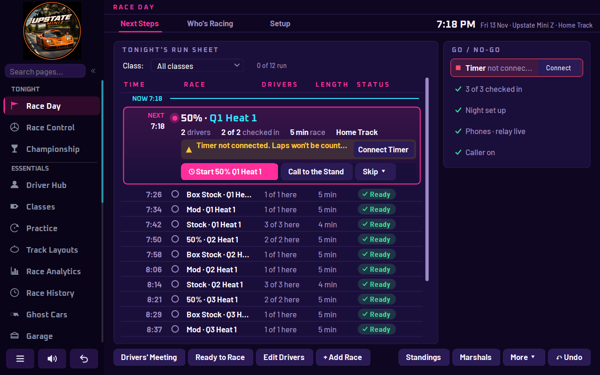

# Program, heats and mains

The program is the race day's running order: every qualifying heat and main, for every class, in the order they go out. This page explains how to build it, adjust heats, start rounds, see who's qualified where, seed the mains, apply bump-ups, assign corner marshals, print heat sheets, and keep a timed running order.

Almost all of it happens on **Race Day → Next Steps**, which says what to do next and has tonight's program underneath. The timed running order is in the **Timetable** window, opened from the program.

## Before you start

The program is built from the current race day, so set that up first on **Race Day → Setup** (see [Events, entries and check-in](events-and-entries.md#race-day-setup)), or let **Set Up Tonight** walk you through it:

- Start a race day with **New Race Day**.
- Check the classes running today under **Classes racing:**. If none are ticked, the program is built for the classes already on today's program, or, if nothing is scheduled yet, for every class that has drivers in it.
- Set **Heats each driver gets:** and **Drivers per heat:**.
- Decide whether **Only include drivers who have checked in** should be ticked (it starts ticked on a race day, unticked on a club night).

Changes on **Setup** save themselves; there's nothing to click.

Each class also needs drivers: a driver is in a class when their profile says so (see [Driver Hub](drivers-and-classes.md#driver-hub)). How a class is scored — its qualifying method, main size and bump-ups — is set on the **Classes** page (see [Classes](drivers-and-classes.md#classes)).

!!! note "Club nights"
    On a club night (**What kind of night:** set to **Club night - just races**) there are no finals. The program builds races instead of heats, the finals commands and **Move the Top Finishers Up** aren't offered, and the next-step card never asks for bump-ups or finals. See [Race day or club night](events-and-entries.md#race-day-or-club-night).

## Race Day → Next Steps

**Next Steps** is the first tab on the Race Day page. It has two halves, one above the other:

- **The top half** says where the day has got to: the day's name, the next-step card, the **Ready to race** card and the day so far.
- **The bottom half** is **Tonight's program**: every round of the day, with the commands that act on them. See [Tonight's program](#tonights-program).

Drag the handle across the top of **Tonight's program** up or down to give either half more room; the two halves follow the mouse as you drag. HeatCaller remembers where you leave it. Double-click the handle to put it back, with the top half just tall enough for **Next Steps**. The bottom half never gets so short that its buttons go out of sight; on a small screen the top half scrolls instead.

At the top, under the day's name, a line gives the date, whether it's a race day or a club night, the venue, the track layout, "closed" if the day is closed, and "running 12 min late" (or early) once the day is 5 minutes or more off the timetable. With no race day open it says "No race day is open".

### The next-step card

The card works out the single next thing to do, with one button that does it. The small heading above it reads **BEFORE YOU START**, **NEXT STEP** or **ALL DONE**. It checks, in this order:

| Situation | Headline | Button |
|---|---|---|
| No race day is open, and a night template is set for today (see **Templates:** on [Race Day → Setup](events-and-entries.md#about-the-day)) | "No race day is open." | **Start tonight's** *template* - for example **Start tonight's Tuesday club night** |
| No race day is open, and there's a race day from before tonight to go by | "No race day is open." | **Start tonight like last time**. It starts tonight with the last race day's kind of night and classes, and everything else a new day carries forward (see [New Race Day](events-and-entries.md#new-race-day)). To change something first, use **Set Up Tonight** on **Setup** |
| No race day is open | "No race day is open." | **Start a Race Day** (opens the Set Up Tonight wizard) |
| The current race day is closed | "Race Day 21 Sep 2026" is closed. | **Start a Race Day** |
| There are no classes at all | "There are no classes yet." | **Set Up Classes** (opens the **Classes** page) |
| There are no drivers at all | "There are no drivers yet." | **Add Drivers** (opens **Driver Hub**) |
| No driver has a class | "No driver is in a class yet." | **Add Drivers** |
| The day only uses checked-in drivers, and nobody has checked in | "Nobody has checked in yet." | **Check Drivers In** (opens **Who's Racing**) |
| The classes picked for the day no longer exist (renamed, say) | "No classes are running today." | **Choose Today's Classes** (opens **Setup**) |
| None of today's classes has any drivers | "None of today's classes has any drivers." (or "No drivers in Stock." with one class) | **Add Drivers** |
| Nothing is scheduled yet | "Nothing is scheduled yet." | **Build tonight's heats** (**Build tonight's races** on a club night) |
| A lower main has finished and bump-ups are due | "B-Main has finished." | **Move the top finishers up** |
| Drivers checked in after the heats were posted, and the club asks before adding them | "Max Power checked in after the heats were posted." | **Add them to the heats...**. See [Checked in late](#checked-in-late) |
| The heats are built, none has run, and they haven't been posted | "Tonight's heats are built - post them next." | **Post the heats...** (**Post the races...** on a club night). See [Post the heats](#post-the-heats) |
| A round is waiting to run | "Next up: Q2 Heat 1" | **Start Q2 Heat 1** |
| Everything has run, and a class has qualified but has no mains | "Qualifying is complete for Stock." | **Build the finals from qualifying** |
| Everything has run | "The program is complete." | **Qualifying Standings** (**Tonight's Standings** on a club night) |

The line under the headline gives the numbers behind it — for example the class, driver count and track for the next round, and how many rounds have run and how many are left. If one class has no drivers while others do, it says that class will be skipped. With **Entries close at:** set on **Setup**, the card counts down to it while the heats are still to build ("Entries close at 18:30, in 12 min."), then says "Entries closed at 18:30 - build the heats and post them." While races are still to run, it also says when the night should finish (see [When the night finishes](#when-the-night-finishes)). Once everything has run, it gives the night pace and lists what's left before lights out (see [Closing the night](#closing-the-night)).

### When the night finishes

While races are still to run, the next-step card ends with "Finishes about 22:40." HeatCaller works it out like this:

- Every race still to run takes its format's time limit plus staging and the countdown. A lap race with no time limit is counted as 5 minutes.
- After each race comes the gap before the next green. Once tonight has run three races, that's tonight's own typical gap (the same figure as the event report's [night pace](../race-control/results-and-championships.md)). Before then it's 3 minutes.
- A race on track is taken as half done.
- On a race day, a class with heats but no finals yet is given the finals it will have (one per heat's worth of drivers), so the finish includes them.
- Each break planned with **Breaks...** on **Setup** is added where it falls, and the card says so: "Finishes about 22:40 (with 30 min of breaks)." See [Planned breaks](#planned-breaks).

With **Out of the venue by:** set on **Setup**, the card says whether that's in time: "Finishes about 22:40, inside the 23:00 out-by time." If it isn't, it says by how much, then what would help, biggest saving first:

- **drop Q3** (the last qualifying round, when none of its heats has run, and never the first)
- **run qualifiers a minute shorter**
- **run one main fewer** in a class with more than one main still to run

For example: "Finishes about 22:40 - 15 min past the 22:00 out-by time. To finish in time: drop Q3 (6 races) to save 48 min; run qualifiers a minute shorter to save 12 min." HeatCaller doesn't make these changes itself. To drop the rest of qualifying, use [We're done after this round](#were-done-after-this-round). The estimate is worked out again whenever the program changes, and each is shown as "about".

### Post the heats

Posting is the moment tonight's heats go on the board. Drivers look up their heat once and trust it, so HeatCaller treats it as a step of its own. With **Post the heats before the first race** ticked on **Race Day → Setup** (on by default), once the heats are built the card reads "Tonight's heats are built - post them next." and its button is **Post the heats...**.

The card also lists any car on tonight's heats that the loop hasn't heard tonight, for example "2 cars on tonight's heats haven't crossed the loop tonight: Al Gorithim and Rhoda Rage." A car counts as heard when it has crossed the line since 6am (practice counts), or when it has a timed lap in a race saved tonight. Get those cars out in practice, or check their transponders, before Q1. In Demo Mode every car counts as heard.

**Post the heats...** opens a window that says the same, with three boxes, all ticked to start with:

- **Print the heat sheets** for every class racing tonight, with their estimated start times (see [Heat sheets](#heat-sheets)).
- **Print the marshal list**, the same roster as the **Marshals...** window (see [Corner marshals](#corner-marshals)).
- **Tell the room (the announcer)**: "Tonight's heats are posted. Check the board, or your phone, for your heat and your marshal post."

Click **Post the Heats**. The print preview opens with all the pages together, and the card moves on to **Start Q1 Heat 1**. **Undo** takes the posting back.

Posting also keeps each race's estimated start, as printed and shown on the phones, as the time drivers were given. Auto start never starts a race more than 2 minutes before it (see [Auto start between races](../race-control/running-a-race.md#auto-start-between-races)). The time from **Entries close at:** to posting is the first of the race director's two measures in the event report's [night pace](../race-control/results-and-championships.md).

Once the heats are posted, **Move Drivers Between Heats** and **Redo Remaining Heats** (on **Race Control**) ask before changing them: "The heats were posted at 18:42, so drivers and marshals may already have looked theirs up." **Add a Late Entry** doesn't ask, because it moves nobody else (see [A late entry](#a-late-entry)).

If you start the first race without posting, the heats count as out and the card stops asking. Untick **Post the heats before the first race** to go straight from building to **Start Q1 Heat 1**, as before.

### Planned breaks

**Breaks...** on **Race Day → Setup** plans breaks into the night before it starts: watering the track, dinner, track repairs. Each break has:

- **When**: **After Q1**, **After Q2** and so on (**After Race 1** on a club night), or **Before the finals**.
- **Minutes**: from 1 to 120.
- **What for**: said to the room, for example "water the track". It can be left blank.

Up to four breaks. **No break** on a line leaves it out. The **Breaks:** line on **Setup** sums them up, for example "After Q2, 10 min (water the track) · Before the finals, 20 min (dinner)".

A break falls between the last race of its round and the next race. A break after Q2 still comes before the finals if Q3 is dropped. HeatCaller allows for breaks in:

- **The finish time and estimated starts** on the next-step card, the heat sheets and the phones' **Schedule** page (see [When the night finishes](#when-the-night-finishes)).
- **Auto start.** The gap before the race after a break is the usual gap plus the break, and the announcer says it as the break begins: "Time for a 10-minute break - water the track. Racing starts again about 20:40." **Hold**, **+1 min** and **Start now** work as usual. With **Auto start** off, nothing is said and the break is yours to time.

A new race day at the same venue starts with the last day's breaks.

### Closing the night

Once everything on the program has run, the card adds what's left to do:

- rental transponders still out, with who has them
- results not on the club website yet (only when publishing is on)
- night emails still to send (only when night emails are on and the mailbox is set up)
- **back up tonight's results**, when the last backup is older than the last race
- drivers who raced and still owe their entry, when the race day has an entry fee (see [Money at the desk](events-and-entries.md#money-at-the-desk))
- **Close Day**, while the day is still open

For example: "Before lights out: 2 rentals still out (Sam, Jo) · 14 night emails to send · back up tonight's results · Close Day." With nothing left, it says "All wrapped up - lights out."

### The closing checklist

With **Close the night with a checklist** ticked on **Race Day → Setup** (on by default), the card's button reads **Close the night...** once everything has run. It opens a window listing the same things, one per line, plus any lines of your own:

- Each line the app can check ticks itself when it sees the job done, for example when the last rental is checked back in on **Rentals**. The window stays open beside the rest of the app and checks again every couple of seconds.
- The button beside a line goes to the screen that sorts it: **Rentals**, **Who's Racing** (for entries still owed), **Club Website** (for results and night emails) or **Setup** (for **Close Day**). **Back Up Now** takes a backup to your usual backup folder straight away.
- If you've dealt with something the app can't see (a rental handed back over the fence, an entry paid to the treasurer), tick it off by hand. It drops off the card too. Hand ticks are kept for tonight's race day only.
- **Your Own Lines...** adds your club's own jobs, one per line, for example "Lock the clubhouse" or "Pack up the timing loop". They're on the list every night, ticked off by hand.

Checks that don't apply tonight, such as money when the day has no entry fee, aren't listed. With the checklist off, the card just shows the one line, and its button opens **Tonight's Standings** as before. Standings is always on the program's **Standings** button too.

Bump-ups come *before* starting the next round on purpose: once the upper main has gone out, it's too late to add the bumped drivers. The Next Up bar on **Race Control** follows the same rule: while bump-ups or finals are owed, its **Start Next** button offers them instead of the next race. See [The Next Up bar](../race-control/running-a-race.md#the-next-up-bar).

The card is only a shortcut. Every program command it offers is also on the program's buttons or its right-click menu, so you can build or seed at any time, not only when the card suggests it.

!!! tip
    A helper can run the program from a phone or tablet too: the race-day manager's **Program** tab builds the finals, applies bump-ups, moves drivers between heats and reorders or deletes rounds. See [Race-day manager](../screens/phone-and-web.md#race-day-manager).

### Ready to race

The **Ready to race** card beside it shows how ready the day is, as a bar and a count such as "3 of 6 ready". Under the bar, **Still to do:** lists what's left: open tonight's race day (or start a new one, when this one is closed), add your classes, choose tonight's classes, check drivers in (or add drivers to tonight's classes), build the program (build the races, on a club night), and connect the timer.

**Finish Setting Up** opens the Set Up Tonight wizard at the first step that isn't done (see [The Set Up Tonight wizard](events-and-entries.md#the-set-up-tonight-wizard)). When only the timer is left, the button is **Connect Timer**, which opens the **Connection** page. Once everything is done, the card says **All set**, and until the first race has run its button is **Ready to Race...** (see [The Ready to race checklist](#the-ready-to-race-checklist)).

### The Ready to race checklist

**Ready to Race...** opens a list of what to check before the first race, the start-of-night twin of [the closing checklist](#the-closing-checklist). Each line ticks itself as HeatCaller sees it done, has a button to the screen that sorts it, and can be ticked off by hand:

- **The decoder is connected and hearing cars**: connected, and a car has crossed the loop tonight. **Connection**.
- **The phone pages are up on the Wi-Fi**, when the club uses them. **Local Screens**.
- **The club website is taking tonight's results**, when publishing is on. **Club Website**.
- **The announcer has a voice**, or why it can't speak (the same reason **Sounds → Mixer** gives). **Mixer**.
- **Tonight's heats are built and posted**. **Next Steps**.
- **Every car on tonight's heats has been on the loop**, or which haven't (see [Post the heats](#post-the-heats)). **Race Control**.
- **Everybody's papers are in order**, when the club checks waivers or memberships (see [Papers](events-and-entries.md#papers-waivers-and-memberships)). **Who's Racing**.
- **Backed up in the last week**. **Back Up Now** takes one.
- **Hold the drivers' meeting**. **Meeting Sheet...** opens it (see below), and printing it or reading it out ticks this line.

**Your Own Lines...** adds your club's own jobs, such as "Water the track" or "Set out the marshal posts". They're on the list every night, ticked off by hand. Hand ticks are kept for tonight's race day only. The window stays open beside the rest of the app and checks again every couple of seconds.

### The drivers' meeting

**Meeting Sheet...** on the Ready to race checklist writes the drivers' meeting from tonight's day, one point to a line: the classes in running order, how many rounds and heats, the first race, the breaks, the out-by time, the marshal rule (each heat marshals the next, and whether the start waits for them), how long results stay provisional, the papers, and the day's **Notes:** from **Setup**. Change anything in the box, then:

- **Print...** prints it on a page for the board.
- **Read It Out** has the announcer say it to the room.

Changes in the box are for tonight only. To say something every week, put it in the day's **Notes:**.

### The day so far

Five tiles under **THE DAY SO FAR**: how many classes are racing, how many drivers are in them, how many are checked in, how many rounds have run (for example "4 / 12"), and what's next up — the next round, "Done" once the program is complete, or the next line on the timetable when there's no program yet.

## Tonight's program

The **Tonight's program** card lists the race day's rounds, all classes together, in the order they run.

| Column | Shows |
|---|---|
| **#** | Position in the running order. |
| **Due** | The round's time on the timetable. Only shown once at least one round has a time. See [The Timetable](#the-timetable). |
| **About** | When a round still to run should start, worked out from tonight's pace. Blank for rounds already run. See [When the night finishes](#when-the-night-finishes). |
| **Round** | The round's name, such as "Q2 Heat 1" or "A-Main". |
| **Kind** | **Heat** (**Race** on a club night), **A-Main**, **B-Main** and so on, **Main (no tier)** for a hand-added main whose name doesn't say its tier, or **Practice**. |
| **Class** | The class, in the class's color. |
| **Drivers** | How many drivers are in the round. Point at the number to see who they are, in running order. |
| **Track** | The track layout, or "-". |
| **Status** | **Recorded** (run and saved), **NEXT** (the next round to run, highlighted), or **Scheduled**. |

Only rounds that belong to the current race day are listed, so last week's heats don't appear. The **Class:** filter above the list shows one class at a time (**All classes** shows everything), and HeatCaller remembers your choice. It lists only the classes racing today, not every class on the club's books; a remembered class that isn't racing today falls back to **All classes** and is picked up again on the next race day that runs it. **NEXT** is always the next round for the whole day, whichever class you're looking at.

The buttons under the list come in two groups:

- On the left, buttons that act on the **selected round**: **Start Selected** and **Edit Drivers**.
- On the right, tools for the day and its classes: **Timetable**, **Standings** (**Tonight's Standings** on a club night), **Marshals**, **Move the Top Finishers Up** (not on a club night) and **Glossary**, which opens **What these words mean**, a plain-English list of the racing terms used on this page.

The class tools work on the class chosen in the **Class:** filter. If the filter shows all classes, they use the class of the selected round, or the only class racing. If none of those settles it, HeatCaller asks you to pick a class.

The line under the buttons says what the last command did. Until then it reminds you that everything else is on the right-click menu.

Everything else is on the round menu. Right-click the list to open it: on a round to act on that round, or anywhere in the list for the commands that don't need one.

| Menu item | What it does |
|---|---|
| **Start This Round** | Same as **Start Selected**. |
| **Start as Demo...** | Runs the round as a simulated race, with no timing hardware. Nothing is recorded against the round unless **Let a demo fill in the race program (rehearse a whole night)** is ticked on **Demo Mode**; then the demo marks it as run. See [Practice, ghosts and demo mode](../race-control/practice-and-ghosts.md). |
| **Edit Drivers...** | Changes who's in the round. |
| **Move Drivers Between Heats...** | Opens the class's heats side by side. See [Balance heats](#balance-heats). |
| **Add a Late Entry...** | Puts a driver who has just arrived into the smallest heat of each round still to run, without moving anyone else. See [A late entry](#a-late-entry). |
| **Move Up** / **Move Down** | Moves the round one place in the running order. |
| **Build Tonight's Heats...** | Builds (or rebuilds) the qualifying heats. On a club night it's **Build Tonight's Races...**. |
| **Build the Finals from Qualifying...** | Seeds a class's mains. Not shown on a club night. |
| **Add a Main by Hand...** | Adds a main you choose the drivers for. Not shown on a club night. |
| **Save Heat Sheet...** | Saves a printable heat sheet for a class. |
| **Print Heat Sheet...** | Prints the class's heat sheet, with a preview first. |
| **We're Done After This Round...** | Finishes the qualifying round under way and drops every later one. See [We're done after this round](#were-done-after-this-round). |
| **Delete** | Deletes the selected rounds from the program (it says **Delete 3 Rounds** when several are selected). |

### We're done after this round

For rain, a curfew, or a track that has to close early. Right-click the list and choose **We're Done After This Round...**. HeatCaller lists the races it would drop: every heat of the later qualifying rounds (Q3, Q4...), none of them run. The round under way is the one on track, or else the next to run, and it's finished as normal. Click **Yes** to drop them.

- Nothing that has run is touched, and the dropped races' lines leave the timetable.
- The announcer tells the room, with the words on the Big Screen: "Change of plan, everyone: qualifying finishes after Q2, and the finals are next." On a club night: "...tonight finishes after Race 2."
- When the round is done, the next-step card offers **Build the finals from qualifying** as usual, from the qualifying that ran.
- **Undo** puts the dropped races back, with their timetable lines.

The command is grayed out when there's no later qualifying round still to run, and refused on a closed day.

## Build the qualifying program

1. Click **Build tonight's heats** on the next-step card (or right-click the list and choose **Build Tonight's Heats...**).
2. Check the summary: how many heats per class, how many drivers, the heat size, the track, and whether only checked-in drivers are used. It also says how many unrun qualifiers will be replaced (only today's are counted and replaced).
3. Click **Yes**.

HeatCaller builds every planned qualifying round for every class that's racing and has drivers:

- **Heats per round.** Each class's drivers are split into as few heats as the **Drivers per heat:** setting allows. For example, 13 drivers with 8 per heat makes 2 heats (7 and 6). Drivers are dealt into the heats in turn, so heats come out within one driver of each other.
- **The first round, by recent pace.** With **First round seeded:** on **By recent pace** (the default), Q1 puts similar pace together: each driver's best lap in the class over the last 60 days, the fastest in the last heat, the next fastest in the one before it, and drivers with no lap yet (a rookie, say) in the first heat with the slowest. Later rounds are dealt in turn from that order. A class where nobody has a recent lap is dealt alphabetically, as with **Alphabetical**. **Random** shuffles the field, the same way for every rebuild of that race day. **Heads-up (HRQF, from practice)** builds every round its own way: see [Heads-up qualifying](#heads-up-qualifying).
- **Drivers in more than one class** are dealt into each class's heats. See [A driver in more than one class](drivers-and-classes.md#a-driver-in-more-than-one-class).
- **Rotation.** In each new round, the starting point in the driver list moves on by one heat's worth, so the same drivers aren't first out on a cold track every round. When the heats divide the class exactly (16 drivers in two heats of 8, say), the groups are mixed as well from Q2 on, so the same drivers don't share a heat every round.
- **Names.** Heats are called "Heat 1", "Heat 2" and so on when there's one qualifying round, or "Q1 Heat 1", "Q2 Heat 3" and so on when there's more than one. On a club night they're races: "Race 1", "Race 2", or "Race 1 Heat 2" when a class is split into groups.
- **Order.** All classes' Q1 heats come first, then all Q2 heats, and so on. Within a round the classes run in the order set by **Class running order:** on **Setup** (the **Classes** page's order until you set one), turned round each round if you ticked that. Then the heats are put in an order that gives a driver in two classes a race off between their races: if one class's last heat and the next class's first heat share a driver, a later heat is brought forward between them. When every heat left shares a driver, the built order stands, and [Auto start](../race-control/running-a-race.md#auto-start-between-races) gives that driver an extra 2 minutes instead. The build's message says how many drivers were kept from racing back to back.
- **Track.** Every heat starts on the race day's **Track layout:**.

Rebuilding replaces any of today's qualifiers for those classes that haven't been run yet. Recorded rounds, and rounds from earlier race days, are never touched. A qualifying round that already has a recorded heat isn't built again, and its heats still to run stay as they are, so a rebuild after Q1 has started builds only the rounds after it; the summary marks those rounds "already run". If every planned round has already been run, the build is refused with **Qualifying already run**: to fit a driver into a heat still to run, use [Move Drivers Between Heats...](#balance-heats). A heat that's out on track can't be replaced: the build is refused until it has been recorded. You can undo the build with **Undo**.

If some of the new heats have been run by the time you undo, they're kept with their results, and the rest of the build is undone. A heat that's on track right now is kept too. A **Some rounds were kept** box lists them.

### Heads-up qualifying

Set **First round seeded:** to **Heads-up (HRQF, from practice)** on **Setup** to run heads-up qualifying. It works best with three qualifying rounds and the class set to **Points per round** (see [Points per round](#points-per-round)).

- **The seed.** Drivers are seeded on tonight's practice: each driver's best 3 laps in a row in a practice session today, either open practice or a practice round of that class. A driver with no practice run is seeded after those with one, by their best lap in the class over the last 60 days. Anyone left is seeded in roster order.
- **Round 1.** Each heat takes every other seed. With two heats, seeds 1, 3, 5 and 7 race together and seeds 2, 4, 6 and 8 race together, so every driver is on track with the drivers just quicker and just slower than them. Each grid is in seed order, quickest on pole.
- **Round 2.** The same heats, with each grid reversed.
- **Round 3.** The field is reseeded on the points from rounds 1 and 2, then spread the same way. When you first build the program, rounds 1 and 2 haven't run yet, so round 3 is built from the practice seed. Click **Build tonight's heats** again once round 2 is recorded: rounds that have run stay as they are, and round 3 is rebuilt on points. The build's message reminds you.
- **The mains** are seeded on the class's qualifying order, so set the class to **Points per round** to seed them on points. The build's message names any class that isn't.

!!! note
    Building needs an open race day. With none open, the build opens the Set Up Tonight wizard instead. A closed race day refuses new rounds with **That day is closed**: reopen it on **Setup**, or start a new day for tonight.

## Adjust the program

### Change who's in a round

Select a round and click **Edit Drivers**. In **Drivers in *round***, tick the drivers to include and use **Move Up** / **Move Down** to set their order — that's the order they appear on the heat sheet. **Select All** and **Clear All** tick or untick everyone. Click **Save**.

The list shows the class's drivers, including those who race it as one of their other classes. To add someone from another class (a late entry, say), click **Add Driver** — they're shown with "(not in this class)" beside their name, every time the round is opened.

If the round has already run, HeatCaller warns you that changing its drivers only affects the program, not the recorded results. A round that's on track can't be changed until it has finished. The change can be undone with **Undo**.

For a no-show or a late entry across every heat still to run, **Redo Remaining Heats** on **Race Control** rebuilds them all from who is checked in now. Drivers you added to a heat by hand from another class stay in it, and nobody is put into a round they have already raced. See [The Next Up bar](../race-control/running-a-race.md#the-next-up-bar).

### Balance heats

**Move Drivers Between Heats...** (on the round menu: right-click the list) shows all of a class's rounds for the day side by side, one column per round, so you can see everyone at once.

<!-- screenshot: Move drivers between heats window with several heat columns and the NOT IN A HEAT column -->

- Drag a driver from one heat to another, or up and down within a heat to change the order.
- Drag a driver onto **NOT IN A HEAT**, or select them and press <kbd>Delete</kbd>, to take them out. That column lists the class's drivers who aren't in any heat, and drivers who are missing from one of the qualifying rounds, marked with the rounds they're missing, for example "(not in Q2, Q3)". Drag from it to put someone in.
- A driver can only be in one heat of each qualifying round. Dropping a driver on a heat they're already in, or on a heat in a qualifying round they already have a heat in, is refused with a message saying where they are. That includes a heat they've already raced tonight ("... has already raced ..., which is in the same round as ..."). Mains aren't limited this way.
- Rounds that have already been recorded are marked "recorded, locked", and the one on track "on track, locked". Neither can be changed.
- The line at the bottom shows the spread, for example "3 heats, between 6 and 7 drivers each."
- **Group by pace** and **Spread by pace** re-sort every qualifying round's heats by pace. See [Heats by pace](#heats-by-pace).

Nothing is saved until you click **Save**, and **Cancel** discards everything. If a heat ends up empty, HeatCaller asks before saving. The whole session's changes are one step for **Undo**.

#### Heats by pace

Two buttons at the bottom of **Move Drivers Between Heats...** sort the drivers in each qualifying round's heats by pace:

- **Group by pace** puts drivers of similar pace together, with the quickest in the last heat. That's close racing in every heat, and the quickest cars on track last.
- **Spread by pace** makes every heat as evenly matched as the next. The quickest goes to the first heat, the next to the second, and so on to the last heat and back again.

Pace is each driver's best lap in this class in the races saved over the last 60 days. Drivers with no lap in that time go after everyone who has one. The buttons are only there once someone in the class has a lap from that time. Each heat keeps the number of drivers it had, and each heat's order (its grid) is quickest first.

Only heats that can still change are sorted: a recorded heat, or the one on track, keeps its drivers. Each qualifying round is sorted on its own, and mains aren't touched. With no round of two or more such heats, or no lap times for these drivers, HeatCaller says so and changes nothing. As with a drag, nothing is saved until you click **Save**.

### Change the running order

Drag rounds up or down the list to reorder them — a line shows where they'll land. You can drag several selected rounds together.

A drag that starts on a round that's already selected moves it. A drag that starts on a round that isn't selected selects every round you pass instead. So to move a run of rounds, drag down them to select them, then drag them to where they go. **Move Up** and **Move Down** on the round menu do the same one place at a time. **Move Up** and **Move Down** on a round's line in the Timetable move the round here too.

When the list is filtered to one class, moves are made relative to what you can see. A move can be undone with **Undo**, which puts the whole running order back as it was.

### Delete rounds

Select one or more rounds, right-click them and choose **Delete**, then confirm. Deleting a round removes it from the program but doesn't delete any recorded results. A round that's on track can't be deleted until it has finished. Undo puts the rounds back in their original places in the running order, and their lines on [the timetable](#the-timetable) come back with the time and tick they had.

### A late entry

For a driver who turns up after the heats are posted. Right-click the list and choose **Add a Late Entry...** (it works on the class in the **Class:** filter, or the selected round's class). Pick the driver from the class's drivers who aren't in a heat still to run, and click **Add to Heats**.

They go into one heat of each qualifying round still to run that they aren't already in, never a heat on track or already run. Which heat:

- **The heat nearest their pace**, when they have a best lap in the class from the last 60 days: the heat whose drivers' typical best lap is closest to theirs. So a fast driver who turns up late doesn't land in the slow heat of a round seeded by pace.
- **A heat with room** before one that's already at **Drivers per heat:**, so a late entry doesn't make a heat bigger than the track runs.
- **The smallest heat** when they have no recent lap (the first of two the same size).

Nobody else moves, so the heat sheet on the wall and everybody's phones stay right; only the heats they joined change. **Undo** takes them out again. On a day that only counts checked-in drivers, check them in first. To re-deal every heat still to run instead, use **Redo Remaining Heats** on Race Control.

### Checked in late

A driver who checks in after tonight's heats are built (at the desk, on a phone, or by scanning) goes into them the same way as **Add a Late Entry**, without anyone having to notice:

- **Before the heats are posted**, they go in by themselves within a few seconds, and nobody else moves. The console says where each went, and **Undo** takes them out.
- **After the heats are posted** (or once a race has run), the card asks first: "Max Power checked in after the heats were posted." **Add them to the heats...** lists each driver and the heats they'd go in. Untick anyone who isn't racing tonight (say they've only come to marshal), and click **Add the Ticked**. An unticked driver isn't asked about again tonight. **Undo** takes back either.
- Tick **Add late check-ins to posted heats without asking** on **Setup** to have them go in by themselves after posting too.

Only drivers who check in after the heats are built count. A driver you take out of the heats on purpose, with **Move Drivers Between Heats** say, isn't put back. After HeatCaller restarts, everybody already checked in counts as known.

### Mixed-class heats

Two small classes can share a heat: 3 Stock and 4 Mod on track as one race. Each class is still scored on its own. The Stock drivers are ranked against each other and the Mod drivers against each other, with their own qualifying, mains, championship points and recap.

There are two ways to make a shared heat:

- **When you build.** On **Setup**, set **Share a heat under (drivers):** to the size below which a class shares, for example 5. When you build, a class whose round is a single heat with fewer drivers than that shares it with another small class, as long as the two fit in **Drivers per heat:** and nobody is in both. A third small class can join while there's room. 0 (the default) never shares. The build's summary and its message say when heats were shared.
- **By hand.** Select two heats (Ctrl+click the second), right-click and choose **Run Together...**. The earlier heat keeps its place and name, and the other heat comes off the program. **Undo** puts both heats back as they were, until the shared heat has been run.

**Run Together...** refuses two heats of the same class (use [Move Drivers Between Heats...](#balance-heats)), a driver in both heats, heats from different qualifying rounds (Q1 and Q2), a main, and a heat that has been run or is on track. It warns you if the heat would be bigger than **Drivers per heat:**.

How a shared heat shows up:

- **The program, Race Control, the Timetable and the Big Screen** name both classes, for example "Stock + Mod". Filtering the program to one class shows the shared heat under each of its classes.
- **The heat sheet** names both classes on the heat and each driver's class in the car column.
- **The announcer** says both classes at the grid call ("Stock and Mod"). At the flag, after the winner, it names each class's winner: "Sam wins Stock, Alex wins Mod." The recap is told each class's top three.
- **Qualifying, the projection and the mains** count the shared heat as one heat of each class, with only that class's drivers in it. Under **Points per round**, a driver's place is their place in their class, and the field is their class's.
- **Championships.** A championship for one class counts the shared race with only that class's drivers, and they score their place in their class: the first Stock driver home scores first place even if a Mod car beat them. A championship for every class scores each class separately.
- **The event report** lists the shared race under each class, with that class's drivers and their places in it.

Each driver's class in the heat is the class whose heat they came from (or the class they were added to as a late entry). A driver added by hand some other way counts in their main class if it's one of the heat's, otherwise their first other class that is. A driver who races both classes is in one of them for that heat.

The [curfew planner](#tonights-program) can suggest it too: when the night is running late and two classes each run one small heat a round, the next-step card offers "run Stock and Mod together (Run Together on the program) to save ...".

## Start a round

Click the next-step card's **Start** button, select a round and click **Start Selected**, or double-click the round. HeatCaller asks you to confirm ("Staging and the countdown begin immediately."), then switches to **Race Control**, calls the grid, and begins staging and the countdown straight away. See [Running a race](../race-control/running-a-race.md).

You'll get an extra warning if the round has no drivers, or has already been run — starting a recorded round again records a new session and doesn't replace the existing result.

If a race is already running on **Race Control**, HeatCaller asks "Abandon the running race?" before anything is announced. See [Staging over a running race](../race-control/corrections-and-recovery.md#staging-over-a-running-race). Starting a round is refused while practice is running.

### Which round a race counts for

A race started from the program is recorded against its round. A race run without a round picked on **Race Control** (a race started by hand, for example) is handled by **Start the next race automatically** on **Race Day → Setup** (on by default): HeatCaller records it against the next round that hasn't run yet, so you work through the program without picking each round by hand. **Next race is:** (in Advanced mode) sets which round it picks:

- **the class that was racing** (the default) — the unrun heat whose drivers were the ones on track: the one that holds the most of them, the earliest in the program on a tie. If no unrun heat has them, the next round for the class most of the drivers on track belong to.
- **any class, in program order** — the next unrun round overall.
- **only "*class*"** — the next round for that one class.

When **Start the next race automatically** is off and no round is picked, the race is saved to history but isn't tied to any heat. The console says so.

It only picks from the open race day's rounds. With no race day open it picks nothing, since the only rounds left would be unrun ones from an earlier meeting; the race is saved but not tied to a heat, and the console says why. Open the race day, or pick the round in the **Round:** box before the start.

Demo races are never tied to a round.

## How qualifying ranks drivers

Qualifying is worked out from a class's **recorded qualifying heats** in the active race day — even on a brand-new race day, earlier days' heats aren't used. With no race day open, nothing counts: the standings and seeding the mains say "No race day is open, so there are no standings to show - qualifying counts one race day's heats. Open the race day, or start tonight's, to see them." instead of ranking every heat the class has ever run. The same today-only results feed seeding, standings and ranking. Each class's rules come from its settings on the **Classes** page. Ghost cars are never counted.

### Most laps, then lowest time

Each heat is scored on laps completed; ties are broken by the lower total time. With **Heats that count:** at 1, a driver's best heat decides their place. With 2 or more, their best heats are added together (laps and time) and the rest are dropped.

### Best consecutive laps

Each heat is scored on the driver's quickest unbroken run of N laps (N is **Consecutive laps to count:**). The run from the start to the car's first crossing of the line isn't a lap and is never part of a run. A driver who didn't complete N laps in a heat has no valid run for that heat.

Penalties count. A time penalty, whether given during the race or afterwards in the result, is added to the run's time, and each lap of a lap penalty adds one average lap of the run. The lap times themselves are left alone, so a penalized run comes to more than its laps add up to.

With **Heats that count:** at 2 or more, a driver's best heats' runs are added together. Drivers are then ranked:

1. By **how many valid runs** make up their total — more runs rank higher.
2. Then by the **total time** of those runs — lower is better.
3. Drivers with no valid run at all go to the bottom, ranked among themselves by most laps, then lowest time.

Ranking by the number of runs first means you can't top qualifying by missing a heat: a one-heat total is never compared with a two-heat total. Running more heats can only help a driver.

A counted heat where the driver had no valid run is shown with **(no valid run)** after its name, so a total made of fewer runs than heats explains itself.

### Points per round

Points qualifying (the ROAR "Qual-Points" style) scores each qualifying **round**, not each heat. A round is all the heats with the same round number: "Q2 Heat 1" and "Q2 Heat 2" are both round 2.

1. Every driver who ran one of the round's heats is ranked against everyone else in that round: most laps, then lowest time.
2. Each driver scores their place: 1st scores 1 point, 2nd scores 2, and so on. Two drivers level on laps and time share the place and its points, and the next driver takes the place after them.
3. A driver who didn't run the round, or was disqualified from it, scores the field plus one. The field is every driver with a qualifying result in the class. For example, in a class of 12, a missed round scores 13.
4. **Heats that count:** sets how many **rounds** count. Each driver's best (lowest) rounds are added up and the rest are dropped. For example, set it to 2 for "best 2 of 3".
5. Fewest points wins.

Ties are broken in this order:

1. The best finish in any single round. A driver who won a round beats one who never did.
2. The best single heat, by most laps then lowest time.

A missed round always scores worse than last place, so missing a round can never beat running it. With best 2 of 3, it is the round that's dropped.

Penalties count, because they're already in the laps and time each round is ranked on. A heat added by hand without a round number ("Extra heat") beside numbered rounds is scored as a round of its own. On a one-round night, all the heats are one round. A driver on their alternate transponder is scored once, under their main transponder.

During a heat, the [qualifying projection](#qualifying-projection) ranks the running heat with the rest of its round. The announcer's provisional pole call follows most laps then time in the heat on track.

### Qualifying standings

Click **Standings** under the program (or **Qualifying Standings** on the next-step card once the program is complete) to see the class's current qualifying order.

<!-- screenshot: Qualifying Standings window for a best-3-consecutive class with dropped heats -->

| Column | Shows |
|---|---|
| **Pos** | Qualifying position. |
| **Driver**, **Car** | Who. |
| **Best Laps** | Laps in the counted heats. |
| **Best 3 Consecutive** | *Best-consecutive classes only.* The run time, or its total over several heats ("Best 3 Consec. x2"). |
| **Avg / Lap** | *Best-consecutive classes only.* Average lap within the counted runs. |
| **From Lap** | *Best-consecutive classes only.* Which lap the run started on. |
| **Fastest Lap** | Fastest single lap in the counted heats. |
| **Heats** | Heats run, or counted/run (for example "2/3") when some were dropped. |
| **Counted Heat** | Which heat (and when) the figures came from, or the counted heats joined with "+". |
| **Dropped** | *Only when more than one heat counts.* The heats that didn't count, and what they scored. |
| **Points** | *Points classes only.* The points total and how it was counted, for example "6 pts (best 2 of 3)". |
| **Each Round** | *Points classes only.* Every round's place and points, for example "Q1 1st (1 pt), Q2 DNS (13 pts), Q3 2nd (2 pts)". |

For a points class, **Best Laps** is headed **Best Heat** and shows the driver's best single heat (the second tie-breaker), and **Counted Heat** is headed **Counted Rounds**.

A driver who qualifies on their alternate transponder is ranked once, under their main transponder. If both of their cars ran in the same heat, the better result counts.

Drivers who couldn't be scored under the best-consecutive rule are grayed out. Double-click a row (even after sorting the table) to see exactly which session the figures came from, so you can check them in **Race Analytics → Lap Times**.

### Qualifying projection

While a qualifying heat is running, **Qualifying Projection** on the **Race Control** page opens a window showing where everyone in the class would qualify if the heat ended right now. It shows the whole class, not just the drivers on track, and updates as laps come in.

- Drivers on track are highlighted.
- The unlabeled column shows places gained (▲) or lost (▼) by this heat so far, or **NEW** if it's the driver's first heat.
- **Score** and **Heats** follow the class's qualifying rule.
- **Keep this window on top** keeps it above other windows — handy on a second screen facing the pits.

If no qualifier is running, the window says so.

## Seed the mains

When a class has finished qualifying, the next-step card offers **Build the finals from qualifying** (it's also **Build the Finals from Qualifying...** on the round menu, available at any time: right-click the list).

1. Click **Build the finals from qualifying**.
2. Check the preview: every driver under the main they go in, in order, with the qualifying result that put them there (for example "14 laps, 5:02.3 (Q2 Heat 1)", "best 3 in a row 36.912" for best-consecutive qualifying, or "6 pts (best 2 of 3)" for points qualifying), the places that bump up marked **[bump-up place]**, and whether bump-ups are on. While the class's results are still provisional, it starts by saying so (see [The protest window](#the-protest-window)).
3. Click **Yes**.

How the mains are built:

- Drivers are taken in qualifying order and split into mains of **Drivers per main:** (from the class settings). The fastest go in the **A-Main**, the next group in the **B-Main**, and so on.
- If the numbers don't divide evenly, the **last** (slowest) main is the short one, never the A-Main.
- The mains are added to the program **lowest first** — C, then B, then A — so a lower main has run before the one above it and its top finishers can bump up.
- Each main except the lowest is set to receive the class's **Bump up:** number of drivers from the main below.
- A class set to a double or triple A-main gets its A-Main as two or three legs. See [Double and triple A-mains](#double-and-triple-a-mains).

### Double and triple A-mains

Set **A-main:** in the class settings to run the A-Main as more than one race, so one bad start doesn't decide the night. Each leg is added to the program as its own main, **A-Main Leg 1**, **A-Main Leg 2** and so on, after the lower mains. Every leg starts with the same seeded grid, and the announcer, Big Screen and results name the leg by its label.

Each leg is scored like a points round:

1. 1st scores 1 point, 2nd scores 2, and so on.
2. A driver who didn't start a leg, or was disqualified from it, scores the field plus one.
3. The best legs count: best 1 of 2 or best 2 of 3, or every leg if you chose that. Fewest points wins.

Ties are broken by the best finish in any single leg, then by the better finish in the last leg run.

The overall result is in the event report, under **A-Main overall**, with each driver's place and points in every leg. Each leg's own result is in **Results** like any race. Once the last leg is recorded, the announcer says who won overall straight after that leg's result, for example "Sam wins the A-Main overall, best two of three legs", and the race recap mentions it too.

The legs take their bump-ups from the B-Main together. **Move the Top Finishers Up...** (or the next-step card) asks once and puts the B-Main's top finishers into every leg that hasn't run, with one **Undo**. Skipping bump-ups skips them for every leg too. A leg that has already run, or already has its bump-ups, is left alone.

Seeding only looks at the current race day's mains. If the class already has mains today that haven't run, seeding replaces them. If any of today's mains have already been run, seeding stops with **Mains already run** — take the ones you don't want off the program first, so recorded results aren't orphaned. Mains from earlier race days are left alone and never block seeding. A main that's out on track can't be replaced either. Seeding can be undone. As with the qualifying build, any new mains that have been run by the time you undo are kept, along with a main that's on track right now, and a **Some rounds were kept** box lists them.

### The protest window

After a class's last qualifier is recorded, its results stay provisional for the club's **Protest window (min):**, so a lap-count query can be dealt with before the finals are built. It's set on the **Club Website** page, under **Let drivers query a result** (5 minutes unless you change it, up to 60). It used to be on **Race Day → Setup**; a race day that had its own value hands it over the first time you open this version.

- The next-step card says "Results are provisional until 20:42 (the protest window)." above **Build the finals from qualifying**.
- Building the finals before then is allowed. The question starts with the same words and "A query still to come could change this order."
- Once every qualifier of the class is in, the announcer says it once, for example "That's qualifying done for Stock. Results are provisional for five minutes - any queries to the race desk, please."
- On the phones, the class's qualifying on the **Schedule** page, and a driver's own qualifying line, say "Provisional until 20:42" while the window is open.
- Drivers can query a result from their phone in the meantime (see [Querying a result](../online/driver-requests.md#querying-a-result)). When the window closes, **Something wrong?** goes from that class's heats on each driver's night page. Mains, and a class still qualifying, keep it as before.
- A window of 0 turns it off, and the phones behave as before.

If the class has no recorded qualifying yet, seeding offers to add a main by hand instead.

### Add a main by hand

For a one-off main, right-click the list and choose **Add a Main by Hand...**. In the **Add Main** window, enter a **Round Label:** (it suggests the first letter not already used by the class's mains in today's program: "A-Main", then "B-Main", "C-Main" and so on), pick a **Track Layout:**, and tick the drivers under **Drivers in this main:**. **Top:** with **from Qualifying** ticks the top N qualifiers; **All** and **None** tick or clear everyone.

A hand-added main takes part in bump-ups only if its label names a tier — "A-Main", "B Main", "A Final", "C" and so on. A label like "Consolation" isn't treated as a tier, and shows as **Main (no tier)** in the **Kind** column.

Lower mains run first, so their top finishers can bump up before the main above them runs. A tiered main you add goes in front of the first higher main still to run, and HeatCaller says where it put it. If every main above it has already run or is on track, it says its finishers can't bump up into them.

## Bump-ups

Bump-ups move the top finishers of a lower main up into the main above it. For example, with **Bump up:** set to 2, the top two in the B-Main join the A-Main. Only the current race day's mains are considered.

A bump-up can happen only when **all** of these are true:

- The lower (feeder) main has been run and recorded.
- The upper main hasn't been run yet.
- The upper main is set to receive bump-ups, and they haven't already been applied to it.

When a bump-up is due, the next-step card says so ("B-Main has finished.") and offers **Move the top finishers up**. You can also click **Move the Top Finishers Up** under the program at any time.

1. Click **Move the top finishers up** (or **Move the Top Finishers Up**).
2. Check the drivers and positions listed. The list shows exactly who will move.
3. Choose:
    - **Yes** to move them up now.
    - **No** to skip bump-ups for that main and carry on. The main is marked as done, so the card moves on. You can undo it.
    - **Cancel** to decide later. The card keeps offering bump-ups.

If every driver who would bump up is already in the upper main, there's nobody to promote: HeatCaller says so in **Nothing to bump** and marks that main's bump-ups as done, so the program can move on.

The upper main **grows** to take the bumped drivers — nobody is moved down, because the lower main has already run. The bumped drivers join at the back of the upper main's list. Anyone who's already in the upper main (for example, moved there by hand), under either of their transponders, is left alone and not counted twice. A driver who raced the lower main on their alternate transponder is promoted under their main transponder and takes one place, not two. Bump-ups can only be applied once per main, and can be undone.

If no main is ready, **Nothing to bump** explains why for each main — for example "B-Main hasn't been run yet." or "This main has already been run - bump-ups have to happen before it runs."

!!! warning
    Apply bump-ups **before** starting the upper main. Once it's been run, its bump-ups can't be applied.

## Corner marshals

Many clubs have the drivers from the previous heat marshal the next one. **Marshals** works out who marshals which corner for every round of a class on the current race day.

The number of posts comes from the track layout's **Corner marshal posts:** setting (see [Track Layouts](drivers-and-classes.md#track-layouts)), using the layout of the class's rounds. If it's 0, the window tells you to set it on **Track Layouts**.

<!-- screenshot: Corner Marshals window with one round highlighted for an uncovered post -->

For each round, the **Corner Marshals** window lists **Round**, **Marshaled By**, **Post** and **Marshal**:

- Each round is marshalled by the drivers of the class's previous round, one per post in order.
- **A driver who's racing in the round is never assigned to marshal it** — for example a late addition or a driver in back-to-back heats. They're skipped, and the next driver from the previous round takes the post.
- The first round has no previous heat, so its posts are left for you to assign by hand.
- If there aren't enough free drivers, the uncovered posts are shown and the round is highlighted, for example "Q1 Heat 2 has 3 drivers free for 4 posts - 1 corner uncovered. (1 more is driving in Q2 Heat 1.)"

**Swap...** covers a post with somebody else: a driver who needs to fix their car can swap their marshal duty with a friend. Select the post's row, click **Swap...**, and pick who covers it (anybody racing tonight who isn't driving in that round). The roster then reads, for example, "Sam (covering Jo)", and the announcer's marshal call, the Next Up bar and drivers' phones all follow it. Pick the original driver again to put them back, or use **Undo**. A swap is for that one round.

**Copy as Text** copies the whole roster as plain text, ready to print or paste into a group chat.

### Marshals in place

To stop Auto start going green with empty posts, right-click the **Auto start** switch on **Race Control** and tick **Wait for the marshals before starting** (off to start with). From then on, for every race with marshals:

- A minute before the start, a banner names them: "Marshals for Q2 Heat 3: Hugh Turn (Turn 1), Rhoda Rage (Turn 2). In place?"
- **Marshals in place** confirms them, and the race starts on time.
- If nobody has confirmed by zero, the race waits: the banner reads "Q2 Heat 3 is waiting for its marshals", and the announcer calls them once: "Marshals for Q2 Heat 3, to your posts please: Hugh Turn on Turn 1 and Rhoda Rage on Turn 2."
- **Someone's missing...** logs a marshal who didn't turn up, for your club's marshal rule. The event report lists them under **Marshal no-shows**. Get someone onto the post, then press **Marshals in place**.
- **Start now** on the Hold button's menu starts without waiting.

A race with nobody on a post (a layout with no **Corner marshal posts:**) never waits.

The same marshal list is what the announcer reads out for the `{marshals}` placeholder in grid calls. See [Voice announcements](../announcer/voice.md). The Next Up bar on **Race Control** also names the round that marshals the next one.

!!! note
    The marshal roster and the heat sheet only list the current race day's rounds. With no race day open, they list every round saved for the class.

## Heat sheets

A heat sheet is a printable page for the pit table: the current race day's rounds of a class with its drivers, cars, transponders and blank columns to write laps and times in.

**To print it straight away:** right-click the list and choose **Print Heat Sheet...**. It uses the class in the **Class:** filter (or the selected round's class). Pick the printer, check the preview, and print from the preview's toolbar. Each page is fitted inside the printer's margins without being stretched.

**To save it as a picture instead:**

1. Right-click the list and choose **Save Heat Sheet...**.
2. Choose where to save the PNG.
3. Open it and print it at full page size.

The sheet is black on white for easy reading, with a band of the class's color across the top and beside each round, so you can sort a pile of sheets by class at a glance. It's letter-size. A class with more rounds than fit on one page runs onto as many pages as it needs, each marked "page 1 of 2" and so on. Saved, the first page goes to the file you chose and the others beside it with "-page2", "-page3" added to the name; HeatCaller asks before replacing pages already in that folder.

Each round still to run shows its estimated start after its title, for example "Q2 Heat 1 - about 20:42", from the same plan of the night as the **Next Steps** finish time. The times are worked out when you print or save, so print the sheet again later in the night for times that have moved. Rounds already run, and a sheet printed with no race day open, show none.

## The Timetable

The timetable is the day's running order with times: every heat and final in the order it runs, plus anything else happening that day — doors open, lunch, the prize-giving. It shows what's done, what's on track now and how far off its slot it started, and what's next.

Click **Timetable** under **Tonight's program** to open it. It opens in a window of its own, titled **Timetable**; close it with **Close** or <kbd>Esc</kbd> to get back to the main window.

<!-- screenshot: Timetable window with done, on-track and up-next lines, and the Reminder countdown card -->

### It follows the program

You don't need to build the timetable. As soon as the open race day has a program, every heat and final gets a line, in program order, and the lines keep up with the program whenever it changes — a build, seeding, bump-ups, a reorder or a delete — even while the window is shut. Lines you added yourself stay where you put them.

A round's line looks after itself:

- Starting the round stamps the line with the actual start time.
- Recording the round ticks the line off. If that race is deleted, the line goes back to not done.
- A class rename or a rebuilt final updates its wording.
- A time you set against it, its tick and its start time survive the program changing around it.

The timetable only follows the program of a real race day. With no race day open, it's left alone.

### Reading the sheet

**Up Next:** above the grid names the first line that isn't done, with its time, class and description. With nothing left it says which: "nothing - the timetable is empty." or "nothing - every line is done."

The grid shows **Done**, **Time**, **Class**, **What** and **Status**. The **Status** column shows:

- **done** (and when it started) for finished lines, faded.
- **on track · started 14:05** for a line that's started but not finished, with how far off its slot it started — **on time**, **4 min late** or **3 min early** — when the slot is a clock time.
- **up next** for the first line not yet done.
- **(round deleted from program)** for a line whose round no longer exists.

Click the **Done** checkbox to tick a line off (or back on) by hand. Double-click a line to edit it.

The timetable's times show up elsewhere too: in the **Due** column of **Tonight's program**, as "running 12 min late" on **Next Steps** (at 5 minutes or more), as minutes behind or ahead on the Race Control Next Up bar (at 3 minutes or more), in the **ON DECK** bar on the [Big Screen](../screens/big-screen.md), and on your club's online schedule.

### Add and change lines

**Add Entry** adds a line of your own. In **Add Schedule Entry**, set a **Time:** (or tick **No set time**), a **Class:**, and a **Description:** such as "Lunch". You need at least a class or a description. The new line goes straight after the selected line, or at the end if nothing is selected, and it stays in that place as the program changes around it.

A line from an older version may have a time typed as text, such as "TBD". It opens in **Edit Schedule Entry** with **No set time** ticked, and saving keeps the text as long as you leave the time alone. To clear it, untick **No set time** and tick it again.

Everything else is on the **More** button, which opens the same menu as right-clicking the grid:

| Menu item | What it does |
|---|---|
| **Edit...** | Changes the selected line in **Edit Schedule Entry**. On a round's line, only the time can be changed: its class and wording come from the program, so HeatCaller keeps your time and puts the rest back ("That belongs to the program"). |
| **Move Up** / **Move Down** | Moves the selected line one place. On a round's line this moves the round itself in the program, and both lists follow. On your own line it moves just that line. |
| **Fill In the Times...** | Stamps a time on every line. See below. |
| **Fill from the Program** | Puts the program's rounds back on the sheet, in program order, after asking. Rounds already there keep their time and tick, and your own lines stay where they are. You only need it after **Clear Schedule**. |
| **Print Run Sheet...** | Saves the sheet as a printable picture. See below. |
| **Delete** | Deletes the selected lines of your own, after you confirm (**Delete 3 Lines** when several are selected). A round's line can't be deleted here: take the round off the program on **Next Steps** and its line goes with it. |
| **Clear Schedule** | Removes every line on this race day's timetable, after you confirm. |

**Edit...**, **Move Up** and **Move Down** need one line selected. **Fill In the Times...**, **Print Run Sheet...** and **Clear Schedule** need at least one line on the sheet.

Edits, deletes, filling in the times, **Fill from the Program** and **Clear Schedule** can all be undone with **Undo**. Undoing only changes the race day the change was made on, and keeps any lines you've typed since. The **Clear Schedule** confirmation says it plainly: "Undo puts it back - but only until a few more changes are made or the app is closed." So if you clear it by mistake, click **Undo** straight away.

### Fill in the times

**Fill In the Times...** gives every line a time, worked down the sheet from the first race.

1. In the **Fill in the times** window, check **First race at:**. It starts from the race day's **First race at:** on **Setup**, or 10:00 if the day has none.
2. Set **Minutes per race:** (1–240). It's start to start, so allow for the changeover as well as the race itself. HeatCaller remembers the last number you used until the app closes.
3. Click **Fill In the Times**.

The rule:

- Each of the program's rounds gets the current time, and the clock moves on by the minutes per race.
- One of your own lines that already has a time keeps it, and the clock carries on from that time. So typing "13:00" against lunch moves the afternoon rather than being moved by it.
- One of your own lines without a time gets the current time, without moving the clock on. "Doors open" and "presentation" are moments, not slots.

The time you started from is written back to the race day's **First race at:**, so the two always agree.

### Print the run sheet

**Print Run Sheet...** saves the sheet as a black-on-white PNG for the drivers' stand, with a tick box, time, class and description for each line. Lines already done are ticked and struck through, and started lines show their start time. It's letter-size, and a long day runs onto more pages, saved beside the first as for the heat sheet. Open each one and print it at full page size.

### Reminder countdown

The **Reminder countdown** card beside the grid announces a countdown to the **Up Next** line through the announcer. Set **Minutes until start:** (1–120) and click **Start**. The announcer calls out at 5 minutes, 1 minute and when time's up, using the line's class and description ("5 minutes to Stock Q1 Heat 2."). **Stop** cancels it quietly.

Tick **Count down by itself from the run sheet** on the card and the announcer counts down to each race on its own, from the time against it in the grid, without anyone pressing **Start**. Which calls it makes (10, 5, 2 or 1 minutes, and time's up) are set on the **Between races** card on **Voice → AI Commentary**, in Advanced mode, where the same setting is **Start the countdown by itself from the run sheet, at** (see [Between races](../announcer/commentary.md#between-races)). **Hold Talk** on Race Control holds it too.

A countdown started at 5 minutes or less skips the "5 minutes" call, and one started at 1 minute skips the "1 minute" call. The countdown follows the clock, so it stays accurate even if the laptop is busy or a dialog is open.

A countdown you started carries on after you close the **Timetable** window, though nothing on screen shows it. Open the window again to see it or **Stop** it.
