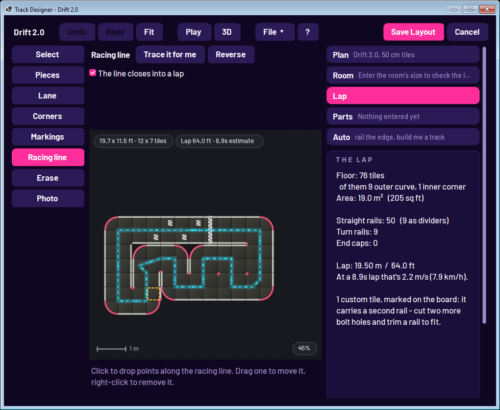
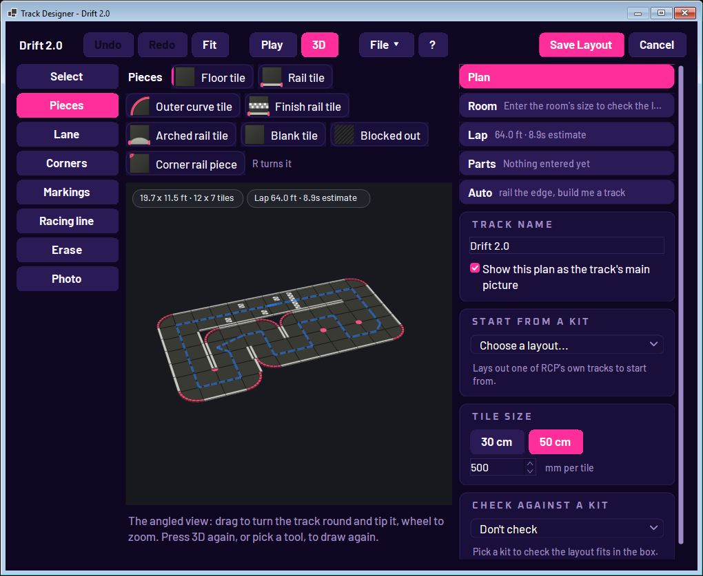

# Track Designer

The Track Designer lets you draw an RCP-style tile track: lay the tiles with their rails already on, as they go down on a real track, add markings, and draw the racing line. It works out the parts the track takes, checks them against what your club owns, gives the lap a time, lays out tracks that fit your room, prints the plan to scale with a build list, and shows the track in 3D.

On the **Track Layouts** page, select a layout and click **Track Designer**, or click it with nothing selected to draw a new track. See [Track Layouts](drivers-and-classes.md#track-layouts).

The window has four parts:

- **The top bar**: the plan's name, **Undo** (<kbd>Ctrl</kbd>+<kbd>Z</kbd>), **Redo** (<kbd>Ctrl</kbd>+<kbd>Y</kbd>), **Fit** (<kbd>F</kbd>), **Play**, **3D** (<kbd>V</kbd>), the **File** menu, **?** for the keys, and **Save Layout** and **Cancel**.
  - **Play** sends a car round the line at the lap time shown, with the lap it's on and its speed in the corner of the drawing; **Stop** ends it. Set it to run at half speed, as timed or double in the **Lap** section.
  - **3D** shows the track tipped and turned (see [The angled view](#the-angled-view)). It's lit while it shows.
  - **File** saves or copies a picture of the plan, prints it to scale with its parts list, opens or saves a plan file (see [Print and share a plan](#print-and-share-a-plan)), and, last and in red, **Clear the plan...**.
  - **?** (or <kbd>?</kbd>) shows every key the designer answers to, in the column on the right. Click it again to put them away.
- **The tools**, down the left: **Select** (<kbd>8</kbd>), **Pieces** (<kbd>1</kbd>, <kbd>2</kbd> and <kbd>3</kbd> pick a plain tile, a rail tile and an outer curve tile), **Lane** (<kbd>L</kbd>), **Corners** (<kbd>C</kbd>), **Markings** (<kbd>4</kbd>), **Racing line** (<kbd>5</kbd>), **Erase** (<kbd>6</kbd>) and **Photo** (<kbd>7</kbd>). The tool in hand is lit.
- **The bar over the drawing** shows only what the tool in hand needs: the pieces to lay, the lane's shape and width, the markings, **Trace it for me** and **Reverse** for the racing line, the photo's controls, or, for **Select**, **Turn**, **Flip across**, **Flip down**, **Duplicate** and **Remove**, which act on what you've picked up and are grayed out while nothing is.
- **The column on the right** has five sections: **Plan**, **Room**, **Lap**, **Parts** and **Auto**. The section names stay at the top of the column, and the open section shows under them; click a name to open that section, and again to close it. A closed section shows its headline beside its name, such as the plan's name and tile size, whether it fits the room, the lap, or whether the club has enough parts, so you can check without opening it. It opens on the section you last used. <kbd>P</kbd> hides the column so the drawing gets the whole width, and brings it back.

The status line under the drawing area explains how the current tool works. Before you click, the drawing shows what the click would make, in orange: the tile with its rail, the lane, or the turn.

The drawing area is a dark floor, whatever look HeatCaller is in, so the tiles and rails always look the same. Its top-left corner shows how big the plan is, in feet or meters (whichever you gave the room in), and the lap length with its lap time (see [The lap time](#the-lap-time)). Each tile is drawn with the seven T-shaped teeth a real RCP tile locks to the next with; zoomed out, the joints are a plain line. Hold <kbd>Space</kbd> and drag to move the view with any tool (the middle button and <kbd>Shift</kbd>+right-drag do the same), and use the mouse wheel to zoom. The zoom shows in the bottom-right corner; click it to go back to 100%.

In any tool, <kbd>Ctrl</kbd>+click or right-click erases. <kbd>T</kbd> takes **Markings** with **Tile label** (see [Name a tile](#name-a-tile)). <kbd>R</kbd> turns the next piece, or markings, 90 degrees, and <kbd>G</kbd> shows or hides the grid. The tool keys only work while the drawing area has focus, so they don't interfere with typing the track name.

## Lay pieces

On a real RCP track a rail is bolted to one edge of its tile and stays on, so a tile and its rail go down together as one piece. A tile carries one rail. Take **Pieces** and pick one in the bar over the drawing (hover over one to see what it is):

- **Floor tile**: a plain tile, no rail (<kbd>1</kbd>).
- **Rail tile**: a tile with a straight rail on one edge (<kbd>2</kbd>).
- **Outer curve tile**: the tile with the one-tile turn rail on it, for the outside of a bend (<kbd>3</kbd>).
- **Finish rail tile**: a tile with the finish-line rail.
- **Arched rail tile**: a rail tile whose rail arches into the lane, for a straight.
- **Blank tile**: a tile with no bolt holes, for infield and lane widening. It takes no rail.
- **Blocked out**: floor you can't use, such as a pillar or a table leg.
- **Corner rail piece**: the pink quarter rail piece that joins rails at a corner. Click the corner of the tile it goes in. Four, one on each tile round a corner, make the round pink post. It's the same part as the inner corner piece, and it's counted with them.

Each piece is drawn as it looks on the floor: a rail sits flush on its own tile's edge, the outer curve tile is a quarter circle with bare room in the corner beyond its turn, and the arched rail tile's rail rises into the lane. With a rail tile, click near the edge you want the rail on. With an outer curve tile, click in the corner the turn goes across. In the middle of a tile, the piece goes the way <kbd>R</kbd> last turned it. Drag to lay a row: the whole row takes the side you pressed near. Click a piece again to make it a plain tile. Two rail tiles laid with their rails back to back are a divider. The inner corner tile, with its small red corner piece, isn't laid by hand: it's worked out at the inside of every bend.

**Erase** takes up a whole piece, the tile and its rail. To take just the rail off a tile, erase right on the rail.

A tile that needs a second rail, such as where a divider meets the outside wall, isn't a piece RCP sells. The club makes it: cut two more bolt holes in the tile and trim a rail to fit. The designer lets you draw it, marks the tile on the board with a dashed amber ring and **custom**, and says how many there are in the **Lap** section. Two more things the club's pieces can't build are marked the same way: a rail with no tile under it is dashed along both sides and tagged **no tile**, and a turn that isn't one of the club's pieces (a two-tile turn, a back-to-back pair, or one with no outer curve tile under it) is dashed round and tagged **not a piece**. Where a divider meets the outside wall, a turn either side of it, on two outer curve tiles, needs no custom tile.

## Draw with lanes

On a real track you think in lanes, not in seams. Take the **Lane** tool (<kbd>L</kbd>) and drag where the track goes. The tiles go down with their rails on: rail tiles down both sides, and an outer curve tile round the outside of every bend. The inside of a bend is an inner corner tile, as on RCP's own layouts. The bar over the drawing sets:

- **Lane** or **Ring**. With **Ring**, drag a box and a closed lane goes round just inside it, which is the quickest way from nothing to a track. The box needs room for an island in the middle; while it's too small it's drawn in red.
- **Width**: **1**, **2** or **3** tiles. It starts at 2, since a real RCP lane is never narrower.

Every lane's bends get the one-tile turn, the only turn a club has. A plan saved with two-tile or square lane turns keeps them.

The rails follow the lane as you change it:

- Start a stroke on a lane to carry it on. That's how you widen a bend or add a bay, and the rails move out round the new tiles.
- A lane started anywhere else is a lane of its own. Where it runs alongside another lane, the seam between them gets a divider (two rails back to back). A corner on a divider stays square, since a turn there would cut into the other lane.
- If a lane stroke runs into a different lane, the two join up into one lane with no divider between them. To keep a divider for only part of the way, stand those rails by hand.
- The eraser takes a lane's floor rather than its rails, and the rails follow the floor in.
- **Blocked out** floor painted onto a lane gets railed round.

Pieces you lay by hand are never moved. A piece laid on a lane's tile takes that tile out of the lane, and the lane's rails are worked out again round it. To open a lane up, paint the floor beyond it into the lane. Plans drawn before lanes existed have no lanes, so nothing in them changes.

## Corners

Take the **Corners** tool (<kbd>C</kbd>) and click a corner to switch it between an outer curve tile and square, and back. This works on a corner where two rails meet at a right angle, and on any turn rail. A square outside corner is two rails on one tile, so it's a custom tile (see [Lay pieces](#lay-pieces)). A corner set with this tool is a hand piece, so the lanes leave it as you set it. A two-tile turn from an older plan goes to square on the first click.

## A racing line that follows the track

**Trace it for me** finds the middle of the track at any width. On a one-tile lane it goes through the tiles' centers. On a two-tile lane it runs along the seam between the two tiles. On a three-tile lane it goes through the middle tiles. The traced line is traced again by itself whenever the track changes, and keeps running the way round it was going, so **Reverse** stays reversed. While the track is broken partway through a change, the line is left as it was until the track joins up again. Drawing, dragging or removing a point of the line by hand stops it following the track, as does ticking or unticking **The line closes into a lap**; click **Trace it for me** to start it following again. A track that isn't one width all the way round, or that opens out into a bay, can't be traced: "The floor at column 6, row 2 is open on three sides, so there's more than one way round. Make the track one width all the way round, wall it in, or draw the line by hand." Draw that line with the **Racing line** tool.

## The lap time

The lap in the corner of the drawing shows the racing line's length and a lap time, and says where the time comes from:

- **from N laps raced**: the middle lap of every race saved on this track layout since its racing line last changed, once there are at least 10 laps. Demo races and laps three times the usual (a crash, a car fetched off the floor) are left out.
- **as entered**: the average lap typed in on **Track Layouts**, when there aren't enough races yet.
- **estimate**: worked out from the plan, for a layout that's never been raced, or whose racing line you've changed in the designer.

The estimate takes each corner at the speed its turn allows (a tight square corner slowest, a two-tile sweeper fastest) and each straight flat out between them. It starts from a stock Mini-Z, and tunes itself to your club's real laps: every layout with both a racing line and races saved on it moves the estimate towards how your cars actually go. Saving a changed racing line starts the count of races for that layout again, since the old laps were for a different track; until the new line has been raced, the estimate is shown rather than the average typed on Track Layouts. Tracing the same line again from a different start, or turning it round with **Reverse**, isn't a change. Races are found by the track layout's name, as the rest of HeatCaller's pace history is, so renaming a layout starts its count again.

Click the lap in the corner of the drawing to see where its time comes from and, with split loops on the plan, each sector's length.

## Build me a track

In the **Auto** section, click **Build me a track** for layouts made to fit your room. First enter the room's size in the **Room** section. It offers:

- **RCP's own** layouts that fit the room, in the plan's tile size;
- layouts worked out for the room: an **Oval**, an **L**, a **U hairpin**, a **T**, an **S-bend** and a **Serpentine**, longest lap first.

Each worked-out layout is as big as the room allows, leaving half a meter to walk round. Its lanes are as wide as the **Lane** tool's width. If you've entered what the club owns, a layout too big for it is made smaller until it fits, and one that can't fit at all isn't offered.

Each card shows the layout's picture, its lap length and size, and the tiles and rails it takes; with your stock entered, it also says whether the club has enough. **Use this layout** puts it on the board in one step (<kbd>Ctrl</kbd>+<kbd>Z</kbd> takes it back), with a finish line on its longest straight and the racing line traced. The worked-out layouts are made of lanes, so the **Lane** tool reshapes them at once and their rails follow. The room and the tile size stay as they were.

## What the club owns

The **Parts** section checks the plan against the track your club actually has. Click **Edit what we own** and enter it once in the **What the club owns** window. Tiles across its top add it up: the boxed sets, and the loose pieces of each size (**30 cm loose**, **50 cm loose**).

- **Boxed sets**: how many of each of RCP's sets.
- **Loose parts**: pieces not in a box, such as blank tiles, a lane widening kit or spares. Count each tile as it is, with its rail on, since the rails stay on between race nights: plain and blank tiles, rail tiles, finish rail tiles, arched rail tiles, outer curve tiles and inner corner tiles. Then the rail parts that aren't on a tile: loose straight rails, loose turn rails, loose corner pieces and end caps. **30 cm** and **50 cm** switch between the two sizes, which are counted separately because they don't mix.

A boxed set counts as the pieces it makes: each straight rail on a tile, each turn rail on its outer curve tile and each corner piece on its inner corner tile. A box with more straight rails than tiles to put them on keeps the rest as loose rails, and the section says so. A cupboard entered before the rails went on the tiles is turned into pieces when HeatCaller opens it: each straight rail paired with a plain tile, and anything left over kept as it is.

It's saved with HeatCaller's settings, not with each layout, so every layout is checked against the same cupboard. It's checked piece for piece, so a plan short of rail tiles says "2 short" on **Rail tiles**, not that it needs 2 more tiles and 2 more rails. Each piece shows as, for example, "56 used of 80, 24 left", or "4 used of 0 - 4 short" in red. A spare finish rail tile counts as a rail tile, and a plain tile does in place of a blank one. A second rail on a custom tile, or a rail with no tile, takes a loose straight rail, and the corner pieces at a divider's open ends and rail posts take loose corner pieces. When anything is short, the plan's size in the corner of the drawing turns red too. You can still draw past what you own; it's reported, not refused.

- Some boxes come with only a tile count from RCP (the Ovals, the Supersized Oval, the 30cm Double Oval Wide). For those, only the tiles are counted, and the section says so.
- End caps aren't in any box's parts list, so they're only checked once you've entered some loose.
- Nothing entered for the plan's tile size means nothing is checked.

## Corner tiles

RCP's turn rails stand on tiles of their own. A bend uses an **outer curve tile** in its outside corner, under the turn rail, and an **inner corner tile** diagonally inside it, with an inner corner piece round the island's corner. HeatCaller works out which tiles those are from the rails; you don't draw them. The parts readout in the **Lap** section shows how many of each the plan uses. **Check against a kit** now also catches a plan with more bends than the box has corner tiles for. A spare corner tile still does as floor, so plain floor is only checked as tiles. The club's pieces have only the one-tile turn, so a two-tile turn is counted as a loose turn rail. On the drawing, the outer curve tile is the quarter circle it is, and the inner corner tile has its small corner piece.

## Print and share a plan

The **File** menu on the top bar has:

- **Save picture**: **Small**, **Medium**, **Large** or **Poster** (32, 64, 128 or 256 pixels a tile). Each says how big the picture comes out; one over 12,000 pixels across is grayed out.
- **Copy picture**: copies the plan, to paste into an email, a post or a document.
- **Print track and parts list...**: prints the plan to scale. Pick **1:10**, **1:20**, **1:25** or **1:50**, or **Fit on one sheet**. Each choice says how big a tile comes out and how many sheets it takes. Then pick the printer and see every sheet in the preview before printing. A big plan prints over several sheets, each labeled with where it goes ("sheet 2 of 4 - row 1 of 2, 2nd from the left of 2"), with the columns lettered along the top and the rows numbered down the side. Every sheet has a scale bar that says how long it should measure. If it doesn't, the printer has shrunk the page: turn off "fit to page" in the printer's settings. A plan that would take more than 60 sheets at a scale can't be printed at that scale.
- **Open plan file...** and **Save plan file...**: open or save a plan as a **.hctrack** file (see below).
- **Clear the plan...**: starts again from an empty floor, asking first.

With **Then the parts list and how to build it, row by row** ticked (it is unless you untick it), the plan is followed by the parts it takes, against what the club owns when that's entered in the **Parts** section (anything short is in red), and then the order to build it in:

1. **Lay the pieces**, row by row from the top, each tile with its rail already on, each cell saying what goes there, for example "Row 1: A outer curve tile, turn across its north-west corner; B to K rail tile, rail north". A custom tile says "(custom: a second rail)". Dividers are two rail tiles back to back, not joined across.
2. **Put the loose rail parts on**: the end caps, the corner pieces at the dividers' open ends, rail posts, and any custom second rail, rail with no tile, or turn that isn't one of the club's pieces.
3. **Put the markings down**, for example "The finish line at E1."

Tiles are named by the grid printed on the plan: columns lettered from the plan's left, rows numbered from its top.

On the plan sheets, each tile is marked in its corner with its piece: **R** rail tile, **F** finish rail tile, **A** arched rail tile, **OC** outer curve tile, **IC** inner corner tile, **B** blank tile, and nothing for a plain tile; a custom tile has an asterisk as well. The marks are left off when a tile prints smaller than 7 mm.

## Plan files

A **.hctrack** file holds the whole plan (floor, rails, lanes, markings, racing line, tile size and kit) for another club's HeatCaller to open. It doesn't hold the traced photo, which stays on your PC. In the **File** menu, **Open plan file...** opens one in place of what's drawn, asking first if there's anything on the board; <kbd>Ctrl</kbd>+<kbd>Z</kbd> puts your plan back. Your room and your track's name stay as they were; if you hadn't entered a room, the file's room comes with it. The status line says what the file called the track. Laps already raced on this layout stop counting towards its lap time, since it's a different track now. A file that isn't a plan, or was saved by a newer HeatCaller, isn't opened, and HeatCaller says why: "That plan was saved by a newer HeatCaller. Update HeatCaller to open it."

## Pick part of the plan up

Take the **Select** tool (<kbd>8</kbd>) and drag a box round part of the plan. Everything the box covers comes up together - tiles, rails, turns, markings and racing-line points. Each tile brings the rail or turn bolted to it, so the rails round the edge of a block come with it rather than being left behind, and a rail on the box's edge that's bolted to a tile outside it stays with that tile. A tile on one side of a divider takes its half: the divider's other rail stays with the other lane's tile, and putting the tile back makes it a divider again. A rail with no tile under it comes along when both its ends are inside the box. Then drag inside it to move it, or use the arrow keys to nudge it a tile at a time. **Turn** (<kbd>]</kbd>) turns it a quarter clockwise and <kbd>[</kbd> turns it the other way; **Flip across** and **Flip down** mirror it. <kbd>Ctrl</kbd>+<kbd>C</kbd> and <kbd>Ctrl</kbd>+<kbd>V</kbd> copy it - a paste lands where the pointer is - <kbd>Ctrl</kbd>+<kbd>D</kbd> duplicates it one tile along, <kbd>Ctrl</kbd>+<kbd>A</kbd> picks up the whole plan, <kbd>Delete</kbd> takes it off and <kbd>Esc</kbd> drops it. Shift-drag a second box to add to what's picked, or drag over something already picked to take it back out.

A turn or a mirror keeps the top-left corner of the box where it is, so turning a corner complex never slides it off the floor you had it lined up with. If you move or paste something onto a part of the plan that's already occupied, what was underneath comes off and what you moved stays - a plan holds one tile, one rail and one marking per place. A pasted lane is a lane of its own, so a copy put down beside the original gets a divider between them. Every drag, nudge, turn and mirror is one press of <kbd>Ctrl</kbd>+<kbd>Z</kbd>; picking something up isn't an edit at all, so it takes no undo step. See [Picking part of a plan up](../reference/keyboard-shortcuts.md#picking-part-of-a-plan-up).

## Stretch part of the plan

To make a straight longer or shorter, pick part of it up with the **Select** tool. The box round what you've picked has a white square handle in the middle of its right edge and another in the middle of its bottom edge. A handle only shows on an edge that runs across the floor: an edge along the end of the plan has no straight to stretch. Drag a handle out to add whole columns (or rows) of tiles, or in to take them away. While you drag, a dashed line shows where the edge will be and the status line says, for example, "Longer by 3 columns of tiles, right across the plan." Nothing changes until you let go.

The stretch runs right across the plan, not just across what you picked. A track is a loop, so lengthening the top straight of an oval lengthens the bottom straight with it, and the track stays in one piece:

- **Longer:** everything past the edge moves out, and the last column (or row) inside the box is laid again in the gap, each tile as the piece it is, with its rail on. A rail across the stretch, on the edge itself, moves out with the edge rather than being repeated, and an outer curve tile's turn stays the one turn on its own tile. Markings and tile names aren't copied, and a finish rail tile is laid again as a rail tile.
- **Shorter:** the columns (or rows) just inside the edge come out, with their rails and markings, and everything past them moves in. You can take out all but one of the picked columns.

A lane's own rails and turns are worked out again for the new shape, and a traced racing line is traced again. A one-tile turn is part of its outer curve tile, so it always goes whole with that tile. Only a turn that isn't one tile's own, such as a two-tile turn from an older plan, can be cut: if the edge you stretch from touches one, nothing changes and the status line says: "That would cut through a turn rail put down by hand. Stretch along a straight, clear of the turns, or take the turn off first." Each stretch is one press of <kbd>Ctrl</kbd>+<kbd>Z</kbd>. While you hold a handle, other clicks and keys wait; picking another tool drops the stretch.

## Name a tile

To name a tile, for example "Pit lane" or "Marshal", pick **Tile label** at the end of the **Markings** tool's bar, or press <kbd>T</kbd>. Then click a tile and type its name, up to 40 letters on one line. Click it again to change the name, and leave it empty to take it off. The name is drawn across the foot of the tile once you're zoomed in far enough to read it, and the build list prints it, for example "Named tiles: D1 Pit lane." A label goes on a tile, so clicking where there's no floor says "A label goes on a tile - lay the floor there first." Each name is one press of <kbd>Ctrl</kbd>+<kbd>Z</kbd>.

## The angled view

Click **3D** on the top bar, or press <kbd>V</kbd>, to see the track tipped and turned, as you would standing at the end of the hall. The floor shows its joints, the rails stand up at their real height with their shadows, each on its own tile, and the turn rails, markings and racing line are all there. The outer curve tile is a quarter circle and the arched rail stands up in its arch. **Play** drives the car round it too.

- Drag to turn the track round and tip it, from straight down to a low angle.
- Use the mouse wheel to go closer or further away.
- Click **3D** again, or pick any tool, to go back to the flat plan.

The angled view is for looking. Clicks, drags and keys like <kbd>Delete</kbd> and the arrows do nothing to the plan while it shows, and the buttons that change the plan (such as **Remove** or **Rail the edge**) go back to the flat plan first. **Undo** and **Redo** stay in the angled view, so you can see the result. The size and lap still show in the top-left corner, and clicking the lap shows where its time comes from.

## Split loops

The markings include **Split 1 loop**, **Split 2 loop** and **Split 3 loop**: a blue band marked S1, S2 or S3, for where a [split loop](../timing/decoders.md#a-split-loop) lies across the track. A plan has one of each; placing it somewhere else moves it. With the finish line on the plan and the racing line drawn through the loops, **The lap** lists each sector's length along the racing line, for example "Sector 1: 4.50 m / 14.8 ft". Race Control uses those lengths for the sector speed columns. If they can't be measured, it says why, for example "The racing line doesn't pass over Split 1." Number the loops in the order cars reach them. The racing line has to close into a lap and run the way the cars go; its arrows show which way, and **Reverse**, in the **Racing line** tool's bar, turns it round.

## The Plan, Room, Lap and Auto sections

The **Plan**, **Room**, **Lap** and **Auto** sections, and the **Photo** tool, have:

- **Track name** (Plan), with **Show this plan as the track's main picture** under it — required before you can save.
- **Tile size** (Plan) — **30 cm**, **50 cm**, or any size in mm.
- **Trace a photo** (the **Photo** tool's bar) — **Choose photo** puts a photo of the real track underneath. Use the **Photo** tool to drag it into place and the mouse wheel to size it until its tiles line up with the grid, then draw over it. **Hide**, **Remove** and a transparency slider control it. This is the quickest way to get a real layout in exactly. The photo gets the same size and type check as a track's attached photo (see [Add or edit a layout](drivers-and-classes.md#add-or-edit-a-layout)), and it must be on this PC: one on another computer is refused with "That photo is on another computer. Copy it to this PC first, then choose the copy." A photo that's refused, or that passes the check but still won't open, gets a **Photo not loaded** message instead of being traced, and the plan keeps whatever photo it already had. **Undo** and **Redo** put the photo back with the plan, so undoing a photo brings the previous one back on screen.
- **The lap** (Lap) — HeatCaller shows the floor tile count and area, rail counts, and the lap length in meters and feet, with the average speed at the lap time on the board (see [The lap time](#the-lap-time)).
- **Start from a kit** (Plan) — opens one of RCP's sets as a layout you can change: the two 96-tile serpentines, the Wide L, the Oblong, the 50cm Oval, the Oval Wide and the Double Oval Wide. The floor and the parts list are exact - each one uses exactly the tiles the box holds and fits inside the rails it holds - but the circuit inside is a layout *buildable from* that kit rather than a copy of RCP's own, because the published rail counts rule out the tight corners their photographs appear to show. Each is laid from the club's own pieces, every rail on a tile of its own: the serpentines and the Wide L meet the wall with a turn either side of the divider, and the 50cm Oval goes round a divider down the middle so both its lanes are two tiles wide. The Wide L, the Oblong and the Oval Wide still sweep their corners with two-tile turns, which their boxes are built for, so those turns are marked **not a piece**. It's a starting point. Starting from a kit costs one <kbd>Ctrl</kbd>+<kbd>Z</kbd> if it wasn't what you wanted, and it leaves the room alone.
- **The room it goes in** (Room) — the width and depth of the hall, in feet or meters. HeatCaller draws it round the plan and says whether the layout fits, turned either way, with how much room to spare or how much too big it is. A plan that's a beautiful circuit and four inches too wide for the hall is a plan nobody can build.
- **Rail the edge** (Auto) — makes every tile round the edge of the floor a rail tile facing out, and its outside corners outer curve tiles.
- **The line closes into a lap** (the **Racing line** tool's bar) — tick it for a circuit.
- **Check against a kit** (Plan) — pick any of RCP's sets to see whether your layout fits in that box, or what it's short of. RCP publish a full parts list for some sets and only a tile count for others; where they don't publish the rails, HeatCaller checks the tiles and says so rather than inventing a rail count to check against.

## When the traced photo can't be shown

When the designer opens a plan whose traced photo can't be shown, the plan opens without it and the status line says why:

| The status line says | Why |
|---|---|
| "The traced photo is on another computer, so it isn't shown. Copy it to this PC, then pick it again with the Choose photo button." | The plan points at a photo on another computer, for example after a backup was restored from elsewhere. HeatCaller doesn't open photos over the network. |
| "The traced photo isn't where it was any more, so it isn't shown. Pick it again with the Choose photo button." | The photo has been moved, renamed or deleted since it was picked. The plan keeps the photo's location, not a copy of it. |
| "That image couldn't be opened." | The photo is over the size limits, isn't a PNG, JPEG, GIF or BMP picture, or is damaged. |

## Saving the plan

In the **Plan** section, **Show this plan as the track's main picture** (on by default) makes the plan the layout's picture. Click **Save Layout** on the top bar to save the plan onto the layout. You can undo the whole designer session with the sidebar **Undo** button.
