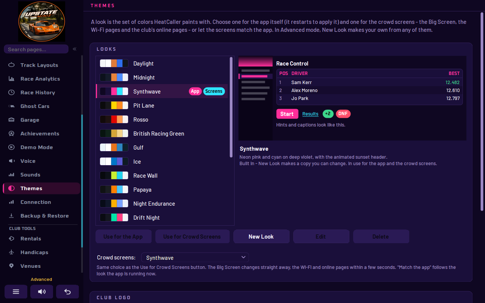

# Looks and the club logo

A look is the set of colors HeatCaller paints with. You choose one look for the app on the laptop and one for the crowd screens (the Big Screen, the Wi-Fi pages and your club's online pages), or let the screens match the app. This page also covers the club logo and the **Appearance** options. They're all on the **Themes** page, which has no tabs: its **Looks**, **Club logo** and **Appearance** cards are all on the one page.

You can open the page in two ways:

- Click **Themes** in the sidebar.
- Click **Open Themes** on the **Look** card of the **Club Website** page (Advanced mode).

Typing `look`, `theme`, `colour`, `color`, `dark mode`, `light mode`, `synthwave`, `logo`, `appearance`, `24-hour` or `military time` in the **Search pages...** box also opens it.

In Simple mode, **New Look**, **Edit** and **Animate the Synthwave sidebar header (scrolling grid, twinkling stars)** are hidden, double-clicking one of your own looks doesn't open the editor, and a **More settings in Advanced mode** line sits at the foot of the page. Everything else on the page works the same in both modes. See [Simple and Advanced mode](../getting-started/simple-and-advanced-mode.md).

How the app sounds, rather than how it looks, is on **Sounds → Soundscapes**, which was the **Announcer Style** tab on this page before 0.56. See [Soundscapes](../announcer/sounds-and-music.md#soundscapes).

## Where a look applies

| Where | Which look | When a change shows |
|---|---|---|
| The app's own window and dialogs | The app's look | After the app restarts |
| The Big Screen | The crowd-screen look | Straight away, even while it's open |
| The Wi-Fi pages: live results (including the OBS overlay), the phone remote and driver check-in | The crowd-screen look | Within about 5 seconds; the pages reload themselves (the check-in page waits until nobody is part way through checking in) |
| Your club's online pages | The crowd-screen look | Within a few seconds |

A few things stay the same in every look:

- **The sidebar is always dark.** Its text is always near-white, so a light look gets a dark sidebar tinted with its own colors.
- **Text on colored buttons and chips** is white, or near-black when white would be hard to read on that color.
- **The phone remote's flag buttons** keep their own fixed flag colors.

## The built-in looks

HeatCaller comes with 18 looks. Built-in looks can't be changed or deleted, but you can copy any of them into a look of your own (see [Make your own look](#make-your-own-look)).

| Look | Light or dark | Description |
|---|---|---|
| **Daylight** | Light | Clean and bright - the app's classic Light mode. Easiest to read outdoors in sunshine. |
| **Midnight** | Dark | Warm orange on deep navy - the app's classic Dark mode. |
| **Synthwave** | Dark, with Synthwave effects | Neon pink and cyan on deep violet, with the animated sunset header. |
| **Pit Lane** | Dark | Hazard yellow on carbon black - loud, and impossible to miss. |
| **Rosso** | Dark | Racing red on charcoal. |
| **British Racing Green** | Dark | Deep green with a brass accent. |
| **Gulf** | Light | Powder blue and orange - the classic endurance livery. |
| **Ice** | Light | Cool blues on white - crisp and calm. |
| **Race Wall** | Dark | Electric lime and cyan on near-black - the classic Big Screen look, now everywhere. |
| **Papaya** | Dark | Bright papaya orange and sky blue on anthracite. |
| **Night Endurance** | Dark | Headlight amber on midnight blue - made for racing after dark. |
| **Drift Night** | Dark | Mint green and hot pink under street lights. |
| **Racing Blue** | Dark | Bold blue with a red flash on deep navy. |
| **Podium Gold** | Dark | Gold and silver on black - trophy night. |
| **Desert Rally** | Light | Burnt orange and teal on warm sand. |
| **Paddock** | Light | Fresh green and amber on light gray - a sunny club day. |
| **Heritage Stripes** | Light | Navy with a red stripe on white - old-school race livery. |
| **Checkered** | Light | Black and white with a red flash - as plain as a flag. |

**Daylight**, **Midnight** and **Synthwave** are the app's old Light, Dark and Synthwave modes, color for color, except that **Synthwave**'s green is now a real green rather than a cyan, so a driver's own best can't be taken for the quickest of anyone. **Pit Lane** to **Ice** are the looks the online pages offered before 0.48.

Only looks with Synthwave effects get the animated sunset header in the sidebar and the neon race clock.

## Reading the Looks card

The list down the left of the **Looks** card shows the built-in looks first, then your own under **Your looks**. Each row has a strip of five of the look's colors (page, cards, primary, accent and text) and its name. Two markers show what's in use:

- **App**: the look the app is running now.
- **Screens**: the look the crowd screens are showing now.

Select a look to see a preview of the app wearing it beside the list, with its name and description under it. The line under the description says whether it's built in or one of yours, and whether it's in use. If you've chosen a new look for the app and haven't restarted yet, it says so, for example "The app switches to this look when it next starts."

## Choose the app's look

1. Select the look in the **Looks** list.
2. Click **Use for the App**.
3. HeatCaller asks, for example, 'Use "Paddock" for the app? The app needs to restart for this to take effect.' If the crowd screens are set to match the app, it adds that they will change with it.
4. Click **Yes**. HeatCaller saves the choice, closes and reopens in the new look.

If a race or practice is running, HeatCaller doesn't restart, since that would end it. It asks instead: 'A race or practice is running, so the app won't restart now - that would end it. Use "Paddock" for the app from the next time HeatCaller starts?' Click **Yes** and the app switches to the look the next time it starts.

**Use for the App** is grayed out for the look the app is already using. While a new look is waiting for a restart, clicking **Use for the App** on the look the app is running keeps it, with no restart.

A new install starts on the look picked on the **Look** step of the **Welcome to HeatCaller** wizard, **Daylight** unless you pick another. Applying a soundscape on **Sounds → Soundscapes** can change the app's look too, because each soundscape wears a look (**Classic** wears **Synthwave**). See [What applying a soundscape changes](../announcer/sounds-and-music.md#what-applying-a-soundscape-changes).

## Choose the crowd screens' look

Pick the look in **Crowd screens:**, under the buttons in the **Looks** card, or select a look in the list and click **Use for Crowd Screens**. Both do the same thing. There's no restart and no Save button.

The first choice in the list is **Match the app**, with the name of the look the app is running in brackets, for example **Match the app (Midnight)**. It follows the look the app is running now, not one waiting for a restart.

The change can be undone with **Undo** in the sidebar.

!!! tip
    For a TV or projector in a bright room, try a light look such as **Daylight** or **Checkered**. For the dark Big Screen of earlier versions, choose **Race Wall**.

## Make your own look

**New Look** and **Edit** are only shown in Advanced mode.

1. Select the look you want to start from. Any look will do, built in or your own.
2. Click **New Look**. The **New Look** window opens with a copy of it, named, for example, "Race Wall (copy)".
3. Change the name, style and colors (see below). The preview on the right shows the result as you go.
4. Click **Save**.

The new look appears under **Your looks**, selected. It isn't used anywhere yet: click **Use for the App** or **Use for Crowd Screens** to put it to work.

<!-- screenshot: New Look window with the color rows on the left and the preview and Readability list on the right -->

### The look editor

| Field | What it does |
|---|---|
| **Name:** | Up to 40 characters. Required. |
| **Description:** | Optional, up to 200 characters. Shown under the preview on the **Themes** page. |
| **Style:** | **Light**, **Dark** or **Synthwave effects**. Light or Dark sets how phones and the online pages treat the page. **Synthwave effects** is a dark page that also gets the animated sunset header and the neon race clock. |

Under **Colors** there are eleven colors:

| Color | Where it's used |
|---|---|
| **Page background** | Behind everything. |
| **Cards** | Panels, lists and table backgrounds. |
| **Alternate rows** | Every other row in tables. |
| **Primary (buttons, headings)** | Main buttons and headings. |
| **Text on primary** | Text on the main buttons. |
| **Accent (links, highlights)** | Links and highlights. |
| **Text** | Normal text. |
| **Hints** | Smaller gray hint text. |
| **Lines** | Borders and dividing lines. |
| **Good (gains, OK)** | Good news, such as gains and passes. |
| **Bad (errors, losses)** | Errors, losses and fails. |

For each color, either click the swatch to pick from the Windows color picker, or type a code in the box beside it, like `#1A2B3C`. You can leave out the `#`; it's added when you leave the box. In the color picker, the custom colors are this look's own colors, so you can match one color to another with a click.

A box that doesn't hold a color yet turns red, and the preview keeps showing its last good color. You can't save until every box holds a color: "*name* needs a color code like #1A2B3C, or pick one with the swatch beside it."

### Readability warnings

Under **Readability**, the editor lists color pairs that may be hard to read, each with its contrast ratio and what to aim for. With none, it says "Everything reads comfortably."

| Warning | Aim for |
|---|---|
| Text is hard to read on the page background | 7:1 or more |
| Text is hard to read on cards | 7:1 or more |
| Hint text is hard to read on cards | 4:1 or more |
| Button text is hard to read on the primary color | 2.5:1 or more |
| The primary color is hard to see on cards (it's used for headings) | 2.5:1 or more |
| The accent color is hard to see on cards | 3:1 or more |
| The "good" color is hard to see on cards | 3:1 or more |
| The "bad" color is hard to see on cards | 3:1 or more |
| The accent and "good" colors look alike | Two plainly different colors. The boards mark the quickest of anyone in the accent and a driver's own best in the good color. |

These are only warnings: "You can still save it - these are only warnings." The same list shows on the **Themes** page when you select one of your looks ("Reads comfortably." when there are none). Built-in looks show no warnings.

A look on a wall across the room needs more contrast than one on a laptop, so it's worth fixing warnings on a look you'll use for the crowd screens.

### Edit or delete a look

Only your own looks can be edited or deleted. **Edit** and **Delete** are grayed out for a built-in look.

- **To edit:** select the look and click **Edit** (or double-click it). The window is titled **Edit Look - *name***. If the crowd screens use the look, they change as soon as you save. If the app uses it, the app shows the changes the next time it starts.
- **To delete:** select the look and click **Delete** (or press <kbd>Delete</kbd>), then confirm.

If you delete a look that's in use, HeatCaller tells you first what will happen:

- **The app is using it:** the app keeps its colors until it next starts, then uses the built-in look of the same style: **Daylight**, **Midnight** or **Synthwave**.
- **The crowd screens are using it:** they go back to **Match the app** straight away.

Making, editing and deleting a look can all be undone with **Undo** in the sidebar. Undoing a delete also puts the crowd screens back on the look.

Your looks are saved in `looks.json` in the data folder and are included in backups. See [Data files](../admin/data-files.md).

## The club logo

The **Club logo** card sets one logo for the whole app. It shows:

- **In the app's top-left corner**, in place of the **HEATCALLER** title (or the Synthwave scene). The header grows taller to give it room.
- **On the Big Screen**, in the top-left corner.
- **On the Wi-Fi pages**, in the header.
- **On your club's online pages**, always: in a block of its own beside the club's name on every page, and in link previews.
- **On highlight videos**, on the title card at the start.

### Choose or remove the logo

1. Click **Choose Logo** and pick a picture (PNG, JPG, BMP or GIF).
2. HeatCaller copies it into its own data folder, so tidying your Downloads folder later won't remove it. The preview shows it on the sidebar's color, as it will look in the app's corner.

The status line says "Logo changed. The Big Screen shows it straight away, the Wi-Fi and online pages within a few seconds."

**Remove Logo** asks first: "Remove the club logo? It comes off the app, the Big Screen, the Wi-Fi pages and the online pages. Undo puts it back, or you can choose it again at any time."

Choosing, changing and removing the logo can all be undone with **Undo** in the sidebar, which puts the earlier logo back. HeatCaller keeps the old logo file for a week for this.

About the logo file:

- The picture is checked before it's opened. A file over 50 MB, a picture over 20000 pixels across or down or over 64 million pixels in all, and anything that isn't a PNG, JPEG, GIF or BMP picture are turned away in a **Logo not changed** message that says why, for example "That file isn't a picture HeatCaller can use as a logo. Choose a PNG, JPEG, GIF or BMP picture." A TIFF, icon or Windows metafile picked through "All files" is refused too.
- HeatCaller makes it square, with a little space around it, and saves it as a PNG at 384 pixels across (or 256 if that's too big). The relay only accepts a real PNG, so this is done for you.
- It must come out under 300 KB. A photo-like or very detailed picture may not; you'll see "That picture is too detailed to use as a logo. A simpler logo, ideally on a plain or transparent background, works best."
- A square logo on a transparent background looks best. Phones crop icons to their own shape, so a logo that runs edge to edge can lose its corners.
- Only a logo file HeatCaller made itself is ever shown. If the settings point at any other file, for example after restoring a backup from somewhere else, it's ignored and no logo shows until you choose one again.

### Where the logo shows

| Setting | What it does | Default |
|---|---|---|
| **Show the logo in the app's top-left corner** | Shows the logo in the sidebar header instead of the **HEATCALLER** title. Changes straight away. | On |
| **Show the logo on the Big Screen and Wi-Fi pages** | Shows the logo on the Big Screen and in the Wi-Fi pages' header. | On |

The online pages always show the logo when there is one. Their home-screen icon is HeatCaller's sun, logo or not.

### The plate behind the logo

A logo with a transparent background can vanish on a background of the same color, such as a black logo on a black Big Screen. When a good part of the logo would be lost, HeatCaller puts it on a plate: white when the part that would vanish is dark, near-black when it's light. A logo that already reads clearly overall - thanks to a ring, a border or lettering, say - isn't plated just because some of its fill is dark by design, a common look for a badge meant for a dark screen. This is worked out separately for the app's corner, the Big Screen, the Wi-Fi pages and the online pages, because each has its own background. In the app's corner the plate follows the logo's own shape: round behind a round logo, a rounded box behind a squared-off one. There's nothing to set.

### On the online pages

On the online pages the logo is drawn between 72 and 180 pixels across, depending on the width of the screen. On a narrow phone the club's name wraps underneath it. A new logo shows straight away, instead of phones keeping the old one for up to an hour.

!!! note
    The larger logo, the plate and the instant change need the relay updated for 0.48. With an older relay, the online pages still show your logo and colors, the way they did before. See [Updating the relay](../admin/relay-hosting.md#updating-the-relay).

## HeatCaller's mark

Everything HeatCaller makes for people to see ends with a small sun and the HEATCALLER wordmark. Your club's name, logo and colors stay in charge: the mark is small, at the edge, in your look's colors (black on paper). On **Synthwave**, the look the **Classic** soundscape wears, the sun is a yellow-to-orange sunset like HeatCaller's logo instead of the look's pink. It's always on; there's no setting for it.

- **Big Screen:** a small sun and HEATCALLER in the bottom right of the countdown band, like a TV channel's corner logo.
- **Highlight videos:** the end card says "Timed and called by" over the sun and HEATCALLER.
- **Results card:** "Timed and called by HeatCaller" beside the sun.
- **Stream graphics:** a HEATCALLER credit along the foot of the OBS race tower.
- **Phone pages on the club Wi-Fi:** the same mark as the online pages at the foot of each page, linking to heatcaller.com.
- **Printed sheets:** heat sheets, run sheets, results sheets, report cards and QR badge sheets share one footer with the sun, HEATCALLER and heatcaller.com. The track plan and the join poster carry the mark too.
- **Event report:** signed with the mark and a link to heatcaller.com.
- **Emails to drivers:** night, PIN and sign-up invite emails end with "Timing by HeatCaller - heatcaller.com".
- **Online pages:** see [Looks and sharing links](../online/index.md#looks-and-sharing-links).

## Appearance

| Setting | What it does | Default |
|---|---|---|
| **Animate the Synthwave sidebar header (scrolling grid, twinkling stars)** | Animates the sidebar header. Only for looks with Synthwave effects, and not while the club logo is shown there. Turn it off for a still image if you'd rather avoid the motion. Advanced mode only. | On |
| **Use 24-hour (military) time** | Shows times as 24-hour instead of AM/PM everywhere a time is written: the app's screens, status lines and logs, the Wi-Fi pages, and your club's online pages on phones (after the relay picks up the change). Lists and pickers already open update as they refresh; a Wi-Fi or phone page shows the change the next time it is opened. Before 12 November 2026 the phone pages used each phone's own setting. | Off |

## After updating from 0.47

- **The app looks the same.** Light mode is now the **Daylight** look, Dark is **Midnight** and Synthwave is **Synthwave**, color for color.
- **The Big Screen and the Wi-Fi pages now use the crowd-screen look.** It starts as whatever you'd chosen for the online pages on the **Club Website** page, which is **Match the app** unless you changed it. So with a **Daylight** app, the Big Screen turns light. For the dark Big Screen of earlier versions, choose **Race Wall** for the crowd screens. If you'd ticked **Use the Synthwave palette on the Big Screen** on the **Local Screens** page, that box has gone; choose **Synthwave** instead.
- **A logo you'd already set on the Club Website page** now also appears in the app's top-left corner and on the Big Screen and Wi-Fi pages. Untick the two checkboxes in the **Club logo** card if you don't want that.
- **The sidebar's Switch to ... Mode button is gone.** Open **Themes** in the sidebar instead.
- **Club admins should redeploy the relay** for the bigger logo and its plate. See [Updating the relay](../admin/relay-hosting.md#updating-the-relay).

## Troubleshooting

| Symptom | Likely cause | Fix |
|---|---|---|
| The app didn't change color | The app's look only changes when the app restarts. | Click **Use for the App** and answer **Yes**, or restart HeatCaller. |
| The Big Screen changed color when I changed the app's look | The crowd screens are set to **Match the app**. | Choose a look of their own in **Crowd screens:**. |
| A Wi-Fi page hasn't changed | Each page checks for a new look or logo every 5 seconds and reloads itself, but waits while someone is typing in it, or while a driver is part way through checking in. | Wait a few seconds, or reload the page. |
| The online pages haven't changed | Changes are sent within a few seconds. | Reload the page on the phone. Check the **Status** group on the **Club Website** page says it's publishing. |
| The online logo is small, or a new logo takes up to an hour to show | The relay hasn't been updated for 0.48. | Ask your relay admin to redeploy it. |
| **Choose Logo** says "That picture is *W* x *H* pixels, too big to use as a logo. ..." | The picture is over 20000 pixels across or down, or over 64 million pixels in all. | Save a smaller copy of it and choose that. A logo ends up 384 pixels across, so it needs nothing like that many. |
| **Choose Logo** says "That file isn't a picture HeatCaller can use as a logo. Choose a PNG, JPEG, GIF or BMP picture." | The file is another kind of picture (such as TIFF or an icon) or not a picture at all. | Save it as a PNG, JPEG, GIF or BMP, and choose that. |
| **Edit** and **Delete** are grayed out | A built-in look is selected. | Click **New Look** to make a copy you can change. |
| There's no **New Look** or **Edit** button | HeatCaller is in Simple mode. | Turn on Advanced mode. See [Simple and Advanced mode](../getting-started/simple-and-advanced-mode.md). |
| **Use for the App** didn't restart the app | A race or practice is running. | The app switches to the look the next time it starts. |

## Related pages

- [Big Screen](big-screen.md)
- [Local Screens](phone-and-web.md)
- [Setting up the Club Website page](../online/setup.md)
- [A tour of the window](../getting-started/tour.md)
