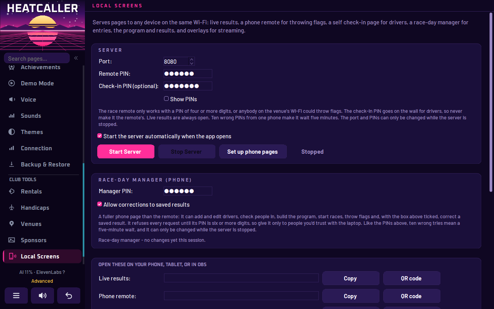

# Local Screens

HeatCaller has a small web server built in. Turn it on from the **Local Screens** page and any phone, tablet or computer on the same Wi-Fi as the laptop can open its pages: live results, a race remote for throwing flags from the trackside, a self check-in page for drivers, a driver coach page with a driver's own laps and pit board, a race-day manager for running entries, the program and results from a phone, a transparent overlay for streaming, and broadcast graphics for a stream from this laptop.

These pages work only on the venue's own network, with no internet needed. To publish results and check-in to the internet, use the online relay instead; see [The online relay](../online/index.md). The race-day manager can also be reached over the relay if the club turns that on - see [Race-day manager](#race-day-manager) below.



## Before you start

- The laptop and the phones must be on the same Wi-Fi network.
- In Windows, set that Wi-Fi network as a **Private** network. The firewall rule HeatCaller suggests only applies to private networks.
- Before phones can connect the first time, Windows needs two one-off changes. **Set up phone pages**, beside **Start Server**, makes them for you. See [Set up phone pages](#set-up-phone-pages).

## Start the server

1. Open the **Local Screens** page. The port and the first two PINs are on the **Server** card, and the Manager PIN is on the **Race-day manager (phone)** card under it.
2. In **Port:**, leave the default (`8080`) unless something else on the laptop already uses it. Any port from 1024 to 65535 works.
3. In **Remote PIN:**, enter a PIN of four or more digits. The race remote won't work without one.
4. In **Check-in PIN (optional):**, enter a different PIN if you want to restrict who can open the check-in page's list, or leave it blank to leave the list open. Either way, checking a driver in or out from a phone also needs that driver's own personal PIN (see [Driver check-in](#driver-check-in)).
5. In **Manager PIN:**, enter a PIN of six or more digits if you want the race-day manager reachable from a phone. Leave it blank to leave the manager closed - unlike the check-in PIN, a blank Manager PIN does not open the manager to anyone.
6. Click **Start Server**, at the foot of the **Server** card.

The status beside the buttons changes from "Stopped" to "Running on port *n* - stop the server to change the port or PINs", and the seven addresses on the **Open these on your phone, tablet, or in OBS** card fill in.

While the server is running, you can't change the port or the PINs. Click **Stop Server**, make the change, and start it again.

To start the server every time HeatCaller opens, tick **Start the server automatically when the app opens**. The server then starts once the main window is up. An automatic start doesn't show any dialogs, so if it fails, the status just stays at "Stopped"; start it by hand to see why.

In Simple mode, **Port:**, the **Race-day manager (phone)** card and the **Choose Web Columns** and **Choose Big Screen Columns** buttons are hidden. They keep their settings and go on working; turn on Advanced mode to change them. See [Simple and Advanced mode](../getting-started/simple-and-advanced-mode.md).

### Set up phone pages

Windows won't let phones on the Wi-Fi reach the laptop until it has two one-off changes: permission for HeatCaller to accept connections on its port, and a firewall rule to let them through. **Set up phone pages**, on the **Server** card, makes both. It works whether or not the server is running.

1. Click **Set up phone pages**. HeatCaller explains the two changes and asks first. Click **OK**.
2. Windows asks once for administrator permission. Allow it. HeatCaller itself keeps running as an ordinary app.
3. HeatCaller says how it went: "Phone pages are set up" or "Phone pages aren't set up", with the reason. What Windows said goes to the console.
4. Start the server, if it isn't running, and open one of the addresses on a phone.

Pressing it again is safe: it replaces its own two entries rather than adding more. You only need it once per laptop and port. If you change the port, press it again.

The firewall rule only covers networks set as **Private**, and Windows puts a Wi-Fi network it has just joined on **Public**. At a new venue, check it in Windows **Settings > Network & internet > Wi-Fi**, in the network's properties, and choose **Private**.

If nobody can answer the administrator prompt (the answer was **No**, or the laptop is locked down), nothing is changed, and the two commands are written to the console so someone with an administrator account can run them by hand. See [If the server won't start](#if-the-server-wont-start).

### The PINs

| Setting | What it protects | Rules |
|---|---|---|
| **Remote PIN:** | The race remote. | Required. Four or more digits, numbers only. With no PIN, or a shorter one, the remote refuses every command. |
| **Check-in PIN (optional):** | Opening the check-in page's list of drivers. | Optional. Blank means anyone on the Wi-Fi can open the list. Checking a driver in or out also needs that driver's own personal PIN, whatever this is set to. |
| **Manager PIN:** | The race-day manager, on this Wi-Fi and, if turned on, through the relay too. | Required for the manager. Six or more digits, numbers only. With no PIN, or a shorter one, the manager refuses every request - unlike the check-in PIN, it does not open up to anyone. |

All three PINs are hidden. Tick **Show PINs**, under the check-in PIN, to see them. They're hidden by default because this page may be on the laptop screen while drivers queue at the desk.

A new PIN that's already a racer's personal PIN isn't saved. HeatCaller says so, for example "The Remote PIN you typed can't be used - it is already in use elsewhere in HeatCaller. Choose another.", and puts the box back to what was saved. The other PINs are saved as usual.

Never make the check-in PIN the same as the remote PIN or the Manager PIN. The check-in PIN is meant to go on the wall for drivers, and anyone who reads it could throw flags (if it matches the remote PIN) or edit entries, the program and saved results (if it matches the Manager PIN).

If there's a problem with the PINs when you click **Start Server**, the server still starts, and HeatCaller shows a warning titled "Server started - check the PINs":

- "The phone remote will refuse every command until its PIN is four or more digits (numbers only). Stop the server, set the Remote PIN, and start it again."
- "The check-in PIN is the same as the remote PIN. The check-in PIN goes on the wall for drivers, so anyone who reads it could throw flags too. Stop the server and change one of them."
- "The race-day manager will refuse every request until its PIN is six or more digits (numbers only). Stop the server, fix the Manager PIN, and start it again."
- "The check-in PIN is the same as the manager PIN. The check-in PIN goes on the wall for drivers, so anyone who reads it could edit entries, the program, and saved results too. Stop the server and change one of them."

The PINs are stored encrypted on the laptop. See [Where HeatCaller keeps your data](../admin/data-files.md).

## The addresses

When the server is running, the page lists one address for each page:

| Caption | Address | Buttons |
|---|---|---|
| **Live results:** | `http://<laptop address>:<port>/` | **Copy**, **QR code** |
| **Phone remote:** | `http://<laptop address>:<port>/remote` | **Copy**, **QR code** |
| **Driver check-in:** | `http://<laptop address>:<port>/checkin` | **Copy**, **QR code** |
| **Driver coach:** | `http://<laptop address>:<port>/coach` | **Copy**, **QR code** |
| **Race manager:** | `http://<laptop address>:<port>/manage` | **Copy**, **QR code** |
| **OBS overlay:** | `http://<laptop address>:<port>/?overlay=1` | **Copy** |
| **Broadcast graphics:** | `http://localhost:<port>/broadcast` | **Copy** |

**Driver coach** is the page a driver opens to hear their own lap times in their earbuds. See [Coach](#coach).

HeatCaller works out the laptop's address on the local network for you (usually something like `192.168.1.20`). If an address says `localhost`, the laptop isn't connected to a network phones can reach.

The server has three more pages that aren't listed on this card:

| Page | Address | What it's for |
|---|---|---|
| Shout-outs | `/shoutout` on the laptop's address | The room sends the announcer a dedication or a birthday. It only takes them while **Take them from phones on the club's Wi-Fi** is ticked on the **Room & Web** card on **Club Website**, and nothing is said until you approve it. See [Letting the room send them](../announcer/commentary.md#letting-the-room-send-them). |
| The room's vote | `/vote` on the laptop's address | The room votes on who wins the next race, while **Let phones on the club's Wi-Fi vote** is ticked on the same card. See [Letting the room vote](../announcer/commentary.md#letting-the-room-vote). |
| Finish camera | `http://localhost:<port>/camera` | The photo-finish camera, opened with **Open Camera Page** on the **Connection** page. It only opens on the timing laptop itself; from anywhere else it says "The finish camera only opens on the timing laptop itself, at http://localhost:*port*/camera". See [Photo finish](../race-control/running-a-race.md#photo-finish). |

The shout-out and vote pages are there even while they're switched off, and then say so, so an address printed on a poster never leads nowhere.

### QR posters

Click **QR code** next to an address to open a scan-to-join poster: a large QR code with a heading ("LIVE RESULTS", "RACE REMOTE", "CHECK IN", "DRIVER COACH" or "RACE MANAGER") and a line telling people to use the same Wi-Fi. The poster has **Print**, **Full screen** and **Close** buttons. Press <kbd>Esc</kbd> to leave full screen.

The poster opens in its own window, so you can leave it up on a second screen while you carry on racing. If the server isn't running, you'll see "Start the web server first - there's no address to put in a code until it's listening."

The check-in page also has its own wall poster: **Self Check-In Poster** on **Race Day → Who's Racing**. See [Events and entries](../race-day/events-and-entries.md).

## The pages

### Live results

The page at `/` is a read-only view of the race, for spectators' phones or a display in the pits. Anyone on the Wi-Fi can open it; it needs no PIN.

- The top bar shows "LIVE RESULTS", the race state and flag (for example "Racing - Green flag") and the race clock.
- An "ON DECK:" line shows what's next on the race day's **Timetable**, when there is something.
- During a race that counts towards a championship, an "IF IT ENDED NOW" line shows the championship as it would stand if the race ended now: who'd lead, and the top six with their points and how many places they'd move. Drivers in this race are highlighted. See [If it ended now](big-screen.md#if-it-ended-now).
- Swipe left and right between four views:
    - The **standings** table. Choose its columns with **Choose Web Columns** on the **Local Screens** page.
    - **Lap times**: a line chart of each driver's laps (up to ten drivers). It needs two laps before it has anything to draw.
    - **Best lap & consistency**: a bar for each driver's best lap, with a paler tail showing how much their lap times vary.
    - **Track map**: the cars going round the track, as on the Big Screen. It needs a plan for the layout being raced on, and shows "No track plan for this layout." without one. A car that seems to have stopped is red and pulses, and the line under the map says who and where. See [Track map](big-screen.md#track-map).
- If you've set up sponsor slides on the **Sponsors** page, the page cuts to them between spells of standings, using the timings set there. Videos play to their own end, muted. See [The Big Screen and sponsors](big-screen.md).

The page refreshes itself every second. Before any laps are in, it shows "Waiting for lap data...".

Drivers without a name on their profile appear under their transponder number.

#### Follow a driver

A driver, or a parent at the fence, can follow one driver on their phone. Under the top bar, pick a name from **Follow a driver...**. The list has everyone on the board and everyone in the races still to run.

<!-- screenshot: Live results on a phone following one driver, showing P2, the gaps and a flashing "YOU'RE UP NEXT" call-up -->

While that driver is racing, a card shows:

- their position, large ("P2"),
- their lap and last lap time,
- the gap to the car ahead ("Leading" for the leader) and to the car behind, in seconds, or in laps when they're lapped ("+1L").

Their row on the standings is outlined, and on the track map their dot has a ring. A dotted ring in their color is their best-lap ghost: where they'd be on their best lap of the race. Ahead of it, they're on a personal best lap.

Under it, the call-up says when they race next and where they grid:

| Call-up | When |
|---|---|
| "STAGED - GO TO THE DRIVER STAND - Q2 Heat 1 (Stock) - grid 3" | Their race is being staged. It flashes. |
| "ON TRACK NOW - Q2 Heat 1 (Stock) - grid 3" | Their race is running. |
| "YOU'RE UP NEXT - Q2 Heat 3 (Stock) - grid 4" | Theirs is the next race. It flashes. |
| "2 RACES BEFORE YOURS - ..." | Races to go before theirs. |

The call-up follows the program on **Race Day → Next Steps**, in running order. The grid slot is their place in the round's roster.

Under a race still to come, the call-up says about when it should start, for example "about 7 min (19:42)", or "any minute now (19:42)" when the time has come. HeatCaller works it out from the time on the day's **Timetable** plus how late the night is running, or, where a line has no time it can read, from how long tonight's races have been taking. With neither, no time is shown. The time is the laptop's, so a phone whose clock is wrong still shows the right minute.

The phone buzzes and beeps twice: once when their race becomes the next one, and again when it's staged, which is the moment to go to the driver stand. Phones only allow this after you've touched the page, and choosing a driver counts. Buzzing works on Android phones; iPhones flash the call-up but don't buzz. Leave the page open, with the screen on.

Under the call-up, when there's something to say, are the driver's penalties:

- **This race:** their warnings and penalty time in the race that's running, for example "This race: 1 warning, +5 s penalty".
- **Tonight:** each penalty from their races saved tonight, with race control's reason, for example "Q1 Heat 2: +5 s - jump start" or "Q2 Heat 1: Warning 1 - Blocking".

The reasons are on this page because it's in the room, where the PA has already said them. The club's online pages show only the numbers, except on the driver's own night page (see [Penalties on the results](../online/index.md#penalties-on-the-results)).

##### Check my transponder

While you're following a driver, a **Check my transponder** button sits under the call-up. Use it to check a transponder before a race:

1. Tap **Check my transponder**. It says "Drive past the line now - watching for it...".
2. Drive the car over the timing line.
3. When the line hears it, the phone buzzes and says, for example, "Seen at 7:42 PM, signal good". A weak signal reads "Seen at 7:42 PM, signal weak - check it is mounted where the loop can see it, and its battery." A decoder that doesn't report signal strength just gives the time.

If it isn't heard within 3 minutes: "Not seen. Check it is switched on and charged, and mounted with a clear view of the track - then try again." Nothing needs doing at the desk: HeatCaller notes every pass over the line anyway, practice included. See [Signal strength](../timing/transponders.md#signal-strength).

The same check is on the driver's own night page online; see [Check my transponder](../online/index.md#check-my-transponder).

The phone remembers who it's following, so it's still following them after a reload. Pick **Follow a driver...** to stop.

#### Lap times in your ear

Once you're following a driver, a **Lap times in my ear: off** button appears beside the **Follow a driver...** list. Tap it (it changes to "on") and the phone reads out each new lap of that driver in its own voice, for example "Lap 7, 19.42, best lap, P2, 0.4 seconds behind":

- the lap and its time,
- "best lap" when it's their quickest of the race so far,
- their position,
- the gap to the car ahead, in seconds or laps. Nothing is said about the gap for the leader.

Put earbuds in and the driver on the rostrum can hear their own laps. The phone says "Lap times on" when you turn it on, which is what lets it speak later. If the page reloads, the button reads "Lap times in my ear: tap to resume" until you tap the page, since phones only let a page speak after a tap. It stays quiet for laps already run when you start following, and starts again from the next one. The phone remembers the setting.

Keep the screen on: most phones stop a page running when the screen goes off.

The follow view is only on the club Wi-Fi page, not on your club's online pages, and never in the OBS overlay.

### Coach

The page at `/coach` is for one driver to watch their own laps on their phone while they practice, or for whoever is coaching them in the pits. It needs no PIN.

- **Pick your driver...** at the top chooses who it's for. The phone remembers the choice, and it's the same choice as following a driver on the live results page, so a phone already following somebody opens on them.
- **Last lap** shows their latest lap and how far it was off their best, or **Best lap** when it was their best.
- **Target** shows how far the last lap was from the target lap race control set for them (**Coach *name*** → **Target lap...** on Race Control; see [Coaching a driver](../race-control/running-a-race.md#coaching-a-driver)), or **On target**. It's only there when a target is set.
- **Last 10 laps** shows the trend of their last ten.
- **Say my lap time**: tick it and the phone reads out the driver's own lap time after every lap, "nine point two one", with "best lap" on a new best - nobody else's laps. It's the phone's own voice, so it doesn't wait for the PA announcer. The phone remembers the tick; after a reload it reads "Say my lap time: tap to resume" until the page is tapped, since phones only let a page speak after a tap. It's hidden on a phone that can't speak.
- A new best lap flashes the page and buzzes the phone. An iPhone can't buzz for a web page, so it beeps instead once the page has been tapped (ticking **Say my lap time** counts).
- Under that is **Your report card** for the night, the same card as on their own night page (see below), worked out each time a race or practice is saved.

"Not on track right now. Your laps show here as soon as you are." means they aren't on the board in the session that's running.

#### The pit board

Once a driver is picked, a **Pit board** button turns the phone into a pit board: a few numbers as big as the screen allows, to read from the driver stand or hold up in the pits.

| Box | What it shows |
|---|---|
| **Last lap** | Their latest lap time, the largest number on the board. |
| **Position** | Their place, for example "P2". |
| **Laps** | How many laps they've done. |
| **Gap ahead** | The gap to the car in front. |
| **To target** | How far the last lap was from their target lap, when race control has set one. |

The whole board flashes green on a new best lap, and the last lap goes red when it was slower than the target. The driver's name is at the top, with **×** to close the board. A box with nothing to show reads "-".

Opening the board makes the page full screen and turns it sideways where the phone allows (an iPhone has no full screen for a web page, so the board just fills the window). To open the coach page straight onto the board, add `?board=1` to the address (`/coach?board=1`) and tap the screen where it says "Tap anywhere to start the pit board": a phone only goes full screen, or stays awake, for a page that's been tapped.

**Keeping the screen on.** While the board is up, the page keeps the phone from going dark. Because the Wi-Fi pages are plain `http`, it usually does this by playing a tiny silent video on a loop, which phones don't sleep through. If that doesn't work on a phone, the board says "If the screen still goes dark, set Auto-Lock to Never (iPhone: Settings, Display & Brightness) or the screen timeout to its longest (Android: Settings, Display) while the pit board is up." Closing the board lets the phone sleep again.

The pit board reads the same live information as the rest of the coach page, so it shows nothing the live results don't.

Anybody on the club's Wi-Fi can open any driver's coach page, so the card here **leaves out the setup line**: what a driver changed on their car is theirs to share. The live laps come from the same board the live results page shows, so nothing appears here that the live results don't already show.

#### The report card

| Line | What it says |
|---|---|
| Best lap | Their best lap tonight on the layout of their latest run, and the ideal lap their best sectors add up to, with the time still to find (the ideal lap needs a split loop). |
| Driver rating | The driver rating (out of 150) each race they ran that night earned: the one race's, or the average over several and the best. Races only. |
| Consistency | How far, on average, their clean laps were off their typical lap, and how many of their laps were clean. Needs five clean laps. |
| Where the time goes | The sector they lose most in, against their best through it. Needs a split loop and three laps with sectors. |
| Against last time | Quicker, level or off against their best the last night they ran this layout. |
| The setup change | What a setup change logged tonight did to their typical lap ("Since the setup change (softer front springs) logged at 8:40, your typical lap is 0.12s quicker"). Needs eight clean laps before the change and eight after. |
| Against the quickest | How far off the quickest lap of anyone they raced with tonight they are, and in which sector most of it is. |

A clean lap is a flying lap no slower than 7% over their best on that layout tonight, so a crash or a pit stop doesn't count against them. Every line is worked out from the timed laps, and a line with too little to go on is left out rather than guessed. A driver who ran two layouts gets the card for the layout of their latest run.

### OBS overlay

The overlay address (`/?overlay=1`) is the same live results page with a transparent background and no sponsor slides, so it sits cleanly over video. In OBS, add a **Browser** source and paste the **OBS overlay:** address.

### Captions

The live results page, the OBS overlay and the broadcast graphics can show what the announcer says as text, for viewers watching with the sound off or anyone who can't hear the PA. Add `captions=1` to the address:

| Page | Address with captions |
|---|---|
| Live results | `http://<laptop address>:<port>/?captions=1` |
| OBS overlay | `http://<laptop address>:<port>/?overlay=1&captions=1` |
| Broadcast graphics | `http://localhost:<port>/broadcast?captions=1` (with `&hide=...` after it if you use that) |

The line the announcer has just said appears near the bottom of the page and fades after eight seconds. A long line, such as the race recap, is shown a sentence or two at a time as the announcer reaches each part. Only lines said while the page is open are shown, so reloading an OBS source in the middle of a race doesn't put an old line back up. On the broadcast graphics, the battle bar and the fastest-lap box move up to make room.

These are in the room, so they use drivers' full names, as the PA does. For captions on the club's online live page, see [Captions](../online/index.md#captions); for the Big Screen, see [Captions on the Big Screen](big-screen.md#captions).

### Broadcast graphics

The page at `/broadcast` is TV-style graphics for a stream, over your camera in OBS. Its address uses `localhost`, for OBS on the timing laptop itself, so a saved OBS source keeps working when the laptop gets a different network address at another venue. For OBS on another PC, use the laptop's address instead, as on the other pages. Add a **Browser** source, paste the **Broadcast graphics:** address, and set it to the size of your canvas (1920 × 1080 is usual). Everything except the graphics is see-through, and they're sized to the source, so they fit any canvas.

<!-- screenshot: Broadcast graphics over a track camera: timing tower top left and a battle bar at the bottom -->

| Graphic | When | What it shows |
|---|---|---|
| Timing tower (top left) | Racing and finished | The race name and clock, the number of lead changes (and leaders), then the top 8, each with their racing number when they have one on their profile. The leader's row shows their lap; the column for the others changes every 8 seconds between **Interval** (the gap to the car ahead), **To leader** and, once someone other than the first leader has led, **Laps led**. Rows slide as places change, a car that's just gained a place flashes green, and the fastest lap holder has a purple mark. |
| If it ended now (under the tower) | Racing, in a championship race | Who'd lead the championship. See [If it ended now](big-screen.md#if-it-ended-now). |
| Battle (bottom) | Racing | The closest two cars in the top 8, when they're less than a second apart: "BATTLE FOR P2  Alex vs Sam  0.420s", or "BATTLE FOR THE LEAD". While it's the same two cars, it adds "CLOSING" or "PULLING AWAY" and how many laps they've been together. |
| Fastest lap (bottom right) | Racing | Pops up for 6 seconds with each new fastest lap of the race. |
| Moment (top middle) | As it happens | A banner for 7 seconds at each lead change ("*name* takes the lead from *name*"), and with the name of an achievement a driver has just earned. |
| The grid (middle) | Staging and countdown | The race name and its grid in order, with racing numbers. |
| The podium (middle) | Finished | The top three, with their laps, best lap and driver rating for the race. Ghost cars are left out. |

A sponsor who presents one of these moments on the **Sponsors** page is named on its graphic every time, for example "FASTEST LAP · PRESENTED BY ...".

To leave graphics out, add `?hide=` and their names to the address, separated by commas: `tower`, `champ`, `battle`, `fastest`, `moment`, `grid` and `podium`. For example, `/broadcast?hide=grid,podium`. To keep the tower's last column on one gap, add `gap=interval` or `gap=leader` (for example `/broadcast?gap=leader`). To add a captions strip, see [Captions](#captions).

### Race remote

The page at `/remote` lets you run the race from a phone at the trackside. It has buttons for **STAGE**, **COUNTDOWN**, **GREEN - START**, **YELLOW**, **RED**, **CHECKERED** and **RESET**, plus the current race state and a live standings table. Under **BETWEEN RACES** are **SKIP** (stops the line on air), **HOLD TALK** (holds or resumes the talk between races) and **CALL UP** (calls up the next race now), the same as the flag row's buttons after the flag (see [The flag row after the flag](../race-control/running-a-race.md#the-flag-row-after-the-flag)). Under them, **HOLD START** holds or resumes [Auto start](../race-control/running-a-race.md#auto-start-between-races)'s count to the next race, and **+1 MIN** puts the next race back a minute. Both say "Auto start isn't counting down to a race right now." when there's nothing to hold. The remote works on the track's Wi-Fi only, never over the club's website.

At the top, **CONTROLLING** shows which race the buttons act on: the round selected on **Race Control** with its class, for example "Q2 Heat 1 (Stock Buggy)", or the race name typed in, **Practice** during practice, or **Freeform race** with neither. A demo race starts with "Demo:". It changes within a couple of seconds when a different round is picked on the laptop, so check it before you press **STAGE**.

1. Open the **Phone remote:** address on your phone (or scan its QR poster).
2. Type the remote PIN into the box at the top ("Remote PIN (set on the laptop)"). The phone remembers it.
3. Tap a button. The page shows, for example, "Sending GREEN…", and then what the laptop actually did with it.

| The phone shows | What it means |
|---|---|
| The laptop's own words: "Staged.", "Countdown started.", "Green - race on.", "Green - racing resumes.", "Already green.", "Yellow flag out.", "Red flag out.", "Checkered flag out." or "Race reset." | Done. |
| "GREEN not done:" (with the button's name) and the reason, for example "STAGE not done: Practice is running - stop it on the Practice page first." or "CHECKERED not done: The race hasn't gone green yet. To call off this start, press Reset." | Race Control refused it, and nothing changed on the laptop. |
| "GREEN sent: Check the laptop - it may be asking a question." | The laptop had the command but hadn't finished with it within about 3 seconds, usually because a question is open on the laptop screen. What happens is decided there. |
| "Connection lost. Check the laptop to see whether GREEN went." | The phone lost contact while it waited, or had no answer within 12 seconds. The command may or may not have reached the laptop. |
| "GREEN: The laptop is closing - that command may not have gone. Check the laptop." | HeatCaller was closing on the laptop as the command arrived. It may or may not have run. |

An answer can take up to about 3 seconds to come. The buttons stay where they are when it appears, so the next tap lands where you expect. During practice every button is refused, because practice has no staging, flags or finish. A command refused during practice doesn't put up a box on the laptop; the console notes it, as it notes every command from the phone and what became of it.

Each button does exactly what the same button on the **Race Control** page does, and is refused for the same reasons, such as **CHECKERED** before the race has gone green. See [Running a race](../race-control/running-a-race.md#flags).

The remote asks before doing anything that would wipe a race in progress:

- **RESET** always asks "Reset the race?"
- **STAGE** or **COUNTDOWN** while a race is running: the laptop doesn't act on it. The phone asks "A race is running - this would wipe its standings. Carry on?" (over a demo, "A demo is running - this would end it. Carry on?"), and sends the command again only on a "yes". A "no" shows "STAGE canceled. Nothing was changed." The question comes from the laptop, so it is asked about the race as it is at that moment - including one that went green while the command was on its way.
- During practice nothing is asked: the laptop refuses **STAGE** and **COUNTDOWN** with "Practice is running - stop it on the Practice page first."

The laptop carries out one command at a time. A second press while one is still going out - two marshals pressing **RED** together, say - is answered "NOT sent - the laptop is still carrying out RED." Check the flag, and press again if it's still needed. Each phone can send 20 commands a minute and all phones together 60; past that, the phone shows "NOT sent - too many commands in the last minute."

The remote works only with the remote PIN set on the laptop. If it isn't, the phone shows "The remote needs a PIN. Set one on the laptop's Local Screens page first." or "The remote PIN on the laptop is too short or has something other than digits. Fix it on the Local Screens page."

### Driver check-in

The page at `/checkin` lets drivers sign themselves on from their own phones, which frees up whoever is at the desk.

1. The driver opens the **Driver check-in:** address, usually by scanning the poster.
2. If you set a check-in PIN, the page asks for it: they type it into "Check-in PIN (leave blank if none)". The phone remembers it. Opening the page before the PIN is typed doesn't count as a wrong guess.
3. They type in "Find your name" to narrow the list, and tap their name.
4. The phone asks for *name*'s own check-in PIN. They type their six-digit personal PIN and the check-in goes through.

#### Checking in or out needs the driver's own PIN

Since 26 Oct 2026, every check-in or check-out from this page needs the driver's own personal PIN: the six-digit PIN HeatCaller gives each racer, the same one they use for [online check-in](../online/check-in.md#personal-pins). Before, this page was an open sign-on sheet: anyone on the Wi-Fi (who knew the check-in PIN, if one was set) could tap any name and check that driver in or out. The check-in PIN is shared and goes on the wall, so it was never a lock on one driver.

- The laptop checks the PIN itself before anything changes, so it can't be got round by changing the page. It's asked for on every tap and never kept on the phone or put in the page's address.
- Ten wrong PINs from one phone in five minutes stop that phone for a while: "Too many wrong PINs. Wait a few minutes." A hundred wrong from all phones together in five minutes stop phone check-ins for everybody for five minutes: "Too many wrong check-in PINs on this Wi-Fi. Phones can't check in for five minutes - check in at the desk." The console shows a "[web] WARNING: ..." line when that happens.
- A wrong PIN gets "That isn't this driver's check-in PIN. No personal PIN? Check in at the desk." A driver who has no personal PIN can't be checked in from a phone, and gets exactly the same answer, so the page never tells anyone which drivers have a PIN. Every try counts toward the limits above, a PIN or not. PINs are made for every racer while **Give every racer their own PIN** is ticked on the **Club Website** page (it's on by default), including when you only use the Wi-Fi pages. Tell drivers their PIN from **Show PINs** there, or email them (see [Emailing racer PINs](../online/email.md)).
- **The desk is unchanged.** The **Who's Racing** list, the USB scanner and the [race-day manager](#race-day-manager) (behind the Manager PIN) still check anyone in or out without a driver's PIN.

Each row shows a driver's name and class, marked **TAP** or **HERE**. The top bar counts how many are here, for example "12 / 18 HERE".

- The list is every driver on the **Driver Hub** page. Ghost cars aren't included.
- Tapping a name that's already **HERE** asks "Check *name* out?" before checking them out, so a slip of the finger while scrolling doesn't sign anyone off.
- A check-in from a phone shows up on **Race Day → Who's Racing** straight away, and the console notes "[web] *name* checked in from a phone."
- The page refreshes itself every few seconds.

Behind the scenes, the page identifies each driver by a random code rather than their transponder number, so the list on a phone never reveals transponder numbers. The codes change every time the server starts, so a code seen at one meeting is useless at the next.

The check-in page doesn't offer camera scanning of QR check-ins on the local network, because phone browsers only allow the camera on secure (https) pages. Use a USB scanner in the **Scan to Check In** box on **Race Day → Who's Racing** for QR check-ins. See [Events and entries](../race-day/events-and-entries.md) and, for internet check-in, [Online check-in](../online/check-in.md).

### Race-day manager

The page at `/manage` lets a second phone or tablet run entries, the program and results, so a helper in the paddock or at the grid can work alongside whoever is at race control on the laptop.

1. Set a **Manager PIN** of six or more digits on this page, and start the server.
2. Open the **Race manager:** address (or scan its QR poster), and type in the Manager PIN. It shows as dots, and it's tried as soon as you've typed it: press Enter or tap out of the box. The phone remembers it.
3. Use the tabs across the top: **Today**, **Entries**, **Program**, **Race** and **Results**.

A wrong PIN empties the box, and the phone forgets it: the page says "Wrong PIN. Enter the manager PIN again." The same happens if the manager has been switched off on the laptop, with the laptop's reason instead. The page doesn't try the PIN while you're still typing it, so a half-typed PIN can't count as a wrong guess.

- **Today** summarizes the day - the current race day, class and how many are checked in - with **New Race Day...** and **Build Qualifying** buttons, and a list of recent changes you can undo on the laptop.
- **Entries** searches the roster; tap a row to check a driver in or out, or use **Add Driver...** to add one by transponder, name and class. Under a driver with battery packs, **Pack in the car** picks the pack their races are recorded on, or **None** (see [A driver's batteries](../race-day/drivers-and-classes.md#a-drivers-batteries)).
- **Program** picks a class from the full-width list at the top, with **Seed Mains** and **Bump Ups** side by side under it, then lists its rounds. Tap a round to see its heats: remove a driver, add one of the drivers still available, delete the round, or reorder the day's rounds.
- **Race** starts the next round and has the same **STAGE**, **COUNTDOWN**, **GREEN - START**, **YELLOW**, **RED**, **CHECKERED** and **RESET** buttons as the phone remote.
- **Results** lists today's finished sessions (a toggle switches to every session), with the winner's name under a small "Winner" caption; tap one to see its rows, or **Publish again**. With **Allow corrections to saved results** ticked on this page, **Edit result...** is also here - it asks for a reason first, then for each driver's total laps added (the box starts at the current total; 0 = none, a minus sign takes laps away) and their outcome (DNF, DQ, and so on). If nothing you typed differs from the result as it stands, it says "Nothing to change" and saves nothing. It's the same correction **Race History**'s **Edit Result** makes on the laptop (see [Correcting a saved result](../race-control/corrections-and-recovery.md#correcting-a-saved-result)).

What the laptop says about each action appears in a box at the foot of the screen, over the page, so the tabs never move. Good news, such as "Checked in.", clears itself after 4 seconds; an error stays until your next action; and changing tab clears either.

**New Race Day...** starts the same kind of race day as **New Race Day** on the laptop: the kind of night, the classes, the venue, the track layout, the championship, the number of heats each driver gets and the drivers per heat all start from your last race day, and the name is today's date (for example "Club Night 21 Sep 2026" after a club night). On a club's first race day, every class is in it.

**New Race Day...** asked for twice, for example by a double tap or a phone asking again after it gave up waiting, doesn't make a second race day. While the race day it started is still the current one, less than 15 minutes old and with no program built yet, a second request with the same name (or again with no name) is answered with that day instead:

> "*name*" was already started and is the current race day. Nothing was changed.

Changes made from a phone go on the laptop's **Undo** list, named "Phone: ..." (for example "Phone: Add driver 'Sam'"). Undo takes back only that change, and only while it's still as the phone left it: adding a driver, moving a driver to a class, changing an alt transponder, opening, starting or changing a race day, and changing a class's format. If the driver, race day or class has been edited, replaced, deleted or used since, the undo is refused, and the console says why and "Nothing was changed."

**Allow corrections to saved results** is off by default, since changing a result after the flag is a decision a club makes on purpose, not something it finds switched on.

The manager works the same way, tab for tab, whether it's opened here on the venue's Wi-Fi or - if the club has turned that on - [through the relay from anywhere](../online/setup.md#race-day-manager). The one difference is the **Race** tab: it never appears over the relay, and the laptop refuses a start, a stop or a flag from anywhere but this Wi-Fi even if one were sent, so the manager can never run a race except from here. Over the relay, drivers' transponder numbers are also left out, the same as everywhere else off this Wi-Fi, and **Today** says only how many changes can be undone on the laptop, not what they were.

### Sponsor images and videos

The server also sends the sponsor slides to the live results page. There's nothing to set up here; the slides come from the **Sponsors** page.

Videos are streamed off the laptop's disk rather than held in memory, so a long ad costs the same whether one phone is watching or thirty. They always play **muted** on a phone, whatever the Big Screen's sound setting is: browsers refuse to autoplay sound on a page nobody has tapped. See [Videos](big-screen.md#videos).

### Colors and logo

The live results page, the overlay, the phone remote and the check-in page all use the crowd-screen look, light looks included, and show the club logo in their header if **Show the logo on the Big Screen and Wi-Fi pages** is ticked. When you change the look or the logo on the **Themes** page, an open page reloads itself within about 5 seconds, so an OBS source or a TV left on Live Results picks it up with nobody touching it. A page waits while someone is typing in it, and the check-in page waits until nobody is part way through checking in. The phone remote's flag buttons always keep their own flag colors. See [Looks and the club logo](looks-and-logo.md).

## Other settings on this page

| Setting | What it does |
|---|---|
| **Choose Web Columns** | Picks the columns on the live results page, the overlay and the remote's table. The live board on the club's website uses them too, until you choose its own with **Choose Live Board Columns** on the **Club Website** page (see [Choose the leaderboard columns](big-screen.md#choose-the-leaderboard-columns)). A transponder column never goes online. |
| **Choose Big Screen Columns** | Picks the columns on the Big Screen window. |
| **Open Big Screen** | Opens the Big Screen window. |
| **Club Website Settings** | Opens the **Club Website** page. |

Column changes apply to the web pages immediately, and to the Big Screen the next time it's opened. See [The Big Screen and sponsors](big-screen.md).

A note on the page says the Big Screen and these pages use the crowd-screen look, which is set on the **Themes** page. The **Use the Synthwave palette on the Big Screen** checkbox of earlier versions has gone; choose **Synthwave** there instead.

Near the bottom, one line tells you whether the club's online relay is publishing. When it's off, it reads "Online publishing is off. These pages are reachable only from this Wi-Fi, and results stop being visible when this laptop closes." See [Setting up online publishing](../online/setup.md).

## Security

The pages are built for a club's own Wi-Fi. HeatCaller protects them as follows:

- **Local network only.** The server answers only requests addressed to the laptop by an IP address, `localhost`, the laptop's own computer name, or a local-network name (a single word, or one ending in `.local`, `.lan`, `.home`, `.internal`, `.localdomain` or `.home.arpa`). A request that arrives under any other name, such as a public web address, is refused with "This address is not served here." This stops a web page somewhere else from reaching the laptop through a phone on the club Wi-Fi.
- **The remote is locked without a proper PIN.** With no remote PIN, or one shorter than four digits, every command is refused.
- **So is the manager.** With no Manager PIN, or one shorter than six digits, the manager refuses every request too - it does not open up the way a blank check-in PIN does.
- **Wrong-PIN limit.** Ten wrong PINs from one phone within five minutes lock that phone out for a while: "Too many wrong PINs. Wait a few minutes." Each device is counted by its full address, so a phone can't dodge the limit by changing its IPv6 address. The remote, check-in and manager PINs are counted separately, so a driver fumbling the check-in PIN can't lock you out of the remote or the manager.
- **Guessing from many phones.** If the remote or manager PIN gets 50 wrong tries in five minutes from anywhere (200 for the check-in PIN, since it's on the wall for everyone to type), that PIN is refused for five minutes on every device that hasn't entered it yet: "Too many wrong PINs on this Wi-Fi. The PIN is not being accepted for five minutes." A phone that entered it correctly in the last 12 hours keeps working, so your own remote or manager isn't locked out. The console on the laptop shows a "[web] WARNING: ..." line when this happens.
- **Check-in rate limit.** One phone can make up to 30 check-in changes a minute. Past that: "Too many changes from this phone. Wait a minute."
- **Each check-in needs the driver's own PIN.** See [Driver check-in](#driver-check-in). Wrong ones are limited as described there, and knowing your own PIN never lets a phone past the limit.
- **Stopping and starting the server** clears all lockouts.
- **Commands only from the app's own pages.** Flags, check-ins and manager changes can only be sent by the app's own pages, not by a link or an image on some other website.
- **PINs never go in the address,** so they don't end up in a browser's history. Each page remembers its own PIN on the phone, and the check-in page can't read the remote's.
- **Live results are always open to view** by anyone on the Wi-Fi. Don't put anything on a driver profile's name that you wouldn't want spectators to see.

For the wider picture, see [Security and privacy](../admin/security-and-privacy.md).

## If the server won't start

If Windows won't let HeatCaller accept connections from other devices, clicking **Start Server** shows "Server didn't start". The quickest fix is **Set up phone pages** (see [Set up phone pages](#set-up-phone-pages)). The message itself gives the same fix by hand (shown here for port 8080; HeatCaller fills in your own port):

```text
Windows blocked the app from accepting connections from other devices.

Fix it once with either of these:

  • Run HeatCaller as administrator, or
  • Open an admin Command Prompt and run:
      netsh http add urlacl url=http://+:8080/ sddl=D:(A;;GX;;;WD)

The second option is the better one - it's a one-time setup and doesn't require running the whole app elevated afterward.

If phones still can't connect after that, allow the port through the firewall (same admin Command Prompt, and set the venue's Wi-Fi as a Private network):
      netsh advfirewall firewall add rule name="HeatCaller web 8080" dir=in action=allow protocol=TCP localport=8080 profile=private
```

To run them by hand, for example on a laptop where **Set up phone pages** isn't allowed:

1. Click **Start**, type `cmd`, right-click **Command Prompt** and choose **Run as administrator**.
2. Run the `netsh http add urlacl ...` command, with your port number.
3. If phones still can't connect afterward, run the `netsh advfirewall ...` command too, with your port number.
4. Back in HeatCaller, click **Start Server** again.

You only need to do this once per laptop and port. If you change the port, run the commands again for the new port.

If the message is "Couldn't start the web server on port *n*: ..." instead, something else is probably already using that port. Choose a different port and try again.

## Troubleshooting

**Phones can't open the page at all (it times out)**
: Check that the phone is on the same Wi-Fi as the laptop, not on mobile data or a guest network. Check that the address doesn't say `localhost`. Make sure the Wi-Fi is set as a Private network in Windows and that **Set up phone pages** has been run for this port (or the firewall command above). Some venue and guest Wi-Fi networks stop devices from talking to each other; if so, bring your own router.

**"Laptop still starting - try again in a moment."** (HTTP 503)
: HeatCaller is still opening, so it can't act on a command or check-in yet. Wait a few seconds and try again.

**"This address is not served here."** (HTTP 421)
: The page was opened under a name the server doesn't accept. Use the address shown on the **Local Screens** page, which uses the laptop's IP address.

**"Too many wrong PINs. Wait a few minutes."** (HTTP 429)
: That phone got the PIN wrong ten times in five minutes. Wait, or stop and start the server on the laptop to clear it. On the check-in page, the phone stops retrying a PIN that was refused until you change what's in the box.

**"Too many wrong PINs on this Wi-Fi. The PIN is not being accepted for five minutes."** (HTTP 429)
: Someone made 50 wrong tries at the remote or manager PIN (or 200 at the check-in PIN) in five minutes. Phones that already entered the PIN keep working. Wait five minutes, or stop and start the server. Consider a longer PIN.

**"The laptop could not take that command just now - it was NOT sent. Try again."**
: The remote's command didn't reach Race Control. Nothing happened on the laptop. Press the button again.

**"The laptop is closing - that command may not have gone. Check the laptop."** (or "The laptop is closing - it was NOT sent.")
: HeatCaller was closing on the laptop when the command arrived. The first means it may or may not have run; the second means it didn't. Check the laptop, and press the button again once HeatCaller is running.

**"GREEN not done:"** (or another button's name) and a reason
: Race Control refused the command, for the reason shown, and nothing changed on the laptop. For example "Practice is running - stop it on the Practice page first." or, for **CHECKERED** before the green, "The race hasn't gone green yet. To call off this start, press Reset." See [Running a race](../race-control/running-a-race.md#flags).

**"GREEN sent: Check the laptop - it may be asking a question."**
: The laptop has the command but hadn't finished with it within about 3 seconds, usually because a question is open on its screen. Answer it on the laptop.

**"Wrong PIN. Enter the manager PIN again."**
: The race-day manager was given a wrong PIN, so the phone emptied the box and forgot it. Type the Manager PIN again; tick **Show PINs** on the laptop to check it.

**"Too many changes from this phone. Wait a minute."** (HTTP 429)
: One phone made more than 30 check-in changes in a minute. Wait a minute and carry on.

**"This page is out of date - reload it and try again."** (HTTP 405)
: The page on the phone is from an older version of HeatCaller. Reload it.

**"Wrong PIN"**
: Retype the PIN. Remember the remote, check-in and manager PINs are different. Tick **Show PINs** on the laptop to check them.

**"Not a driver on this list"**
: The driver isn't on the check-in list, or the server was restarted after the phone loaded the page. Reload the page.

**The remote says "Connection lost"**
: The phone lost contact with the laptop. Check the Wi-Fi and that the server is still running. After a button press it says "Connection lost. Check the laptop to see whether GREEN went." (with that button's name): the command may have reached the laptop before the connection went, so look at the laptop or the live page before pressing again.

**The status says "Stopped" even though auto-start is ticked**
: The automatic start failed. Click **Start Server** to see the reason.

For more, see [Troubleshooting](../admin/troubleshooting.md).
