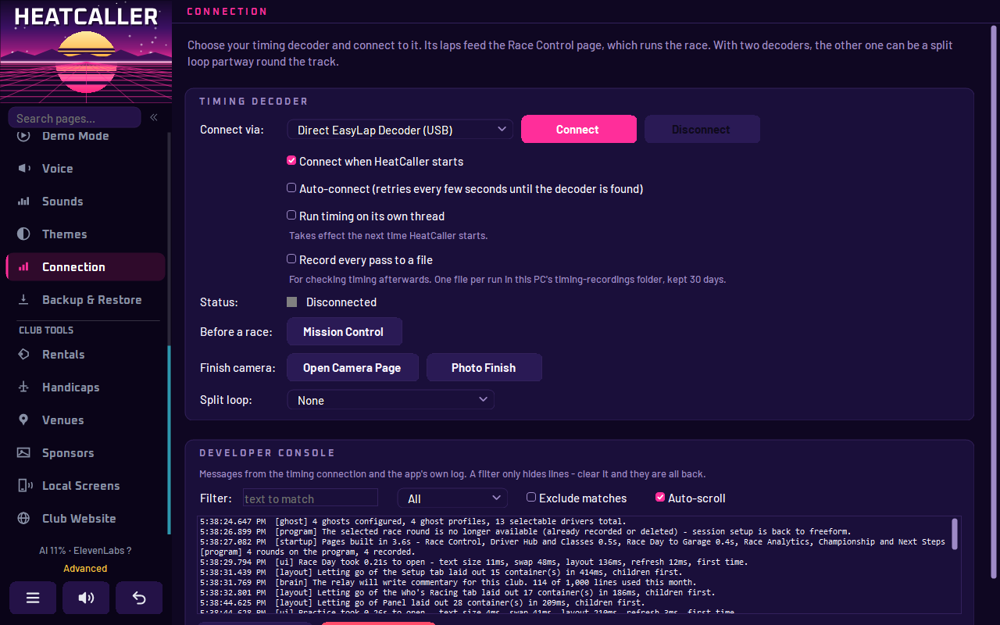
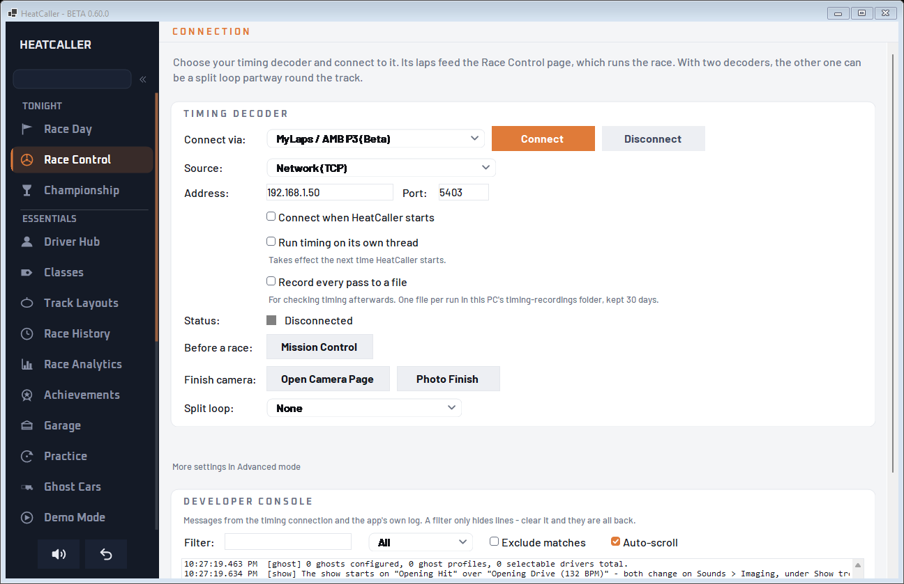
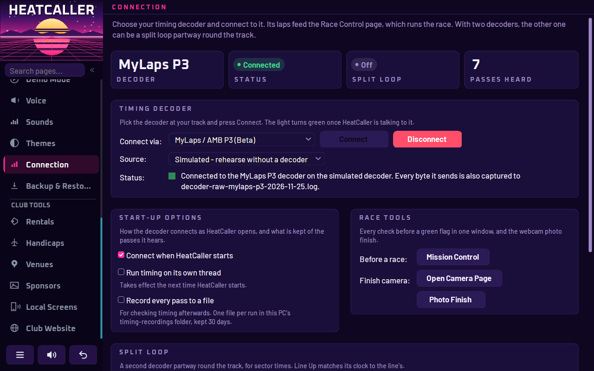

# Connecting your decoder

The **Connection** page is where HeatCaller gets its timing data. You choose how the laptop hears the cars, connect, and watch what the hardware is saying in the Developer Console. Come here first on every race night, and whenever laps stop arriving.

HeatCaller reads your decoder directly and runs the race itself, on the **Race Control** page. It works with these decoders:

| Connect via | What it is |
|---|---|
| Direct EasyLap Decoder (USB) | HeatCaller reads an EasyLap USB decoder directly. |
| I-Lap Decoder (Serial) | HeatCaller reads an I-Lap decoder through its serial (COM) port. |
| MyLaps / AMB P3 (Beta) | MyLaps and AMB decoders that speak the P3 protocol (AMBrc, RC4 and others), over the network or a COM port. |
| ZRound open protocol / RiCino (Beta) | RiCino and other decoders that use ZRound's open protocol, over a COM port or the network. |
| Cano / RCHourglass (Beta) | Howard Cano's DIY decoder, and RCHourglass in its Cano or RCHourglass mode, over a COM port. |
| OpenStint (Beta) | The open-source OpenStint decoder, over the network. |
| EasyLap / Robitronic Serial (Beta) | An EasyLap or Robitronic decoder on a serial port instead of USB. |

The five marked **(Beta)** were written from each decoder's published format and haven't yet been tested on a real decoder. See [The Beta decoders](#the-beta-decoders).

The line at the top of the page says the same: "Choose your timing decoder and connect to it. Its laps feed the Race Control page, which runs the race. With two decoders, the other one can be a split loop partway round the track."

## Choosing a connection type

- **You have an EasyLap decoder.** Choose **Direct EasyLap Decoder (USB)**. Close any other timing program first, Next Level Timing included, because only one program can use the decoder at a time.
- **You have an I-Lap decoder.** Choose **I-Lap Decoder (Serial)**.
- **You have a MyLaps/AMB, RiCino, Cano, RCHourglass or OpenStint decoder, or an EasyLap or Robitronic on a serial port.** Choose its **(Beta)** entry. See [The Beta decoders](#the-beta-decoders).

The decoder you choose here is the start/finish line, where laps are counted. If you have both, the other one can be a split loop partway round the track. See [A split loop](#a-split-loop). See also [Switching decoder types](#switching-decoder-types).

!!! note "Next Level Timing"
    Earlier versions could also listen to Next Level Timing through its Neon API, with NLT running the race. That connection was retired in 0.50.0. If this laptop last used it, HeatCaller now starts on the EasyLap decoder, and the console says "[connection] Next Level Timing (Neon API) is no longer offered - the Connection page now starts on the EasyLap decoder." Sessions saved from Next Level Timing stay in **Race History**.

!!! tip
    If you race at more than one venue, save its decoder on the **Venues** page. Pressing **Apply This Venue** there sets **Connect via:** on the **Connection** page for you. See [Drivers, classes and venues](../race-day/drivers-and-classes.md).

## Connect when HeatCaller starts

**Connect when HeatCaller starts**, on the **Connection** page, connects the decoder in **Connect via:** (and the split loop with it, when one is set) as soon as HeatCaller opens, so nobody has to remember to press **Connect** on race night. It's ticked to begin with.

- **I-Lap:** it connects on the COM port it was last connected on, and no other. If that port isn't there yet, for example a USB adapter plugged in after HeatCaller opened, the console says "Waiting for the I-Lap on COM*n*" and it connects as soon as the port appears. Until you've connected once by hand there's no port to remember, and the console says to pick it and press **Connect** once.
- **EasyLap:** it's tried once as HeatCaller opens. To keep trying until the decoder is found, and after a dropped connection, tick [Auto-connect](#auto-connect) as well.
- **A Beta decoder:** it connects the way it was last set up, with its own **Source:**, port or address. On a COM port it waits for that port as the I-Lap does ("Waiting for the ... decoder on COM*n*"). Once connected, it keeps trying by itself if the link drops.
- Pressing **Connect** or **Disconnect** yourself, or unticking the box, stops it waiting.

## Run timing on its own thread

**Run timing on its own thread**, on the **Connection** page, keeps lap counting going even when the HeatCaller window is busy or stops responding for a few seconds. It's off to begin with. Changing it takes effect the next time HeatCaller starts.

With it ticked, every pass from the line decoder and the split loop goes straight to timing instead of waiting for the window, whether or not a race is running, so a freeze doesn't lose sector times either. Practice still starts by itself when a car crosses the gate (with **Start automatically when a car crosses the gate** ticked on the Practice page); the Practice page catches up when the window does, and starting a race at that same moment wins over the practice. The race clock, the time limit, the checkered flag and the crash-recovery file keep up on their own, and the start still waits for the countdown audio (up to 10 seconds) without needing the window. An automatic start's green is dropped by timing too, as soon as the countdown audio ends, so cars crossing the line after the countdown are never booked as jump starts because the window was late; the horn may sound late, but the race clock starts on time. Phones on the club's Wi-Fi pages and the club's live page keep the board, flag, countdown and standings live; parts the window works out (the track map, call-ups, championship and race in hand) catch up when it does. When the window catches up, the board jumps to the present, and lap calls that are more than a few seconds old aren't spoken, so the room hears what's happening now. The results still get every lap.

With it off, everything works as it always has, except that practice no longer starts by itself at the gate while On Air is running (a car warming up during the opening used to start practice and call On Air off). Either way, each pass is now judged by the moment it reached HeatCaller, so a window that was busy across the time limit can't move a driver's crossing to the wrong side of the flag.

!!! tip "Try it at a rehearsal first"
    Tick it in a **HeatCaller Rehearsal** first (the Start menu shortcut that runs on a copy of your club's data, see [What the installer adds](../getting-started/install.md)) and run a few races before you use it on a race night.

## Record every pass to a file

**Record every pass to a file**, on the **Connection** page, writes down every pass the race is given and every race command (Stage, the green, flags, laps added by hand, warnings, penalties, releases, undo), with the moment each one arrived. It's off to begin with, and ticking or unticking it takes effect straight away. A night recorded this way can be played back through HeatCaller's race timing to check a result afterwards, or to show exactly what the decoder sent and when.

- One file per run of HeatCaller, in `%LocalAppData%\HeatCaller\timing-recordings`, named like `passes-20261024-191500.jsonl`. A rehearsal adds `-rehearsal` to the name.
- Files are kept for 30 days, then deleted. One file stops at 64 MB; the console says so, and timing is never affected.
- The files stay on this PC and aren't part of backups. Each is plain text you can open while the night is still being recorded.

## Direct EasyLap Decoder (USB)

### Before you start

- The EasyLap decoder is plugged into the laptop's USB port.
- Any other program that talks to the decoder, Next Level Timing included, is closed. Only one program can use the decoder at a time.

### Connect

1. Open the **Connection** page.
2. In **Connect via:**, choose **Direct EasyLap Decoder (USB)**.
3. Click **Connect**.

There's nothing else to set up: no host, port or COM port.

### Auto-connect

Tick **Auto-connect (retries every few seconds until the decoder is found)** if you want HeatCaller to connect by itself. With it ticked:

- HeatCaller connects as soon as it opens (when EasyLap is the chosen connection type).
- If the decoder isn't found, or the connection is lost, HeatCaller tries again every few seconds. Each attempt shows "[auto-connect] Retrying..." in the console.

Clicking **Disconnect** unticks **Auto-connect** so that the decoder stays disconnected. Tick it again when you want it back.

The **Auto-connect** option only appears when **Direct EasyLap Decoder (USB)** is chosen.

### Confirm it's working

| Dot | Status message | Meaning |
|---|---|---|
| Amber | "Looking for the EasyLap decoder (Silicon Labs CP2110)..." | Searching for the decoder. |
| Green | "Connected. Listening for lap events." | Connected. |
| Red | "No CP2110 device found (VID 0x10C4, PID 0x86B9). Is the EasyLap decoder plugged in?" | The decoder isn't plugged in, or Windows can't see it. |
| Red | "Found the decoder but could not open it. If Next Level Timing (or another instance of this app) already has it open, only one application can use a HID device at a time - close the other one first." | Another program has the decoder. Close it and connect again. |
| Red | "Read failed: ..." | The connection was lost, for example because the cable was pulled. |
| Gray | "Disconnected." | You disconnected. |

Pass a car (or a transponder) over the loop. In the console you'll see a line like `[LAP EVENT] transponder=8467BE  device_time=...ms  signal_hits=...  signal_strength=...`. The transponder number is what you enter on the driver's profile. See [Transponders](transponders.md).

When the decoder connects, the console also lists every transponder number HeatCaller knows, under "[profiles] Known transponder keys:". This is a quick way to check a driver's number is typed correctly.

## I-Lap Decoder (Serial)

### Before you start

- The I-Lap decoder is connected to the laptop and shows up in Windows as a COM port.
- No other timing program has that COM port open.

### Connect

1. Open the **Connection** page.
2. In **Connect via:**, choose **I-Lap Decoder (Serial)**.
3. In **COM port:**, choose the decoder's port. If it isn't listed, plug the decoder in and click **Rescan**.
4. In **Baud:**, choose the speed your decoder is set to: 9600, 19200, 38400, 57600 or 115200. 9600 is the usual I-Lap setting. The **Baud:** box only appears when I-Lap is chosen.
5. Click **Connect**.

HeatCaller remembers the port and baud rate, and selects the port again next time if it's still there.

If you click **Connect** without choosing a port, HeatCaller shows "No COM port selected. Plug the I-Lap decoder in, press Rescan and pick its port."

### Confirm it's working

| Dot | Status message | Meaning |
|---|---|---|
| Amber | "Opening COM*n* at *rate* baud..." | Opening the port at the **Baud:** rate you chose. |
| Green | "Connected to COM*n*. Listening - every line the decoder sends is also captured to ilap-raw-*date*.log." | Connected. |
| Red | "Couldn't open COM*n*: ... If another timing program has the port, close it first." | The port couldn't be opened. |
| Red | "Read failed: ..." | The connection was lost. |
| Gray | "Disconnected." | You disconnected. |

Every line the decoder sends appears in the console as `[ilap raw] ...`, and every pass HeatCaller recognizes appears as `[LAP EVENT] transponder=...`.

Things to know about I-Lap:

- **Transponder numbers** are read from the I-Lap's passing record. It comes in two forms: a long one, which is the decoder's number, then the transponder, then the decoder's time, and a short one such as `@040000070442`, where the two digits after the @ are the transponder (here, 4). Leading zeros are removed. A line in any other shape is read for its first run of 3 to 8 digits. Status messages from the decoder, and the clock it sends every second, are never counted as laps. The first clock reading after you connect shows in the console as "[ilap] The decoder is talking...". If nothing at all arrives in the first 5 seconds, the console says so.
- **Lap times** are measured by the laptop, at the moment each line arrives from the decoder.
- **Repeated reads** of the same transponder within 0.8 seconds are treated as one pass. The console shows "[ilap] Suppressed repeat of ...".
- **Signal strength** isn't available from I-Lap, so the pre-race check never marks an I-Lap transponder as weak. See [Transponders](transponders.md#the-pre-race-check).
- I-Lap isn't retried: if the port fails to open, you're told once. To connect it as HeatCaller opens, use [Connect when HeatCaller starts](#connect-when-heatcaller-starts).

### The raw capture log

While connected, HeatCaller writes every line the I-Lap decoder sends to a file named `ilap-raw-YYYY-MM-DD.log` (one per day) in the HeatCaller data folder. If passes aren't being recognized, this file shows exactly what the decoder sent.

- Files older than 14 days are deleted automatically the next time you connect.
- Each day's file is capped at 20 MB. If it reaches that, capture stops for the day and the console says "Raw capture file reached 20 MB - capture stopped; timing is unaffected." That usually means the decoder is sending garbage, for example because of a wrong baud rate.

See [Where HeatCaller keeps your data](../admin/data-files.md) for the folder location.

## The Beta decoders

**MyLaps / AMB P3**, **ZRound open protocol / RiCino**, **Cano / RCHourglass**, **OpenStint** and **EasyLap / Robitronic Serial** are marked **(Beta)**. HeatCaller reads them from each decoder's published format, and they're tested against records built from those formats, but none has yet timed a real session on the real hardware. Until one has:

- Run your usual timing system alongside HeatCaller the first time.
- Every time you connect one, the console says "BETA: HeatCaller's ... support was written from the published format and has not yet been tested on a real decoder."
- Keep the day's raw capture file (see below) and send it with any report. It's what turns Beta into tested. **Save Support Info** includes the last few days' capture files.

They can be the start/finish line, but not a split loop. Choosing one turns **Split loop:** off, and the console says "Split loop turned off - it works with the EasyLap and I-Lap only. Turn it on again after switching back to one of them."

### Connect

1. In **Connect via:**, choose the decoder.
2. In **Source:**, choose how the laptop reaches it:

    | Source | What to fill in |
    |---|---|
    | Serial (COM port) | **COM port:** and **Baud:**, as for the I-Lap. |
    | Network (TCP) | **Address:**, the decoder's IP address, and **Port:**. |
    | Network (ZeroMQ) | OpenStint only: the address of the PC running OpenStint, and **Port:**. |
    | Simulated - rehearse without a decoder | Nothing. See [Rehearsing without a decoder](#rehearsing-without-a-decoder). |

3. Click **Connect**.

Each decoder remembers its own source, port, address and baud rate, so switching between decoders and back loses nothing. An address and port you've typed but not yet connected with are kept when you change **Source:**.

| Decoder | Sources | Usual settings |
|---|---|---|
| MyLaps / AMB P3 | Network, Serial | Port 5403. Some newer MyLaps decoders ship with P3 switched off; turn it on in the decoder's own settings. |
| ZRound open protocol / RiCino | Serial, Network | 19200 baud. On the network, the decoder's own port (5001 for OpenStint's ZRound bridge). |
| Cano / RCHourglass | Serial | 57600 baud for RCHourglass's serial port. |
| OpenStint | Network | Port 5556. |
| EasyLap / Robitronic Serial | Serial | 38400 baud. |

When you connect a ZRound decoder, HeatCaller sends the handshake and the race start (`%C&%I&`). The race start sets the decoder's clock to zero, which is harmless: HeatCaller keeps its own clock.

### Confirm it's working

| Dot | Status message | Meaning |
|---|---|---|
| Amber | "Connecting to the ... decoder on ..." | Opening the port or connection. |
| Green | "Connected to the ... decoder on .... Every byte it sends is also captured to decoder-raw-*name*-*date*.log." | Connected. |
| Red | "The ... decoder on ...: ... Trying again every 3 seconds - press Disconnect to stop." | It couldn't connect, or the connection dropped. It keeps trying by itself; **Disconnect** stops it, and **Connect** tries again at once, for example after you've corrected the address. |
| Gray | "Disconnected." | You disconnected. |

The console says "[decoder] The ... decoder is talking." when the first data arrives, and every pass appears as `[LAP EVENT] transponder=...`. If nothing arrives in 10 seconds, the console says so once. A Cano sends nothing until a car crosses, so drive one over the loop.

Things to know about these decoders:

- **Transponder numbers** are shown in decimal for P3, ZRound, Cano and OpenStint, which is the number printed on the transponder. A serial EasyLap's are six hex digits, as over USB.
- **Lap times** come from the decoder's own clock, matched to the laptop's. Until HeatCaller has learned the decoder's clock (its first few readings), a pass is timed when it arrives. If the decoder restarts, the console says so and HeatCaller learns its clock again.
- **Repeated reads** of the same transponder within 0.8 seconds are treated as one pass. The console shows "[decoder] Suppressed repeat of ...".
- **Hits** are read from P3, RCHourglass, OpenStint and the serial EasyLap. A plain Cano sends none.

### The raw capture files

While connected, HeatCaller writes every byte the decoder sends to `decoder-raw-NAME-YYYY-MM-DD.log` in the HeatCaller data folder, where NAME is the decoder (for example `decoder-raw-mylaps-p3-2026-11-01.log`). Text decoders are kept as text, the others as hex. As with the I-Lap's, files older than 14 days are deleted when you next connect, and each day's file stops at 20 MB.

### Rehearsing without a decoder

Choose **Simulated - rehearse without a decoder** in **Source:** and click **Connect**. HeatCaller makes up a decoder of that type, speaking its real format, with up to eight cars lapping every 11 to 17 seconds. The cars use your drivers' transponders where the format can carry them, so their laps land on real drivers. Otherwise they're numbered 1001 to 1004.

The console says "A simulated ... decoder - its cars are made up, laps from it are not real. Disconnect it before racing."

## A split loop

With both an EasyLap and an I-Lap, the one in **Connect via:** is the start/finish line, and the other can read cars partway round the track. Choose it in **Split loop:** (it lists the decoder that isn't the line).

- **Connect** connects both. **Connect Split** connects the split loop on its own, for example after it was unplugged. **Disconnect** disconnects both.
- When the line connects by itself (with **Connect when HeatCaller starts**, or the EasyLap's auto-connect), an I-Lap split loop uses the COM port it was last connected on. If that port isn't there yet, **Split status:** says "Waiting for the I-Lap on COM*n*" and it connects as soon as the port appears.
- **Split status:** has its own light. Once connected, it says how closely the two decoders' clocks are tied together, for example "Clocks tied together to within about 4 ms". HeatCaller works this out from the EasyLap's once-a-second clock reading; nothing needs setting.
- **The split loop never counts a lap.** Laps, the minimum lap time, jump starts and the finish all come from the line, exactly as with one decoder. If the split loop unplugs or misreads, the race carries on as it would without it.
- **Each car needs a transponder for each decoder:** one the line reads and one the split loop reads. Add the split loop's on the driver's **Transponders** tab with **Add Split Transponder**. See [A driver's transponders](../race-day/drivers-and-classes.md#a-drivers-transponders).
- During a race, the TIMING line on the Next Up bar says "Split loop quiet" if the split loop stops reading cars. If it isn't connected, the bar says "Split loop not connected" for 15 seconds, then leaves it to the console and Mission Control. Laps are still timed either way.
- The console logs each split pass as `[split] Split 1: ...`, with whose transponder it is.

### Line Up

Each decoder takes a moment to report a car, and the I-Lap's serial line adds a little more, so the split loop reads a car slightly late. **Line Up** measures how late, once:

1. Lay the split loop right beside the start/finish line, at the same spot.
2. Click **Line Up**, then drive a car with both its transponders across them five or six times. Each crossing both loops read is listed.
3. Click **Save**. The middle reading is kept and taken off every split time. **Set to Zero** clears it.
4. Put the split loop back in its place round the track.

Line Up waits until at least three crossings agree to within a tenth of a second, and says "they don't agree yet - drive across a few more times" until they do. A car sitting over both loops is read again and again; those repeat reads are ignored rather than taken for crossings. Line Up can't be opened or saved while a race or practice is running. While it's open, a car crossing the line doesn't start practice by itself, even with **Start automatically when a car crosses the gate** ticked.

### Split times

With the split loop on, each flying lap is cut into two sectors: **S1** from the line to the split loop, **S2** from the split loop back to the line. The sectors always add up to the lap time exactly.

- **On the board:** add the **S1**, **S2**, **Ideal Lap** and **At Split** columns: right-click a column heading on the leaderboard. See [Columns](../race-control/running-a-race.md#columns). The quickest sector of the session is in the look's accent color (blue in most looks), and a driver's own best is green, on Race Control and the Big Screen alike. **At Split** shows, as a car crosses the split loop, whether it's up or down on its best lap.
- **On the Big Screen:** the same columns, and a banner such as "FASTEST SECTOR 1 — MAYA 12.31" when someone sets the quickest sector of the session.
- **In the lap breakdown:** each lap's sectors, and the driver's ideal lap.
- **Saved with the race:** each lap's sectors are kept in the results.
- **Speeds:** place the split loops on the layout's plan in the Track Designer (see [Split loops](../race-day/track-designer.md#split-loops)). Race Control then knows each sector's length, and the **S1 mph**, **S2 mph** and **Top Speed** columns show average speeds. **Top Speed** is the fastest the driver has gone through any sector this session.
- **Speed trap:** to measure top speed rather than sector times, put the split loop a short, measured distance past the line on the main straight, at least 8 ft, and mark it there on the plan. Sector 1 is then the trap, and **S1 mph** and **Top Speed** are trap speeds. With loops this close, a timing error of about 15 ms is several percent of the speed, so treat trap speeds as close, not exact.
- **The announcer:** three new calls on **Voice → Race Calls**, all off by default: **Fastest sector**, **Up at the split** (a tenth or more up on the driver's own best lap at the split) and **Record pace at the split** (ahead of the track record lap there). Record pace at the split needs a track record set with a split loop running, so its sectors were kept. New placeholders for these lines: {sector}, {sectortime}, {split} and {gap}.

### Hearing the splits

Four more lines on **Voice → Race Calls** speak the split loop's times rather than mark a moment. The first three are ticked for **Practice** and not for **Race** in a new install, because practice is where a driver wants their split; tick **Race** on a row to hear it in races too. None says anything without a split loop.

- **Split time**: each car's time to the split as it crosses, "Eight point four zero seconds at the split." **Read every** _n_ **split crossing(s) per driver** spaces it out.
- **Split coach (up or down)**: right-click a driver on the Race Control board and choose **Coach *name*** → **At the split** (see [Coaching a driver](../race-control/running-a-race.md#coaching-a-driver)). Each time they cross the split they hear "Up a tenth at the split.", "Down two tenths at the split." or "Level at the split.", against their own best lap this session. One driver at a time: coaching another moves it. It ends when you untick **At the split**, with **Stop coaching *name***, a **Reset**, or the end of the race they were picked for, whether you picked them between races or during one; in practice it lasts until **Reset**. The console says when it stops. With **Tones instead of words** ticked for them, a tone plays at the split instead: high when up, middle when level, low when down. Each time the driver is told up or down they don't also hear their **Split time**; before they have a best lap to compare with, or with **Split coach** switched off for the session, they still hear it.
- **Battle gap at the split**: two cars on the same lap less than a second apart, timed at the split, "At the split, Sam's two tenths up on Bill." At most once every five laps per pair, and only when the gap has moved.
- **Sectors at the flag** (off until you tick it): after a race, who was quickest through each sector, said with the unofficial result. "Quickest through sector one was Sam, sector two Bill."

Under **Lap times only**, **Split time** and **Split coach** stay as you have them; the battle gap and the sectors at the flag are switched off. See [Voice announcements](../announcer/voice.md#every-announcement).

A lap gets no sectors when the split loop didn't read the car, when it's the start lap or a lap through a crash recovery, or when it was merged or edited by hand afterwards. It still counts as a lap.

**Possible missed lap.** If the split loop reads a car twice without the line reading it in between, the TIMING line on the Next Up bar says so for 20 seconds, for example "Possible missed lap: Maya was read at the split twice without crossing the line - check their lap count". Nothing is added to the race; you decide whether to correct the lap count.

**Pre-race check** notes any car that has no split transponder: it races normally, just without sector times.

## Switching decoder types

The decoder chosen in **Connect via:** is the line; with **Split loop:** on, the other one is the split loop. Any other connection is disconnected. When you change **Connect via:**:

- Any connection that is neither the new line nor the split loop is disconnected. With the split loop on, the EasyLap and I-Lap swap roles. Choosing a Beta decoder turns the split loop off.
- Between the EasyLap and the I-Lap, the Line Up measurement is turned round to match, whether or not the split loop is on at the time. Run Line Up again when you can, to be sure.
- The **Status:** line switches to the new choice's own state (usually "Disconnected"). Click **Connect** to connect it.

HeatCaller remembers your choice and uses it next time it opens.

**Not during a race.** **Connect via:**, **Split loop:** and Line Up can't be changed while a race or practice is running, since a change would disconnect the decoder timing it. The choice jumps back, and a **Race under way** message says to finish or reset the session first.

!!! note
    The first-run wizard offers every decoder, including I-Lap with its COM port and baud rate. For a Beta decoder, choose its source and address or port here on the Connection page afterwards. Whatever you choose there is set on this page straight away. See [The first-run wizard](../getting-started/install.md#the-first-run-wizard).

## If the connection drops during a race

The race on the **Race Control** page keeps running. Its clock and time limit carry on, but no crossings are counted while the decoder is disconnected.

- With **Auto-connect** ticked, EasyLap reconnects by itself as soon as the decoder is back. A Beta decoder always does, trying every 3 seconds. Otherwise, click **Connect**.
- Crossings made while disconnected are lost. Each driver's first counted lap after the reconnect runs from their last counted crossing, so it will be long. Check the laps and correct them if needed. See [Corrections and recovery](../race-control/corrections-and-recovery.md).
- If the decoder's own clock restarted (for example, it lost power), HeatCaller can't work out a real lap time for the first crossing afterward. It rejects that one crossing, logs "Lap rejected: the decoder clock went backwards for ... The decoder was most likely reconnected during the race.", and times the following laps normally.
- I-Lap lap times come from the laptop's clock, which doesn't restart when you reconnect. A Beta decoder's clock is learned again after a reconnect or a restart, with its first passes timed as they arrive (see [The Beta decoders](#the-beta-decoders)).

You won't miss it: the Next Up bar on **Race Control** turns into a pulsing red alarm while the decoder is unplugged, from the moment a race is staged. [Mission Control](../race-control/running-a-race.md#mission-control) shows the decoder and its heartbeat as tiles you can keep on a second screen. See [Timing warnings](../race-control/running-a-race.md#timing-warnings).

## The Developer Console

The **Developer console** card, under the **Timing decoder** card, shows everything HeatCaller logs: decoder traffic from whichever connection you use, race events, voice, sound, storage messages and more.

| Control | What it does |
|---|---|
| **Filter:** | Type text to show only matching lines. Separate several words with spaces to show lines that match any of them. Matching ignores upper and lower case. |
| Preset list | Quick filters: "All", "Audio timing", "Voice", "Sound", "Race", "Decoder", "Storage" and "Hide raw HID". Anything typed in **Filter:** takes priority over the preset. |
| **Exclude matches** | Turns the filter around: hides matching lines and shows everything else. Choosing "Hide raw HID" ticks this for you. |
| **Auto-scroll** | Keeps the newest line in view. Untick it to read back without being pulled to the bottom. On by default. |
| **Copy** (under the console) | Copies the lines currently shown (after filtering) to the clipboard. |
| **Clear** (under the console) | Empties the console. |

Filtering never throws lines away. You can narrow the view, read what you need, and clear the filter to see everything again. The console keeps roughly the most recent 5,000 lines.

Right-click inside the console for **Copy** (the selected text), **Copy everything shown**, **Select all**, **Clear the console** and **Save support info...** (see [Save Support Info](../admin/backups.md#save-support-info)).

!!! tip
    When you ask for help with a timing problem, filter to "Decoder", reproduce the problem, click **Copy** and paste the result into your message.

## Troubleshooting

**"No CP2110 device found..." (EasyLap)**
: Check the USB cable and try another USB port. Then click **Connect** again, or tick **Auto-connect** and let it retry.

**"Found the decoder but could not open it..." (EasyLap)**
: Next Level Timing or another copy of a timing program has the decoder. Close it, then connect again. HeatCaller itself only runs one copy at a time.

**I-Lap port isn't in the COM port list**
: Plug the decoder in, wait a few seconds, and click **Rescan**.

**I-Lap connects but no laps appear**
: Look at the console. If you see `[ilap raw]` lines but no `[LAP EVENT]` lines, HeatCaller isn't finding a transponder number in what the decoder sends. If you see "Discarded ... characters with no line ending - check the baud rate.", the decoder isn't talking at the rate chosen in **Baud:**. Check the decoder's setting and pick the same rate (9600 is the usual default). Keep the `ilap-raw-*.log` file for support.

**A Beta decoder connects but no laps appear**
: Look for "[decoder] Nothing has come from ... in 10 seconds." in the console. Check the address or COM port, the baud rate, and the decoder's own settings (some newer MyLaps decoders ship with P3 switched off). A Cano sends nothing until a car crosses, so drive one over the loop. Keep the `decoder-raw-*.log` file for support.

**"... no answer from ... in 5 seconds - check the address, and that this PC is on the decoder's network" (Beta decoder on the network)**
: The laptop can't reach the decoder. Check **Address:** and **Port:**, and that the laptop is on the same network as the decoder. HeatCaller keeps trying every 3 seconds until you press **Disconnect**.

**"Type the decoder's IP address first - it's in the decoder's own settings, or its manual."**
: **Source:** is a network one and **Address:** is empty. A **Port:** that isn't a number from 1 to 65535 is refused the same way, with the usual port for that decoder in the message.

**Laps arrive but show a number instead of a name**
: The transponder isn't on any driver profile yet. See [Transponders](transponders.md).

For problems elsewhere in the app, see [Troubleshooting](../admin/troubleshooting.md).
